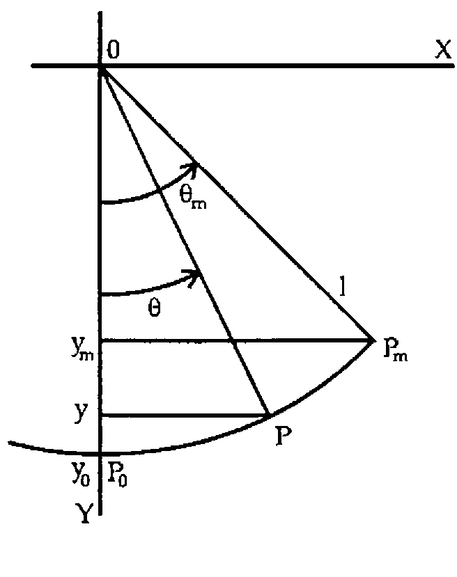

*by Joseph De Kerf (Reprinted from APL-CAM Journal, Vol.18 No.1)*
{ .byline }

## Abstract

Calculation of time \(t\) as a function of the declination \(\theta\) of the simple pendulum with length \(l\) is reduced to the calculation of an incomplete elliptic integral of the first kind \(K(\phi;p)\). For the period \(T\) this is reduced to the calculation of a complete elliptic integral of the first kind \(K(p)\). Algorithms, based on the common mean concept, are illustrated with APL user-defined functions. Examples are given.

## Introduction



In a previous paper [1], we have shown that the rectification of a lot of so-called closed curves is reduced to the calculation of elliptic integrals. The elliptic integrals were evaluated with algorithms based on the common mean concept [2], as such algorithms are much more efficient in cpu time than those based on gaussian quadrature or serious expansion. Implementation was illustrated with APL user-defined functions, calling the user-defined functions described in [3] and [4]. In this paper, we follow the same line of thought for the solution of the simple or plane pendulum: the calculation of time \(t\) as a function of the declination \(\theta\) [5].

## The Simple Pendulum

The simple or plane pendulum consists of a mass point \(m\) (\(P\)) at one end of a massless rigid rod with length \(l\), pivoted at the other end (0) and placed in a uniform gravitational field \(g\). Let \(P\) (declination \(\theta\)) be moving from the equilibrium position \(P_0\) (declination 0) towards its maximum displacement \(P_m\) (maximum declination or amplitude \(\theta_m\)).

## Time versus Declination

\begin{alignat*}{2}
&\text{Kinetic energy of the system is:}\qquad &&
\begin{alignedat}[t]{2}
& \frac{1}{2}mv^2 &\qquad& \text{with} \\
& v = \frac{ds}{dt} && \text{and}\quad s = l\theta\left(v = l\frac{d\theta}{dt}\right)
\end{alignedat} \\[1.5ex]
&\text{Potential energy of the system is:} &&
\begin{alignedat}[t]{2}
& mgl\,(1-\cos\theta) && \\
& \text{as } y_0 = l &\qquad& \text{and}\quad y = l\cos\theta
\end{alignedat} \\[1.5ex]
&\text{Conservation of energy gives:} && \frac{1}{2}mv^2 + mgl\,(1-\cos\theta) = mgl\,(1-\cos\theta_m) \\[1ex]
&&& \frac{1}{2}mv^2 = mgl\,(\cos\theta-\cos\theta_m) \\[1ex]
&&& v = \sqrt{2gl\,(\cos\theta-\cos\theta_m)} \\[1.5ex]
&\text{Substituting } v \text{ by } l\frac{d\theta}{dt} \text{ we get:} && \frac{d\theta}{dt} = \sqrt{\frac{2g}{l}(\cos\theta-\cos\theta_m)} \\[1ex]
&\hphantom{\text{Substituting } v \text{ by } l\frac{d\theta}{dt}}\text{or:} && dt = \sqrt{\frac{l}{2g}}\,\frac{d\theta}{\sqrt{\cos\theta-\cos\theta_m}}
\end{alignat*}

Setting the time at the equilibrium point \(t_0 = 0\), time \(t\) for declination \(\theta\) becomes:

\begin{equation*}
t = \sqrt{\frac{l}{2g}}\int_0^{\theta}\frac{d\theta}{\sqrt{\cos\theta-\cos\theta_m}}
\end{equation*}

\begin{alignat*}{2}
&\text{Substituting:}\qquad && \sin\frac{\theta}{2} = p\sin\phi \quad\text{with}\quad p = \sin(\theta_m/2) \\[1ex]
&&& d\theta = \frac{2p\cos\phi}{\sqrt{1-p^2\sin^2\phi}}\,d\phi \\[1.5ex]
&\text{we have:} && \sqrt{\cos\theta-\cos\theta_m} = \sqrt{2\bigl(\sin^2(\theta_m/2)-\sin^2(\theta/2)\bigr)} \\
&&& \hphantom{\sqrt{\cos\theta-\cos\theta_m}} = \sqrt{2}\,p\cos\phi \\[1.5ex]
&\text{such that:} && t = \sqrt{\frac{l}{g}}\int_0^{\phi}\frac{d\phi}{\sqrt{1-p^2\sin^2\phi}} \quad=\quad \sqrt{\frac{l}{g}}\,K(\phi;p)
\end{alignat*}

\(K(\phi;p)\) being the incomplete elliptic integral of the first kind with

\begin{equation*}
\phi = \operatorname{arc\,sin}\left(\frac{\sin(\theta/2)}{p}\right) \quad\text{and}\quad p = \sin(\theta_m/2).
\end{equation*}

## APL Function

An APL user-defined function *TIME* for calculating time \(t\) as a function of the declination \(\theta\) may be:

```apl
      ∇TIME[⎕]∇
    ∇T←LA TIME D;F;P
[1]   F←((1↑LA)÷980.6294)*0.5
[2]   P←1○○(1↓LA)÷360
[3]   T←F×(¯1○(1○○D÷360)÷P) IEI1 P
    ∇
```

with: *LA* being the catenation of the length \(l\) (cm) and the maximum declination or amplitude \(\theta_m\) (degrees°)

- *D* the declination \(\theta\) (degrees°)
- *P* the parameter \(p = \sin(\theta_m/2)\)
- *F* the factor \(\sqrt{l/g}\)
- *IEI1* the user-defined function described in [4]

and geodetic constant \(g\) being set to 980.6294cm/sec<sup>2</sup> (Hayford latitude 45°) [6].

\begin{alignat*}{2}
\text{Example:}\qquad & l && = 100\,\text{cm} \\
& \theta_m && = 60^\circ \\
& \theta && = 10^\circ(10^\circ)60^\circ
\end{alignat*}

```apl
      LA←100 60
      D←10×⍳6
      2 0 12 6 ⍕ D,⊃(6⍴⊂LA) TIME¨ D
10  0.056021
20  0.113851
30  0.175831
40  0.245926
50  0.333733
60  0.538320
```

## Note:

The time to go from position \(P_0\) to maximum displacement \(P_m\) (\(\theta = \theta_m\) or \(\phi = \pi/2\)) is one-fourth of the period \(T\). Therefore, the period of the pendulum is:

\begin{align*}
T &= 4\sqrt{\frac{l}{g}}\int_0^{\pi/2}\frac{d\phi}{\sqrt{1-p^2\sin^2\phi}} \\
&= 4\sqrt{\frac{l}{g}}\,K(p)
\end{align*}

with \(p = \sin(\theta_m/2)\) and \(K(p)\) being the complete elliptic integral of the first kind.

The period \(T\) may be calculated with the function *TIME*, setting the right argument to the maximum declination or amplitude \(\theta_m\), and multiplying the result by 4. An APL user-defined function *PERIOD* for calculating the period directly from the complete elliptic integral of the first kind, more efficient in cpu time, may be:

```apl
      ∇PERIOD[⎕]∇
    ∇T←L PERIOD A;F;P
[1]   F←(L÷980.6294)*0.5
[2]   P←1○○A÷360
[3]   T←4×F×CEI1 P
    ∇
```

with: L being the length \(l\) (cm)

- A the maximum declination of amplitude \(\theta_m\) (degrees °)
- CEI1 the user-defined function described in [3]

and the geodetic constant \(g\) being set to 980.6294cm/sec<sup>2</sup> (Hayford latitude 45°) [6]. The period \(T\) is returned in seconds.

\begin{alignat*}{2}
\text{Example:}\qquad & l && = 100\,\text{cm} \\
& \theta_m && = 60^\circ
\end{alignat*}

```apl
      8 6 ⍕ 4×100 60 TIME 60
2.153281
      8 6 ⍕ 100 PERIOD 60
2.153281
```

## References

1. J. De Kerf: *Rectification with APL*; APL-CAM Journal, Vol. 17, No. 4, 16th December 1995 pp. 560 - 582.
2. J. De Kerf: *The Common Mean and APL*; APL-CAM Journal, Vol. 16, No. 3, 16th July 1994, pp. 370 - 372.<br>*See also*: Vector, Vol. 11, No. 3, January 1995, pp. 21 - 23.
3. J. De Kerf: *The Complete Elliptic Integrals and APL*; APL-CAM Journal, Vol. 16, No. 4, 16th October 1994, pp. 631 - 635.<br>*See also*: Vector, Vol. 12, No. 1, July 1995, pp. 102 - 106.
4. J. De Kerf: *The Incomplete Elliptic Integrals and APL - An Extension*; APL-CAM Journal, Vol. 17, No. 3, 16th September 1995, pp. 455 - 460.<br>*See also*: Vector, Vol. 12, No. 2, October 1995, pp. 95 - 100.
5. H.C. Corben and P. Stehle: *Classical Mechanics*; John Wiley & Sons, New York, 1950.
6. M.Abramowitz and L.A. Stegun (eds.): *Handbook of Mathematical Functions*; Applied Mathematics Series No. 55; National Bureau of Standards, Washington D.C., 1964 (and subsequent revisions).

## Appendix

For convenience of the reader, the APL user-defined functions *CEI1* [3] and *IEI1* [4], referred to in this paper, are reproduced here:

```apl
      ∇CEI1[⎕]∇
    ∇R←CEI1 P
[1]   R←1,(1-P*2)*0.5
[2]   LAB:→(≠/R←(0.5×+/R),(×/R)*0.5)/LAB
[3]   R←(○1)÷+/R
    ∇

      ∇IEI1[⎕]∇
    ∇R←F IEI1 P;I;A;B
[1]   →((1≠|P)∨(○÷2)≤|F)/LAB1
[2]   →0,R←⍟3○0.5×F+○0.5
[3]   LAB1:R←(2+I←¯1),÷÷(1-P*2)*0.5
[4]   LAB2:A←(-/R)×1○F×2*1+I←I+1
[5]   B←2×+/R×(2 1○F×2*I)*2
[6]   F←F-(¯3○A÷B)÷2*I+1
[7]   →(≠/R←(0.5×+/R),(×/R)*0.5)/LAB2
[8]   R←F÷0.5×+/R
    ∇
```
