*by Eric Lescasse*
{ .byline }

## Introduction

Do you want to port your APL+Win application to the Web? Or do you want to write an APL+Win application which will be usable on the Web?

It is now feasible with the new APL2000 **APL+WebComponent** product.

What we mean by “deploying your APL+Win application to the Web” is that you’ll make it run within the browser and that, once deployed on your Server, users from all around the world may start using it right away: all they will need to use it is a fast Internet connection and Internet Explorer!

## Required Software

In order to use APL+WebComponent to deploy your APL+Win application to the Web, you will need the following software:

| | |
|---|---|
| Windows 2000 Pro or Windows XP Pro (or Windows 2003 Server) | It should also be possible to use Windows 98, Me or NT but we have not tested APL+WebComponent on these systems. |
| Internet Explorer 5 (or 6) | The later version, the better |
| IIS Internet Information Services (5 or 6) | You may install IIS only if you run Windows 2000 Pro or Windows XP Pro. It is not available for Windows XP Home. To check if it is installed, click Start/Control Panel/Administrative Tools and check if Internet Information Services is displayed. If not, you can install IIS by running Start/Control Panel/Add or Remove Programs/Add Remove Windows Components: check the Internet Information Services (IIS) check box and proceed. |
| Microsoft .Net Framework 1.1 | If not yet installed on your computer download the Microsoft .Net Framework 1.1 now (free) (Note: to find this, start Google and search for: “Download Microsoft .Net Framework 1.1”) |
| APL+Win 5.0 | Always best to run the latest version, but the one you have will do (to download the latest version you must be an APLDN Subscriber: a login and password is required) |
| APL+WebServices | APL+Web Services are part of APL+Win 5.0. However you will need the latest version as downloadable from the APL2000 Web Site (you must be an APLDN Subscriber: a login and password is required) |
| APL+WebComponent | APL+WebComponent are not part of APL+Win 5.0: the latest version of APL+WebComponent may be downloaded from the APL2000 Web Site (you must be an APLDN Subscriber: a login and password is required) |
| Microsoft Office Web Components v11 (or v10) | Only required for APL+WebComponent (part 2) article. The latest version of this Microsoft spreadsheet object, made for the Web, can be downloaded from the Microsoft Web Site. (Note: to find the link, start Google and search for: “owc11.exe” and “microsoft”) |
| Microsoft Office Web Components Toolpack | Only required for APL+WebComponent (part 2) article and want to learn how to program the OWC Spreadsheet. The latest version of this learning tool can be downloaded from the Microsoft Web Site. (Note: to find the link, start Google and search for: “Office Web Component Toolpack”) |

Note: most APL+Win 5.0 users should already have the required components installed except maybe the APL+WebComponent. The last 2 items in the list above are only required if you want to run the example workspace in APL+WebComponent (part 2).

## Installation

Here are special instructions about installing and configuring some of the above products:

**APL+Win 5.0**

Even though you may have already installed APL+Win 5.0, you will need to register it as a COM Server. To do so, be sure to run the 2 following commands from **Start/Run**:

```text
regsvr32 "c:\aplwin50\aplwco.dll"
c:\aplwin50\aplw.exe /regserver
```

**APL+WebServices**

Run the **APLServicesSetup.msi** installation

Once the APL+Web Services are installed, check installation by clicking **Start/Run/Services.msc**: **APLServices** should appear in the list of installed services. You need to right click on APLServices, click on Properties and then on the Log On tab and check both the **Local System Account** radio button and the **Allow service to interact with desktop** check box. Click OK.

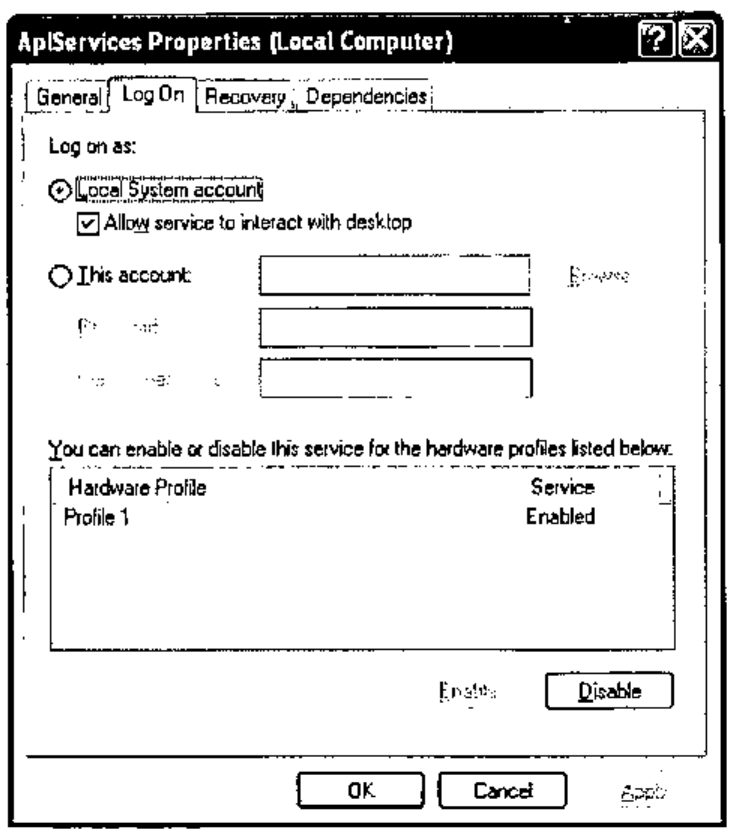

**APL+WebComponent**

Create a directory called LC under C:\\INETPUB\\WWWROOT

Create a subdirectory of LC called C:\\INETPUB\\WWWROOT\\LC\\WEBSERVICES

Note: LC and WEBSERVICES are not fixed names but we need to use these names here so that the examples cut & pasted from my machine match.

The following files can be downloaded from the APLDN Web Site (you must be an APLDN Subscriber: a login and password is required):

Download and unzip the JSAVESDKFILES.ZIP file into C:\\INETPUB\\WWWROOT\\LC\\WEBSERVICES

Download and copy the latest JSAVESDK.W3 file into C:\\INETPUB\\WWWROOT\\LC\\WEBSERVICES

Download and copy the latest APLWS.W3 file into C:\\INETPUB\\WWWROOT\\LC\\WEBSERVICES

Download and copy the latest JSCRIPT_FILES.ZIP file into C:\\INETPUB\\WWWROOT\\LC\\WEBSERVICES

## The Sample Application

We will write a very simple APL application and then publish it to the Web. While doing so we will explain in detail how to proceed.

Here is the sample application as it will appear in the browser:

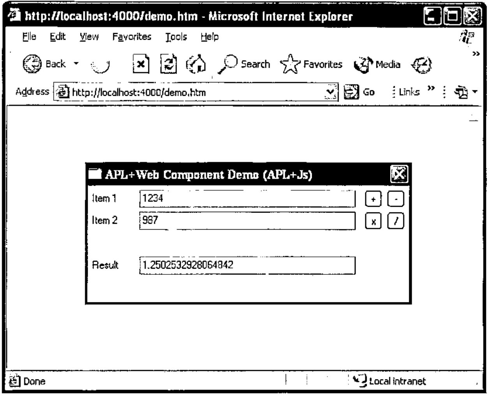

This is a simple calculator capable of computing the 4 basic arithmetic operations on 2 numbers. It is made of a form containing 3 labels (Item 1, Item 2 and Result), 3 Edit controls and 4 buttons.

And here is all the code you need to write for this simple application:

```apl
    ∇ Main B;Z;op1;op2;res;op
[1]
[2]   :select B
[3]   :case''
[4]       ⍝ Build the interface
[5]       Z←'fmMain'⎕wi'Create' 'Form'('border'1 16)'Hide'
[6]       Z←'fmMain'⎕wi'caption'('APL+Web Component Demo (',⎕sysid,')')
[7]       Z←'fmMain.lOp1'⎕wi'Create' 'Label'('where'(8 5 15 50÷16 8 16 8))('caption' 'Item 1')
[8]       Z←'fmMain.edOp1'⎕wi'Create' 'Edit'('where'(5 60 21 250÷16 8 16 8))('text' '')
[9]       Z←'fmMain.lOp2'⎕wi'Create' 'Label'('where'(34 5 15 50÷16 8 16 8))('caption' 'Item 2')
[10]      Z←'fmMain.edOp2'⎕wi'Create' 'Edit'('where'(31 60 21 250÷16 8 16 8))('text' '')
[11]      Z←'fmMain.lRes'⎕wi'Create' 'Label'('where'(86 5 15 50÷16 8 16 8))('caption' 'Result')
[12]      Z←'fmMain.edRes'⎕wi'Create' 'Edit'('where'(83 60 21 250÷16 8 16 8))('text' '')
[13]      Z←'fmMain.bnAdd'⎕wi'Create' 'Button'('where'(5 320 21 21÷16 8 16 8))('caption' '+')('onClick' 'Main"bn.onClick"')
[14]      Z←'fmMain.bnSub'⎕wi'Create' 'Button'('where'(5 346 21 21÷16 8 16 8))('caption' '-')('onClick' 'Main"bn.onClick"')
[15]      Z←'fmMain.bnTim'⎕wi'Create' 'Button'('where'(31 320 21 21÷16 8 16 8))('caption' 'x')('onClick' 'Main"bn.onClick"')
[16]      Z←'fmMain.bnDiv'⎕wi'Create' 'Button'('where'(31 346 21 21÷16 8 16 8))('caption' '/')('onClick' 'Main"bn.onClick"')
[17]      Z←'fmMain'⎕wi'size'((83+21+5)(346+21+5)÷16 8)
[18]      Z←'fmMain'⎕wi'Show'
[19]  :case'bn.onClick'
[20]      ⍝ Buttons handler
[21]      op1←↑⎕fi'fmMain.edOp1'⎕wi'text'
[22]      op2←↑⎕fi'fmMain.edOp2'⎕wi'text'
[23]      op←↑⎕wi'caption'
[24]      :select op
[25]      :case'+' ⋄ res←op1+op2
[26]      :case'-' ⋄ res←op1-op2
[27]      :case'x' ⋄ res←op1×op2
[28]      :case'/' ⋄ res←op1÷op2
[29]      :end
[30]      'fmMain.edRes'⎕wi'text'(⍕res)
[31]  :end
[32]
    ∇
```

If we called this application from the APL+Win Session, here is how it would look:

```apl
      Main''
```

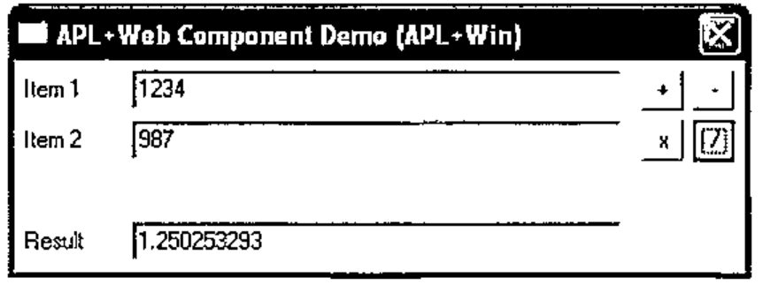

Notes about the APL code :

1. When an empty vector is passed as an argument to Main, then we fall into :case'' and lines 4 to 18 are executed. These lines build the application interface.
2. When the user clicks one of the 4 buttons, the buttons handler **Main'bn.onClick'** is called. In order to keep the whole application within the scope of one APL function, we have embedded this handler within the Main function which we call with an argument of 'bn.onClick' and the code from line 20 to 30 gets executed. The caption of the clicked button is retrieved and we use the :select :case control structure to execute the right operation depending on the caption found

## Step by step Setup

Here is the step by step procedure you need to follow to deploy this simple APL application on the Web:

### Preparing the workspace

1. Load the C:\\INETPUB\\WWWROOT\\LC\\WEBSERVICES\\APLWS.W3 workspace
2. Rename it C:\\INETPUB\\WWWROOT\\LC\\WEBSERVICES\\DEMO.W3
3. Copy the **Main** function displayed above into this workspace
4. Add an **AutoStart** function reading as follows:

    ```apl
        ∇ AutoStart
    [1]   Main''
        ∇
    ```

5. Set the workspace `⎕LX` to be AutoStart

    ```apl
    ⎕lx←'AutoStart'
    ```

6. Save the workspace

### Setting up the APL+WebService

Next you need to configure an APL+Web Server for this application. Proceed as follows:

1. Click **Start/All Programs/APL2000 Web Services/AWS Admin** to start the APL Web Services Configuration console
2. Right click on **Workspaces** and select **New Workspace** to add your application. A new workspace called **defaultworkspace** is created
3. Right click this **defaultworkspace**, select Rename and rename it **demo**
4. Click the **demo** workspace and then set the various values in the right hand pane to match the ones in the following screen shot:

    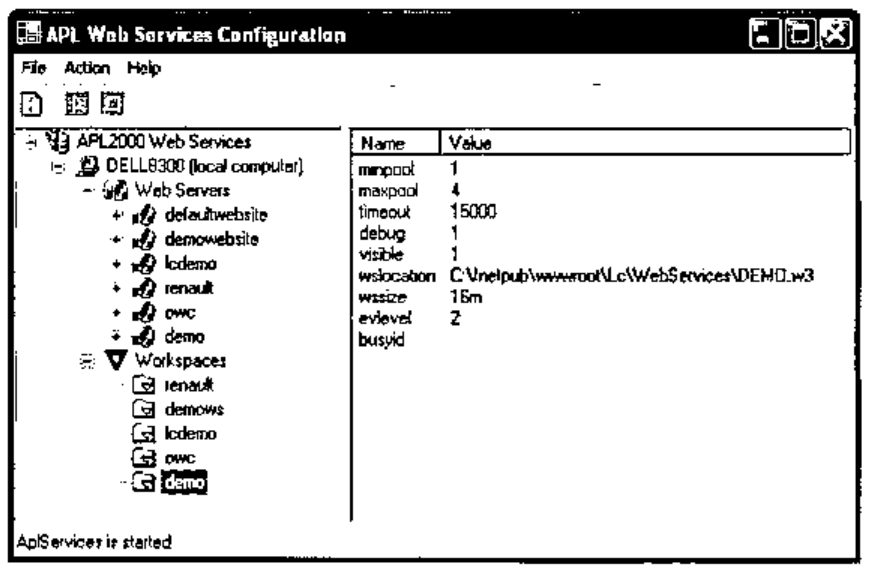

    Note: as soon as you have defined the **wslocation** to be your DEMO.W3 workspace, an **APL+Win ActiveX Server** session starts with your workspace loaded!

5. now right click on Web Servers and select New Server to create a new APL+Web Server. A new server called defaultwebsite1 is created
6. right click on this **defaultwebsite1** server and select **Properties**. The Properties dialog box gets displayed: fill its first tab as follows:

    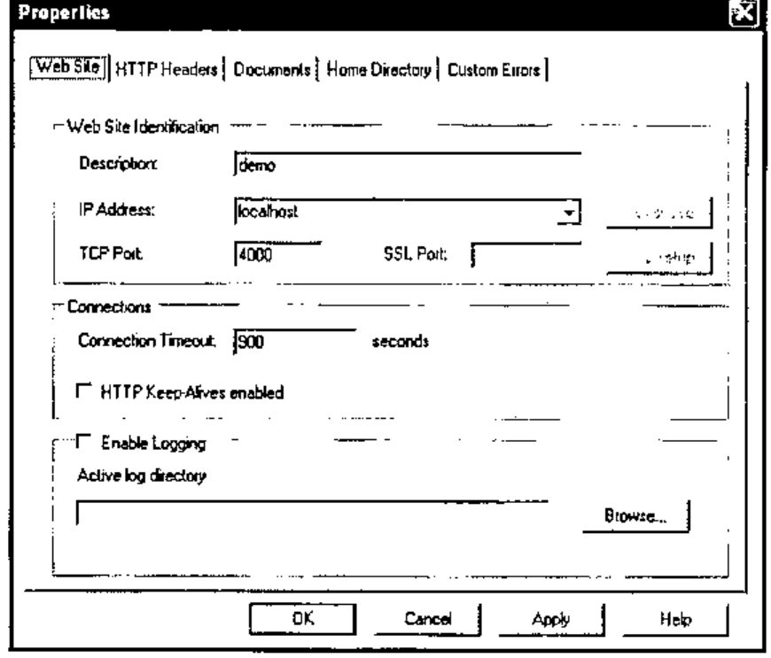

7. click the **Home Directory** tab and fill it as follows:

    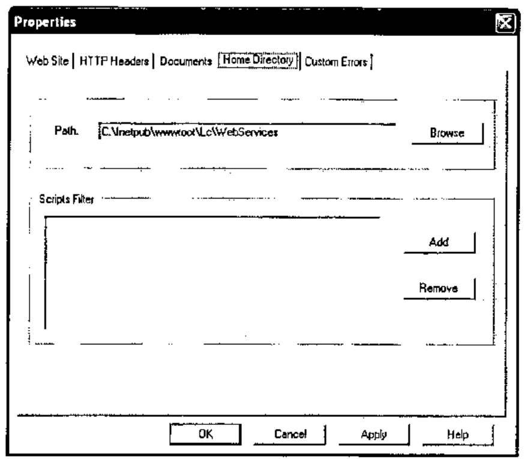

8. click the **Apply** button and then the **OK** button to close the dialog
9. next right click on the **demo** Web Server and select **New Virtual Directory**. A new virtual directory called **/default** is created (click on the + sign next to **demo** to see it)
10. right click this **/default** virtual directory, select **Rename** and rename it to: **/jsaveservice/service1.asmx**. Note: this **/jsaveservice/service1.asmx** name is fixed and reserved for APL+Web Component
11. next click or right click on the items below **/jsaveservice/service1.asmx** and set their properties in the right hand pane to be the same as the ones displayed in the following screen shots:

    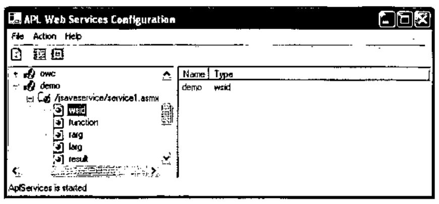

    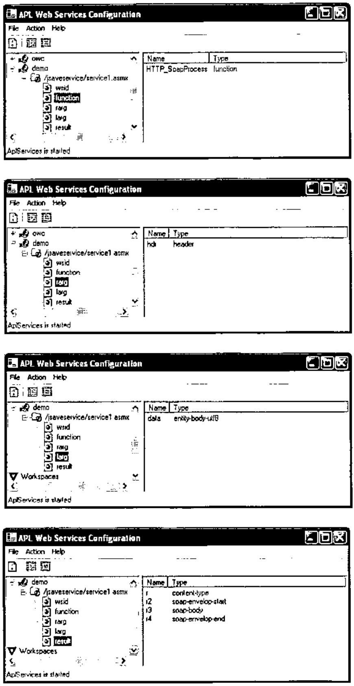

12. last but not least, you need to start your new **demo** APL+Web Server. To do that click on the **demo** Web Server once and then click the **Start Server**toolbar button

Note: also, be sure that the console Status Bar displays **AplServices is started**. If it’s not the case click **Start/Run** and run **Services.msc** then right click **APL Services** and start them.

### Publishing the workspace with JSaveSDK

In order for the browser to be able to display your workspace, you now need to publish the functions which represent its interface, using the **JSaveSDK** software. The process of publishing a workspace is simple: it consists of selecting the APL functions of your workspace which will run on the Client side of the application (i.e. in the browser). These APL functions are automatically translated from APL to JScript so that they can run in the browser when you run the application. This translation is “transparent” for you: you never see JScript code and in fact, you could deploy APL applications to the Web without even knowing that this translation has occurred. I just explain this for the sake of understanding JSaveSDK.

But this translation has some implications, one of which being that JScript is much slower than APL and therefore you will generally want to limit as much as possible the amount of APL code that you want to publish.

All the rest of your application code will run on the Server Side of the application. We will explain this in much more detail in the APL+Web Component (part 2) page. For now, just remember that almost everything related to your application Interface needs to be published. For our small application, everything will run on the Client side of the browser and therefore we will publish the only 2 functions we have written so far: AutoStart and Main.

1. Start another APL
2. Load the C:\\INETPUB\\WWWROOT\\LC\\WEBSERVICES\\JSAVESDK.W3 workspace. The JSAVESDK window pops up
3. Click Project/Import Workspace and select your C:\\INETPUB\\WWWROOT\\LC\\WEBSERVICES\\DEMO.W3 application workspace. The functions contained in this workspace get displayed
4. Click on AutoStart and then Ctrl+Click on Main to select these 2 functions
5. Click the Publish button. What you should see so far is:

    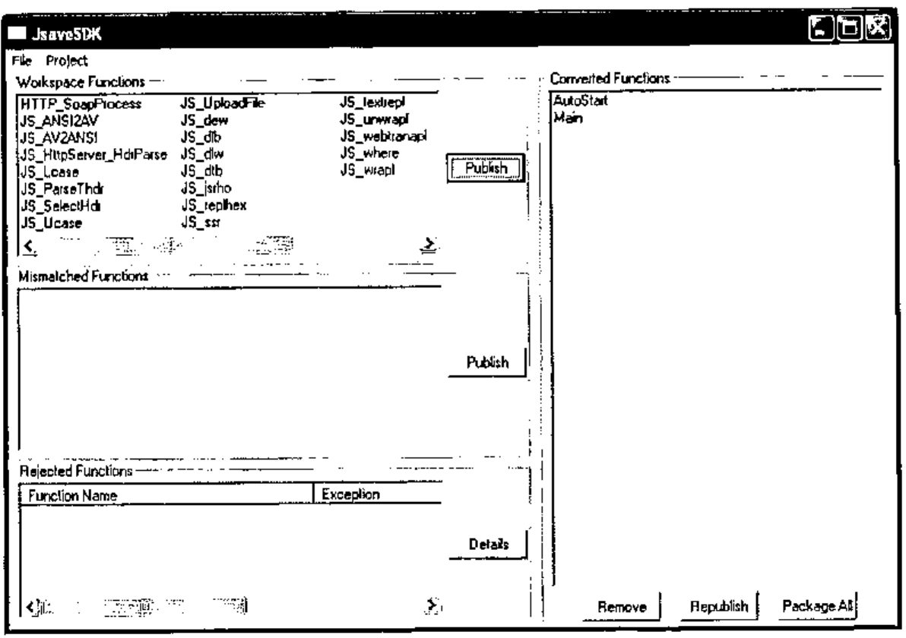

6. The Select Dialog Mode window pops up. Check the Maintain SI Info check box in the following dialog then click OK

    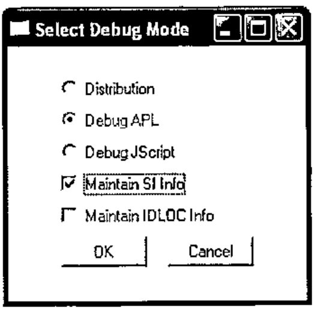

7. Then select File/Save and save the JSaveSDK Project as C:\\INETPUB\\WWWROOT\\LC\\WEBSERVICES\\DEMO.WJS
8. Finally click the Package All button and fill the next dialog as follows:

    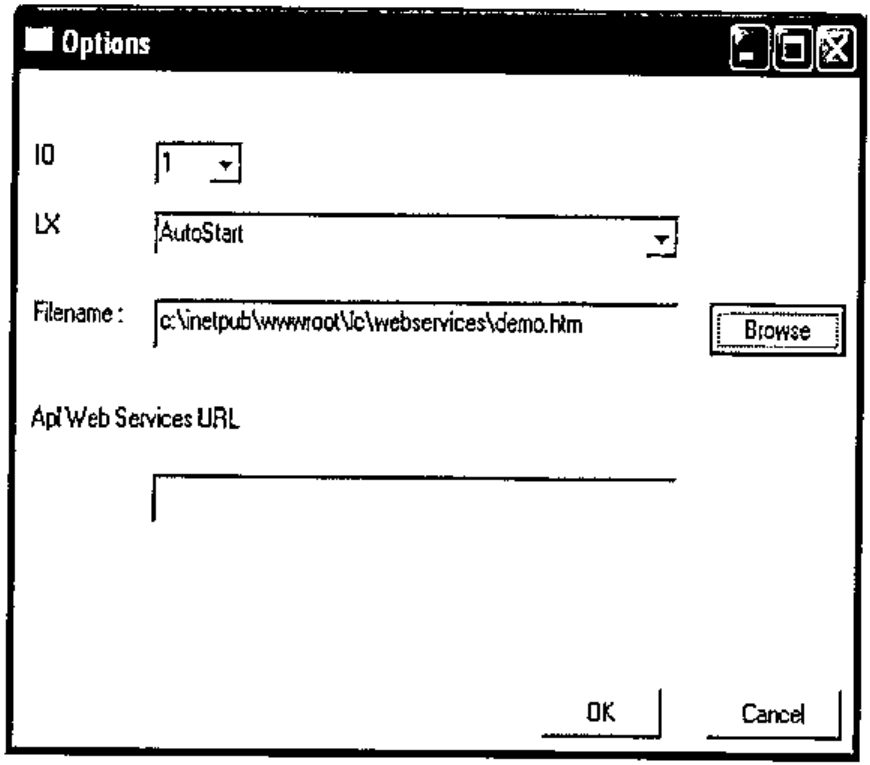

Congratulations! You have successfully configured your first APL+Web Component application. Yes it is a little long and cumbersome the first time, but the good news are that you must only do this setup once for a given application and that you quickly get used to it. Also the setup process described above is the same whether for a small APL application or for a very large one.

## Testing the application

It is now time to test our application.

As a good habit, it is always recommended to test it first in standard APL+Win mode. For that you should use the APL+Win ActiveX Server session where your DEMO workspace is loaded.

Check that your application is working fine in APL and correct any bug you may encounter. Then save the workspace.

The fact that your application runs fine in APL does not mean that it will necessarily run smoothly in the browser: there are many reasons for that which we explain in the APL+WebComponent (part 2) article. One of the reasons is that JSaveSDK is not able to translate all APL primitives, operators and constructs in JScript.

For example, when developing the **Main** function I had first written my buttons handler as follows:

```apl
[19]  :case'bn.onClick'
[20]      ⍝ Buttons handler
[21]      op1←↑⎕fi'fmMain.edOp1'⎕wi'text'
[22]      op2←↑⎕fi'fmMain.edOp2'⎕wi'text'
[24]      :select ↑⎕wi'caption'
[25]      :case'+' ⋄ res←op1+op2
[26]      :case'-' ⋄ res←op1-op2
[27]      :case'x' ⋄ res←op1×op2
[28]      :case'/' ⋄ res←op1÷op2
[29]      :end
[30]      'fmMain.edRes'⎕wi'text'(⍕res)
```

Everything was running fine when testing in standard APL mode, but the buttons would not operate when running the application in the browser. I have had to split line 24 into 2 lines as follows to correct the problem:

```apl
[19]  :case'bn.onClick'
[20]      ⍝ Buttons handler
[21]      op1←↑⎕fi'fmMain.edOp1'⎕wi'text'
[22]      op2←↑⎕fi'fmMain.edOp2'⎕wi'text'
[23]      op←↑⎕wi'caption'
[24]      :select op
[25]      :case'+' ⋄ res←op1+op2
[26]      :case'-' ⋄ res←op1-op2
[27]      :case'x' ⋄ res←op1×op2
[28]      :case'/' ⋄ res←op1÷op2
[29]      :end
[30]      'fmMain.edRes'⎕wi'text'(⍕res)
```

This is just one example of the many things which may happen when publishing your functions. The bad news are that, when something like that happens, you do not get any precise error message pointing you to the culprit line. As a matter of fact in this case, I did not get any error message at all: the buttons would just not operate.

The good news are that, with a little habit, and some time spent working with this new technology, you most often quickly guess what’s going wrong. The other good news are that these little debugging occur only with the functions you are publishing on the Client side, not at all with the ones you run on the Server: these latter ones use the full APL syntax and debugging on the Server side is easy.

In any case it is best to process as follows:

- write a few lines of code (or sometimes just one line)
- test in standard APL mode and debug
- republish your functions
- test in the browser

If it does not run fine in the browser, and if it was working fine the previous time, you know the problme occurs in the line (or small bunch of lines) you have added. This development method may seem slower, but in fact gets you more wuickly to a running application in the browser.

Also remember that every time you make the smallest change to one of the APL functions which you have selected to publish in JSAVESDK, you MUST **Save** the workpsace and then **Republish** with **JSAVESDK**. If you don’t do so your change will not be taken in account when testing your application in the browser.

### Running the APL application in the browser

We are at last ready to run our APL application in the browser.

Start an instance of Internet Explorer and enter the following URL:

```text
http://localhost:4000/demo.htm
```

Here are some explanations:

- we use **localhost** to mean that we want to test our application on this current machine (not on a remote server). Also remember that **localhost** is what we entered in Setting up the APL+Web Service step 6 above
- we specify that we call on the **4000** port. According to the APL+Web Service Step 6 setup (see above), this Web Server port is associated with the following Home Directory: **C:\\INETPUB\\WWWROOT\\LC\\WEBSERVICES**
- then we specify the **demo.htm** page. The Web Server associated with port 4000 therefore fetches the C:\\INETPUB\\WWWROOT\\LC\\WEBSERVICES\\DEMO.HTM page and loads it. This page is the page built by JSaveSDK when we published the application.

## Conclusion

In this first article on APL+Web Component we have showed the basics which should allow you to publish a simple APL application on the Web.

However, when deploying a real life application, things gets a bit more complicated: in APL+Web Component (part 2) we go much deeper into this new technology through a more complex example involving:

- using the Microsoft OWC Spreadsheet object
- running APL functions on the Server
- deciding what to run on the Client and what on the Server
- debugging
- transferring data from the Server to the Client using XML
- publishing your application on a Real Server

If you succeed in publishing a small APL application on the Web after reading this article, please send me an E-mail. Also, if I have omitted anything important in my Description above and if you get stuck, please tell me.
