*by Eric Lescasse*
{ .byline }

## Introduction

This is the second part of a two-part article about the new APL2000 APL+WebComponent product which allows you to publish your APL+Win applications on the Web. The first part introduced this new technology basics and showed how to setup and port a very small APL+Win application to the Web. In this article we will go further within the technology and port to the Web the following APL+Win application:

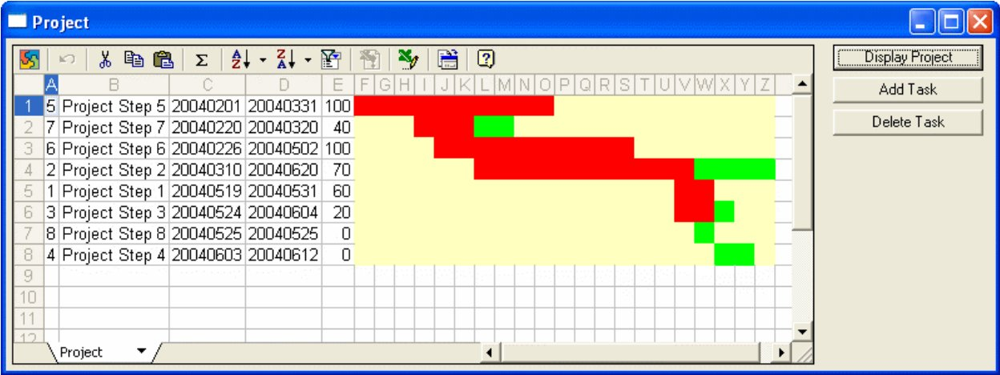

This application displays the various tasks of a Project with a diagram in an OWC (Microsoft Office Web Component) spreadsheet. One can click on the **Add Task** button to add a new task to the Project:

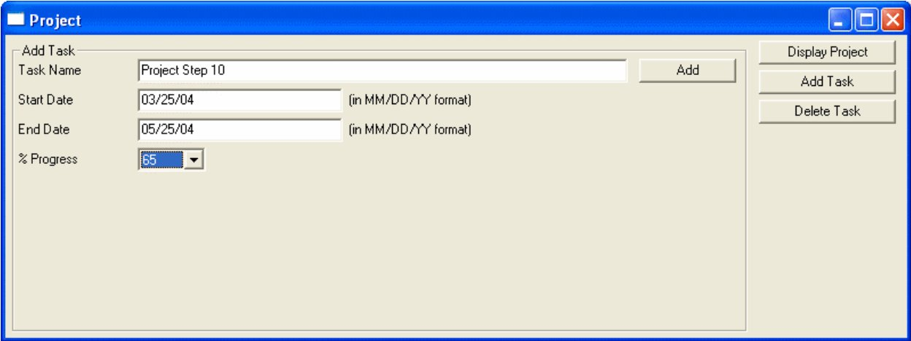

Clicking the **Add** button in the above screen will add the **Project Step 10** task to the project and clicking on the **Display Project** button computes and displays the new Project diagram after sorting the tasks according to their start date:

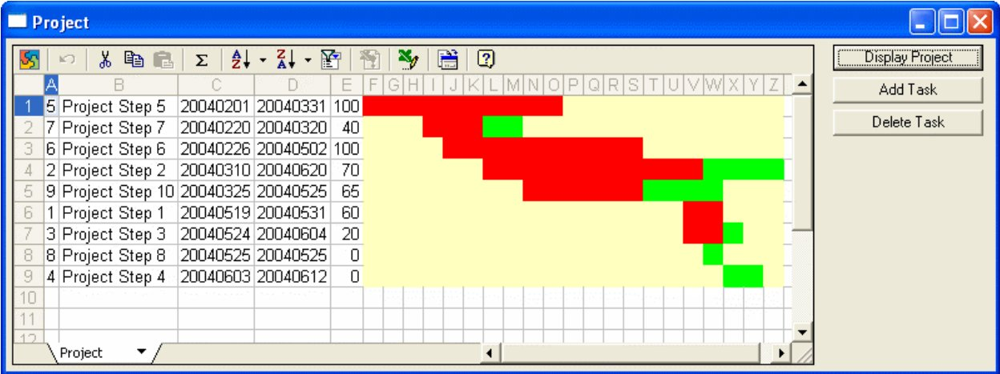

To delete a task, one can click on the **Delete Task** button resulting in the following frame being displayed:

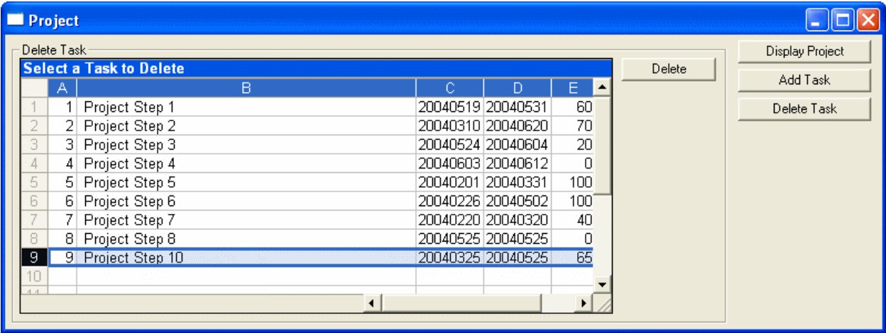

Select a line by clicking on the line number and then click **Delete** to delete the task. Clicking **Display Project** would compute and display the new Project diagram with the task having been deleted.

## Downloading and installing the Microsoft OWC Spreadsheet

For this application we will need to use the Microsoft OWC Spreadsheet. This ActiveX object is just a simplified version of Excel especially made by Microsoft for use in the browser, but since it is an ActiveX object, we can also use it within any APL+Win application.

You can download the Microsoft Office Web Components v11 which work with Office 2003 from the Microsoft Web Site. Be sure to select the right language

corresponding to your Office language. To install it, just run the OWC11.EXE file you have downloaded. (Note: if the link is hard to find, start Google and search for: “owc11.exe” and “microsoft”.) Note that the Microsoft Office Web Components do not only contain a Spreadsheet object, but also a Charting object and a Database object for publishing graphics or data on the Web.

Finally, if you want to learn how to program the OWC Spreadsheet, there is nothing better than downloading and installing the Microsoft Office Web Components Toolpack.

## Preparing the Workspace

This application will be called **owc** so we have created an C:\INETPUB\WWWROOT\LC\WEBSERVICES\OWC.W3 workspace containing all the application functions.

Then we have (p)copied the C:\INETPUB\WWWROOT\LC\WEBSERVICES\APLWS.W3 workspace into OWC.W3 and saved it again. Remember that APLWS.W3 contains the various base functions necessary for APL+WebComponent to work.

Our OWC.W3 workspace is made of 2 functions which we will publish:

- **AutoStart** (this will be the `⎕LX` function)

- **Main** (this will be our Main application function responsible for creating and displaying the interface)

and we will develop several other APL functions which will all run on the Server:

- **TieFile**
- **FileExist**
- **AddTask**
- **Fread**
- **DeleteTask**
- **ComputeProject**
- **DateBase**
- **DATEBASE**
- **DAYOFWK**
- **DATEREP**
- **UniqueFileName**

We will soon explain why we decide to run all these functions on the Server rather than publish them to run in the browser.

## Setting up the Web Services with APL+WebServicesController

Rather than going through all the steps (a bit cumbersome) necessary to set up our APL application within the AWS Admin, we will use the new APL2000 **APL+WebServicesController** product to run all the setup steps.

APL+WebServicesController is a COM object and therefore we can use APL+Win to pilot it as required. You can download the Alpha version of APL+WebServicesController from the APL2000 Site (you need to be an APLDN Subscriber, and a Login and Password is required).

Here is the APL+Win Script which sets up the Workspace and the Web Server for our **owc** application:

```apl
    ∇ CreateOwcServer;Z
[1]   ⍝∇ CreateOwcServer -- Uses the new APL+WebServicesController
[2]   ⍝∇ (c)2004 Eric Lescasse
[3]
[4]   :if 0∊⍴'wsc'⎕wi'self'
[5]       Z←'wsc'⎕wi'Create' 'APL2000.WSC'
[6]   :end
[7]   Z←'wsc'⎕wi'serviceStop'
[8]
[9]   ⍝ Delete Server & Workspace if already exist
[10]  Z←'wsc'⎕wi'DeleteWorkspace' 'owc'
[11]  Z←'wsc'⎕wi'DeleteServer' 'owc'
[12]
[13]  ⍝ Setup new Server
[14]  Z←'wsc'⎕wi'newServer' 'owc'
[15]  Z←'wsc'⎕wi'setServerHost' 'owc' 'localhost'
[16]  Z←'wsc'⎕wi'setServerPort' 'owc' '4000'
[17]  Z←'wsc'⎕wi'setServerPublicHttpDir' 'owc' 'c:\...\webservices'
[18]  Z←'wsc'⎕wi'addServerDefaultFileName' 'owc' 'default.htm'
[19]  Z←'wsc'⎕wi'setEnableDefaultFile' 'owc' 1
[20]
[21]  ⍝ Setup new Workspace
[22]  Z←'wsc'⎕wi'newWorkspace' 'owc'
[23]  Z←'wsc'⎕wi'modifyWorkspaceMaxpool' 'owc' '4'
[24]  Z←'wsc'⎕wi'modifyWorkspaceDebug' 'owc' '1'
[25]  Z←'wsc'⎕wi'modifyWorkspaceLocation' 'owc' 'c:\...\webservices\owc.w3'
[26]
[27]  ⍝ Create and setup new Virtual Directory
[28]  Z←'wsc'⎕wi'newVirtualPath' 'owc' '/jsaveservice/service1.asmx'
[29]  Z←'wsc'⎕wi'modifyServerPathWsid' 'owc' '/jsaveservice/service1.asmx' 'defaultworkspace' 'owc'
[30]  Z←'wsc'⎕wi'modifyServerPathFunction' 'owc' '/jsaveservice/service1.asmx' 'default' 'HTTP_SoapProcess'
[31]  Z←'wsc'⎕wi'addServerPathRargData' 'owc' '/jsaveservice/service1.asmx' 'header' 'header'
[32]  Z←'wsc'⎕wi'addServerPathLargData' 'owc' '/jsaveservice/service1.asmx' 'data' 'entity-body-utf8'
[33]  Z←'wsc'⎕wi'modifyServerPathResultData' 'owc' '/jsaveservice/service1.asmx' 'r' 'r' 'content-type'
[34]  Z←'wsc'⎕wi'addServerPathResultData' 'owc' '/jsaveservice/service1.asmx' 'r2' 'soap-envelop-start'
[35]  Z←'wsc'⎕wi'addServerPathResultData' 'owc' '/jsaveservice/service1.asmx' 'r3' 'soap-body'
[36]  Z←'wsc'⎕wi'addServerPathResultData' 'owc' '/jsaveservice/service1.asmx' 'r4' 'soap-envelop-end'
[37]
[38]  ⍝ Create and setup new Virtual Directory
[39]  Z←'wsc'⎕wi'newVirtualPath' 'owc' '/owc/xmlfile'
[40]  Z←'wsc'⎕wi'modifyServerPathWsid' 'owc' '/owc/xmlfile' 'defaultworkspace' 'owc'
[41]  Z←'wsc'⎕wi'modifyServerPathFunction' 'owc' '/owc/xmlfile' 'default' 'GetXMLFile'
[42]  Z←'wsc'⎕wi'addServerPathRargData' 'owc' '/owc/xmlfile' 'filename' 'entity-body'
[43]  Z←'wsc'⎕wi'modifyServerPathResultData' 'owc' '/owc/xmlfile' 'r' 'r' 'document-filename'
[44]  Z←'wsc'⎕wi'addServerPathResultData' 'owc' '/owc/xmlfile' 'r2' 'document-filename-delete'
[45]
[46]  ⍝ Start Workspace and Server
[47]  Z←'wsc'⎕wi'serviceStart'
[48]  Z←'wsc'⎕wi'startWorkspace' 'owc'
[49]  Z←'wsc'⎕wi'startServer' 'owc'
    ∇
```

After having properly installed the APL+WebServicesController (you just need to run the **APLWSCSetup.msi** installer) run the **CreateOwcServer** function:

```apl
      CreateOwcServer
```

This will result in the following setup added to the AWS Admin console:

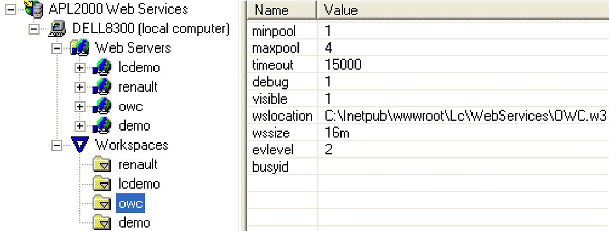

and:

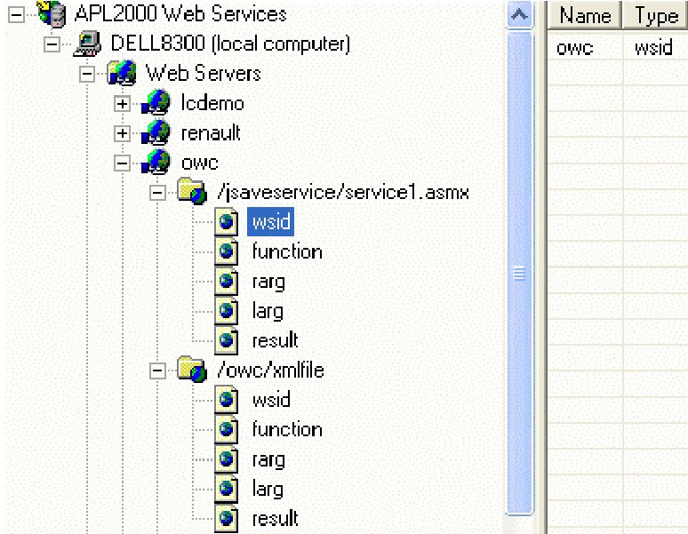

with the following parameters:

| Web Server | Virtual Path | Name | Type |
|---|---|---|---|
| owc | /jsaveservice/service1.asmx | | |
| | | wsid | owc wsid |
| | | function | HTTP_SoapProcess function |
| | | rarg | hdr header |
| | | larg | data entity-body-utf8 |
| | | result | r content-type |
| | | | r2 soap-envelop-start |
| | | | r3 soap-body |
| | | | r4 soap-envelop-end |
| | /owc/xmlfile | | |
| | | wsid | owc wsid |
| | | function | GetXMLFile function |
| | | rarg | filename entity-body |
| | | larg | |
| | | result | r document-filename |
| | | | r2 document-filename-delete |

## Publishing the Necessary Functions with JSAVESDK

As done for the Demo application in APL+WebComponent (part 1):

1. Start another APL

2. Load the C:\INETPUB\WWWROOT\LC\WEBSERVICES\JSAVESDK.W3 workspace. The JSAVESDK window pops up

3. Click **Project/Import Workspace** and select your C:\INETPUB\WWWROOT\LC\WEBSERVICES\OWC.W3 application workspace. The functions contained in this workspace get displayed

4. Click on **AutoStart** and then Ctrl+Click on **Main** to select these 2 functions

Click the **Publish** button What you should see so far is:

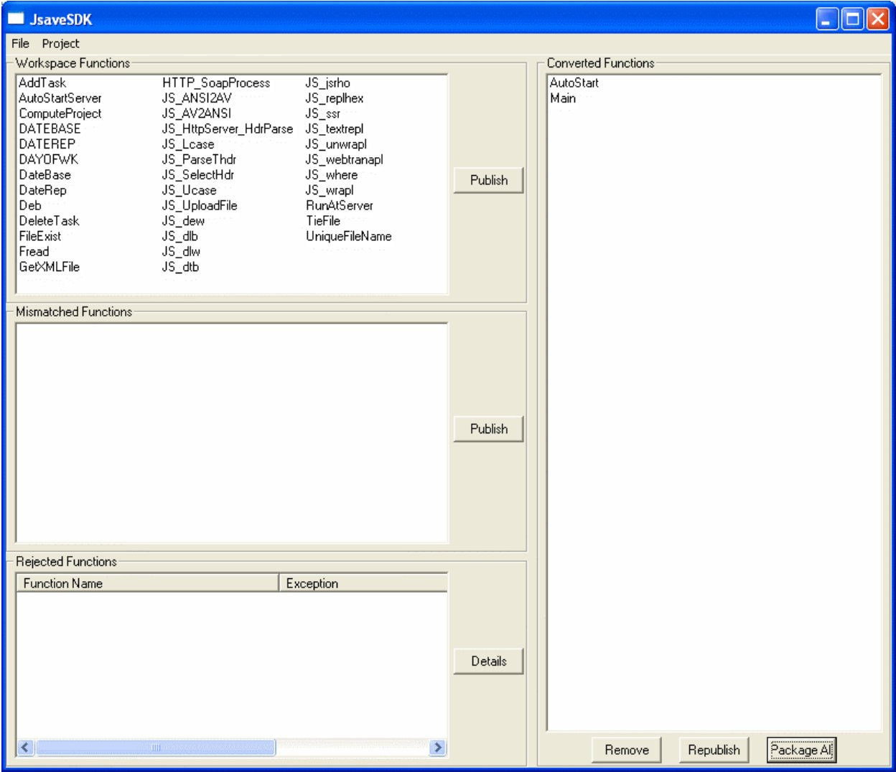

The **Select Dialog Mode** window pops up Check the **Maintain SI Info** check box in the following dialog then click OK:

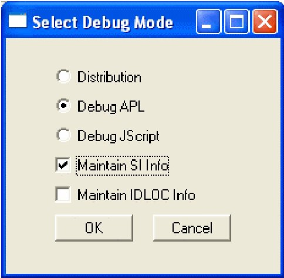

5. Then select **File/Save** and save the JSaveSDK Project as C:\INETPUB\WWWROOT\LC\WEBSERVICES\OWC.WJS

Finally click the **Package All** button, fill the next dialog as follows, then click OK:

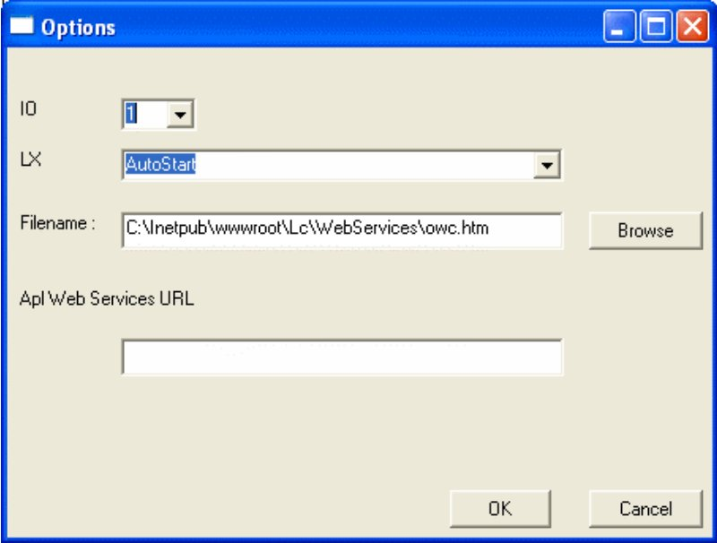

And we are now ready to use the application in the browser!

## Using the OWC application in the browser

Start an instance of IE and enter the URL - http://localhost:4000/owc.htm. Here is how it looks:

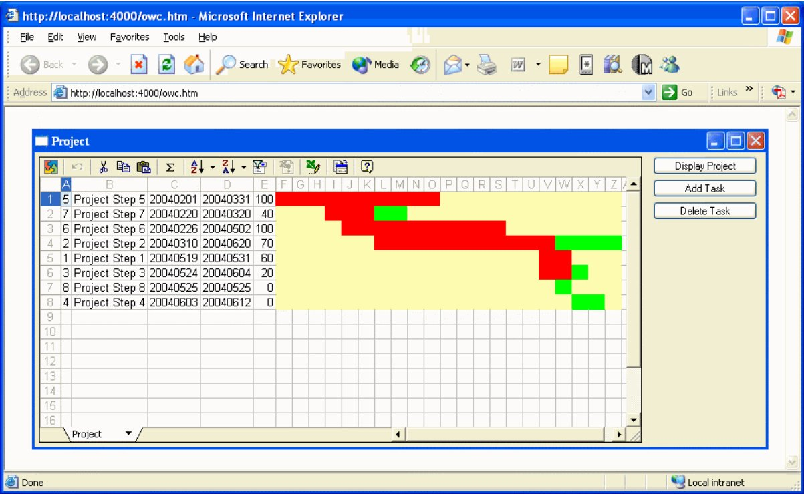

This application is resizable and works exactly the same in the browser as when you start it as a Windows application.

## Analysing the Application Code

First let’s display the 2 published functions: **AutoStart** and **Main**. Let’s analyse the **AutoStart** function first.

```apl
    ∇ AutoStart;dir;Z
[1]   is∆browser←'APL+Js'⎕sysid
[2]   :if is∆browser
[3]       Main''
[4]   :else
[5]       AutoStartServer
[6]   :end
    ∇
    ∇ AutoStartServer;dir;Z
[1]   :if 0'#'⎕wi'server'
[2]       Main''
[3]   :else
[4]       ⎕←'I am running on the server!'
[5]       ⍝ Change ⎕chdir from C:\Windows\System32 to the workspace dir
[6]       dir←⌽⎕wsid
[7]       dir←⌽(~^\dir≠'\')/dir
[8]       Z←⎕chdir dir
[9]   :endif
[10]
    ∇
```

We have also displayed the **AutoStartServer** function which is called by **AutoStart**.

Let’s comment first about **AutoStart**.

In **AutoStart** we first check `⎕sysid` and compare it to ‘APL+Js’: as a matter of fact `⎕sysid` is a way to know if the workspace is run in the browser (`⎕sysid` is ‘**APL+Js**’ in this case) or on the Server (`⎕sysid` is ‘**APL+Win**’ in that case). We set a variable `is∆browser` to **1** if we are running in the browser. We will need this information in the **Main** function.

So, if the workspace is run in the browser (i.e. if it is the JScript translated version of the APL code which runs), then we execute `Main''` which builds the application interface and displays the Project form in the browser.

On the other hand, if `is∆browser` is 0, this means that we are not running in the browser and this can occur in 2 cases:

- either we have loaded the workspace with the standard APL+Win System in which case `'#'⎕wi'server'` is 0 and we can start the application (`Main ''`)

- or the workspace has been loaded by an APL+Win ActiveX Server and in this case `'#'⎕wi'server'` returns a non 0 number (a pointer to the APL IUnknown interface) and we know the application is running on the Server: there is no need to display the application there; instead we change the current directory which by default is always C:\Windows\System32 for a COM Server to the application directory ... (in our case C:\INETPUB\WWWROOT\LC\WEBSERVICES)

The most important part of this application is of course the **Main** function:

```apl
    ∇ Main B;Z;height;width;off;M;H;arg;warg;bool;dir;file;colorsmat;tasks;spreadcols;lastcol;range;I;J;res;range2;tasks0;ttasks;list;lvwidth;E;F;taskid;row;colwidth;rok;data;name;start;end;progress;errmsg
[1]
[2]   :if 1≠arg←B ⋄ warg←B ⋄ arg←↑B ⋄ :end
[3]   :select arg
[4]   :case''
[5]       Z←RunAtServer TieFile 0
[6]       (height width)←'#'⎕wi'*size'
[7]       ⍝ Build the interface
[8]       Z←'fmProject' ⎕wi 'Create' 'Form' ('scale'1) ('caption' 'Project')'Hide'
[9]       ⍝ Create an instance of OWC Spreadsheet (OWC11.SpreadSheet)
[10]      Z←'fmProject.owc' ⎕wi 'Create' '{0002E551-0000-0000-C000-000000000046}' ('border'1)('DisplayGridlines'0)
[11]      Z←'fmProject.owc' ⎕wi 'Sheets("1").Name' 'Project'
[12]      ⍝ Create buttons
[13]      Z←'fmProject.bnProj' ⎕wi 'Create' 'Button'~ ('caption' 'Display Project')
[14]      Z←'fmProject.bnProj' ⎕wi 'onClick' 'Main"bnProj.onClick"'
[15]      Z←'fmProject.bnAdd' ⎕wi 'Create' 'Button' ('caption' 'Add Task')
[16]      Z←'fmProject.bnAdd' ⎕wi 'onClick' 'Main"bnAdd.onClick"'
[17]      Z←'fmProject.bnDel' ⎕wi 'Create' 'Button' ('caption' 'Delete Task')
[18]      Z←'fmProject.bnDel' ⎕wi 'onClick' 'Main"bnDel.onClick"'
[19]      ⍝ Create Frame for adding a Task
[20]      Z←'fmProject.frAdd' ⎕wi 'Create' 'Frame' ('scale'1) ('caption' 'Add Task') ('visible'0)
[21]      Z←'fmProject.frAdd' ⎕wi 'onResize' 'Main"frAdd.onResize"'
[22]      Z←'fmProject.frAdd.lName' ⎕wi 'Create' 'Label' ('scale'1) ('caption' 'Task Name')
[23]      Z←'fmProject.frAdd.edName' ⎕wi 'Create' 'Edit' ('scale'1)
[24]      Z←'fmProject.frAdd.lStart' ⎕wi 'Create' 'Label' ('scale'1) ('caption' 'Start Date')
[25]      Z←'fmProject.frAdd.edStart' ⎕wi 'Create' 'Edit' ('scale'1)
[26]      Z←'fmProject.frAdd.lStart2' ⎕wi 'Create' 'Label' ('scale'1) ('caption' '(in MM/DD/YY format)')
[27]      Z←'fmProject.frAdd.lEnd' ⎕wi 'Create' 'Label' ('scale'1) ('caption' 'End Date')
[28]      Z←'fmProject.frAdd.edEnd' ⎕wi 'Create' 'Edit' ('scale'1)
[29]      Z←'fmProject.frAdd.lEnd2' ⎕wi 'Create' 'Label' ('scale'1) ('caption' '(in MM/DD/YY format)')
[30]      Z←'fmProject.frAdd.lProgress' ⎕wi 'Create' 'Label' ('scale'1) ('caption' '% Progress')
[31]      Z←'fmProject.frAdd.cbProgress' ⎕wi 'Create' 'Combo'('style'2 16) ('scale'1)('list'(⍕¨5×0,⍳20))
[32]      Z←'fmProject.frAdd.lStatus' ⎕wi 'Create' 'Label' ('scale'1) ('caption' '')
[33]      Z←'fmProject.frAdd.bnAdd' ⎕wi 'Create' 'Button' ('scale'1) ('caption' 'Add')
[34]      Z←'fmProject.frAdd.bnAdd' ⎕wi 'onClick' 'Main"frAdd.bnAdd.onClick"'
[35]      ⍝ Create Frame for deleting a task
[36]      Z←'fmProject.frDel' ⎕wi 'Create' 'Frame' ('scale'1) ('caption' 'Delete Task') ('visible'0)
[37]      Z←'fmProject.frDel' ⎕wi 'onResize' 'Main"frDel.onResize"'
[38]      Z←'fmProject.frDel.owc' ⎕wi 'Create' '{0002E551-0000-0000-C000-000000000046}' ('border'1) ('DisplayToolbar'0)('DisplayWorkbookTabs'0)
[39]      Z←'fmProject.frDel.owc' ⎕wi 'TitleBar.Visible'1
[40]      Z←'fmProject.frDel.owc' ⎕wi 'TitleBar.Caption' 'Select a Task to Delete'
[41]      Z←'fmProject.frDel.bnDel' ⎕wi 'Create' 'Button' ('scale'1) ('caption' 'Delete')
[42]      Z←'fmProject.frDel.bnDel' ⎕wi 'onClick' 'Main"frDel.bnDel.onClick"'
[43]      ⍝ Make main form the right size
[44]      Z←'fmProject' ⎕wi 'onResize' 'Main"onResize"'
[45]      Z←'fmProject' ⎕wi (⊂'size'),.5 .6×height width
[46]      Z←'fmProject' ⎕wi 'limitwhere' (300÷16) (500÷8)
[47]      ⍝ Display main form
[48]      Main'DisplayProject'
[49]      Z←'fmProject'⎕wi'Show'
[50]
[51]  :case'onResize'
[52]      (height width)←((25×is∆browser)0)+16 8×⎕wi'size'
[53]      Z←'fmProject.bnProj'⎕wi(⊂'where'),(5(width-130)21 120)÷16 8 16 8
[54]      Z←'fmProject.bnAdd'⎕wi(⊂'where'), ((5+21+5)(width-130)21 120)÷16 8 16 8
[55]      Z←'fmProject.bnDel'⎕wi(⊂'where'), ((5+21+5+21+5)(width-130)21 120)÷16 8 16 8
[56]      Z←'fmProject.frAdd'⎕wi(⊂'where'),(7 6 (0⌈height-12) (0⌈width-146))÷16 8 16 8
[57]      Z←'fmProject.frDel'⎕wi(⊂'where'),(7 6 (0⌈height-12) (0⌈width-146))÷16 8 16 8
[58]      Z←'fmProject.owc'⎕wi(⊂'where'), (5 5 (0⌈height-10),(0⌈width-140+10))÷16 8 16 8
[59]
[60]  :case'frAdd.onResize'
[61]      (height width)←('fmProject.frAdd' ⎕wi 'size')×16 8
[62]      off←100
[63]      Z←'fmProject.frAdd.lName' ⎕wi (⊂'where'), ( 17 5 15 off)÷16 8 16 8
[64]      Z←'fmProject.frAdd.edName' ⎕wi (⊂'where'), ( 14 (5+off+5) 21 (120⌈width-5+off+5+5+100))÷16 8 16 8
[65]      Z←'fmProject.frAdd.bnAdd' ⎕wi (⊂'where'), ( 14 (0⌈width-95) 21 85)÷16 8 16 8
[66]      Z←'fmProject.frAdd.lStart' ⎕wi (⊂'where'), ( (17+21+5)5 15 off)÷16 8 16 8
[67]      Z←'fmProject.frAdd.edStart' ⎕wi (⊂'where'), ( (14+21+5) (5+off+5) 21 (120⌈180⌊width-5+off+5+5+100))÷16 8 16 8
[68]      Z←'fmProject.frAdd.lStart2' ⎕wi (⊂'where'), ( (17+21+5) (5+off+5+(120⌈180⌊width-5+off+5+5+100)+5) 21 150)÷16 8 16 8
[69]      Z←'fmProject.frAdd.lEnd' ⎕wi (⊂'where'), ( (17+21+5+21+5) 5 15 off)÷16 8 16 8
[70]      Z←'fmProject.frAdd.edEnd' ⎕wi (⊂'where'), ( (14+21+5+21+5) (5+off+5) 21 (120⌈180⌊width-5+off+5+5+100))÷16 8 16 8
[71]      Z←'fmProject.frAdd.lEnd2' ⎕wi (⊂'where'), ( (17+21+5+21+5) (5+off+5+(120⌈180⌊width-5+off+5+5+100)+5) 21 150)÷16 8 16 8
[72]      Z←'fmProject.frAdd.lProgress' ⎕wi (⊂'where'), ( (17+21+5+21+5+21+5) 5 15 off)÷16 8 16 8
[73]      Z←'fmProject.frAdd.cbProgress' ⎕wi (⊂'where'), ( (14+21+5+21+5+21+5) (5+off+5) 200 60)÷16 8 16 8
[74]      Z←'fmProject.frAdd.lStatus' ⎕wi (⊂'where'), ((17+21+5+21+5+21+5+21+5) 5 15 (width-5+5))÷16 8 16 8
[75]
[76]  :case'frDel.onResize'
[77]      (height width)←('fmProject.frDel' ⎕wi 'size')×16 8
[78]      off←100
[79]      Z←'fmProject.frDel.owc' ⎕wi (⊂'where'), ( 14 7 (0⌈height-23) (lvwidth←120⌈width-5+5+100))÷16 8 16 8
[80]      Z←'fmProject.frDel.bnDel' ⎕wi (⊂'where'), ( 14 (0⌈width-95) 21 85)÷16 8 16 8
[81]      Z←'fmProject.frDel.owc' ⎕wi 'ActiveSheet.Range("a:a").ColumnWidth'3
[82]      Z←'fmProject.frDel.owc' ⎕wi 'ActiveSheet.Range("c:c").ColumnWidth'8
[83]      Z←'fmProject.frDel.owc' ⎕wi 'ActiveSheet.Range("d:d").ColumnWidth'8
[84]      Z←'fmProject.frDel.owc' ⎕wi 'ActiveSheet.Range("e:e").ColumnWidth'5
[85]      colwidth←lvwidth÷8
[86]      colwidth←colwidth-(3+8+8+5)
[87]      colwidth←0⌈colwidth
[88]      colwidth←⌊.5+colwidth
[89]      :if colwidth≠0
[90]          Z←'fmProject.frDel.owc' ⎕wi 'ActiveSheet.Range("b:b").ColumnWidth' colwidth
[91]          Z←'fmProject.frDel.owc' ⎕wi 'Refresh'
[92]      :end
[93]
[94]  :case'bnAdd.onClick'
[95]      Z←'fmProject.owc' ⎕wi 'visible' 0
[96]      Z←'fmProject.frDel' ⎕wi 'visible' 0
[97]      Z←'fmProject.frAdd' ⎕wi 'visible' 1
[98]
[99]  :case'bnDel.onClick'
[100]     Z←'fmProject.owc' ⎕wi 'visible' 0
[101]     Z←'fmProject.frAdd' ⎕wi 'visible' 0
[102]     Main'FillTasks'
[103]     Z←'fmProject.frDel' ⎕wi 'visible' 1
[104]
[105] :case'bnProj.onClick'
[106]     Z←'fmProject'⎕wi'pointer'11
[107]     Z←'fmProject.frAdd' ⎕wi 'visible' 0
[108]     Z←'fmProject.frDel' ⎕wi 'visible' 0
[109]     Main'DisplayProject'
[110]     Z←'fmProject.owc' ⎕wi 'visible' 1
[111]     Z←'fmProject'⎕wi'pointer'1
[112]
[113] :case'frAdd.bnAdd.onClick'
[114]     ⍝ Read screen data
[115]     name←'fmProject.frAdd.edName' ⎕wi 'text'
[116]     start←'fmProject.frAdd.edStart' ⎕wi 'text'
[117]     start←(↑¨⎕fi¨(start≠'/')⊂start)[3 1 2]
[118]     start[1]←2000+100|start[1]
[119]     start←100⊥start
[120]     end←'fmProject.frAdd.edEnd' ⎕wi 'text'
[121]     end←(↑¨⎕fi¨(end≠'/')⊂end)[3 1 2]
[122]     end[1]←2000+100|end[1]
[123]     end←100⊥end
[124]     progress←↑⎕fi,'fmProject.frAdd.cbProgress' ⎕wi 'text'
[125]     errmsg←RunAtServer AddTask name start end progress
[126]     :if 0∊⍴errmsg
[127]         'fmProject.frAdd.edName' ⎕wi 'text' ''
[128]         'fmProject.frAdd.edStart' ⎕wi 'text' ''
[129]         'fmProject.frAdd.edEnd' ⎕wi 'text' ''
[130]         'fmProject.frAdd.cbProgress' ⎕wi 'text' ''
[131]         'fmProject.frAdd.lStatus' ⎕wi '∆style_color' '#00AA00'
[132]         'fmProject.frAdd.lStatus' ⎕wi 'caption' 'Record added to the database!'
[133]     :else
[134]         'fmProject.frAdd.lStatus' ⎕wi '∆style_color' '#FF0000'
[135]         'fmProject.frAdd.lStatus' ⎕wi 'caption' errmsg
[136]     :end
[137]
[138] :case'frDel.bnDel.onClick'
[139]     row←'fmProject.frDel.owc' ⎕wi 'ActiveCell.Row'
[140]     tasks←RunAtServer Fread 1 11
[141]     taskid←tasks[row;1]
[142]     Z←RunAtServer DeleteTask taskid
[143]     Main'FillTasks'
[144]
[145] :case'DisplayProject'
[146]     Z←RunAtServer ComputeProject is∆browser
[147]     (rok data)←Z
[148]     :if rok = 0
[149]        :if is∆browser
[150]             'fmProject.owc' ⎕wi 'xXMLUrl' data
[151]         :else
[152]             'fmProject.owc' ⎕wi 'xXMLData' data
[153]         :endif
[154]     :endif
[155]
[156] :case'FillTasks'
[157]     tasks←RunAtServer Fread 1 11
[158]     :for I :in 1+1↑⍴tasks
[159]         :for J :in ⍳¯1↑⍴tasks
[160]             range←(J⊃'ABCDE'),⍕I
[161]             Z←'fmProject.frDel.owc' ⎕wi ('ActiveSheet.Range("',range,'").Value2') ('')
[162]         :end
[163]     :end
[164]     :for I :in ⍳1↑⍴tasks
[165]         :for J :in ⍳¯1↑⍴tasks
[166]             range←(J⊃'ABCDE'),⍕I
[167]             Z←'fmProject.frDel.owc' ⎕wi ('ActiveSheet.Range("',range,'").Value2') (⍕tasks[I;J])
[168]         :end
[169]     :end
[170]
[171] :end
[172]
    ∇
```

Let’s explain this function in detail.

First, it is built on a **:select ... :case ...** structure.

When the **Main** argument is an empty character vector, lines **5** to **46** are executed and the application main form is built.

The interface is made of 3 frames and 3 buttons. Only one of the 3 frames may be visible at any time: the other 2 are hidden. The 3 buttons help show the appropriate frame and hide the other 2.

In 2 of the frames an OWC Spreadsheet object is instanciated. Note that in order for the OWC Spreadsheet object (which is an ActiveX object) to get displayed in the browser we need to instanciate it using its class id:

```apl
 'fmProject.owc' ⎕wi 'Create' '{0002E551-0000-0000-C000-000000000046}'
```

In order to keep all the code within the **Main** function, we embed all the necessary handlers within it. For example when a user clicks on the **bnProj** button in the main form, the following handler is run:

```apl
 Main"bnAdd.onClick"
```

so the **Main** function is called with an argument of **bnAdd.onClick** and the **:select** control structure branches to line **94** and executes lines **95** to **97**. This technique makes the code very readable.

Events which we handle here are the **onClick** events on the various buttons, but also the **onResize** events on the main form and on the Frame objects. This way our form may be resized by the user (even in the browser) and all controls get nicely resized or repositioned accordingly.

Another point to notice is that we needed to run a few subroutines to perform specific tasks like **FillTasks** (to fill the OWC Spreadsheet in the Delete Task frame) or **DisplayProject** (to compute and display the Project graph).

Rather than making these subroutines, we have made them methods of the **Main** function by encapsulating them as **:case** statements in the **Main** function: this way **Main** contains all the logic necessary to its operation, except for the code sections which need to run on the Server.

## The Client Server Decisions and RunAtServer

One of the difficulties you’ll bump into when porting APL applications to the Web will be to decide which lines of your code need to run on the Server and which should run on the Client. But first let’s explain a little bit more what running on the Client and running on the Server mean.

Every function you have published with JSaveSDK will run on the Client (after having been translated by JSaveSDK to JScript): however your application is installed on a Server and is loaded by APL+Win on the Server when someone starts it in his browser. APL functions which are not published will run on the Server.

In general you are publishing the APL functions which create your application interface and are the main functions of your application: however these functions may call subroutines which you want or need to run on the Server.

The way to do that is to call these functions through the following utility:

```apl
    ∇ R←RunAtServer R
    ∇
```

Here is an example: in our OWC application, we need to use an APL+Win file to store the Project tasks information. Using the file system is not authorized on the Client side for obvious security reasons, therefore we need to open the file on the Server (in any case, most often, a file like the file containing the Project tasks information has to be shared among Web users so it needs to reside on the Server).

To open the file (which we called OWC.SF) we need to write a **TieFile** utility and make it run on the Server.

Here is how we call it:

```apl
      Z←RunAtServer TieFile 0
```

and here is the **TieFile** function which opens (or creates) the **OWC.SF** file:

```apl
    ∇ R←TieFile dummy;M;H;bool;dir;file;Z;comp2
[1]
[2]   R←0 0⍴''
[3]
[4]   dir←⎕chdir''
[5]   file←dir,'\owc'
[6]
[7]   ⍝ Create or tie the OWC file
[8]   :if FileExist file,'.sf'
[9]       file ⎕fstie 1
[10]  :else
[11]      comp2←'File Structure',⎕tcnl
[12]      comp2←comp2,⎕tcnl,'Comp 1 -- File Description'
[13]      comp2←comp2,⎕tcnl,'Comp 2 -- File Structure'
[14]      comp2←comp2,⎕tcnl,'Comp 3-10 -- (reserved)'
[15]      comp2←comp2,⎕tcnl,'Comp 11 -- Tasks matrix'
[16]      comp2←comp2,⎕tcnl,'           [;1] ←→ Task #'
[17]      comp2←comp2,⎕tcnl,'           [;2] ←→ Task Name'
[18]      comp2←comp2,⎕tcnl,'           [;3] ←→ Task Start Date'
[19]      comp2←comp2,⎕tcnl,'           [;4] ←→ Task End Date'
[20]      comp2←comp2,⎕tcnl,'           [;5] ←→ Task % Progress'
[21]      file ⎕fcreate 1
[22]      Z←'APL+Web Components Project Demo Application File'⎕fappend 1
[23]      Z←comp2 ⎕fappend 1
[24]      Z←(⊂'')⎕fappend¨8⍴1
[25]      Z←(0 5⍴0''0 0 0)⎕fappend 1
[26]
[27]  :end
[28]
    ∇
```

Note that the above function describes the file structure we are using for our very simple OWC.SF application file.

The rules are the following:

- any function called through **RunAtServer** should be monadic and return a result.

In our case, the **TieFile** function did not need any argument or to return any result, but we still had to add an argument and a result in its syntax; to conform to the above rule.

- The argument to a function called through **RunAtServer** may be a nested vector and its result may also be a nested vector.

Look at the various lines in the **Main** function (displayed above) which call **RunAtServer** to run subroutines on the Server. Line **125** shows an example of passing a nested vector to a function called through **RunAtServer**.

```apl
[113]     Z←RunAtServer AddTask name start end progress
```

So, the big question is: “when do we need to use **RunAtServer** and when not?”

Here are a few hints to help you make these decisions:

- you must use **RunAtServer** to perform any task which is forbidden on the Client (among these are any file system operations)

- you must use **RunAtServer** whenever your code uses primitives, operators or more generally APL constructs which are not translatable to JScript, though an alternative would be to rewrite these instructions, if possible, using exclusively APL constructs which are supported by JSaveSDK (you can download the precise description of JSaveSDK supported and unsupported APL features from the APL2000 Web Site)

- you should in general use **RunAtServer** to perform anything APL task which is not User Interface related like calculations, database operations, etc.

- you should sometimes use **RunAtServer** when using ActiveX objects because the JSaveSDK support for these ActiveX properties and methods may be limited: in our case, I tried to update and fill the OWC Spreadsheet object to display the project Graph on the Client side, but several properties and methods would not work, so I had to do all this stuff on the Server (see function DisplayProject below)

- finally, you should use **RunAtServer** as often as possible since APL is MUCH faster than JScript, but remember that everything related to your interface should be published, i.e. run on the Client

To better explain this last point, here is an example: we needed to write an **AddTask** function and to run it on the Server to add a new task to our **OWC.SF** since this operation uses a file. It would have been an error to try to read the data input by the Web User within the **AddTask** function. This is easy to understand: the Server does not know about what the Client has done in its browser. Instead we needed to read the data input by the Web User within the **Main** function (which runs on the Client) and to pass these information to the **AddTask** function, hence the following code in the **Main** function:

```apl
[113] :case'frAdd.bnAdd.onClick'
[114]     ⍝ Read screen data
[115]     name←'fmProject.frAdd.edName' ⎕wi 'text'
[116]     start←'fmProject.frAdd.edStart' ⎕wi 'text'
[117]     start←(↑¨⎕fi¨(start≠'/')⊂start)[3 1 2]
[118]     start[1]←2000+100|start[1]
[119]     start←100⊥start
[120]     end←'fmProject.frAdd.edEnd' ⎕wi 'text'
[121]     end←(↑¨⎕fi¨(end≠'/')⊂end)[3 1 2]
[122]     end[1]←2000+100|end[1]
[123]     end←100⊥end
[124]     progress←↑⎕fi,'fmProject.frAdd.cbProgress' ⎕wi 'text'
[125]     errmsg←RunAtServer AddTask name start end progress
[126]     :if 0∊⍴errmsg
[127]         'fmProject.frAdd.edName' ⎕wi 'text' ''
[128]         'fmProject.frAdd.edStart' ⎕wi 'text' ''
[129]         'fmProject.frAdd.edEnd' ⎕wi 'text' ''
[130]         'fmProject.frAdd.cbProgress' ⎕wi 'text' ''
[131]         'fmProject.frAdd.lStatus' ⎕wi '∆style_color' '#00AA00'
[132]         'fmProject.frAdd.lStatus' ⎕wi 'caption' 'Record added to the database!'
[133]     :else
[134]         'fmProject.frAdd.lStatus' ⎕wi '∆style_color' '#FF0000'
[135]         'fmProject.frAdd.lStatus' ⎕wi 'caption' errmsg
[136]     :end
```

And here is the **AddTask** function which runs on the Server:

```apl
    ∇ R←AddTask rarg;name;start;end;progress;tasks;startdate;enddate
[1]   ⍝∇ R←AddTask rarg -- Adds a task to the OWC file
[2]
[3]   R←''
[4]   (name start end progress)←rarg
[5]   (startdate enddate)←⎕split⍉10000 100 100⊤start end
[6]   :if~DATECHECK startdate ⋄ R←'Invalid Start Date!  ' ⋄  :end
[7]   :if~DATECHECK enddate ⋄ R←R,'Invalid End Date!  ' ⋄  :end
[8]   :if startdate[1]≠2004 ⋄ R←R,'Start year must be 2004!  ' ⋄ :end
[9]   :if enddate[1]≠2004 ⋄ R←R,'End year must be 2004!  ' ⋄ :end
[10]  :if start>end ⋄ R←R,'Start date must be before end date!  ' ⋄ :end
[11]  :if 0∊⍴R
[12]      tasks←⎕fread 1 11
[13]      tasks←tasks⍪(1+⌈/0,tasks[;1])name start end progress
[14]      tasks ⎕freplace 1 11
[15]  :end
    ∇
```

In the **AddTask** function we check the Start date and End date entered on the client and the **AddTask** function returns an appropriate error message if any of these dates is not valid for our application. If the dates are valid, we can add the task to the **OWC.SF** file: this is done on lines **12** to **14**.

In the **frAdd.bnAdd.onClick** event handler, we capture the result of **AddTask** in the **errmsg** variable and depending on its content we display an error message in the Add Task frame or inform the user that the record has indeed be added to the database, in which case we empty the Add Task frame fields.

One interesting point about the **frAdd.bnAdd.onClick** handler is that we have used a DHTML style property to set the Status label colour:

```apl
      'fmProject.frAdd.lStatus' ⎕wi '∆style_color' '#FF0000'
```

Note that you can use any style, DHTML or JScript property on interface objects as long as you set them as APL User defined properties starting with the ‘style_ prefix, followed by the style name (example: ‘style_fontFamily , ‘style_fontSize , ‘style_backgroundColor , etc.). Note that the value you pass to the property should be a valid value for the DHTML or JScript property, hence the '#FF0000' for the colour style here.

## Using the OWC Spreadsheet on the Client and on the Server

As I said, not all OWC Spreadsheet properties and methods work on the Client when translated to JScript. However a few of them work fine. In our OWC application, we have used the OWC Spreadsheet both on the Client and on the Server.

### Using the OWC Spreadsheet on the Client

Let’s first talk about using it on the Client. Look at the **FillTasks** method which role is to fill the OWC Spreadsheet in the Delete Task Frame with our **tasks**’ nested array so that the User may select a task to delete:

```apl
[133] :case'FillTasks'
[134]     tasks←RunAtServer Fread 1 11
[135]     :for I :in 1+1↑⍴tasks
[136]         :for J :in ⍳¯1↑⍴tasks
[137]             range←(J⊃'ABCDE'),⍕I
[138]             Z←'fmProject.frDel.owc' ⎕wi ('ActiveSheet.Range("',range,'").Value2') ('')
[139]         :end
[140]     :end
[141]     :for I :in ⍳1↑⍴tasks
[142]         :for J :in ⍳¯1↑⍴tasks
[143]             range←(J⊃'ABCDE'),⍕I
[144]             Z←'fmProject.frDel.owc' ⎕wi ('ActiveSheet.Range("',range,'").Value2') (⍕tasks[I;J])
[145]         :end
[146]     :end
```

We first need to read the tasks nested array from the OWC.SF file on the Server, which is done through a small trivial **Fread** utility:

```apl
    ∇ R←Fread A
[1]   R←⍕¨⎕fread A
    ∇
```

(note that we are making each cell a string with the `⍕¨` construct to avoid having to do that on the Client side)

Then we perform 2 double loops on the Client side:

- the first one is to empty the OWC Srpeadsheet

- the second one is to fill it with the tasks nested array

The reasons we have had to do these loops is that the OWC Spreadsheet **Clear** method which was supposed to work on a range of cells did not work when translated through JSaveSDK, and similarly the **Value2** property which normally accepts a nested array to fill a matrix range of cells at once, would not work either when translated through JSaveSDK.

So here is a case where things were not working as expected when translated to JSaveSDK, but where we still could find a workaround to make things work on the Client side. Obviously these loops do not provide us with the best performance possible, especially since JScript is rather slow.

### Using the OWC Spreadsheet on the Server

Let’s talk now about using the OWC Spreadsheet on the Server side.

You will tell me: what? this is an interface problem and should be running on the Client: how can you make this running on the Server side?

Well, this part is the trickiest in our example, but shows what you can do with APL+WebComponent.

First look at the code which runs in the **Main** function when computing and displaying a new Project graph:

```apl
[122] :case'DisplayProject'
[123]     Z←RunAtServer ComputeProject is∆browser
[124]     (rok data)←Z
[125]     :if rok = 0
[126]        :if is∆browser
[127]             'fmProject.owc' ⎕wi 'xXMLUrl' data
[128]         :else
[129]             'fmProject.owc' ⎕wi 'xXMLData' data
[130]         :endif
[131]     :endif
```

Basically almost everything is done on the Server in a **ComputeProject** function (displayed a little further below). We need a function to run on the Server for several reasons here:

- first, this function needs to access the OWC.SF file to read the tasks data

- second, this function needs to perform a bunch of APL calculations to transform the tasks nested array in a Project graph

- third, we wanted to use the OWC Spreadsheet on the Server to make full use of its properties and methods

Here is the **ComputeProject** function:

```apl
    ∇ R←ComputeProject is∆browser;tasks;mindate;maxdate;spandates;boolmat; totals;splitmat;daysmat;colorsmat;white;red;green;tasks0;boolmatdone; dayofwk;mondays;spreadcols;Z;lastcol;range;range2;I;J;data;filename
[1]   ⍝∇ R←ComputeProject is∆browser
[2]   ⍝∇ Comp 11 -- Tasks matrix
[3]   ⍝∇            [;1] ←→ Task #
[4]   ⍝∇            [;2] ←→ Task Name
[5]   ⍝∇            [;3] ←→ Task Start Date
[6]   ⍝∇            [;4] ←→ Task End Date
[7]   ⍝∇            [;5] ←→ Task % Progress
[8]
[9]   tasks←⎕fread 1 11
[10]  tasks0←tasks←tasks[⍋tasks[;3];]            ⍝ sort tasks by Start Date
[11]  tasks[;3 4]←DateBase tasks[;3 4]           ⍝ convert YYYYMMDD dates
[12]  mindate←⌊/tasks[;3]                        ⍝ earliest Start Date
[13]  maxdate←⌈/tasks[;4]                        ⍝ latest End Date
[14]  spandates←mindate+0,⍳maxdate-mindate
[15]  boolmat←(tasks[;3]∘.≤spandates)^tasks[;4]∘.≥spandates
[16]  boolmatdone←⊃(⊂spandates)∊¨(tasks[;3]-1)+⍳¨⌊.5+.01×tasks[;5]×+/boolmat
[17]  colorsmat←1+boolmat+boolmatdone
[18]
[19]  ⍝ Compute per week
[20]  dayofwk←DAYOFWK DATEREP spandates
[21]  mondays←1,1↓dayofwk=3
[22]  colorsmat←⍉⊃⌈/¨mondays ⎕penclose colorsmat
[23]
[24]  (white red green)←256⊥¨(192 255 255)255(0 255 0)
[25]  colorsmat←(white green red)[colorsmat]
[26]
[27]  spreadcols←256↑,((⊂''),'ABCDEFGHI')∘.,'ABCDEFGHIJKLMNOPQRSTUVWXYZ'
[28]
[29]  :if ~0∊⍴'ftmp.owc' ⎕wi 'self'
[30]      Z←'ftmp' ⎕wi 'Delete'
[31]  :endif
[32]  Z←'ftmp' ⎕wi 'Create' 'Form' 'Hide'
[33]  Z←'ftmp.owc' ⎕wi 'Create' '{0002E551-0000-0000-C000-000000000046}'
[34]  Z←'ftmp.owc' ⎕wi 'Sheets("1").Name' 'Project'
[35]
[36]  ⍝ Compute range
[37]  lastcol←(¯1↑⍴tasks)⊃spreadcols
[38]  range←'A1:',lastcol,⍕↑⍴tasks0
[39]  range2←'A:',lastcol
[40]  Z←'ftmp.owc'⎕wi'xActiveSheet.xRange().xValue2'range(⍉tasks0)
[41]  Z←'ftmp.owc'⎕wi'xActiveSheet.xRange().XAutoFit'range2
[42]  ⍝ Install Colors matrix
[43]  range←((1+¯1↑⍴tasks)⊃spreadcols),':', ((¯1↑⍴tasks)+¯1↑⍴colorsmat)⊃spreadcols
[44]  range2←(1+(¯1↑⍴tasks)+¯1↑⍴colorsmat)⊃spreadcols
[45]  range2←range2,':',range2
[46]  Z←'ftmp.owc'⎕wi'ActiveSheet.Range().ColumnWidth'range 1.5
[47]  Z←'ftmp.owc'⎕wi'ActiveSheet.Range().ColumnWidth'range2 255
[48]  :for I :in ⍳↑⍴colorsmat
[49]    :for J :in ⍳¯1↑⍴colorsmat
[50]        range←((J+¯1↑⍴tasks)⊃spreadcols),⍕I
[51]        Z←'ftmp.owc'⎕wi'xActiveSheet.xRange().xInterior.xColor'range (colorsmat[I;J])
[52]    :end
[53]  :end
[54]
[55]  data←'ftmp.owc' ⎕wi 'xXMLData'
[56]
[57]  :if is∆browser
[58]  ⍝   data←'/&/&'TEXTREPL data
[59]      filename←UniqueFileName 'c:\inetpub\wwwroot\lc\webservices\'
[60]      ⎕nuntie ¯1
[61]      filename ⎕xntie ¯1
[62]      0 ⎕nresize ¯1
[63]      filename←(¯3↓filename),'xml'  ⍝ the extn is .tmp, change to .xml
[64]      filename ⎕xnrename ¯1
[65]      data ⎕nappend ¯1
[66]      ⎕nuntie ¯1
[67]      filename←(⍴'c:\inetpub\wwwroot\lc\webservices\')↓filename
[68]  ⍝   R←0 ('http://www.lescasse.com:9000/owc/xmlfile?',filename)
[69]      R←0 ('http://localhost:4000/owc/xmlfile?',filename)
[70]  :else
[71]  ⍝   data←'/&/&'TEXTREPL data
[72]      R←0 data
[73]  :end
[74]
[75]  'ftmp'⎕wi'Delete'
[76]
[77]
    ∇
```

The **ComputeProject** function contains 3 parts:

- lines **9** to **25**, the computation part, takes the **tasks** nested array and converts it to a colours matrix for the Project graph: note that we are using subroutines like **DateBase**, **DATEBASE**, **DATEREP** and **DAYOFWK**, the latter 3 ones coming from the **DATES** workspace delivered with APL+Win. Since these functions are called by a function running on the Server, they automatically also run on the Server and we don’t need to use **RunAtServer** again to call them. On line **11** the YYYYMMDD dates in the **tasks** nested array are converted to number of days since January 1 1900. The **spandates** variable is computed on line **14** and contains all the dates from the start of the first task to the end of the last task. The **boolmat** variable contains one line per task, one column per **spandates** and a 1 for each day between the task start date and end date. The

**boolmatdone** variable has the same dimensions as **boolmat** and is the same as **boolmat** except that it contains 1s only for the dates corresponding to the task % which is done. Finally on line **20** to **22**, we reduce the colours matrix to one cell per task and per week, instead of one cell per task and per day, in order to reduce the number of columns we will use in the OWC spreadsheet.

- lines **21** to **53** are used to create a new instance of the OWC Spreadsheet object on the Server in an invisible form and to fill it with the **tasks** data and with the Graph, i.e. the colours matrix we have just computed: we do this on the Server exactly as we would have liked to do it on the Client. Now you have to understand that this OWC Server Spreadsheet has nothing to do with the one displayed on the Client in the browser, but it is precisely the same kind of object. Once the OWC Server Spreadsheet is populated with data, we get its complete content, including all its formatting, in an APL variable called **data** by invoking its **xXMLData** property on line **55**. The **data** variable now contains an XML representation of our OWC Server Spreadsheet content.

- lines **57** to **73** are used to transfer this XML content back to the Client. One tricky aspect here is that we have to distinguish the 2 following cases: we may be running the application from the browser, or we may be running in a raw APL session just for tests purposes. The tricky thing is that we CANNOT use `⎕sysid` within the **ComputeProject** function to determine if we are running from the browser or from a raw APL session. Guess why? This is because in both cases `⎕sysid` will return **‘APL****+****Win’**. The reason is that when you run a function on the Server through **RunAtServer**, you are running it in a standard APL+Win session on the Server. How do we solve this problem? The trick is simple: since `⎕sysid` returns the right information when we are running on the Client, we just need to pass its Client value to the **ComputeProject** function as its argument. More precisely we are passing here the `is∆browser` variable which reflects the `⎕sysid` value, as an argument to the **ComputeProject** function before calling it through **RunAtServer**. When we are running on the Server, we need to create a native file and to populate it with the **data** variable: this is done through lines **55** to **66**. And we return a return code of 0 and the following string to the client:

```apl
        'http://localhost:9000/owc/xmlfile?',filename
```

where **filename** is the name of the XML file we just created. Remember that we have created a virtual path called **/owc/xmlfile** as follows in the APL Web Services Configuration Console:

| Web Server | Virtual Path | Name | Type |
|---|---|---|---|
| owc | /owc/xmlfile | | |
| | | wsid | owc wsid |
| | | function | GetXMLFile function |
| | | rarg | filename entity-body |
| | | larg | |
| | | result | r document-filename |
| | | | r2 document-filename-delete |

The role of this **/owc/xmlfile** Virtual Path is to send the right XML file from the Server to the Client. The **GetXMLFile** function is very simple and just returns the complete name of the file:

```apl
    ∇ r←GetXMLFile filename
[1]
[2]   r←('c:\inetpub\wwwroot\lc\webservices\',filename) 1
[3]
    ∇
```

So let’s look at the **DisplayProject** method in the **Main** function:

```apl
[122] :case'DisplayProject'
[123]     Z←RunAtServer ComputeProject is∆browser
[124]     (rok data)←Z
[125]     :if rok = 0
[126]        :if is∆browser
[127]             'fmProject.owc' ⎕wi 'xXMLUrl' data
[128]         :else
[129]             'fmProject.owc' ⎕wi 'xXMLData' data
[130]         :endif
[131]     :endif
```

It runs **ComputeProject** on the Server with an argument of `is∆browser` (which is 1). The **ComputeProject** function returns the following string to the client **data** variable:

```apl
 'http://localhost:4000/owc/xmlfile?',filename
```

where filename is the name of the XML file created on the server.

Then if the **ComputeProject** return code is **0** and if we run on the Client, we pass **data** as an argument to the Client OWC Spreadsheet **xXMLUrl** property. This results in the Client OWC Spreadsheet downloading the right XML file from the Server and instantaneously populating itself with its content.

As a summary, to use the OWC Spreadsheet on the Server rather than on the client, we have:

- called a function on the Server (**ComputeProject**)

- created another instance of the OWC Spreadsheet in an invisible form on the Server

- done all the necessary work to populate it and format it on the Server

- captured its **xXMLData** property

- created a native file on the Server and filled it with the OWC Spreadsheet **xXMLData**

- returned to the Client the URL necessary for the Client to download this native file

- called the Client OWC Spreadsheet **xXMLUrl** property with this URL as an argument to download the file and populate itself

Note that using a result of **r2 document-filename-delete** in the /owc/xmlfile setup results in the native XML file being deleted as soon as it has been received by the Client. This avoids the Server getting cluttered with the XML native files created by people using our application. This is very important: we should never forget that such an application runs on the Internet and that there may be thousands of people using it every day (or more): this would quickly result in tens of thousands of XML files cluttering the Server!

Yes I know: all this may seem a bit complicated at first, but it works and rather efficiently!

## The APL+WebComponent Development Cycle

How do you proceed in practice to write an APL+WebComponent application?

Well this depends if you are writing a brand new application or trying to port an existing APL+Win application to the Web. Assume first you are writing a brand new APL+Win application to be published on the Web.

I recommend the following development cycle:

1. design your application interface first, leaving aside as much code as possible which will run on the Server, concentrate on the interface first.

2. write your **AutoStart** function (the one shown in this example should do).

3. write your **Main** function.

4. go very slowly, i.e. write a couple of lines at a time.

5. always check that you are using APL constructs which are supported by JSaveSDK.

6. test it within the APL+Win ActiveX Server workspace, in APL mode (example: Main'' ); correct any APL bug ;

7. save the workspace.

8. then go to JSaveSDK and Republish your application (once you have selected the functions you want to publish, you need to click 2 buttons in JSaveSDK in this order each time: **Republish** and **Package All**).

9. test your application in the local browser (http://localhost:port/application.htm example: http://localhost:4000/owc.htm).

10. if everything runs fine, come back to the workspace and write a couple more lines of code and then loop at step 5 ...

11. if a problem occured while testing in the browser, you need to debug the APL+WebComponent version of your application (this is a little hard, see next paragaph, and that’s the reason why you really need to write one or 2 lines of code before testing again in APL and then in the browser).

12. once the whole interface is running fine, i.e. all your published functions are running fine in the Browser, you can start writing code running on the Server.

13. remember to use **RunAtServer** to call any subroutine running on the Server.

14. remember that these subroutines must be monadic and return a result.

15. remember that you should NOT do any interface stuff within the subroutines running on the Server: this is reserved to the Client side (do this interface stuff on the Client instead and pass the resulting necessary data as arguments to the subroutines running on the Server).

16. remember that Server subroutines’ arguments and results transfer from the Client to the Server and vice versa: as much as possible keep these arguments and result variables as small as possible.

17. in all cases, go very slowly. Re-publish any time you change anything to a published function and test in the browser.

If you are trying to port an existing APL application, things are more complicated, because you’ll be inclined to try to use your existing code as is and to publish it as is to go faster. It’s almost sure you’ll get some headaches doing that.

I would recommend rewriting the application (at least the code which needs to be published) from scratch in the same workspace with different function names and following the development cycle described above. It is almost certain you’ll go faster this way.

## Debugging an APL+WebComponent Application

This may be very tricky to do.

First let’s forget about debugging stuff on the Server side of your application. Remember – the Server side is pure APL+Win and you know how to debug pure APL programs.

On the Client side it is more complex. The reason is that you do not always get a clear error message pointing you to the error. Sometimes you get no error message, but things do not happen in the browser in the same way as they were happening when testing in APL mode.

Sometimes you get an Internet error but it is not explicit enough to let you know where something bumped. Here is an example:

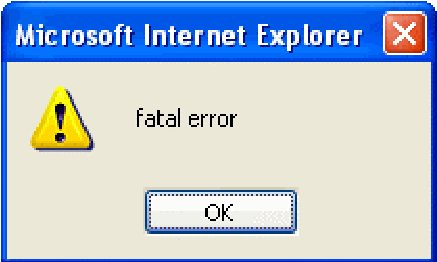

Sometimes you get an APL Error popping up in the browser, but the reported error is further on in the program than the one that really occurred.

Sometimes things are due to your coding because you forgot about some of the JSaveSDK limitations (always keep at hand the following document and always refer to it: “Description of JSaveSDK supported and unsupported APL features”.

But sometimes things are due to bugs in the JSaveSDK translation system (i.e. you do everything right and your application still does not run as expected). Fortunately, there aren’t many of these, but as for any software, that may happen.

Let’s assume I have made an error in the **frAdd.bnAdd.onClick** handler, as follows:

```apl
[113] :case'frAdd.bnAdd.onClick'
[114]     ⍝ Read screen data
[115]     name←'fmProject.frAdd.edName' ⎕wi 'text'
[116]     start←'fmProject.frAdd.edStart' ⎕wi 'text'
[117]     start←(↑¨⎕fi¨(start≠'/')⊂start)[3 1 2]
[118]     start[1]←2000+100|start[1]
[119] ⍝   start←100⊥start                  ⍝ correct line
[120]     start←⊥start                     ⍝ Error: left ⊥ argument omitted
[121]     end←'fmProject.frAdd.edEnd' ⎕wi 'text'
[122]     end←(↑¨⎕fi¨(end≠'/')⊂end)[3 1 2]
[123]     end[1]←2000+100|end[1]
[124]     end←100⊥end
[125]     progress←↑⎕fi,'fmProject.frAdd.cbProgress' ⎕wi 'text'
[126]     errmsg←RunAtServer AddTask name start end progress
[127]     :if 0∊⍴errmsg
[128]         'fmProject.frAdd.edName' ⎕wi 'text' ''
[129]         'fmProject.frAdd.edStart' ⎕wi 'text' ''
[130]         'fmProject.frAdd.edEnd' ⎕wi 'text' ''
[131]         'fmProject.frAdd.cbProgress' ⎕wi 'text' ''
[132]         'fmProject.frAdd.lStatus' ⎕wi '∆style_color' '#00AA00'
[133]         'fmProject.frAdd.lStatus' ⎕wi 'caption' 'Record added to the database!'
[134]     :else
[135]         'fmProject.frAdd.lStatus' ⎕wi '∆style_color' '#FF0000'
[136]         'fmProject.frAdd.lStatus' ⎕wi 'caption' errmsg
[137]     :end
```

I have replaced line **119** by line **120** which contains an obvious error (no left argument to the decode primitive).

If we republish and test/run the application in the browser we get the following error:

![Internet Explorer showing an APL error box: start←⊥start, DWI ACTION ERROR, VALUE ERROR, SI Main[120]](art10005070/final.jpg)

## Conclusion

In this second article on APL+WebComponent we have showed a much more sophisticated APL application ported to the Web. If you try this application, please note that it has not been written to handle limit conditions like deleting all tasks, or creating tasks with an end date so far away that it will go beyond the number of columns contained in the OWC Spreadsheet object, etc. If you try the **owc** application, don’t try to break it please.

We have explained how to use the APL+WebServicesController to automate setting up your APL+Web Component application, how to develop such an application, how to separate code which needs to run on the Client and code which needs to run on the Server, how to make code run on the Server, how to use the Microsoft OWC Spreadsheet, how to sometimes do interface work on the Server and transfer it to the Client.

We hope you have a better understanding of how to develop APL+WebComponent applications and we hope you will decide to try that soon.
