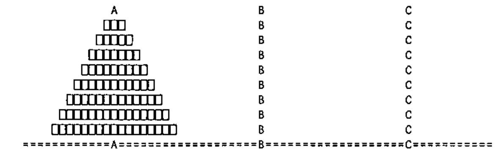

*by John Scholes, Dyalog Ltd*
{ .byline }

## Apology

I apologise to those of you who already know how to write computer programs; please skip to the next article. Anyone who has any doubts might find something of interest in what follows. First, indulge me by listening to a parable:

## A Parable

Identical twins Isambard and Deuteronomus (Izzy and Dewy to their friends – see note [1]) were separated at birth and both grew up to become APL programmers. By a strange twist of fate, for the last year or so, they have independently been experimenting with **D**, a functional subset of Dyalog APL; because they have heard that it is “cool”.

On the face of it, the code they produce is very similar, but closer examination of *how* they produce it, reveals some profound differences.

Dewy frowns and mutters while he codes, whereas Izzy seems to fizz slightly while maintaining a Zen-like tranquillity.

When faced with an unfamiliar and complex APL expression, Dewy tackles it from the right, while Izzy tends to start from the left. Sometimes Dewy even *writes* APL expressions right to left by backing up and prefixing extra bits.

Dewy uses *temporal* words when thinking about programming: “*First* do this, *then* do that …”. Izzy doesn’t.

Dewy says: “`N` *gets* one”, while Izzy says: “`N` *is* one” and Dewy refers to `N` as a *variable*, while Izzy calls it a *definition*. Dewy sees assignment as working right-to-left: a value is *put* into a named pigeonhole, whereas Izzy sees a name *indicating* an existing value to its right (see note [7]). Izzy sometimes wonders why APL uses a left, rather than a right-pointing arrow for assignment.

Dewy sees the statement: `i←3 ⋄ j←3` as assigning two *instances* of the number 3 to variables `i` and `j`, whereas Izzy considers that both names indicate the same “Platonic constant in the sky” (see note [8]). The same goes for assignments such as `sum←+` and even: `gcd←{⍵=0:⍺ ⋄ ⍵ ∇ ⍵|⍺}`.

Dewy comments code with injunctions: “`⍝ Initialise result`”, while Izzy tends to use descriptive noun phrases: “`⍝ Mean value`”.

Dewy calls the first four primitive functions “plus, minus, times and divide”, whereas Izzy says “sum, difference, product, and quotient”.

Dewy wonders how to simulate **for** and **while** loops in **D**, while it never occurs to Izzy to think about this. (When control structures were introduced, their great uncle Gottlieb (Go-ey) used to wonder how to simulate branch arrows. He still maintains that control structures are thinly disguised branches and when, for example, he looks at an **:If :EndIf** structure, he sees through it to the underlying go-to).

Dewy finds the **flowchart** an indispensable tool of thought; Izzy doesn’t.

In general, Dewy finds programming a difficult (though rewarding) experience, while Izzy wonders what all the fuss is about.

Dewy finds that, more often than not, his programs run a little quicker than those of Izzy, but that they are buggier, so he spends more time fixing them.

Although raised in separate homes, their upbringing was remarkably similar, except for a single life-changing event. One day, at a formative age, while Izzy was exploring the attic, he found a piece of framed embroidery, which proclaimed:

> Describe the result<br>
> in terms of the arguments,<br>
> using only the present tense<br>
> of the verb “to be”.
{ style="text-align: center" }

Picked out in smaller stitches around the border, was the additional rubric:

> You may use<br>
> conditional **if** clauses and<br>
> supplementary **where** clauses<br>
> to define terms.
{ style="text-align: center" }

And

> Only when you have a complete description,<br>
> should you transliterate it into code.
{ style="text-align: center" }

## End of Parable

(The characters in this story are fictional. Any resemblance to person or persons living or deceased is purely coincidental.)

## So what?

D, a subset of Dyalog APL is a modest attempt to provide a back end for **is-y** programming. It is hard to **do** anything in D, but easy to define what anything **is**.

A surprisingly large number of problems are amenable to **is-y** programming, as is a surprisingly large proportion of the components of an otherwise **do-y** program.

Perhaps also surprising: **is-y** programs have no need of:

- Loops
- Partial assignment `]←..` or `)←..`
- Modified assignment: `I+←..` (or `I←I+..`)
- Variables (which change, as opposed to definitions, which do not).

Is-y programs have no “moving parts” in the same sense that this program for the mean item of a vector has no moving parts:

```apl
mean←{(+/⍵)÷⍴⍵}
```

“The **mean** is the quotient of the **sum** and the **number** of items.”

## Eh?

Do-y and Is-y programming are also known as *procedural* and *declarative* programming respectively. Declarative languages and in particular *functional* languages are generally accepted to be easier to program and produce more stable code, than procedural ones.

But you have to treat them right.

Some of us are old enough to remember the disappointment of people who translated Basic programs into APL on the understanding that something magic would occur to make them easier to understand and go a lot faster. Not so. To reap APL’s benefits, you have to think arrays *before*, rather than *after* designing your code.

## An Example

Many years ago, before there were control structures (and by the look of it, lower-case function names), I wrote a program to generate random maze puzzles:

```text
      MAZE 5 10
+ +-+-+-+-+-+-+-+-+-+
|   |     |   | |   |
+ +-+-+-+ +-+ + +-+ +
| | |   | |         |
+ + + + + + +-+-+ +-+
|   | | | |     | | |
+ +-+ + + + + +-+-+ +
|     |     |     | |
+-+ +-+ +-+-+-+ +-+ +
|   |         |     |
+-+-+-+-+-+-+-+-+-+ +
```

As a Christmas gift to the dfns@dyalog.com email group, I translated `MAZE` into **D**. This was not a trivial task, as the original code had a fairly spaghetti-like branching structure. Only after I had finished the translation, did it occur to me to wonder what the program would look like had I (like Izzy) *thought about the problem* in a declarative way, in the first place.

Let’s contrast the two approaches to this problem:

### `MAZE`: procedural approach

- Initialise an `⍵`-sized grid of cells.
- Starting from opposite corners of the grid, alternately extend a random path by breaking down cell walls, until the paths collide. The resulting path, corner-to-corner, is the solution path of the maze.
- Starting from each unvisited cell, extend a random path until it collides with a path other than itself.
- When extending a random path, if all cells adjacent to the active (foremost) cell belong to the path being extended, choose a cell at random from those in the path and continue extending from this point.

### `MAZE`: declarative approach

An **`⍵`-maze** is the **fill** of a **solution** for an initial **`⍵`-grid**. Where:

- An **`⍵`-grid** is an `⍵`-sized grid of cells.
- A **solution** through a grid is
    > If the half-paths collide, then the grid.
    >
    > Otherwise, the solution of the extension of each half-path.
- The **fill** of a solution is:
    > If there are no unvisited cells, then the solution.
    >
    > Otherwise, the fill of the extension of a path that is an unvisited cell.
- The **extension** of a path is:
    > If the **active** cell has an adjacent cell that is not within the path, then the path extended with a random selection from such cells.
    >
    > Otherwise, the random extension of the path with a randomly chosen active cell.

## Another Example

The **Tower of Hanoi** problem may be stated and solved in both a procedural and declarative fashion:

Disks of decreasing sizes are placed on one of three spikes A, B and C, as shown:



### Procedural statement and solution of the problem

How *do* you move all of the disks, one at a time, from spike A to spike B, while avoiding placing a larger disk above a smaller one?

If n is greater than 0:

> Move n-1 disks from spike i to spare spike k, then
>
> move disk n from i to j, then
>
> move n-1 disks from spare spike k to spike j.

```apl
[0]   {ftv}hanp n;fm;to;via
[1]   :If n>0
[2]       :If 0=⎕NC'ftv' ⋄ ftv←'ABC' ⋄ :End
[3]       fm to via←ftv
[4]       (fm via to)hanp n-1
[5]       ⎕←(⍕n),':',fm,'→',to
[6]       (via to fm)hanp n-1
[7]   :End
```

### Declarative statement and solution of the problem

What *is* the sequence of moves that transfers disks, one at a time from spike A to spike B, while avoiding placing a larger disk above a smaller one?

If n is 0, then the null sequence.

Otherwise, the concatenation of:

> The sequence for moving n-1 disks from spike i to spare spike k,
>
> The move that transfers disk n from spike i to spike j, and
>
> The sequence for moving n-1 disks from spare spike k to spike j.

```apl
hand←{
    ⍵=0:0 0⍴''
    ⍺←'ABC' ⋄ fm to via←⍺
    seq1←↓(fm via to)∇ ⍵-1
    seq2←↓(⍕⍵),':',fm,'→',to
    seq3←↓(via to fm)∇ ⍵-1
    ↑seq1,seq2,seq3
}
```

## The Mathematicians’ Con Trick

Simple declarative statements, such as the solutions above, sound too good to be true. They remind us of an elegant mathematical proof that was a long time in the finding and then stated very simply. Of course the mathematician who discovered the proof didn’t do so in its final neat form; it would have been refined over time from an initially much messier version. So it is with the statement of the result in terms of its arguments. We can work with this statement, refining it over and over until we are satisfied that it is robust, simple and sufficiently general for our needs. At various points, we may commit this statement to code for testing purposes. When we find problems that cause us to amend the code, we should first correct the description accordingly, as the statement will form a powerful piece of system documentation for our program, when we later forget how it works.

## Full Circle

When we become proficient in describing the result in terms of the argument, using only the present tense of the verb *to be*, we could experiment with writing the description in a different language (French, Latin, Esperanto, …) before transliterating it into code. At some point, we might even find that a declarative *programming* language (such as appropriately commented **D**) is suitable for our needs.

## What’s the Catch?

One significant downside of **is-y** programs is that in general they run slower than corresponding **do-y** programs. For example, an indexed assignment is significantly quicker than a function to mesh together the parts of two arrays to form a third. However, because APL interpreter mongers tend to keep an eye on the way we code, the more we use such language constructs, the faster they tend to become.

## Notes

[1] Dewy pronounces his name Do-y, rather than Due-y. American readers, for whom *do* and *due* sound the same, will have the same take on this statement as with “you say tomato and I say tomato”.

[2] On a personal note: I was brought up firmly in the **do-y** school of programming. I find it extremely hard to change and when the going gets tough, I slip back into the old ways. It may be too late for me, but younger minds may be able to make the switch.

[3] The functional programming community has spent the last couple of decades inventing languages in which *all* programming is conducted in the **is-y** style. As an example, they even propose implementing operating systems this way. APL is a forerunner of the functional programming movement and many of its exponents started life as APLers.

[4] You might review the above parable as a sort of “teen magazine personality test” to see how **is-y** or **do-y** you are. Invent your own scoring system.

[5] Exercise: Old habits die hard. You will not believe the advantages of **is-y** programming unless you take the time to try it one time “for real”. Rewrite your favourite function from scratch using **is-y** techniques.

[6] See Alan Perlis’ Aphorisms: http://www.cs.yale.edu/homes/perlis-alan/quotes.htm.

[7] At a baby-naming ceremony, such as a christening, we (with the possible exception of some folk in the pop music industry) usually think of assigning the name to the baby, rather than the baby to the name.

[8] Another school of thought holds that this stuff is ref-counted. The number 3 will remain in existence as long as someone, somewhere in the world, bears it in mind. This is why it is important to teach our children to count.

[9] “Yes, but computers *do* things don’t they?” Well yes, but a lot of what they do is maths, and maths doesn’t *do* anything, it just *is*.

## Appendix 1 – A note on the conditional construct

Although they often use the same keyword: **`if`**, conditional execution differs between procedural and declarative languages.

Both constructs tend to have three working parts: the **`test`**; the **`true`** part; and the **`false`** part. For example:

> **if** test<br>
> **then** true<br>
> **else** false<br>
> **fi**

In both cases, **`test`** is an expression that evaluates to a Boolean scalar but the similarity stops there:

In a procedural language: both **`true`** and **`false`**, together with the construct as a whole are non-result-returning (void) **do-y** *statements*; in a declarative language, all three are result-returning *expressions* and in a strongly typed language, all three must be of the same type.

In natural language terms, the procedural **`true`** and **`false`** are *clauses*: “If it’s raining, put on a mackintosh, otherwise (else) wear a jacket”; in a declarative language, they are *noun phrases*: “I would like: if you have milk, then tea, otherwise coffee”.

In a procedural language, the **`else`** `false` part of the construct may be omitted: “if it’s raining, put on a mackintosh”; in a declarative language such an omission would render the sentence incomplete: “I would like: if you have milk, then tea” (“Else what?”).

The **C** language has distinct procedural and declarative conditionals:

```c
if (test) true; else false;   // procedural.

(test ? true : false)         // declarative.
```

Classical **APL** may use indexing or pick as a declarative conditional, although as the language is *strict*, both sides of the condition are evaluated and then one is discarded:

```apl
(⎕io+test)⊃false true
```

In **D**, the declarative conditional is implemented by the **guard**:

```apl
test:true ⋄ false
```

(\*) Strictly speaking, a declarative conditional could omit the `else` clause if the type of the conditional were `(void)`. However, the market for void-returning clauses is fairly slim: given that there are no side effects, it is hard to imagine the purpose of such a clause.

## Appendix 2: A short note on the Declarative Programming Style

Declarative Programming, of which Functional Programming is a subset, of which *pure* D is a sub- subset, differs from the more traditional Procedural Programming style in that, in the latter we are obliged to provide a procedure for the construction of a result, whereas in the former, we merely declare what the result is to be. APL was one of the first languages to show that the declarative style is feasible and was cited as such in John Backus’ seminal paper [Backus 1978].

An example of the declarative style is the APL “program” for the arithmetic mean of a numeric vector:

```apl
mean←{          ⍝ The arithmetic mean of a vector IS the:
    (+/⍵)÷⍴⍵    ⍝ quotient of the sum and number of its items.
}
```

Notice that the function comments form a single sentence of the form: subject, copula, predicate. The “body” of the function is a noun phrase. Contrast this with the comments for a primitive procedural language:

```apl
    ∇ z←mean vec;i;tot ⍝ The mean of a vector IS
[1]   tot←0            ⍝ FIRST, ZERO total, THEN
[2]   i←⍴vec           ⍝ SET index to number of items, THEN
[3]  loop:→i↓done      ⍝ BREAK loop if finished, otherwise
[4]   tot←tot+i⊃vec    ⍝ INCREMENT total by next item THEN
[5]   i←i-1            ⍝ DECREMENT index and THEN
[6]   →loop            ⍝ LOOP back for next item.
[7]  done:z←tot÷⍴vec   ⍝ The result IS the quotient of ...
    ∇
```

Notice that the way we read procedural programs, tends to be rife with temporal words: *first* do this, *then* do that; *repeat* so-and-so *until* such-and-such; *variable* what’s-its-name *becomes* something-or-other; ….

The temporal sense of the code is further reinforced by the use of ‘destructive’ verbs such as *zero, set, increment* and *decrement*. You might think this a little unfair and that we could have commented the first couple of lines with: “Total *is* 0; index *is* the number of items …”, but we would then be forced to contradict this, for example in line[5] by trying to say: “index *is* one less than index”, which is clearly nonsense.

Declarative programs, on the other hand, have no sense of the passage of time; everything just *is*.

Not that any of this is in itself a bad thing, but such words are indicative of the program’s having *state*. The beauty of a program without state is that, as there are no “moving parts”, little can go wrong.

A similar point is made about the background of the little **Min** language (see *www/dyalog.com/dfnsdws/min_index.htm*). With its roots in Church’s Lambda Calculus [Church 1941], Min uses the terms *successor* and *predecessor* in preference to: *increment* and *decrement*. Min’s primitive function + is equivalent to D’s `{1+⍵}`:

> “Incidentally, using the terms *successor* and *predecessor* as opposed to *increment* and *decrement* stems from having a *denotational* rather than *operational* view of a function. In other words, a function is seen as denoting the mapping between the sets that comprise its domain and range, rather than as a prescription for the operation that converts one into the other. To take a specific example: Min’s + doesn’t increment its argument; it leaves it alone and denotes its successor as result. Given this view, words from the subset of nouns that can be used as determiners (first of, reverse of, …), seem more appropriate than transitive verbs as names for functions. Specifically, *sum, difference, product* and *quotient* would appear preferable to: *add, subtract, multiply* and *divide*”.

It is important not to misunderstand all this emphasis on language. Our choice of words in describing a process is often indicative or symptomatic, of our internal mental model. However, being careful to use the “right” words, does not of itself, improve the model: curbing the symptoms doesn’t cure the disease, although there is some evidence that rationalised behaviour is gradually incorporated. Avoiding sexist, racist, ageist … language does not automatically qualify me as being free of that particular -ism, but it’s a good start.

A first step might be to read APL expressions, and write APL expressions that can be read, from left to right. Again taking `mean←{(+/⍵)÷⍴⍵}` as an example: the declarative left-to-right reading of the code is in the end simpler than the procedural right-to-left reading: “Take the shape of the vector and divide it into the sum of the items”.

Notice that the declarative version of `mean` isn’t compromised by splitting it up a little with local definitions (strictly speaking, not “local variables” as nothing varies).

```apl
mean←{          ⍝ The arithmetic mean of a vector IS:
    tot←+/⍵     ⍝ (Let <tot> BE the sum of the items and
    num←⍴⍵      ⍝       <num> BE the number of items) in
    sum÷num     ⍝ the quotient of the two".
}
```

A reasonable definition of a **D** function in this context is “an expression of `⍺` and `⍵` preceded by 0 or more local definitions”. Given this, it is sometimes helpful to read the code backwards, bottom to top: “The arithmetic mean of a vector *is* the quotient of `sum` and `num`, where `num` *is* the number and `sum` *is* the sum of the items”. In fact, because there are no side-effects in such a definition, it doesn’t really matter in which order the expressions are evaluated, so long as all referenced values are available at the time of the evaluation. In the early 1970s there were a number of rather sensationalist statements in the computer press, along the lines of: “Researchers are designing programming languages in which you can shuffle the source card deck”.

## References

Backus, J., 1978. “Can Programming Be Liberated from the Von Neumann Style? A functional Style and Its Algebra of Programs”. Comms of the ACM 21, No. 8, pp 613-641 (1978).

Church, A., 1941. The Calculi of Lambda Conversion. Princeton University Press.

*http://www.dyalog.com/dfnsdws/min_index.htm*

## Acknowledgements

Thanks are due to:

> John Daintree for pointing out that declarative (is-y) **`if`**s must have an **`else`**.
>
> Stephen Taylor for suggesting that APL might have chosen the *right arrow* for assignment.
>
> Maria Wells for overhearing note [9].

## Revisions

This note was first published at the Dyalog APL conference in Naples Beach, Florida in November 2004 and revised in April 2005.
