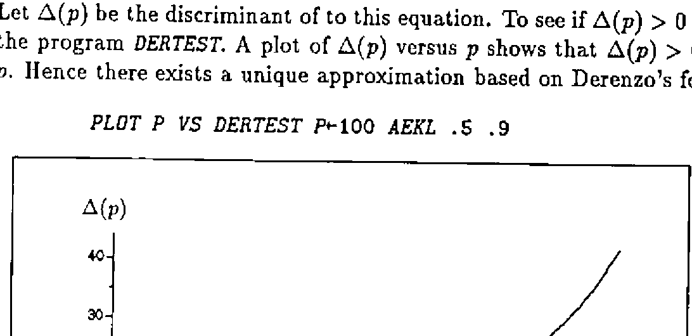

*by Dietrich Trenkler, University of Osnabrück, Germany*
{ .byline }

## A cubic equation with derived forms

Let us be given the equation

\begin{equation*}
Ax^3 + Bx^2 + Cx + D = 0, \quad A \ne 0.
\end{equation*}

Dividing by \(A\) leads to its *normal form*

\begin{equation*}
x^3 + ax^2 + bx + c = 0 \quad ,
\end{equation*}

where

\begin{equation*}
a = B/A, \quad b = C/A, \quad c = D/A.
\end{equation*}

Substituting \(x = y - \frac{a}{3}\) finally renders the *reduced form*

\begin{equation*}
y^3 + py + q = 0
\end{equation*}

where

\begin{equation*}
p = b - \frac{a^2}{3}
\end{equation*}

and

\begin{equation*}
q = c + \frac{2a^3 - 9ab}{27}.
\end{equation*}

## Cardano’s rule

Define the *discriminant* by

\begin{equation*}
\Delta = \left(\frac{q}{2}\right)^2 + \left(\frac{p}{3}\right)^3.
\end{equation*}

Further let

\begin{equation*}
u = \sqrt[3]{-\frac{q}{2} + \sqrt{\Delta}}
\end{equation*}

and

\begin{equation*}
v = \sqrt[3]{-\frac{q}{2} - \sqrt{\Delta}}.
\end{equation*}

Depending on the sign of \(\Delta\) *Cardano’s rule* distinguishes three cases to solve the reduced form, [1].

- \(\Delta < 0\) (*casus irreducibilis*): The three real solutions are

    \begin{align*}
    y_1 &= 2\sqrt{\frac{|p|}{3}}\cos\frac{\phi}{3} \\
    y_2 &= -2\sqrt{\frac{|p|}{3}}\cos\left(\frac{\phi - \pi}{3}\right) \\
    y_3 &= -2\sqrt{\frac{|p|}{3}}\cos\left(\frac{\phi + \pi}{3}\right)
    \end{align*}

    where

    \begin{equation*}
    \phi = \arccos\left(\frac{-\dfrac{q}{2}}{\sqrt{\left(\dfrac{|p|}{3}\right)^3}}\right)
    \end{equation*}

- \(\Delta = 0\): There are three real solutions, two of them being identical. They are given by

    \begin{align*}
    y_1 &= u + v \\[3ex]
    y_{2,3} &= -\frac{u + v}{2}
    \end{align*}

- \(\Delta > 0\): There is one real solution and two complex ones. They are given by

    \begin{align*}
    y_1 &= u + v \\[3ex]
    y_2 &= -\frac{u + v}{2} + \frac{\sqrt{3}}{2}(u - v)i \\[3ex]
    y_3 &= -\frac{u + v}{2} - \frac{\sqrt{3}}{2}(u - v)i
    \end{align*}

The program `CARDANO` can be used to get the solutions of any cubic equation.

## Approximating \(\Phi^{-1}(p)\)

Let \(\Phi\) be the distribution function of a standard normal distribution, i.e.

\begin{equation*}
\Phi(z) = \int_{-\infty}^{z} \frac{1}{\sqrt{2\pi}} e^{-t^2/2}\,dt.
\end{equation*}

Recently, Derenzo [2] and Lin [3] considered approximations to \(\Phi(z)\). Derenzo established the approximation

\begin{equation*}
\Phi(z) \approx \begin{cases}
\frac{1}{2}e^{-p_D(-z)} & , \quad z \le 0 \\
1 - \frac{1}{2}e^{-p_D(z)} & , \quad z > 0
\end{cases}
\end{equation*}

where

\begin{equation*}
p_D(t) = \frac{83t^3 + 351t^2 + 562t}{165t + 703},
\end{equation*}

see also [4].

Lin’s method amounts to

\begin{equation*}
\Phi(z) \approx \begin{cases}
\frac{1}{2}e^{-p_L(-z)} & , \quad z \le 0 \\
1 - \frac{1}{2}e^{-p_L(z)} & , \quad z > 0
\end{cases}
\end{equation*}

with

\begin{equation*}
p_L(t) = 0.717t + 0.416t^2.
\end{equation*}

Its advantage is the fact that a simple formula is available to approximate \(z_p\) with \(\Phi(z_p) = p\). It is given by

\begin{equation*}
z_p \approx \frac{-0.717 + \sqrt{0.514089 + 1.644a(p)}}{0.832} = z_{pL}
\end{equation*}

where \(a(p) = -\ln(2(1 - p))\).

Inverting Derenzo’s formula is not so obvious, since for \(p > 0.5\) we have to solve

\begin{equation*}
83x^3 + 351x^2 + (562 - 165a(p))x - 703a(p) = 0.
\end{equation*}

Let \(\Delta(p)\) be the discriminant of to this equation. To see if \(\Delta(p) > 0\) we used the program `DERTEST`. A plot of \(\Delta(p)\) versus \(p\) shows that \(\Delta(p) > 0\) for all \(p\). Hence there exists a unique approximation based on Derenzo’s formula.

```apl
PLOT P VS DERTEST P←100 AEKL .5 .9
```



The program `IDERENZO` computes the approximation \(z_{pD}\) for a vector of values \(p \in (0,1)\).

Although inserting Derenzo’s values in Cardano’s rule leads to a very clumsy formula its implementation is straightforward and yields excellent results as can be seen by comparing it to Lin’s method. The following table corresponds to that in [3] although values \(p\) greater than .9995 have been taken into account. It reveals the fact that the absolute relative error \(rz\) of the new approximation is never greater than 0.34% for all values of \(p\).

| \(p\) | \(z_p\) | \(z_{pD}\) | \(z_{pL}\) | \(rz_D\) (%) | \(rz_L\) (%) |
|---:|---:|---:|---:|---:|---:|
| 0.500000 | 0.000000 | 0.000000 | 0.000000 | 0.000000 | 0.000000 |
| 0.600000 | 0.253347 | 0.253261 | 0.269179 | 0.033907 | 6.249075 |
| 0.700000 | 0.524401 | 0.524515 | 0.542005 | 0.021740 | 3.357063 |
| 0.800000 | 0.841621 | 0.841877 | 0.854404 | 0.030447 | 1.518867 |
| 0.900000 | 1.281552 | 1.281774 | 1.285662 | 0.017374 | 0.320770 |
| 0.950000 | 1.644854 | 1.644962 | 1.643760 | 0.006618 | 0.066510 |
| 0.975000 | 1.959964 | 1.959978 | 1.956721 | 0.000701 | 0.165453 |
| 0.990000 | 2.326348 | 2.326287 | 2.323588 | 0.002614 | 0.118620 |
| 0.995000 | 2.575829 | 2.575744 | 2.575194 | 0.003311 | 0.024658 |
| 0.997500 | 2.807034 | 2.806943 | 2.809597 | 0.003233 | 0.091325 |
| 0.999500 | 3.290527 | 3.290463 | 3.303295 | 0.001931 | 0.388044 |
| 0.999750 | 3.480756 | 3.480712 | 3.498733 | 0.001275 | 0.516455 |
| 0.999900 | 3.719016 | 3.718998 | 3.744378 | 0.000496 | 0.681953 |
| 0.999950 | 3.890592 | 3.890592 | 3.921829 | 0.000010 | 0.802889 |
| 0.999975 | 4.055627 | 4.055642 | 4.092928 | 0.000374 | 0.919743 |
| 0.999995 | 4.417173 | 4.417211 | 4.469071 | 0.000858 | 1.174914 |

## References

[1] Bartsch, H.J. (1971) *Mathematische Formeln*, Buch- und Zeit-Verlagsgesellschaft mbH, Köln.

[2] Derenzo, S.E. (1977) *Approximations for Hand Calculators Using Small Integer Coefficients*, Mathematics of Computation **31**, 214-225.

[3] Lin, Jinn-Tyan (1989) *Approximating the Normal Probability and its Inverse for Use on a Pocket Calculator*, Appl. Statist. **38**, 69-70.

[4] Velleman, P.F and Hoaglin, D.C. (1981) *Applications, Basics, and Computing of Exploratory Data Analysis*, Duxbury Press, Boston.

## Appendix: The Programs

```apl
∇Δ←DERTEST p;AP;A;B;C;D;P;Q;a;b;c;Δ
[1] AP←-⍟2×1-p
[2] A←83 ⋄ B←351 ⋄ C←562-165×AP ⋄ D←¯703×AP
[3] a←B÷A ⋄ b←C÷A ⋄ c←D÷A
[4] P←b-a×a÷3 ⋄ Q←c+(÷27)×(2×a*3)-9×a×b
[5] Δ←((Q÷2)*2)+(P÷3)*3
∇

∇R←IDERENZO p;a;b;c;p;q;D;u;v;A
[1] A←-⍟2×1-p
[2] a←351÷83 ⋄ b←(562-165×A)÷83 ⋄ c←¯703×A÷83
[3] p←b-(a×a)÷3
[4] q←c+((2×a*3)-9×a×b)÷27
[5] D←(0.25×q×q)+(p÷3)*3
[6] u←(×u)×(|u←(¯0.5×q)+D*0.5)*÷3
[7] v←(×-v)×(|v←(0.5×q)+D*0.5)*÷3
[8] R←u+v-a÷3
∇

∇R←CARDANO ABCD;a;b;c;p;q;D;u;v;f
[1] a←ABCD[2]÷ABCD[1]
[2] b←ABCD[3]÷ABCD[1]
[3] c←ABCD[4]÷ABCD[1]
[4] p←b-(a×a)÷3
[5] q←c+((2×a*3)-9×a×b)÷27
[6] a←-a÷3
[7] →( ¯1 0 1=×D←(0.25×q×q)+(p÷3)*3)/DS0,DE0,DG0
[8] DS0:'Three real solutions:'
[9] R←2○f←(¯2○(¯0.5×q)×((|p÷3)*3)*¯0.5)÷3
[10] R←a+(2×(|p÷3)*0.5)×R,-2○f+ ¯1 1 ×○÷3
[11] →0
[12] DE0:'Three real solutions (two identical):'
[13] R←a+(-u+u),R,R←u←(0.5×q)*÷3
[14] →0
[15] DG0:'Two conjugate complex and one real solution:'
[16] u←(×u)×(|u←(¯0.5×q)+D*0.5)*÷3
[17] v←(×-v)×(|v←(0.5×q)+D*0.5)*÷3
[18] R←u+v+a
[19] (⍕a-0.5×u+v),' + ',(⍕(0.5×3*0.5)×u-v),'i'
[20] (⍕a-0.5×u+v),' - ',(⍕(0.5×3*0.5)×u-v),'i'
∇
```
