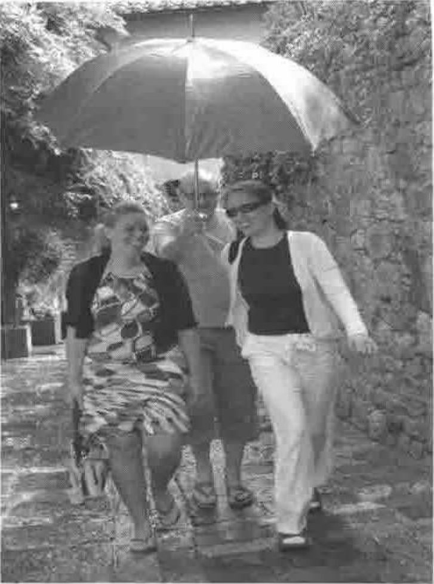
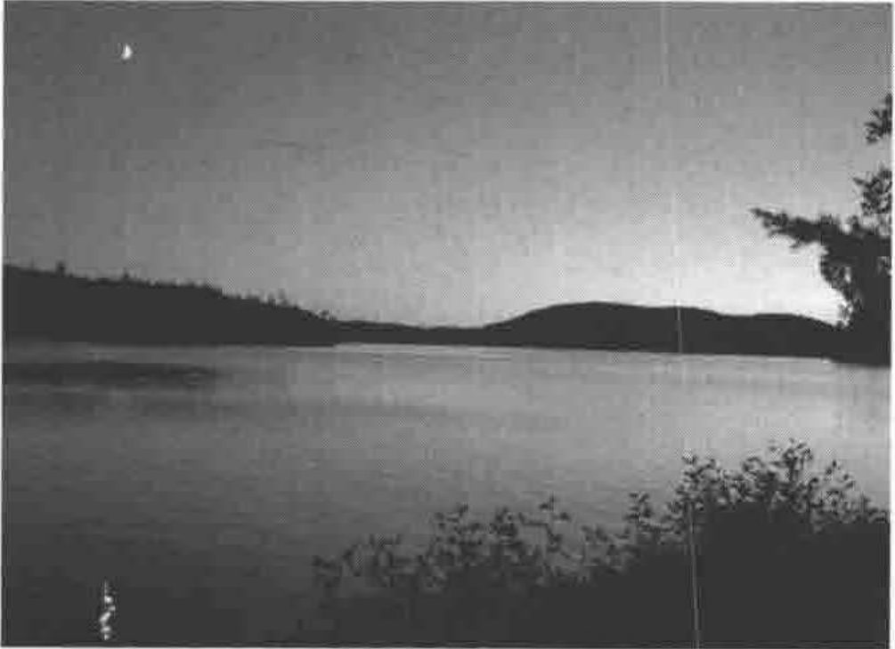

**The June Moot at San Quirico d’Orcia and Minnowbrook in the Fall**

**Girls in the Rain in Tuscany** 
Back from lunch at the San Quirico Moot
{ .caption }

**Moonset over Blue Mountain Lake** 
From the deck outside the classroom
{ .caption }
