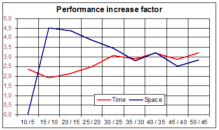

*R.E. Boss*
{ .byline }

**Abstract** A partition is a way of writing an integer as a sum of positive integers. \[1\] \[2\] So 5=3+1+1 is a partition of 5. The subject of this paper is an efficient algorithm in J \[3\] to generate all partitions of a given number.
{ .abstract }

## Introduction

This analysis was inspired by a remark of Roger Hui \[4\] “This computation of partitions in 3 lines is the neatest I have seen over the years (although it is not the most efficient).”

Since you can add any number of zeros to a partition, the zeros are left out. Furthermore, in this paper a partition is given in non-ascending order, to identify the uniqueness of the partition. A partition can usually be given as a sequence of the (smaller) numbers with any separator, such as 3,1,1.

If you start generating partitions, you get for the numbers 1, 2 and 3 the partitions 1; 1 1 and 2; 1 1 1, 2 1 and 3 respectively.

Let P(n) be the set of all partitions of n and P(n,k) be the partitions of n starting with k or less \[5\]. Obviously P(n,n) = P(n). In formula this looks like

> P(n) = { x = (x<sub>0</sub>, x<sub>1</sub>, …) \| n ≥ x<sub>0</sub> ≥ x<sub>1</sub> ≥ x<sub>2</sub> ≥ … ≥ 0; n = Σx<sub>i</sub> }

and

> P(n,k) = { x = (x<sub>0</sub>, x<sub>1</sub>, …) \| k ≥ x<sub>0</sub> ≥ x<sub>1</sub> ≥ x<sub>2</sub> ≥ … ≥ 0; n = Σx<sub>i</sub> }

We can group the partitions of n according to their starting number, which can be 1 to n. If a partition of n starts with number, say k, the rest is a partition of n-k starting with number k or less. This can be put in formula (A) as follows.

\(A\) P(n) = { (k, x<sub>0</sub>, x<sub>1</sub>, …) \| 0 &lt; k ≤ n; x ∈ P(n-k,k) } where x = (x<sub>0</sub>, x<sub>1</sub>, …)

Notice that for k ≥ ½n we have k ≥ n-k, so P(n-k,k) = P(n-k).

We develop a J program, based on this analysis.

## Using smaller partitions

In generating P(n), we suppose for all 0&lt;k≤m&lt;n that P(m,k) is known already. Applying equation (A), that is, for all 0&lt;k≤n we generate P(n,k) from P(n-k,k) by prefixing k, and since P(n,n) = P(n), we are done.

Assume the partitions of n to be boxed according to the starting number; see Fig. 1. So we start (at the right hand side) with `<<i. 1 0` being the partition of 0, followed by the partition of 1 etc.

Now suppose we have a list of boxes, each box containing the (boxed) partitions, as in Fig. 1, and we want to generate the partitions of the next number, n=5. This is done in a few steps.

*Figure 1.*

```apl
+---------+-------+-----+---+--+
|+-------+|+-----+|+---+|+-+|++|
||1 1 1 1|||1 1 1|||1 1|||1|||||
|+-------+|+-----+|+---+|+-+|++|
||2 1 1  |||2 1  |||2  ||   |  |
||2 2 0  ||+-----+|+---+|   |  |
|+-------+||3    ||     |   |  |
||3 1    ||+-----+|     |   |  |
|+-------+|       |     |   |  |
||4      ||       |     |   |  |
|+-------+|       |     |   |  |
+---------+-------+-----+---+--+
```

First we generate the list of starting numbers of the partitions of 5, here 1…5, which is produced by `>:@i.@#` applied to the given list of boxes. This will be the left argument of our verb to be developed, the right argument being the list of boxes. See Fig. 2, where both arguments are depicted.

*Figure 2.*

```apl
            +---------+-------+-----+---+--+
            |+-------+|+-----+|+---+|+-+|++|
1 2 3 4 5   ||1 1 1 1|||1 1 1|||1 1|||1|||||
            |+-------+|+-----+|+---+|+-+|++|
            ||2 1 1  |||2 1  |||2  ||   |  |
            ||2 2 0  ||+-----+|+---+|   |  |
            |+-------+||3    ||     |   |  |
            ||3 1    ||+-----+|     |   |  |
            |+-------+|       |     |   |  |
            ||4      ||       |     |   |  |
            |+-------+|       |     |   |  |
            +---------+-------+-----+---+--+
```

Second, with these left and right arguments, the numbers left are matched to the boxes right and within that box, this number is used to select the first partitions. So from the first, only the first box is selected, from the second the first 2 etc. Of course, no more sub boxes can be selected than available. So the selections are done by `(<.#){.]` and are visualised in Fig. 3.

*Figure 3.*

```apl
+---------+-------+-----+---+--+
|+-------+|+-----+|+---+|+-+|++|
||1 1 1 1|||1 1 1|||1 1|||1|||||
|+-------+|+-----+|+---+|+-+|++|
|         ||2 1  |||2  ||   |  |
|         |+-----+|+---+|   |  |
+---------+-------+-----+---+--+
```

Then the numbers of the left argument are appended with the content of the selected partitions in the boxes by `>:@i.@# ([ ,.&.> (<.#){.])&.> ]` producing the boxes as in Fig. 4.

*Figure 4.*

```apl
+-----------+---------+-------+-----+---+
|+---------+|+-------+|+-----+|+---+|+-+|
||1 1 1 1 1|||2 1 1 1|||3 1 1|||4 1|||5||
|+---------+|+-------+|+-----+|+---+|+-+|
|           ||2 2 1  |||3 2  ||     |   |
|           |+-------+|+-----+|     |   |
+-----------+---------+-------+-----+---+
```

But the items in the sub boxes should be taken together since they start with the same number, which is done by `>:@i.@# ;@ ([,.&.> (<.#){.])&.> ]` resulting in the output from Fig. 5.

*Figure 5.*

```apl
+---------+
|1 1 1 1 1|
+---------+
|2 1 1 1  |
|2 2 1 0  |
+---------+
|3 1 1    |
|3 2 0    |
+---------+
|4 1      |
+---------+
|5        |
+---------+
```

Now this outcome is exactly the set of partitions of 5 in the required form, so must be boxed and then can be prefixed to the boxes from which we started. Then we are in the same situation, but now with one number further, see Fig. 6.

*Figure 6.*

```apl
+-----------+---------+-------+-----+---+--+
|+---------+|+-------+|+-----+|+---+|+-+|++|
||1 1 1 1 1|||1 1 1 1|||1 1 1|||1 1|||1|||||
|+---------+|+-------+|+-----+|+---+|+-+|++|
||2 1 1 1  |||2 1 1  |||2 1  |||2  ||   |  |
||2 2 1 0  |||2 2 0  ||+-----+|+---+|   |  |
|+---------+|+-------+||3    ||     |   |  |
||3 1 1    |||3 1    ||+-----+|     |   |  |
||3 2 0    ||+-------+|       |     |   |  |
|+---------+||4      ||       |     |   |  |
||4 1      ||+-------+|       |     |   |  |
|+---------+|         |       |     |   |  |
||5        ||         |       |     |   |  |
|+---------+|         |       |     |   |  |
+-----------+---------+-------+-----+---+--+
```

So, the whole process is given by

```apl
,~ <@(>:@i.@# ;@([ ,.&.> (<.#){.])&.> ])
```

Starting with the initial empty partition of 0 and repeating this the required number of times, this finally leads to

```apl
(,~ <@(>:@i.@# ;@([ ,.&.> (<.#){.])&.> ])) ^:y <<i.1 0
```

If we distinguish the different processes we get

```apl
nrs0=: >:@i.@#                      NB. numbers to be generated
apsl0=: [ ,.&.> (<.#){.]            NB. select partns, append nmbrs
new0=: ,~ <@( nrs0 ;@apsl0 &.> ])   NB. new partitions to be added
part0=: 3 : ';;{. new0^:y <<i.1 0'  NB. the complete script
```

## An alternative with single boxing

We change the foregoing construction by representing all partitions of number n in a matrix with n columns, where shorter partitions are padded with zeros, like in Fig. 7, the analogue of Fig. 6, with the order of the boxes and the order in the boxes reversed. At the left hand side the partitions of 0, than of 1, etc. until finally the partitions of 5 are given.

*Figure 7.*

```apl
++-+---+-----+-------+---------+
||1|2 0|3 0 0|4 0 0 0|5 0 0 0 0|
|| |1 1|2 1 0|3 1 0 0|4 1 0 0 0|
|| |   |1 1 1|2 2 0 0|3 2 0 0 0|
|| |   |     |2 1 1 0|3 1 1 0 0|
|| |   |     |1 1 1 1|2 2 1 0 0|
|| |   |     |       |2 1 1 1 0|
|| |   |     |       |1 1 1 1 1|
++-+---+-----+-------+---------+
```

Now the processes are adapted as follows.

```apl
nrs1=: (-i.)@#                      NB. numbers to be generated
apsl1=: [,. (>: {."1)# ]            NB. select partns, append nmbrs
new1=: , [: <@; nrs1 apsl1 &.> ]    NB. new partitions to be added
part1=: 3 : '> {: new1 ^:y <i.1 0'  NB. the complete script
```

## Not all smaller partitions are needed

Let’s have a closer look at this example of the partition of 5. If you look at Figures 0 and 2, it is obvious that not all smaller partitions are selected. From the partitions of 4 only the first one is used and from those of 3 only the first 2. So why not consider only those partitions which are needed for the final result?

From equation (A) we conclude that for generating all partitions of n, we need only the partitions P(k) and P(n-k,k) with 0 &lt; k ≤ ½n to combine with n-k and k respectively. As an example, we take n=6, for P(6) we need the partitions P(5,1), P(4,2), P(3,3) = P(3), P(2), P(1).

First we determine max(k,n-k) for k = 1…n-1, which is done by `(](-<.>:@])i.)@<:` and append these numbers to the original number, see Fig. 8.

*Figure 8.*

```apl
   (],(](-<.>:@])i.)@<:) 6
6 1 2 3 2 1
```

Now these numbers, taken from right to left, are used to generate the partitions P(6), P(5,1), P(4,2), P(3,3) = P(3), P(2), P(1), also in the order from right to left. This is done as follows:

```apl
6 1 2 3 2 1 P(0)
6 1 2 3 2 P(1) P(0)
6 1 2 3 P(2) P(1) P(0)
6 1 2 P(3) P(2) P(1) P(0)
6 1 P(4,2) P(3) P(2) P(1) P(0)
6 P(5,1) P(4,2) P(3) P(2) P(1) P(0)
P(6) P(5,1) P(4,2) P(3) P(2) P(1) P(0)
```

It is obvious that P(5,1) and P(4,2) are quite a bit less numerous than P(5) and P(4).

Since we want to apply *scan* instead of *power*, we have to box these numbers first and then append the empty partition (of 0): see Fig. 9.

*Figure 9.*

```apl
   (<<i.1 0),~<"0(],(](-<.>:@])i.)@<:) 6
+-+-+-+-+-+-+--+
|6|1|2|3|2|1|++|
| | | | | | ||||
| | | | | | |++|
+-+-+-+-+-+-+--+
```

Scanning these boxes from right to left generates P(0), P(1), P(2), P(3) = P(3,3), P(4,2), P(5,1), P(6) subsequently. To explain this process, suppose we have reached P(3), as depicted in the last box of Fig. 10, together with the remaining parameters 6, 1, 2.

*Figure 10.*

```apl
+-+-+-+--------------+
|6|1|2|+-----+---+-++|
| | | ||1 1 1|1 1|1|||
| | | ||2 1 0|2 0| |||
| | | ||3 0 0|   | |||
| | | |+-----+---+-++|
+-+-+-+--------------+
```

The process applies to the last two boxes, being

```apl
        +--------------+
        |+-----+---+-++|
+-+     ||1 1 1|1 1|1|||
|2| and ||2 1 0|2 0| |||
+-+     ||3 0 0|   | |||
        |+-----+---+-++|
        +--------------+
```

Opening the boxes first and selecting the items from the right as indicated by the left: `({.)&.>` we get

```apl
+-----+---+
|1 1 1|1 1|
|2 1 0|2 0|
|3 0 0|   |
+-----+---+
```

From the left argument, the (smaller) integers are generated (1 2) and from each of the boxes in the right argument those partitions are selected by

```apl
   (>:@i.@[ (((>:{."1) # ])&.>) {.)&.>
```

giving

```apl
+-----+---+
|1 1 1|1 1|
|     |2 0|
+-----+---+
```

The numbers from the left side now are prepended with those on the right side and the appropriate unboxing and boxing is done. This gives

```apl
+-------+
|1 1 1 1|
|2 1 1 0|
|2 2 0 0|
+-------+
```

This output is prepended to the right hand side. In J this becomes

```apl
   (],~ >:@i.@[ <@;@:(([,.(>:{."1)#])&.>) {.)&.>
```

The corresponding output is in Fig. 11.

*Figure 11.*

```apl
+----------------------+
|+-------+-----+---+-++|
||1 1 1 1|1 1 1|1 1|1|||
||2 1 1 0|2 1 0|2 0| |||
||2 2 0 0|3 0 0|   | |||
|+-------+-----+---+-++|
+----------------------+
```

If this is applied to all the elements of the initial noun – see Fig. 9 – then we get the script

```apl
(],~ >:@i.@[ <@;@:(([,.(>:{."1)#])&.>) {.)&.>/ …
                       (<<i.1 0),~<"0(],(](-<.>:@])i.)@<:) 6
```

and the output as in Fig. 12. The first box contains the desired partitions of 6.

*Figure 12.*

```apl
+--------------------------------------------+
|+-----------+---------+-------+-----+---+-++|
||1 1 1 1 1 1|1 1 1 1 1|1 1 1 1|1 1 1|1 1|1|||
||2 1 1 1 1 0|         |2 1 1 0|2 1 0|2 0| |||
||2 2 1 1 0 0|         |2 2 0 0|3 0 0|   | |||
||2 2 2 0 0 0|         |       |     |   | |||
||3 1 1 1 0 0|         |       |     |   | |||
||3 2 1 0 0 0|         |       |     |   | |||
||3 3 0 0 0 0|         |       |     |   | |||
||4 1 1 0 0 0|         |       |     |   | |||
||4 2 0 0 0 0|         |       |     |   | |||
||5 1 0 0 0 0|         |       |     |   | |||
||6 0 0 0 0 0|         |       |     |   | |||
|+-----------+---------+-------+-----+---+-++|
+--------------------------------------------+
```

If we split this script into comprehensible verbs we get

```apl
NB. initial sequence
init=: (<<i.1 0) ,~ <"0@(] , (] (- <. >:@]) i.)@<:)
NB. select partns, prepend numbers
ppsl=: >:@i.@[ <@;@:(([ ,. (>: {."1) # ])&.>) {.
exit=: >@{.@>                            NB. desired partition
part2=: [: exit [: (],~ ppsl)&.>/ init  NB. complete script
```

## Performance

Performance is measured for n = 5 10 15 20 25 30 35 40 45 50. If we measure only the relative performances of `part0` and `part1` with respect to the third verb `part2`, we get the following figures for execution time respectively:

```apl
  5     10     15     20     25     30     35     40     45     50
1.49   2.19   2.86   3.28   3.08   2.52   2.18   2.17   1.94   1.97
1.32   1.84   1.80   2.28   2.48   2.98   3.11   3.56   3.24   3.40
```

with averages 2.4 and 2.6 respectively.

For execution space the relative performances of `part0` and `part1` compared to `part2` are respectively:

```apl
  5     10     15     20     25     30     35     40     45     50
1.32   1.31   1.35   1.37   1.43   1.52   1.65   1.65   1.74   1.75
1.10   1.17   1.36   1.57   1.75   1.88   2.06   1.97   2.13   2.14
```

with averages 1.5 and 1.7 respectively.

The factor of increase of execution time and space of `part2` with each step of 5 extra, is shown in the following chart.



As can be seen, the partition of each 5 more elements costs about 3 times more.

## Notes

1.  *Partition* Eric W Weisstein, in *MathWorld*, a Wolfram Web Resource, <http://mathworld.wolfram.com/Partition.html>

2.  *The Art of Computer Programming* , Donald Knuth, Vol. 4, Fascicle 3, p.37. Knuth uses non-negative integers for the addends, although “… the zero terms are usually suppressed.”

3.  <http://www.jsoftware.com>

4.  <http://www.jsoftware.com/pipermail/general/2005-June/023191.html>

5.  So all the numbers of any element of P(n,k) are less than or equal to k.
