## Abstract

In the APL Theory of Human Vision [1], [2], Langlet introduced a computational model, the “neurobit network.” This model, it is claimed, is able to (1) detect periodic replications in data and (2) compress boolean vectors, reducing their lengths without loss of information. The neurobit network is shown here to be capable of detecting certain kinds of replicated patterns, but that this capability depends critically on the data to be processed having dimensions that are powers of two. The success of data compression is also shown to depend similarly on the dimensions of the data to be compressed; however, the key functions of the neurobit network are structure-preserving mappings over boolean matrices of any dimensions and periodicities. These functions give surprisingly simple spectral analyses of certain L-system fractals. Langlet used “old” APL notation in his papers. J is used here. The J script in the Appendix contains all the verbs needed to allow experimentation with the ideas presented in this paper.

## Introduction

One of the more intriguing figures in the APL Theory of Human Vision presentation [1] is this one:

*[Figure lost: the image file is no longer on vector.org.uk and no copy has been found.]*

*The neurobit-system detects periodic replications and compresses them, filling both the JCT and the JHT with 0s.*

What this figure seems to promise is almost too good to be true: an extremely simple system that simultaneously detects periodic replications in data and compresses them. The triangular structure shown here is a fanion. [2], [8] Given a length n input sequence, the `fanion` verb generates successive rows of a fanion with `n-1` iterations of `s=.(1}.s)~:(_1}.s)`, where is `s` is initially the input sequence and also the top row of the fanion. The top row of the fanion in this case is the character string `'AA'` rendered as the corresponding binary character codes. Reading down the left edge of the fanion we have Langlet’s Helix transform (or helicon) of the sequence. Reading up the right edge of the fanion, we have Langlet’s Cognitive transform (or cogniton) of the sequence \[3,4,5\]. The value of each element in a given row is the exclusive-or (J `~:`) of the two elements immediately above it. As Langlet pointed out [2], all of these relationships are retained when the fanion is rotated 120º in either direction, that is, the left edge is the Helix transform of the top row, the right edge is the Cognitive transform of the top row, and each element in a given row is the exclusive-or of the two elements immediately above it.

## Data compression

We will consider the compression claim first. The given sequence of 16 items representing the binary codes for the string `'AA'` is compressed to just the six topmost elements of both the left and right edges of the fanion. All the 1’s are at the upper end of the result, followed by a tail consisting solely of 0’s. To uncompress the result, the 0’s tail must be concatenated back onto one of the compressed sequences—left or right—and then the appropriate transform must be applied (Helix if the left edge of the fanion was used, Cognitive if the right edge was used). It is therefore necessary to remember how many zeroes there are below the compressed segment along each edge. The original string `'AA'` requires two bytes, but the compressed string also requires two bytes: one to hold the (encoded) replicated element 'A' and another to hold a count of the zeroes that need to be tacked onto it in order to uncompress the string. Thus, no compression is achieved; however, the transforms of longer strings of identical characters such as `'AAAA'` and `'AAAAAAAA'` still require only two bytes, thus achieving a degree of compression that increases with the length of the string. The Helix and Cognitive transforms will also compress binary representations of character strings such as `'ABAB'`, in which groups of characters are repeated.

More generally, when the input to `fanion` consists of a length n sequence (`n` a power of 2), and the sequence contains `2^k` repetitions of a vector of length `n%2^k`, an all-1’s row will be generated before row `n÷%2^k` (in 0-origin indexing). Because the value of each item in a given row is the exclusive-or of the two items immediately above it, the row following the all-1’s row, and the remaining rows, will be all zeroes. This accounts for the increasing degree of compression as the number of replicated units is increased. For example, `fanion` applied to a length eight vector containing four repetitions of 1 0 produces the following result:

```
fanion 1 0 1 0 1 0 1 0
            
            1 0 1 0 1 0 1 0
             1 1 1 1 1 1 1
              0 0 0 0 0 0
               0 0 0 0 0
                0 0 0 0
                 0 0 0
                  0 0
                   0
```

As expected, row 1 is all 1’s, and row 2 and the remaining rows consist entirely of zeroes.

This is good, but a limitation of this method is that the compression observed in Langlet’s fanion picture disappears if only the seven low-order bits of the ASCII code for `'A'` are used to form the initial sequence, seven bits being all that are necessary to select any one of the 128 ASCII characters. The input to `fanion` in this case is a length 14 sequence consisting of two 7-bit codes, and the output has no long, all-0’s tail:

```
fanion 1 0 0 0 0 0 1 1 0 0 0 0 0 1
            
            1 0 0 0 0 0 1 1 0 0 0 0 0 1
             1 0 0 0 0 1 0 1 0 0 0 0 1
              1 0 0 0 1 1 1 1 0 0 0 1
               1 0 0 1 0 0 0 1 0 0 1
                1 0 1 1 0 0 1 1 0 1
                 1 1 0 1 0 1 0 1 1
                  0 1 1 1 1 1 1 0
                   1 0 0 0 0 0 1
                    1 0 0 0 0 1
                     1 0 0 0 1
                      1 0 0 1
                       1 0 1
                        1 1
                         0
```

The success of data compression with `fanion` depends on the input being a sequence that consists solely of repetitions of a binary vector whose length is a power of two. Compression cannot be guaranteed if this condition is not met. It is therefore something of an overstatement of the capabilities of fanion and the Helix and Cognitive transforms, to say

> signals with redundant, repetitious, or palindromic structures appear compressed in the helicon H and the cogniton C, i.e., both the helical and the cognitive transform compress information. [8]

Redundant or palindromic signals may be compressed if they are composed of units whose length is some power of two. Thus fanion is not a general method for data compression.

Although the fanion is an interesting object in its own right – see, e.g., [2], [8] – it does not play an essential role in the discussion to follow. The important results of fanion are rather attributed to the Helix and Cognitive transforms, which can be computed in several different ways. What we want to see are the useful results these transforms can deliver, regardless of how they are computed.

## Detection of periodic replication

For any theory of human vision, we will certainly want to know how effective the operations of the theory are in detecting important features of two-dimensional scenes. The ability of the Helix and Cognitive transforms to detect periodic replications is particularly well demonstrated when they are applied to highly structured binary images.

```
viewmat stripes 4
```

The simplest 2D test case is a square image consisting of equal-width black and white stripes. Here, for example, is a 16x16 image consisting of sixteen stripes, each one unit wide:

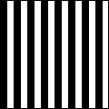

```
   viewmat hel2 stripes 4
```

The 16x16 Helix transform of this image consists of a single white element (1) in an otherwise black (0’s) matrix. The white element is located at (0,1), that is, in position 1 in row 0:

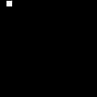

Because the Helix transform is its own inverse, applying it to the transformed image will reproduce the original striped image. Further investigation shows that the Helix transform of any binary image that (a) is square, (b) has a side whose length is a power of two, and (c) consists only of alternating equal-width black and white stripes will have a single 1 in the first row if the stripes are vertical, in the first column if the stripes are horizontal. The 1 will be located in a row or column position whose index is a power of two, which will also be the relative width of each stripe. We conclude, then, that the 2D Helix transform can detect the simplest cases of periodic replication.

A more searching test of the Helix transform’s ability to detect periodic replication is provided by Mark Dow’s collection of 2x2 block-replacement L-system patterns [6] (these patterns are also discussed by Wolfram [10]). These tiling patterns, some quite pretty, are all built in the same way: a 2x2 matrix of 1’s and 0’s is given as a start pattern, and then successively larger square matrices are built by replacing each 1 with a copy of the start pattern and each 0 with a copy of another, usually different, 2x2 matrix. Successively higher orders of Langlet’s G (geniton) matrix can be built in exactly this way (see, e.g., the `G` verb in the Appendix). The start pattern is

```
1 1
1 0
```

To generate the next higher order geniton, replace each 1 with the start pattern and each 0 with a 2x2 all-zeroes matrix, which produces this 4x4 matrix:

```
1 1 1 1
1 0 1 0
1 1 0 0
1 0 0 0
```

This process can be continued indefinitely, producing larger and larger matrices, all of which will be square with side a power of two. In [6] Dow shows the different tiling patterns that can be generated by all possible combinations of two 2x2 boolean matrices. Thus we can know in every case exactly how a given tiling pattern was generated. The task of the Langlet transforms here is to detect the underlying replications. The transforms reveal replication in several different ways depending upon the particular combination of 2x2 matrices selected to create an image. A complete analysis of all of Dow’s 2x2 tiling patterns may be found at <https://www.cs.uml.edu/~stu/>.

## Thue-Morse plane

For the next test case we will use an image that has a relatively complex visual appearance but, as it turns out, a very simple Helix transform: the Thue-Morse plane, a familiar fractal image.

```
viewmat TM 4
```

Here, for example, is the 16x16 Thue-Morse plane:

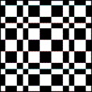

```
viewmat hel2 TM 4
```

Applying the Helix transform to the plane produces this image:

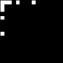

The 1’s are at positions 0, 1, 2, 4, and 8 in both the first row and first column. This analysis of the plane yields a set of nine 16x16 “basis images” or “basic forms”, each corresponding to a specific 1 in the transformed image. A particular basis image is obtained simply by applying the Helix transform to a matrix containing 1 in the selected position and 0’s everywhere else. When the basis images are combined element-wise with ~: the result is the original Thue-Morse plane. The first basis image, corresponding to the 1 at position (0,0) in the transformed matrix, is an all-1’s (i.e., completely white) square. The only effect of the all-1’s basis image is to complement an image, that is, reverse black and white. The remaining basis images correspond to 1’s in the first row and first column. As expected, these images consist of black and white stripes whose relative widths are 1, 2, 4, and 8. The relative width of the stripes in a given basis image is the same as the row or column index of that image’s 1 in the transform. Here is the set of basis images of the 16x16 Thue-Morse plane:

- 

- 

- 

- 

- 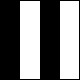

- 

- 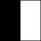

- 

- 

The Helix transform reveals replication of both horizontal and vertical stripes at four different scales. This is a global picture of the large-scale replicated elements from which the original image is built, rather than the local 2x2 block replacements. The Helix and Cognitive transforms are non-local, like the FFT, Walsh-Hadamard, and Discrete Sine and Cosine transforms, and unlike the Discrete Wavelet transform.

## Hadamard matrix

The Hadamard matrix is one of the most interesting simple test cases because it has a relatively complex visual appearance but a very simple Helix transform. It is also of interest because it has applications in image and signal processing and in cryptography, among other areas.

```
viewmat hadamard 4
```

Here, for example, is a 16x16 Hadamard matrix represented as a binary image:

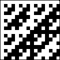

```
viewmat hel2 hadamard 4
```

Applying the Helix transform to this matrix produces this image:

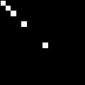

In the transformed image, the 1’s lie on the main diagonal at positions (0,0), (1,1), (2,2), (4,4), and (8,8). This analysis of the Hadamard matrix yields a set of five basis images, each corresponding to a 1 in the transformed image. The first basis image, corresponding to the 1 at position (0,0) in the transformed matrix, is an all-1’s (i.e., completely white) square. The remaining 1’s in the transformed image are in positions (1,1), (2,2), (4,4), and (8,8) along the main diagonal. Each of these 1’s corresponds to an instance of Dow’s “Corner Periodic” system:

- 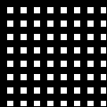

- 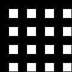

- 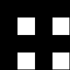

- 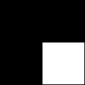

The transform reveals replication of an inverted “L” shape at four different scales.

Most of the other tilings in Dow’s collection have Helix transforms in which the replication patterns are obvious but involve a large number of basis images, far too many to permit showing all of them as was done above with the Thue-Morse plane and the Hadamard matrix. Interested readers can view all of the original images in Dow’s presentation [6]. These patterns can also be generated with the `tile` function listed in the Appendix.

## Beyond 2x2 block replacement images

The Helix and Cognitive transforms appear to be exquisitely designed to detect multiple levels of replication in the kinds of binary images represented by Dow’s collection. This is not surprising because both transforms were originally based on Langlet’s G matrix, which is itself a member of that collection. However, we immediately encounter difficulties when we apply the transforms to images that are not square with a side whose length is a power of two, or to images in which the period of replication is not a power of two.

With appropriate zero-padding, any matrix can be embedded in a larger, square matrix whose side is a power of two. But the transformed images produced from padded matrices are generally disappointing visually as compared with those above. The case pictured below is typical. On the left is a 27x27 Sierpinski “Carpet,” on the right its Helix-transformed image. The Carpet pattern here was padded out to 32x32 before it was given as the argument to the Helix transform. As can be seen, the transformed image is larger as a result of the padding:

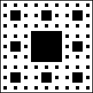

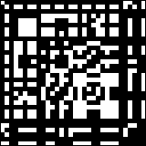

The replication pattern is easily visible in the Carpet image, but the transformed image appears to reveal nothing beyond mirror symmetry around the main diagonal. This situation arises out of the mismatch between the Langlet transform matrices, which consist of elements that are replicated at scales that are powers of two, and the 3x3 tiling patterns, which consist of elements that are replicated at scales that are powers of three. While the rows and columns of a 2x2 tiling pattern are precisely aligned with the rows and columns of Langlet transform matrices (which are themselves 2x2 tiling patterns), this can never occur with 3x3 tiling patterns.

Langlet offers another way to deal with images like the Carpet. In [4] he observes that the relevant transformational properties of the G matrix are preserved even if both the last row and the first column are repeatedly removed. G can therefore be pared down in this way until the length of its side is the same as the length of the vector to be transformed. The resulting matrix can then be used to compute the Helix or Cognitive transform of a matrix the length of whose side is not a power of two. The Helix transform of the Carpet computed in this way looks like this:

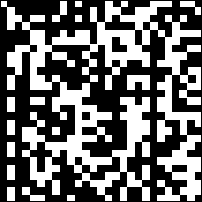

Little or nothing indicating replication leaps off the screen or page, not even the mirror symmetry around the main diagonal found in the previous example; however, the transforms of 3x3 block replacement tiling patterns computed with either of the above methods still have exact inverses. The original image can be recovered intact from the transformed image simply by applying the transform to its own result (and trimming off the padding, if any). The Helix and Cognitive transforms are morphisms over boolean arrays, a characteristic that may prove significant for applications of these transforms.

## Discussion

As we already saw in the data compression example at the beginning of this paper, many of the nice properties of the Helix and Cognitive transforms depend on the dimensions and periodicities of their arguments being powers of two. In Langlet’s system the problems that arise when the dimensions and/or periodicities are not powers of two cannot be dealt with through conventional image or signal processing techniques (e.g., windowing, smoothing, filtering, etc.). The reason is that Langlet insisted that essentially all operations in his system have exact inverses so that no information could ever be lost in the course of a computation. To achieve the goal of completely reversible computation, it is necessary to follow Langlet’s droll mini-manifesto and scrupulously respect the “the rights of a bit:” [7]

**Déclaration des Droits du Bit (Antwerp, 1994)**

0\. All bits contain information, so they deserve respect.  
1\. Every small bit is a quantum of information.

Nobody has the right to crunch it.  
Nobody has the right to smooth it.  
Nobody has the right to truncate it.  
Nobody has the right to average it with it(s) neighbour(s).  
Nobody has the right to sum it, except modulo 2.

Given the severity of these requirements and the nature of the problems encountered, it is not clear how to proceed with the work described here. The practical problem with respect to this work is somehow to connect Langletian parity logic to the domains of image and signal processing. I had hoped that Langlet had gone further in this direction than what I knew from his publications; however, in conversations after his passing with people who knew him I learned that he had never made the connection. He was one of the first to see and to point out the need for a new approach to computation, but he was destined not to enter the promised land himself. More recently, Wolfram’s magisterial A New Kind of Science [10] has pointed in directions in which progress might be made. One will recognize in this book many of the themes that Langlet was developing, although there is no mention of Langlet in it.

## Appendix - J verbs

### HEL

```
NB.   Langlet's Helix transform of a boolean vector.
NB.   The length of the vector must be a power of 2.

hel =: ] ~: / . *. [: Gv #
```

### RHEL

```
NB.    fast Helix transform of a boolean vector. The length of the 
NB.    vector must be a power of 2. This verb is much faster than
NB.    "hel". 

rhel =: 3 : 0
   half =. (#y) % 2
   if. half > 2 do.
      left =. rhel half {. y
      right =. rhel half }. y
      left , left ~: right
   elseif. 1 do.
      left =. hel half {. y
      right =. hel half }. y
      left , left ~: right
   end.
)
```

### COG

```
NB.   Langlet's Cognitive transform of a boolean vector.
NB.   The length of the vector must be a power of 2.

cog =: [: |. [: rhel |.
```

### HEL2

```
NB.   Two-dimensional Helical transform of a boolean matrix.
NB.   The matrix argument must be square with side a power of 2.

hel2 =: 3 : 0
   n =. #y
   y =. ,y
   ( n , n ) $ rhel y
)
```

### COG2

```
NB.   Two-dimensional Cognitive transform of a boolean matrix.
NB.   The matrix argument must be square with side a power of 2.

cog2 =: 3 : 0
   n =. #y
   y =. ,y
   ( n , n ) $ cog y
)
```

### SUPPRESS

```
NB.    Suppresses the last row and first column of matrix argument y.
NB.    If y is Langlet's G matrix, its transformational properties
NB.    will be preserved.

suppress =: [: }. "1 }:
```

### NSUPPRESS

```
NB.    Suppresses the x last rows and x first columns of matrix
NB.    argument y. If y is Langlet's G matrix, its transformational
NB.    properties will be preserved. This verb can be used to pare a G
NB.    matrix down so it can be used to transform a vector whose length
NB.    is not a power of 2.

nsuppress =: 4 : 0
   suppress ^: x y
)
```

### PAD

```
NB.    Pads matrix y with 1{x rows and 0{x columns of zeroes. This verb
NB.    can be used to pad a non-square matrix or a square matrix whose
NB.    side is not a power of 2 so that it may be used as the argument
NB.    of a Langlet transform.

pad =: 4 : 0
   n =. #y
   r =. y ,. ( n , 0 { x ) $ 0
   r , ( ( 1 { x ) , ( n + 0 { x ) ) $ 0
)
```

### FANION

```
NB.    Generates the "fanion" of a boolean vector

fanion =: 3 : 0
   n =. #y
   s =. y
   r =. <y
   count =. 1
   while. count < n do.
      s =. ( 1 }. s ) ~: ( _1 }. s )
      r =. r , <s
      count =. count + 1
   end.
   ( n , 1 ) $ r
)
```

### G

```
NB.    generates Langlet's G ("geniton") matrix. The argument
NB.    is the length of the side. Thanks to Howard Peelle for this
NB.    very compact algorithm.
    
Inputs =: i.`(#1:)

G =: ~:/\^:Inputs
```

### Gv

```
NB.    generates Langlet's G matrix rotated around its 
NB.    vertical axis. This is required for the Helix 
NB.    transform. The argument is the length of the side.

Gv =: |."1 @ G

NB.               2x2 BLOCK REPLACEMENT TILINGS

NB. L-system matrices mentioned in the text constructed by block
NB. replacement. The argument to each verb is the number of levels of
NB. replacement. The result is a matrix of order 2^(y+1).

NB. SIERPINSKI TRIANGLE (LANGLET'S "G")

sierpinski =: 14 0 tile ~ ]


NB. STRIPES

stripes =: 5 5 tile ~ ]


NB. THUE-MORSE PLANE

TM =: 9 6 tile ~ ]


NB. HADAMARD MATRIX

hadamard =: 14 1 tile ~ ]
```

### tile

```
NB.    Creates 2x2 tiling patterns. x is the number of iterations of
NB.    tiling to be performed. y is a length-2 vector that contains 
NB.    decimal numbers in the range 0-15 that specify the two tile
NB.    patterns to be used. The "start" pattern is the first item of y.

tile =: 4 : 0
   black =. 1 { y
   white =. 0 { y
   pat =. black makepat white
   start =. > 1 { pat
   ocount =. 0
   while. ocount < x do.
      table =. start { pat
      res =. 0 makerow table
      n =. # table
      icount =. 1
      while. icount < n do.
         res =. res , icount makerow table
         icount =. icount + 1
      end.
      start =. res
      ocount =. ocount + 1
   end.
   res
)

NB. makes a table of the two 2x2 bitmaps required for tiling
NB. x = decimal number (0-15) representing the start pattern
NB. y = decimal number (0-15) representing the 0-replacement
        pattern)

makepat =: 4 : 0
   black =. 2 2 $ 2 2 2 2 #: x
   white =. 2 2 $ 2 2 2 2 #: y
   (<black) , <white
)


NB. extracts from nested table x the cell at coordinates y

getcell =: 4 : 0
   table =. x
   row =. 0 { y
   col =. 1 { y
   ( >( <row ; col ) { table )
)


NB. Makes row x of table y into a flat 2 x n array

makerow =: 4 : 0
   row =. y getcell ( x , 0 )
   n =. #y
   count =. 1
   while. count < n do.
      row =. row ,. y getcell ( x , count )
      count =. count + 1
   end.
   row
)
```

## References

1.  Gérard Langlet. The APL Theory of Human Vision (foils). Vector, 11:3.

2.  Gérard Langlet. The APL Theory of Human Vision. APL ‘94 - 9/94 Antwerp, Belgium ACM 0-89791 -675-1 /94.

3.  Gérard Langlet. Towards the Ultimate APL-TOE. ACM SIGAPL Quote Quad, 23:1, July 1992.

4.  Gérard Langlet. The Axiom Waltz - or When 1+1 make Zero. VECTOR, 11:3.

5.  Gérard Langlet. Paritons and Cognitons: Towards a New Theory of Information. VECTOR, 19:3.

6.  Mark Dow.  
    [lcni.uoregon.edu/~dow/Geek\_art/Simple\_recursive\_systems/2-D/2x2\_2s/2x2\_2-symbol\_L-systems.html](http://lcni.uoregon.edu/~dow/Geek_art/Simple_recursive_systems/2-D/2x2_2s/2x2_2-symbol_L-systems.html)

7.  Gérard Langlet. Binary Algebra Workshop. Vector, 11:2.

8.  Gérard Langlet. Binary Algebra Workshop. Vector, 11:2.

9.  Michael Zaus. Crisp and Soft Computing with Hypercubical Calculus: New Approaches to Modeling in Cognitive Science and Technology with Parity Logic, Fuzzy Logic, and Evolutionary Computing: Volume 27 of Studies in Fuzziness and Soft Computing. Physica-Verlag HD, 1999.

10. Stephen Wolfram. A New Kind of Science. Wolfram Media, 2002.
