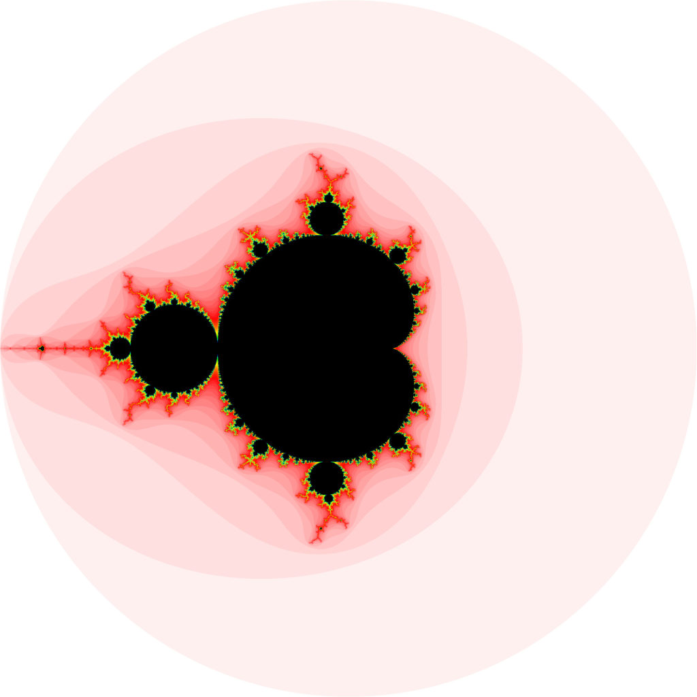
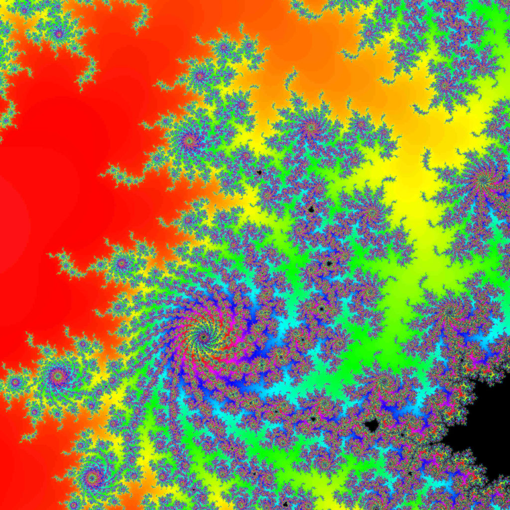
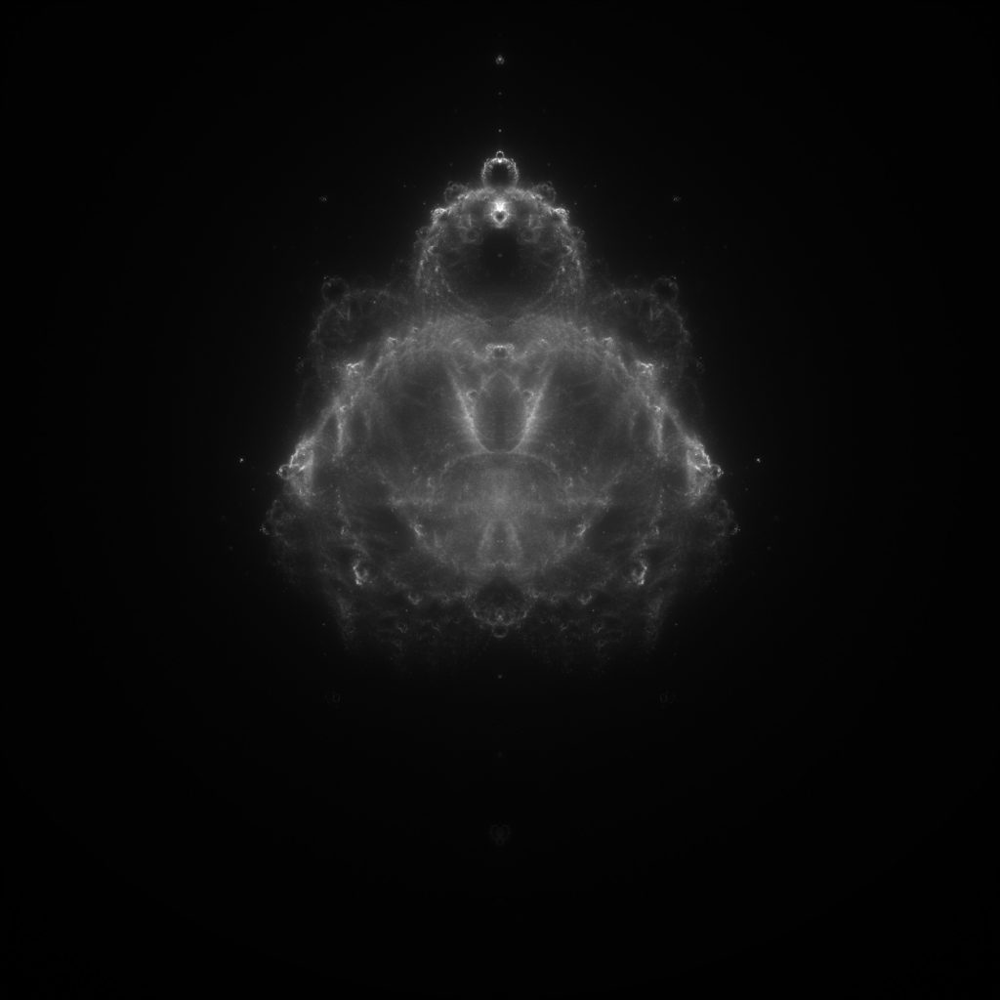

Nicolas Delcros
{ .byline }

[Buddhabrot](https://en.wikipedia.org/wiki/Buddhabrot) (wiki)

## Making images with Dyalog APL

The code demonstrated in this post is available from <https://github.com/nicolas-dyalog/Brot>. The examples below assume you have a MAXWS of at least 1GB.

Since the support of [ZLib](https://en.wikipedia.org/wiki/Zlib) by Dyalog APL v14.0 ([as `219⌶`](http://help.dyalog.com/17.0/Content/Language/Primitive%20Operators/Compress%20Vector%20of%20Short%20Integers.htm)), cross-platform generation of compressed PNG’s has become reasonably implementable, as you’ll find out if you have a glance at the [`#.Png` namespace](https://github.com/nicolas-dyalog/Brot/blob/master/Png.dyalog) in the Github link above.

## The Mandelbrot set

The [Mandelbrot set](https://en.wikipedia.org/wiki/Mandelbrot_set) is a fractal set defined by the points of the complex plane where the following series remains bounded (does not diverge to infinity):

```
      z[n+1] ← z[⎕IO] + z[n]*2
```

The usual display of the Mandelbrot set is to assign a color to each point of the complex plane that gives the escape time of the series using that point as a seed of the series (`z[⎕IO]`).

To produce an overview of the set, X/Y coordinates are between ¯2 and 2:

```
      './mandelbrot.png' #.Png.Write #.Brot.MandelbrotImage 2000 2000 ¯2 ¯2 2 2 100
```

- 

The code is quite simple: at each iteration, apply the formula. Trim points that escape and color them according to the iteration number at which they escaped, then move on to the next iteration. When the maximum number of iterations is reached, the remaining points are considered within the Mandelbrot set and colored black.

The nice thing about the Mandelbrot algorithm is that output pixel only depends on its corresponding input pixel, making the code easily parallelisable. Also, when zooming on areas of the plan, computation remains proportion to the number of input points in that area. The only limit when zooming is that the number of iterations must be raised to reveal finer details of the structure. The zooming is therefore limited by the precision of the numeric format.

To display fine details of the structure, enable color cycling for more psychedelic rendering:

```
      image←1 #.Brot.MandelbrotImage 2000 2000 ¯1.093 0.235 ¯1.091 0.237 1000
      './mandelbrot_zoom.png' #.Png.Write image
```

Because we have raised the number of iterations, and because we can’t trivially rule out members of the main cardioids of the Mandelbrot set, the zoomed image takes about half a minute to be computed.

- 

## The Buddhabrot

As lots of people toyed with the Mandelbrot approach, eventually people tried to display things differently. Rather than assigning a color to every seed of the series, one idea was to trace the paths of all the points as they diverge towards infinity – thereby ignoring points within the Mandelbrot set, which don’t diverge.

The result was named [Buddhabrot](https://en.wikipedia.org/wiki/Buddhabrot) because, When displayed with a vertical real axis, the result is somewhat reminiscent of the Buddha as traditionally represented in meditation pose. Its belly button is on the origin of the plane.

```
      './buddhabrot.png' #.Png.Write #.Brot.BuddhabrotImage 2000 2000 ¯2 ¯2 2 2 20000 20
```

- 

After about ten minutes, you’ll get the image above. Compare with the traditional Buddha representation below:


*Buddha Daibutsu, Kamakura*

There are three problems with the Buddhabrot computation.

First, it is a convolutive algorithm: to compute a single output pixel, you still need to input the whole plane, because we display all the paths of all the points.  
That means that, as opposed to the Mandelbrot algorithm, zooming on a subset of the plane takes the same computation as displaying the whole plane, and can only be implemented by cropping of the output plane.

Second, we must fully iterate a series to decide whether its path will be displayed or not. That means we can only chunk the computation across the plane, and that we cannot chunk along iterations. The consequence is that the number of iterations is fundamentally limited by the available memory, because we must retain all the iteration intermediate points, even though we may process starting points independently. With a MAXWS of 1G, APL starts struggling at about a million iterations, because it starts processing chunks of less than a dozen points. However the rendering time for a million iterations over a 2000×2000 image at density one takes about a day, and my example stops at 20000 iterations.

Last, for the same reason as the previous problem, when rendering the Buddhabrot at a given iteration number, one can not benefit from the rendering at a lower number of iterations, and resume computation based on that. That means we must restart the whole rendering for every requested number of iterations.

## Gathering the images as a video with FFMPEG

Finally, let’s display different stages of the iteration as an animation, to display the construction of the Buddhabrot as we loop through iterations of the series.

```
      '.'#.Brot.AnimatedBuddhabrot 2000 2000 20
```

About half an hour later, you will obtain the following:

[Video](https://youtu.be/rIFF6QBlkd0)

The code requires FFMPEG. On linux, simply install the ffmpeg package from your favorite distro (it’s probably already installed anyways). On Windows, download ffmpeg.exe from <https://ffmpeg.zeranoe.com/builds/> and put it in the current working directory along with the .dyalog files (or in the %PATH% if you’re feeling brave), and run the code by double-clicking on the .dyapp file so that ffpmeg.exe ends up in the current working directory of the APL session.

If you don’t have 1 hour of CPU to waste, you can generate a low-density video in a couple of minutes by doing:

```
      '.'#.Brot.AnimatedBuddhabrot 2000 2000 1
```
