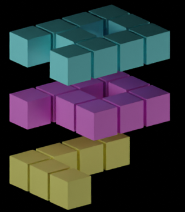
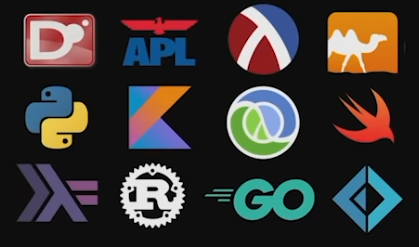
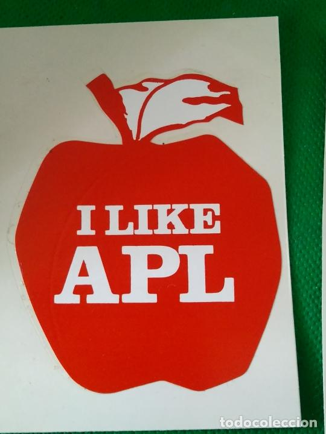
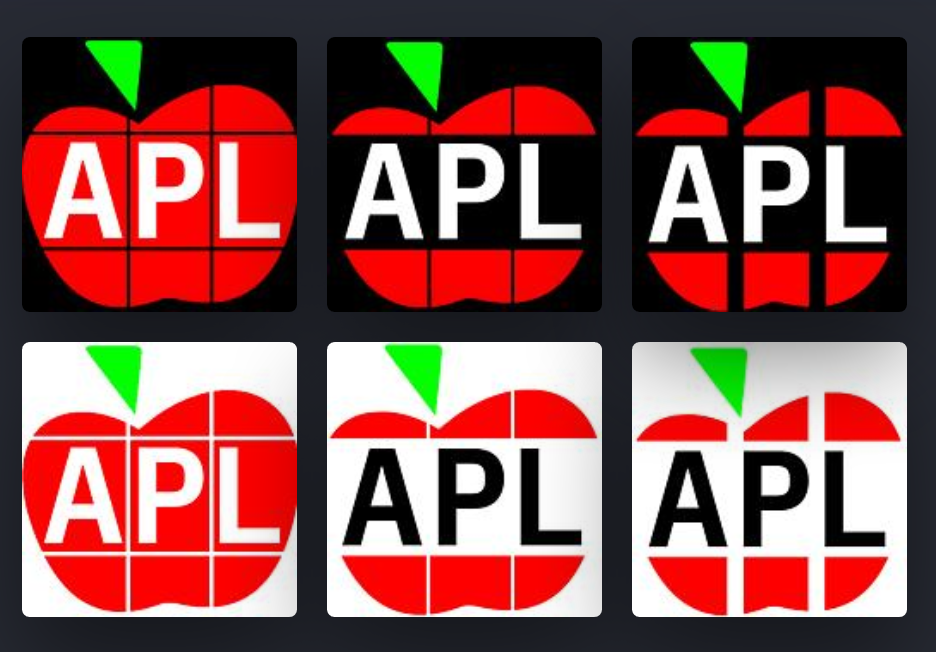
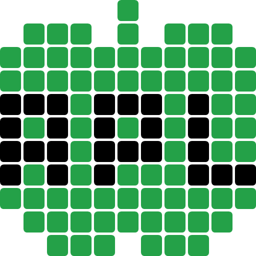
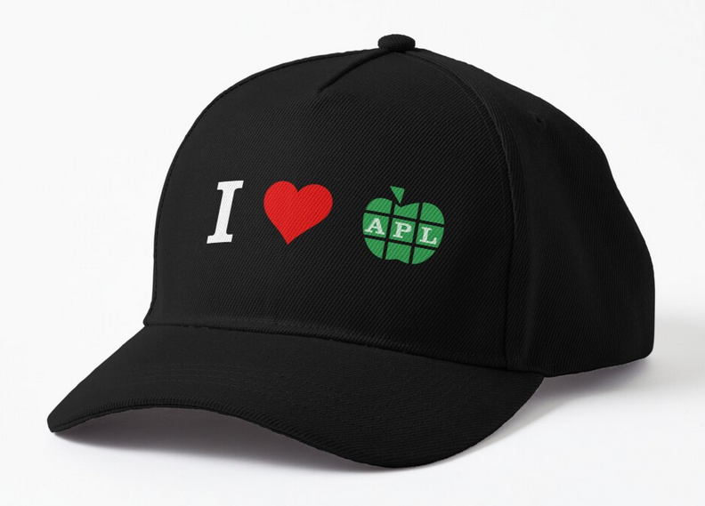
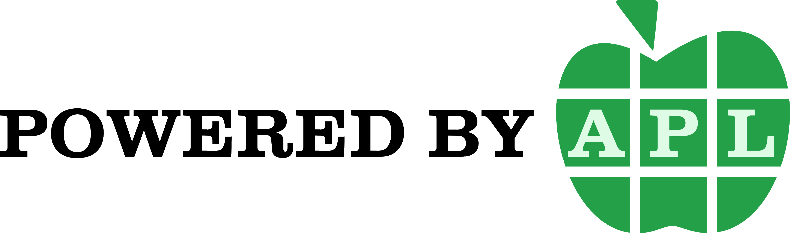

Something special has happened. It is now 55 years since APL as we know it first became available. Though various vendors and implementations had logos, APL as a whole never had one. But finally, APL joined the club of [programming languages with a logo](https://abrudz.github.io/logos/). (Fortran joined just two years ago, at the age of 63.) This is the story of how that happened.

*3D block array*

It was a long process. Since early 2020, Conor "code\_report" Hoekstra had been using the Dyalog APL application logo to represent APL — alongside implementer-agnostic logos of other programming languages — in his videos with solutions to problems from LeetCode (a platform for exercising skill in solving coding problems.) By the end of 2020, the APL Orchard chat room was replete with discussions about a logo for APL and array programming languages in general. "dzaima" (author of an [Android APL keyboard](https://github.com/dzaima/hackerskeyboard), a [Dyalog-like APL implementation](https://apl.wiki/dzaima/APL), and a companion [Android IDE](https://github.com/dzaima/APL/tree/master/AndroidIDE) that also can use TryAPL or the RIDE protocol) was very helpful in experimenting with 3D blocks of pixelated letters `APL`, but all the attempts were found to be unsuitable for use at icon sizes.

*American President Lines*

It was in November 2017 that Vihan "Downgoat" Bhargava, of [code golf](https://apl.wiki/Code_golf) fame, had asked if APL had a logo, having only found the logo of American President Lines ([Roger Hui's first "APL"](https://www.jsoftware.com/papers/eem/anecdotes.htm#15000)), which Conor had used on occasion too.

*Old APL sticker*

For at least 45 years, APLers have been using [apple-puns](https://apl.wiki/Humour#Apples), playing on the similarity in pronunciation between "APL" and "apple". Based on this, and wanting to keep hinting at support for rectangular arrays, I designed a stylised green apple, made of "pixels", colouring some of the pixels black to spell out the same low-resolution `APL` letter-shapes as had been used in the 3D blocks. This design evolved into a line drawing of an apple with a leaf in the shape of a slanted Del (`∇`). This apple was cut into pieces, representing the elements of a matrix, to hint at APL's native support for multi-dimensional arrays. These ideas happen to have been very similar to the final logo, but it would be another couple of years until the logo was established.

*Early versions of the final logo*

*Pixelated apple*

In February 2021, we were getting ready for the first [APL Seeds](https://apl.wiki/APL_Seeds), and needed a logo for it, so we adapted the outline of the apple-shaped proposal, adding seeds to it. Discussions continued sporadically throughout the summer, with variations of the apple outline. One of the alternatives prompted the idea of using a stylised Lamp-Rho-Downstile (`⍝⍴⌊`) as a way to spell "APL" — an idea that saw much popularity, and many adaptations, right up until the final logo was chosen. I brought the question of a universal APL logo up at a September 2021 [BAA webinar](https://apl.wiki/BAA_webinar). After some discussions, I created the [APL logo page on the APL wiki](https://apl.wiki/APL_logo) with a few ideas, and then we gave the community until the end of the year to submit logo concepts and [discuss them](https://apl.wiki/Talk:APL_logo). And boy, did the community participate! The page grew and grew, ending up with about 25 general designs, many of which had multiple variants.

*Merchandise*

After a month of voting, the results were revealed. Unfortunately, someone had clearly tried to game the system with over a thousand automated votes. Luckily, these votes were all identical, so thanks to having selected ranked choice voting, it was possible to ignore the fraudulent input and declare [Nested Bitmaps](https://apl.wiki/APL_logo#Nested_Bitmaps) the definite winner — by a wide margin. Next came a lengthy process of refining the logo, and a professional designer was brought in, especially to solve the issue of having two complementing logos, where we really would prefer having a single edition. Since the lettering touched the background, while needing to maintain sufficient contrast with the coloured apple, we had two versions; one with white letters and one with black letters. The designer did not manage to solve this problem, but he did *inspire* a solution; pulling each letter into its apple piece/matrix element. This allowed the apple's colour to act as a margin between the background and the letters, and the letters could then be white, and eventually slightly green-toned white, on all backgrounds. After some iterations, we were down to the final design, except for the choice of font. Would it be the blocky pixelated font to hint at APL's affinity for Boolean arrays, a modern sans-serif font, or the good old Clarendon as used for that old APL-apple sticker and on IBM's early manuals? A vote decided it, and work began to create [merchandise](https://apl.wiki/APL_merchandise) which you can now buy at cost price.

*"Powered by APL" badge*

And there you have it. A huge thank you to everyone who participated in the process! As of one month ago, APL has a logo, proudly displayed on [the Wikipedia page](https://en.wikipedia.org/wiki/APL_(programming_language)) and [ready for you to use](https://github.com/abrudz/logos/tree/main/apl) on websites, banners, advertisements, and so on. Why not adorn your projects with a "Powered by APL" badge?
