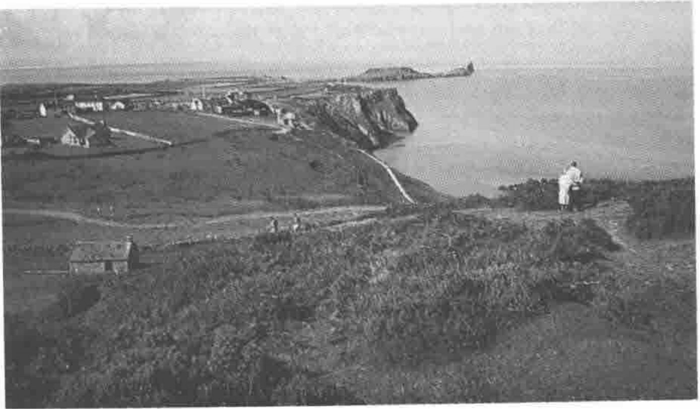

## APL in Business 18-22 July 1994 University College of Swansea

The European Business Management School in conjunction with the British APL Association is to host an international conference in Swansea next year. The title ‘APL in Business’ is an umbrella term to signify the inter-related themes of Finance, Operational Research and Statistics which can work together with the aid of modern computing power to enable more effective management. The future for APL lies in an effective synthesis of technical expertise applied by means of APL in co-operation with other software. The conference aims to bring these application areas into contact with the technical developments in operating systems, managing technologies and hardware.

Consequently we would like to take this opportunity to encourage participation from as many of our readers as possible in the following areas:

> **Finance.** Trading systems, actuarial methods, credit scoring.
>
> **Operational Research.** Rule-based systems, scheduling and rostering, management information and control systems, genetic algorithms.
>
> **Statistics.** Statistical modelling in general, experimental design and Taguchi methods. Forecasting techniques, Econometrics, Bayesian methods, Reliability analysis.
>
> **Technical.** Designing fully-functional Windows applications covering the GUI objects, the Windows DLL’s and the Windows Help engine, Working with messages, co-operative processing (using APL as one element in a suite of co-operating applications.

All papers presented at the conference will be published in a conference proceedings. In addition, selected papers will collectively form the first volume of *The APL Review*, a new international refereed journal to be launched by the British APL Association.

Sessions will take place in the Swansea Conference Centre based on the **Taliesin Arts Centre**, which houses a 350-seat auditorium, an art gallery, bookshop and bank. All the facilities of the European Business Management School will be available to conference members throughout. The College has its own sports centre including squash, badminton and tennis courts and a heated indoor swimming pool adjacent to the campus, making the college a most attractive conference centre. The organizers are committed to making this a most enjoyable and fruitful conference — all you have to do is to commit yourself to come and participate!

Further details will shortly be available in a ‘Call for Papers’. If you would like to help with the organization of the conference please contact one of us as soon as possible.

> Adrian Smith 
> Brook House, Gilling East, YORK YO6 4JJ Tel: 04393-385
>
> Alan Sykes, 
> European Business Management School, 
> Singleton Park, Swansea SA2 8PP 
> Tel: 0792-295296, Fax: 0792-295626.
