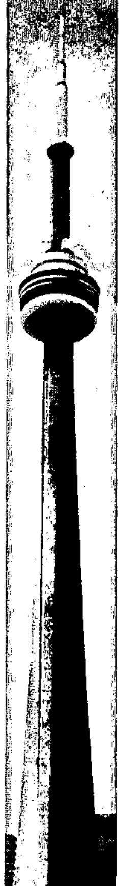
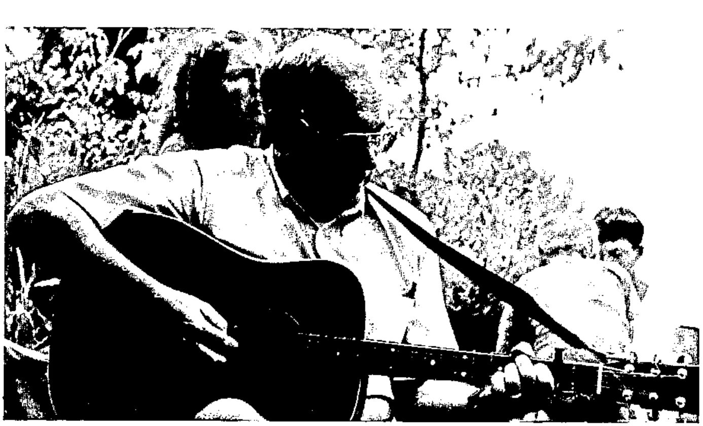

*by Anthony Camacho*
{ .byline }

## Toronto

May I thank the APL 93 Committee and their helpers on behalf of the APL community? APL 93 had the best programme of any conference I've attended. That made reporting it hard work. In four and a half days from 8:30 to 17:00 there were three sessions when I was not in one presentation or another; the reports seem to me more earnest than usual. Perhaps I tired myself out. I'm sure the people who ran it did.

Toronto is a very civilised place. Most of it is clean, it has excellent publicly run public transport, it tolerates minorities, there are few street beggars and they are not too threatening, it is safe to walk about at midnight, much of it is even beautiful and it has the most amazing warren of underground walkways and malls which extend about a mile north east from the CN Tower. You can see a lot of Toronto in a heat wave or the cold of winter without suffering from its climate.

The conference, too, was civilised. It ran with the minimum overt control. Many sessions even omitted a chairman. The weather was unusually hot and this made hurrying a bad idea; people often arrived late, especially for the more distant sessions. Luckily the presentation theatres were air conditioned but the room where Donald McIntyre's tutorial was held was not! J is hard enough without sweat tricking down one's face.

The civic reception was run-of the mill as these things go. The location was quite extraordinary. The city hall is a very avant garde building and I was glad of the chance to see inside it. The banquet at Casa Loma offered an excellent range of types of food. The place itself was fascinating to explore and the entertainments varied enough to please everyone. The picnic at Algonquin island was just the sort of relaxed occasion I needed. A pity so few people accepted the implied invitation on the bottom of the instructions how to get there "Yes, you may swim in the lake."

## Vector

Nominally Jonathan Barman handed over the editor's chair to me after Volume 10 number 1 was printed. The material for volume 10 number 2 was nearly all collected and edited for me. Thank you Jonathan and the working group. Please do go on helping.

There is no charge for entries in the product guide. We are very keen to make it comprehensive and will welcome new entries. Even if you only provide your services in Vancouver or Valparaiso, please send us your entry for the product guide. Vector has a large international readership. What have you got to lose?

---

### Little-known Feats of APLers:

*Chris Lincoln, Joint Chairman of APL 89 in New York, has other talents. This July he sailed his windsurfer all round Fire Island in one day. Readers should know that Fire Island, though narrow, is over thirty miles long! Chris reckons that, with tacking, he sailed about eighty miles and the trip took nine hours.*

---

**Jim Brown Entertains at the Conference Picnic**
