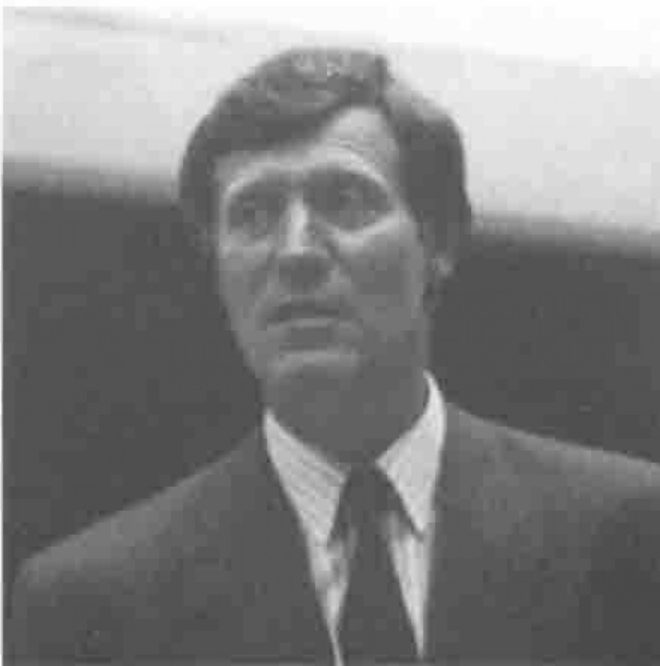
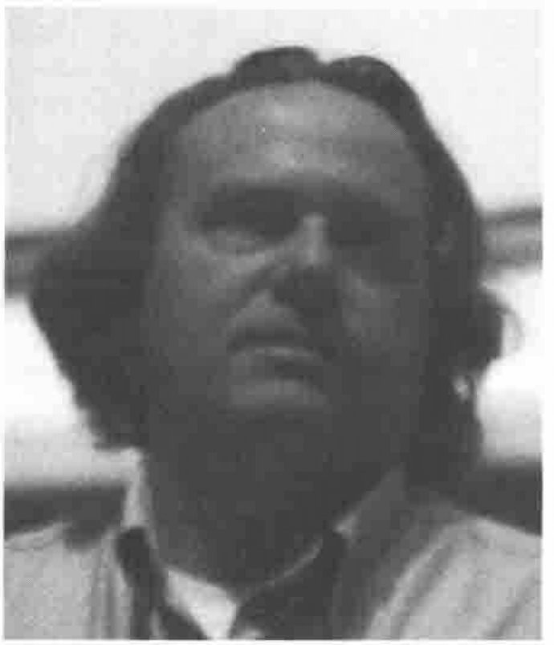

*reported by Anthony Camacho and Jonathan Barman*
{ .byline }

Although billed as a workshop, this was really a panel session with the usual introductory statements followed by audience comment and questions. We had not realised that there were two David Crossleys in the APL world, one who lives in Canada and one who lives in France. The Canadian David Crossley introduced the speakers: James Wheeler, David Liebtag, Peter Donnelly and Eric Iverson. He explained that he had written two systems in APL\*PLUS II using quad-WIN and that he doesn't want to learn many windows GUI standards. He supposes the rest of us are equally reluctant and so we need to agree a GUI standard.

## Initial Statements

**James Wheeler**, who has been with STSC/Manugistics for 16 years, told us that Manugistics were committed at least to emulate the behaviour of the current features of their interpreters, so users could write new systems in confidence that they would continue to run in upgrades. He was dissatisfied with the current GUI interface and felt that we are far from reaching a final solution. It would be inappropriate to set a standard until we are sure it will last.

**Peter Donnelly**, who has been with Dyadic for 14 years and has worked on GUIs for the last three of them, tended to agree that it was too early to standardise. He felt that the GUI interface eventually needed to be part of the language, and to be portable would have to work not only with Windows, Motif and Presentation Manager but with any GUI system. A standard would have to apply to all GUIs. At present competition and the desire to have a competitive edge are strong forces against standardisation. In the process of looking at many GUI toolsets Peter has found that *Objects* and *Events* are easy in APL but that *Properties* are unnatural to it and the Dyadic team had implemented them as quad-functions. The *Methods* used in Visual BASIC for specifying circle, rectangle and so on are also unnatural in APL. Peter thinks that Visual BASIC has got it wrong. Dyadic found that call-back functions are easy and natural in APL functional structure and so overall APL is a great way to do GUI programming.

**David Liebtag** had ten years of applications experience before his work with the APL group for the last three or four years; he has recently been working on the OS/2 user interface. He said he admires the Dyadic approach but thinks it is wrong, and so he agrees that it is too early to standardise. Simple GUI interfaces are easy but a full one may be very complex indeed. As in consequence it will be expensive, it is not worth doing unless it is going to last; a two year life would not pay back the investment. In David's opinion the functionality should be in the operating system, not in the language, so IBM's current emphasis was to provide lots of easy-to-use utilities.

**Eric Iverson** has been an APL implementer for twenty-five years and has been working on the GUI interface for two years. He spoke about the philosophy behind the ISI window driver. The primary design goal was to keep the interface at a high level so that it is easy to use (N.B. NOT like C). A second goal is to make the driver portable to Motif and other windowing systems. So ISI began with the essentials to cover the needs of standard applications omitting the less often needed facilities but allowing the design to be extended when ISI users needed more. Using a windows driver meant that the same mechnism could be used for both J and APLIWIN and so the commands to it are written in a scripting language like PostScript or SQL. This approach preserves the integrity of APL and also makes it possible to sell the driver separately so that it could be driven from any other APL or any other language. ISI intends to improve the windows driver by adding features, but not too many low level controls as ISI does not want to compete with Visual BASIC or Smalltalk. Eric hoped the DLL as an independent product would be put on sale.

## Contributions from the Audience and Panel Responses

Ray Polivka confessed he was floundering; he had not been given a clear idea what it is that is involved in standardisation and still wanted to know.

Eke van Batenburg of the University of Leiden wants to be able to port GUI workspaces between PCs, Macs and Ataris. APL porting is easy: GUI porting is hard. He suggested that if we wait too long before standardising we will get another bad split, like that between boxed and nested arrays.

Jim Ryan said that he had been using APL for 25 years and that he would be satisfied if APL communicated with the GUI in a standard way. His preference is for the Dyadic solution to the problem. Willi Hahn later said that he would like to see the equivalent of quad and quote-quad for GUIs (whatever that would be). Steve Hayward asked about the value building GUI interfaces into APL when there are lots of products available to do the same job.

Peter Donnelly replied that Dyalog wished to be able to compete with Visual BASIC, C applications and that using another product to drive the GUI would be giving up the competition.

Adrian Smith said he sat alongside a user of Power Builder and could do the same job in a fifth of the time because he was using APL. He liked the scripting approach — his system writes PostScript in APL — but the problem with scripting is when you want to control the interaction between the user and the system.

Eric Iverson said that ISI had solved this difficulty; a scripting language can handle call-back and so this doesn't have to be a disadvantage of scripting.

Gregg Taylor suggested that he could map most ISI features to Dyalog features and vice versa; he felt these two implementations were not far from as compatible as two implementations of the APL filing system used to be. On the other hand he had found he could not do the same thing with IBM or Manugistics interpreters.

James Wheeler said he was 100% in agreement with John Scholes (of Dyadic) about the conceptual framework of *call-back, objects, properties* and *methods*. The differences between Dyalog and APL\*PLUS arise from the things that are not intrinsic to the language: he pointed out that features built into quad-functions had not been added to the language, only to the implementation.

Richard Eller of TMT-Team said that using APL with an independent GUI product adds a lot to the complexity.

Asked why, as everyone agreed that APL was good at *objects*, they could not be added to the language, Peter Donnelly explained that the difficulty is that APL does not have *structures*: a *structure*, for example, would be a defined pattern for a nested array. David Liebtag amplified by saying that a *structure* would be the equivalent of a user-defined type.

A speaker who claimed to come from Harvard (but no-one is listed as such in the list of delegates) suggested that even if we could agree on a specification for the ideal GUI interface, the thing would necessarily be so complex that there would not be enough users to test out all its features and find the bugs in anything like a reasonable time.

Richard Levine thought a good approach would be to emphasise the importance of examples. Try many out in several implementations and compare the elegance and ease of use of each of them. By publishing such comparisons Vector and Quote-quad could serve the community by helping people towards an informed consensus.

Arto Juvonen said he had a *Vitaform* driver which could drive Dyalog and Manugistics with a scripting language. He had a window looking like an HP45 calculator containing 65 objects which worked in both implementations.

Nikolai Puntikov said that maybe it is too early to standardise the GUI interface but it is most important to be able to do the work using the currently available operating systems and interpreters. To get what he needs he writes DLL code in C and so wants a way to drive this code. It is how APL should control this DLL driver that ought to be standardised. Since an object oriented APL would be a different language, there is no point in trying to incorporate it inside APL.

Zdenek Jizba said that he had been using APL since it was invented and that Iverson's genius was to abstract the concepts necessary to express algorithms of great power. He felt what we needed was a similar genius to abstract the essence of the GUI interface.

Adrian Smith said that no-one has yet had to maintain an APL/GUI system. He foresaw problems and wanted to agree with Nikolai that putting the GUI features into APL, even as quad-functions, compounded the difficulty.

Eric Iverson said that the vendors have provided enough to enable users to write APL GUI systems and that by sticking to the middle of the road users could write fairly portable GUI systems now.

Richard Levine wondered whether the APL Toolkit could be expanded with suitable GUI cover functions.

Keith Sanders wondered whether APLs could be given access to the DLLs in Visual BASIC, but James Wheeler said that Microsoft forbade the use of the necessary hooks.

Eric Iverson hoped that the DDE engine used in APLIWIN and J-WIN would be available in the autumn.
