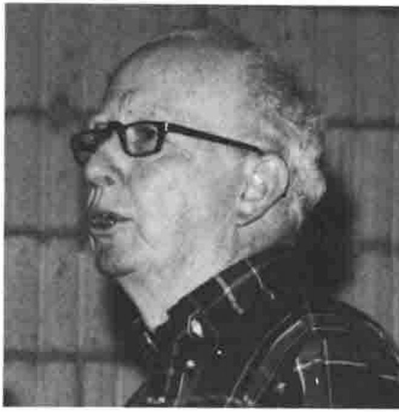

*reported by Anthony Camacho*
{ .byline }

David Steinbrook introduced the presentation by saying it was a report on work in progress. The authors had been given access to the source code for J from the beginning of the project. The original proposal had been to add a tree *data* type to J, encouraged by Knuth's remark that trees are *the most important non-linear structures arising in computer algorithms*. The version of J with the new data type was written but there were many overlaps between the operations required to manipulate trees and those provided for boxed arrays.

**Eugene McDonnell**

On investigation they found that the J boxed data type enabled them to do even more than they had expected. All they needed to implement trees were some specialised verbs, adverbs and conjunctions and so they now have implemented trees as a subset of boxed arrays. This has been done without adding a new data type to the language. The new parts of speech are added as external verbs in the `12!:n` range and the C code is very similar to the J model on which it is based.

The main body of the presentation followed the paper fairly closely, going through the representations of a tree, the process of tracing a tree and over fifty facilities for manipulating trees or parts of them. The traditional representation of a tree is of the trunk and its branches; there are no roots (which would make it look double-ended) although the node where they would go is called the root, yet for some reason a tree is usually shown as Ken would put it *upside down* with the leaves at the bottom. We were told that Ken also says trees are round (3D), although the data type consists entirely of espaliers (2D): how this affects things and how the paper representation falls short was not made clear.

David said that the source code would be made available and looked forward to seeing trees in common use in J.
