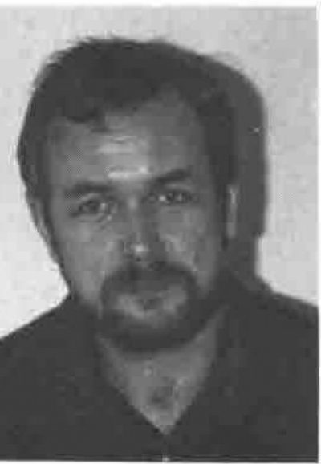

*by John Searle*
{ .byline }

It is my sad duty to inform you of the passing of one of our members, Mike Gregory. Mike died on December 3rd, 1993, following a recurrence of his battle against melanoma, at the age of 42.

Mike was one of those people who could do anything with computers. His CV reveals that he worked on almost all modern operating systems and, apart from his APL skills (in all dialects) he was proficient in languages ranging from C to REXX, SAS and SQL.

Mike's career began at British Oxygen Corporation (BOC) in 1972 and over 10 years moved from programmer in the Gases Division to Technical Manager of Interactive Services at BOC Datasolve. His projects ranged from the development of APLB for ICL mainframe hardware, to MIS systems, to a simulation of the Grand National horserace for the Sun newspaper.

Mike then helped to form IBSL as Technical Director, a company which serviced various clients in the leisure industry, before forming his own company PC Associates in 1985. The variety of his clients was again considerable. After a brief period working for SimCorp, the Danish software house, he returned to his freelance business, specialising in operations research and airline applications.

I met Mike whilst consulting to a well-known favourite British airline, and he helped me understand the complexity of existing APL code (and the maze of freelancing paperwork!) with great patience and humour. What Mike didn't know wasn't worth knowing, and what he did know would fill a database of textbooks. John Scholes from Dyadic Systems told me that in their client contact system, Mike was always listed as "nice bloke".

Mike's passions in life, away from computers, were Jaguar motorcars, motorbikes and good wines. The joys of classic British motoring adorned his conversation, his bookshelves and his driveway. Mike was also very concerned for the environment, and was a keen supporter of wildlife preservation.

Mike is survived by his wife Judith and their children Bill and Claire. Mike did request that if you wish to remember him, please plant a tree in his name.
