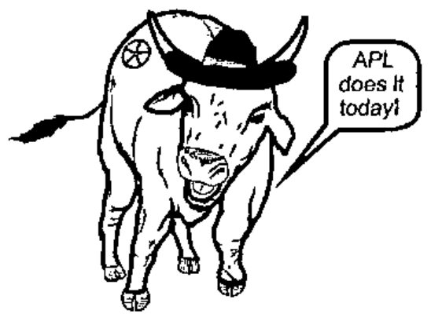

## APL 95

### Dates: June 4-8 1995 Venue: St. Anthony Hotel, San Antonio, Texas

### Costs and Administration:

| | until 1 April | thereafter |
|---|--:|--:|
| ACM or SIGAPL member | $335 | $435 |
| Join-and-Register plan | 390 | 490 |
| Non-member | 435 | 535 |
| Accompanying adult | 100 | 125 |
| Accompanying child | 75 | 75 |
| Full-time student | 100 | 100 |
| Single day | 175 | 200 |
| Extra banquet ticket | 65 | 65 |
| Software Exchange, 3.5" disks | 10 | 10 |

Payable by cheque in $US on a US bank, money order in $US, Visa, MasterCard, or American Express Card. Cheques and money orders should be made payable to: ACM/SIGAPL95 Conference.

Mail (including cheques/M.O.s) to:

> APL95 Conference 
> c/o CM Planners 
> 3700 Forums, Suite 201 
> Flower Mound, TX 75028 USA
>
> Tel: +1 (214) 539 8298 
> Fax: +1 (214) 539 2850 
> e-mail: cmplan@unicomp.net

*ACM SIGAPL is pleased to announce that the 1995 Kenneth E. Iverson Award for outstanding contribution to APL will be fully funded by an unconditional grant from Soliton Associates. The grant consists of US$1,000 for the cash award to this year's recipient(s) plus up to $500 for other expenses directly connected with the granting of the award. The SIGAPL Executive Committee thanks Clarke Bruce, Nancy Lamb, and all the employees of Soliton Associates for their support of SIGAPL and of our program for recognition of exceptional achievement by members of the APL community. Michael Kent, Secretary-Treasurer, ACM SIGAPL*

### Panels and Workshops:

| | |
|---|---|
| Evolution of APL (90 mins) | Moderator: Kimmo Kekäläinen |
| Compiling array languages (90 mins) | Moderator: not finalised Panellists: Bob Bernecky, Wai-Mee Ching, others |
| Objects and APL (90 mins) | Moderator: Mike Kent. Panellists: Bob Brown, David Liebtag, Bill Rutiser, John Scholes |
| APL Alternatives (3 hrs) | Moderator: Martin Neitzel Panellists: Bob Bernecky, John Feo, Richard Gaylord, John Howland, Clint Jeffery |
| Improving J (90 mins) | Moderator: Harvey Davies |
| ASCII transliteration | Moderator: Leroy J. Dickey |

APL95 offers far more "professional development" opportunities to build directly and immediately applicable skill than ever before.

### Workshops:

| | |
|---|---|
| Business Graphics (3 hrs) | Leader: George MacLeod |
| Programming for Portability (90 mins) | Leader: Eke van Batenburg |
| Elementary Calculus (3 hrs) | Leaders: Walter Spunde, Richard Neidinger |

### Professional Development Seminars:

| | |
|---|---|
| Programming in J (6 hrs) | Leader: Donald McIntyre |
| APL in Engineering (6 hrs) | Leader: Scott Kimbrough |
| Sharing and Associating (3 hrs) | Leader: Ray Polivka |
| Off the Couch, Onto the Highway (3 hrs) | Leader: Jim Brown |
| Nonlinear Constrained Optimization (6 hrs) | Leader: Bill Koko |
| Genetic Machine Learning (3 hrs) | Leader: Andreas Geyer-Schulz |
| Neural Networks in APL and J (3 hrs) | Leader: Ben Best |
| Concrete Math (3 hrs) | Leader: Ken Iverson |
| What to do 'til the Millenium Comes (3 hrs) | Leader: Mike Kent |
| APL at Both Ends (3 hrs) | Leader: Morten Kromberg |
| Making Nested Arrays Work for You (3 hrs) | Leader: Phil Benkard |
| Application Development in J (90 mins) | Leader: Chris Burke |
| Structured Programming in APL and J | Leaders: Bill Rutiser, Eric Iverson |
