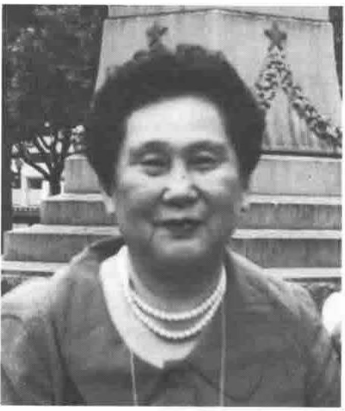

**Makoto Kikkawa of Shokei Women’s Junior College**
{ .caption }

Ms Makoto Kikkawa of the English department of Shokei Women’s Junior College brought to APL95 a proposal for a ‘virtual classroom’ on Internet, where English-speakers learning Japanese can co-operate with Japanese speakers learning English.

If you are interested, please contact:

> Ms Makoto Kikkawa  
> Shokei Women’s Junior College  
> [Contact details omitted.]
