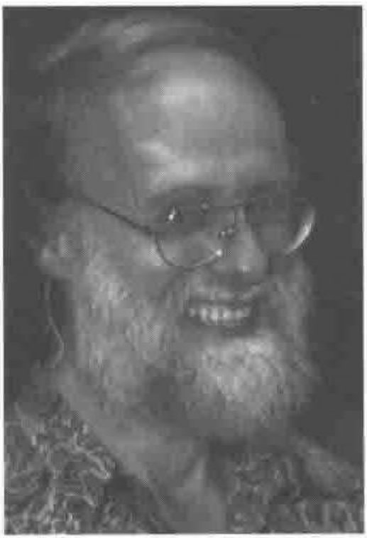

*moderated by Eke van Batenburg & Adrian Smith*
{ .byline }

## General Information

The workshop on portability was held at the APL conference on Wednesday June 7th. There were about 15 attendees, and most of them had experience with portability issues (if not portability problems). This made for an interesting discussion where everybody was very much involved.

The discussions mainly covered the following four topics. Is portability an issue? What can we demand from vendors? What can we do ourselves? Plan of action.

## Is Portability an Issue?

As said before, all attendees had some experience with portability problems, but some had more horrible stories to relate to us than others. For example starting with APL on a micro-computer like TRS80, PET or other brands, going to a mainframe and subsequently to another mainframe, and finally to a mini-computer, expecting quite probably to have to migrate to a micro-computer again in the next few years.

*Eke van Batenburg*

In general, philosophical issues (floating vs grounded arrays) were not a concern, and missing functionality (such as `⎕DAYS` in APL.68000 or the APL\*PLUS `FASTFNS` library) was felt to be a nuisance, but one which could be easily covered by global variables or utilities. The real problems were with syntactic incompatibilities (the use of the up-arrow) and subtle variations in behaviour such as the point where integers turn to floats.

Some people were on the move because of the changes in APL support. For example lack of development in STSC’s MacAPL or discontinuing support of APL by Dec which forced, or at least motivated people to switch to another computer. Others had to move because of upsizing (going from 8-bit micro to mini or mainframe) or downsizing (the recent trend to quit the mainframe and go to PCs). One participant had been through 2 enforced migrations (from the MCM micro in 1984 and then from Wicat) when APL vendors went out of business. Another was working on Honeywell APL 66 (one of the first nested APLs) and had only 3 more weeks until the plug was to be pulled on the system!

Another group of people experienced daily portability problems because they have to support an application on different computers. Although the initial start focussed on portability of programs, several participants stressed the importance of porting data, in particular porting data in component files.

## What Can we Demand from Vendors?

Of course the easiest solution to portability problems is to demand of vendors that they make their APL identical to that of the others. However, most participants agreed that the variability that gives the problems in porting has a very good side too. APL evolved into the more powerful product that it is today, because vendors introduced new things. On the other hand, it is in every programmer’s interest to have a common set of APL functions that is available on every platform. However, it was recognised that vendors have to make a living and one cannot ask them to make many essential changes if this is not, at least to a certain extent, reflected in more revenue..Nevertheless the participants agreed that some things could be asked of vendors:

> **Consistency within their own product line.** People felt that the products of one vendor on different platforms should not be different. For example differences in Dyalog APL on the Unix platform and Dyalog APL on the PC platform, or differences in Manugistics APL on the Macintosh and Manugistics APL on the PC should be remedied.
>
> **Consistency with the ISO standard for Extended APL.** Many of the raised topics of portability problems were differences that are unequivocally defined in the standard for Extended APL. Discussions about those topics were cut short because we agreed that it is reasonable to ask vendors to be at least compatible with the APL extended standard. Unfortunately, some of the hardest problems to work around (such as the behaviour of Reshape on empties) are “consistent extensions”; it would be helpful if the standard included some guidance on these.
>
> **Some Goodies.** Although everybody has a long, long wish list of things that he wants his vendor to include in that particular APL, it seemed that some wishes are more universally shared than others. So, apart from the wishes that were already defined in the APL extended standard, some others that remained and were shared more or less are:
>
> > Standardisation of partitioned enclose (=APL2-like) or partition (=APL\*PLUS-like). Some people liked the partitioned enclose using cumulative integers to separate, others were afraid that separation of big arrays by integers would result in `WS FULL` and preferred separation using bits. Which alternative is chosen is of less importance than that there is one standard way only.
> >
> > Take and drop with axis to avoid having to specify the size of axes that are not changed.
> >
> > Ravel with axis to make a 1-column or a 1-row matrix and for ravel over several dimensions.
> >
> > Scalar functions with axis.
> >
> > `⎕Monitor` Function to measure CPU time of each function line. It is not only useful to pinpoint hot spots of CPU time devourers, but also to check if a test set covered all lines.
> >
> > `)IN` and `)OUT` for porting. Many vendors like MicroAPL, IBM and Manugistics have already implemented effective IN/OUT commands, others like Dyalog only have an obsolete and buggy alternative.
> >
> > Negative index. Useful for various constructions (the question was raised if it not implemented because of illogical behaviour with `⎕IO=0`?).
> >
> > Standard position of characters in `⎕AV`.
> >
> > Standard behaviour of “`A B C←`” and “`A B C[...]`” (binding to C or to ABC). Some APLs require parenthesis to assign to “A B C”, others do not. Again (as with partitioned enclose) which alternative is chosen is of less importance than that there is one standard way only.
> >
> > Standard storage (or at least publication of formats) of component files.
> >
> > Availability of `⎕MONTH` for names of months and `⎕DAY` for days of the week.
> >
> > Namespaces

## What Can we Do Ourselves?

Of course if you think that you will never have a portability problem your need to protect yourself against future problems is small. Nevertheless the effort to protect yourself is sometimes small.

> **Be wary of non-portable constructions.** Sometimes it is very easy to use an alternative programming construction if you know that some features are not universally supported. For example one can get a single value from a non-nested vector using index, using pick or using squeezed quad. If you know that the latter is not implemented in many APL systems, taking one of the alternatives is no problem at all.
>
> Some participants were rather surprised to learn that some constructions that had easy alternatives were not widely supported, and expressed their intention to change their programming immediately. Apparently it could be useful to publish a list of differences.
>
> **Use cover functions.** Some actions, especially those regarding input and output, are always different in various APL systems, for example file I/O and graphics, and others will hopefully grow together but are still rather different (like GUI functions). A sensible way to diminish future portability efforts is to hide that machine-specific code in cover functions. In porting, only those cover functions need to be rewritten.
>
> **Develop public-domain cover functions.** It will be useful if the APL community has some public-domain cover functions. The packages CAUSEWAY for GUI and RAIN for graphics are good examples of this.
>
> **Work at the most APL2-like level offered by Manugistics and Dyadic respectively.** The bulk of the code in RAIN is now identical in both these environments, having been migrated to `⎕ML 2` in Dyalog and then copied via the Windows clipboard to PLUS III.

## Plan of Action

**Publish this in QuoteQuad and Vector.** Adrian will publish the discussions of this workshop in Vector and Eke will submit a report to QuoteQuad.

**Report this to ISO.** Eke will report the main topics of the workshop in the ISO meeting.

**Develop more public domain software.** No action proposed.

> **Publish a list of deviations.** Eke will start a publication of differences between the mainstream vendors and ask Joseph De Kerf to join him if he wants to. Several participants offered to help, so it was proposed to set up preliminary versions on the Internet and ask for help. Eke will do so. The `comp.lang.APL` forum was suggested as a good repository for this information.

Eke van Batenburg 
Leiden, 28th June 1995
