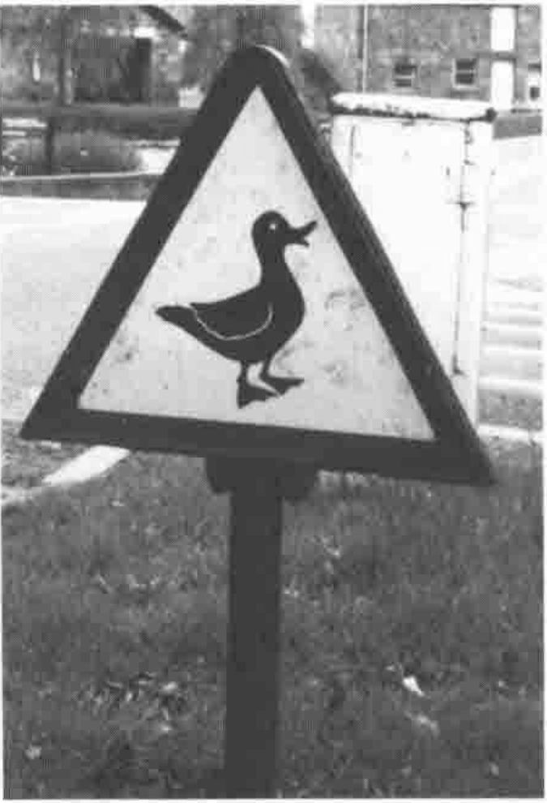
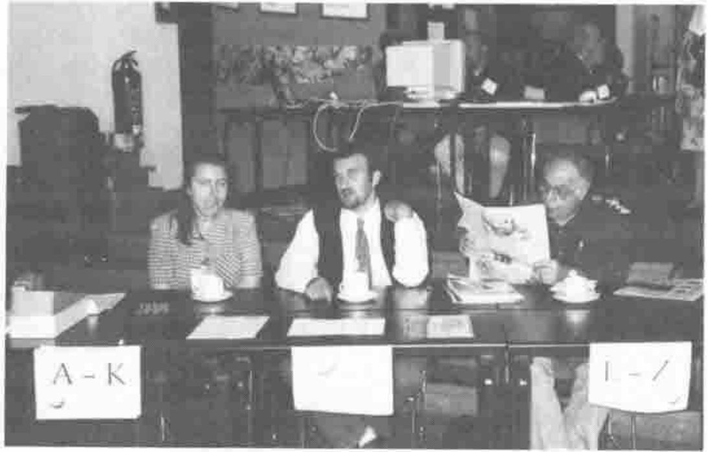
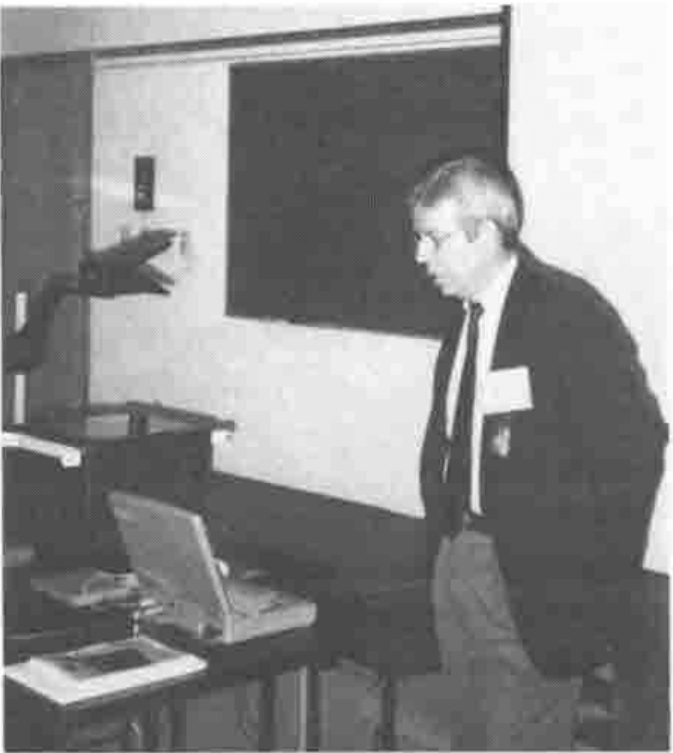
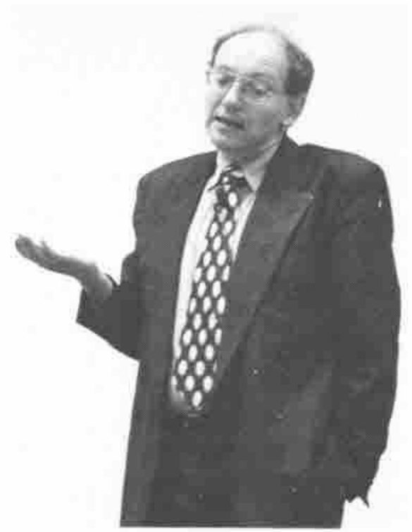
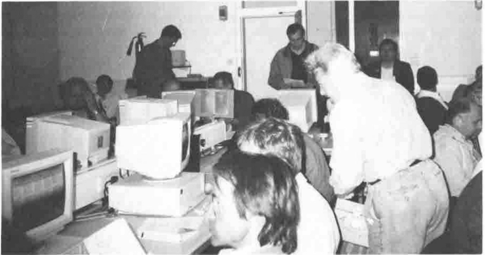

*by Ray Cannon*
{ .byline }

## Sunday 28 July

I arrived at Lancaster University at 2:30pm after a long but uneventful drive up from Hampshire. On entering the University Grounds I drove past a red warning triangle with a duck on it. Was this the first Dyalog Demo?

I booked into Lonsdale College and was shown to my room, which was a trifle Spartan but very functional. It was very clean and the decor was in pristine condition, quite different from the rooms in County College. (They looked like they had been lived in by students. The walls bore all the signs of generations of posters held up by BlueTack, and the communal kitchen having suffered several chip-pan fires despite the 6 warning notices above the cooker hob.)

On leaving my room, I met Peter from Germany (all surnames will be withheld to protect the innocent) who was also attending the conference and staying in the room next to mine. We walked down to the George Fox Conference Centre, which took us about 10 minutes. The way was not exactly direct, but was well sign posted. En route we passed through the main square of the university with its bookshops, banks, travel offices and newsagents. We also encountered a peacock strutting around the open walkways. Knowing how students are, I was surprised to see it had what appeared to be a full set of tail feathers.

When we got within sight of the George Fox building, we met some other APLers and was told that the centre was closed until registration which was not until 5pm. Peter and I decided to drive into Lancaster to see the sights.

Once in Lancaster, we walked round the semi-deserted streets and found ourselves at the tourist information office, where we discovered that we were just in time for the last guided tour of the castle.

**The Front Desk at APL96 manned by Angie, Gary and John De Lorenzo of ACM**

Peter and I then drove back to the University and registered for APL96. Even though I was late registering (and paid on site) this was a painless and very quick procedure, and I was soon wandering round with my IBM APL-2 conference bag. The next act was to sign up for the workshops and tutorials. The conference had two computer labs (each containing about 20 PCs) where the workshops took place. With about 160 attendees, several of the workshops were over-subscribed 2 or 3 times.

Since I had not booked up for the evening meal, I drove into town to a local Kebab House and had an excellent (if a little greasy) supper.

At 9pm I went (in the pouring rain) to the bar of the Lancaster House Hotel where the Vector Working Group had arranged to meet for a pre-conference briefing and try to see how we could cover as much of the conference as possible.

## Monday

Up at 6:30 for an early (luke-warm) shower and down to a full English breakfast of cereal, eggs, bacon, sausage, tomatoes and hash browns. Plus toast with marmalade and tea.

8:45: Initial announcements followed by a very interesting talk by Jack Rudd on *Real-time APL Prototype of a Wide Area Differential GPS System*. The now familiar Global Positioning System can (with the aid of a $200 civilian hand-held unit) give your position to an order of accuracy of 50-100 metres. The military units give an accuracy of about 16 metres. The talk described how (with the aid of extra ground-based receivers) superb navigational accuracy can be achieved using civilian receivers.

**Eric Lescasse giving the Delphi Tutorial**

After the mid-morning coffee break, I attended a tutorial on *Advanced Windows Programming with APL and Delphi* given by Eric Lescasse. This covered much of the same ground as his recent article in Vector (Vol.13 no.1, July ’96). The idea of mixing APL and Delphi (a Borland product that could be described as "Visual Pascal") has some merits, (speed, good GUI designer, low Delphi programming content), but also several disadvantages (including the difficulty of debugging any "mixed mode" system, having to learn to write Pascal, "pointers", difficulty in putting up multiple forms, hard to set up callback functions in APL triggered from events in Delphi).

Lunch was provided in the main part of the George Fox building, where the vendors had set up their stalls and all the conference notices were displayed. This area provided a very pleasant focal point to the conference.

After lunch was the IBM Vendor Forum. They announced several new features and products including the beta version of APL2 for Windows (NT and Windows 95 only), a full "APL out of a box". Also a new session manager and editor. Enhancements to their TCP/IP AP to include encryption for cross platform shared variables.

The IBM forum was followed by the conference General Welcome. Strange not having the welcome at the start of the conference, but practical, allowing late arrivals not to miss it.

I then attended Robert Bernecky’s tutorial on *APEX: The Peak of APL Parallel Performance*. This was well up to Bob’s usual very high standard, and included many amusing one liners such as "the only thing more frustrating than writing a thesis, is debugging Windows code". (Bob is currently doing his Master’s degree, and writing a compiler for APL: APEX the APL Parallel EXecutor.) Topics covered included an overview of APEX (currently a "program" not a "product"), the performance of compiled APL (including a suggested target of producing code that will run at over 80% of the speed of hand-coded Fortran 77), the rationale of compiling APL, the future of APEX, Implementation of APEX, and APL design issues. I look forward testing out the final product.

## Tuesday

**Heinz Roggenkemper of SAP**

Up at 7am, hot shower, breakfast as per Monday.

8:45: Announcements followed by a talk by Heinz Roggenkemper of SAP (the world’s 6th largest software company with annual sales of £1.2 billion) whose paper was entitled *The "Organisational Architect" Project*. It was all about how an outside company had completed a major project from very loose specifications, with a very tight schedule, on time and on budget using APL. "This would not have been possible with any other development environment." The project was started in Nov 1994 and shipped in July 1995 to 2000 customers.

The outside company was Causeway Graphical Systems. Heinz went on to say that about 30 problems were reported, of which 15 were installation problems (see later) and 6 were requests for Windows NT versions. Fewer than 10 errors were reported back to Causeway (snapshots were sent via ISDN from SAP in Germany to Causeway in Yorkshire) with responses returned in 20 minutes on average.

Heinz then went on to say that in the next phase of the project, the APL was being replaced by C++ and J (again written by Causeway), and this is to be shipped to 10,000 customers. Two main reasons were given for the APL (Dyalog) being replaced by C++ and J. The first was to overcome the installation difficulties with Dyalog APL/W. The complex command line needed, along with long path names, can require more than the 128 character limit imposed by Windows 3.1. The second was the lack (at the time) of support for double-byte characters, required by SAP’s Japanese customers. The speed improvements were not an issue. Causeway performed the conversion (including a learning curve for both J and C++) in 60 man-days.

After Coffee, I attended a tutorial by Ed Shaw on *EDI: Messaging Standards on a PC*. This tutorial gave a very good introduction into what EDI (Electronic Data Interchange) is and how important it is becoming in the USA (*e.g.* in 1993 a target was set that by Jan 1 1997, all US government agencies must use EDI for all purchases under $100,000). Ed described how APL is being used to produce programs that translate data to and from EDI transaction streams. Unfortunately, I have lost the excellent handout that accompanied the tutorial so cannot go into more details here.

After lunch was the Dyadic Vendor Forum. This had two show stoppers. Firstly John Scholes demonstrated an experimental version of their interpreter which supports "Dynamic Functions" (Dyadic’s name for their extended Direct Definition.) Not only was the resulting APL "Beautiful" (as one member of the audience stated) but it also ran faster. (After the forum John showed me some benchmarks where for some problems it ran 7 times faster than standard Dyalog APL.)

Peter Donnelly then demonstrated full OLE support with Dyalog APL, via 1 short line of APL. (In the Soliton vendor forum it was described thus "OLE server from Dyadic is a 1st class piece of work".) Peter demonstrated the OLE technology by "mapping" an instance of an OLE object into an instance of a Dyalog Namespace, the objects methods into the function in the namespace, and the Object properties into the data in the namespace. The demonstration ended with some "Duck à l’ OLE".

Following the SIG/APL meeting, I attended the workshop *New Life for Legacy Systems* (having been banned from the Designing with Causeway workshop by Adrian). This workshop was hosted by Lynne Shaw and Chris Lincoln. (Its findings were presented in the final session on Thursday afternoon.) The workshop defined what legacy systems are and what to do with them. As someone who has potentially about 400 legacy systems written in APL on the mainframe, I found the workshop useful.

At the end of the workshop, I met up with Ellis, and with three others (Bob from New York, Bob from Woking and Cape Town, and John from Houston and Yorkshire). Ellis had been doing his homework with the Ordnance Survey map, and found a "PH" (public house) west of the university on the coast by a small harbour. We all piled into Ellis’ car and off we went. Bob from NY found the concept of single track roads interesting, especially when you could touch the roadside hedge, from the car on either side.

When we finally got to the harbour, we had a choice of 3 pubs, and selected the nicest looking (i.e., it had the best selection of real ales). After the first round we asked for the menu, and were very disappointed to find out that it was the chef’s day off, but the landlord very kindly pointed us to the nearby Thurnham Mill, an hotel and restaurant.

We found the converted mill down a farm track located between the river’s tidal estuary and the canal (which in the past provided the water to the mill race). On entering, we knew we were at the right place, by the contents of the top shelf running the full length of the bar: Pure Malt Whisky bottles (I think the landlord said he had £3000 of pure malts in stock).

At about midnight, we were suddenly told that we had better leave quickly, or we would be cut off by the tide! However, by this stage the last thing we could do was anything quickly. So after about 15 minutes, when we were all in Ellis’ car (who had refrained from drinking all evening, and was quite enjoying the show), we set off. Only to get 100 yards up the track to a hump in the road, with the sea on the other side.

We were cut off, so back we went to the bar and waited for the tide to drop. We finally got back to Lancaster University at about 2:30 all ready for a good night’s sleep.

## Wednesday

Up at 7:00 am, two paracetamol, hot shower and a full English breakfast. (I never knew I had it in me, and almost could not keep it there!) This morning’s talk was given by Per Gjerløv and was on *The Song of the Whale*. Per showed how students used APL to analyse whale song recordings and used them to recognise individual whales.

After (a very welcome) coffee and 3 orange juices I attended John Scholes’ Hands On Workshop on Dyalog Namespaces. This was fine, except, the keyboard of the PC I was using was set up as an Adrian Smith special, which meant that some (or many) of the system function keys had their meaning changed. Worst of all to me was that the ESC key when pressed in a function did a quit, rather than (the default Dyalog action) save and exit. Keyboard aside, this was an excellent introduction to Namespaces.

Over lunch I complained to Adrian about his keyboard, and he went over to the workshop and set all the machines to use the standard Dyalog keyboards.

(Question for Dyadic here. When has the keyboard translation input field in the configure dialogue box been changed from a "drop down list" to a simple input field, between versions 7.1 and 7.2?)

The Soliton Vendor forum followed, but I was sill suffering a little from the previous night. I can’t remember much of it other than many diagrams full of mnemonics (such as TCP/IP, OCDE MVS, UNIX, SAM, SAX and UNAMIT, I think).

I then attended Timo Laurmaa’s hands-on workshop on TCP/IP which used Dyalog APL/W and the AP119/W from Lingo Allegro. (See Vector Vol.12 No.4, April 1996.) With the course notes, we all succeeded in getting TCP/IP connections going and sending messages to one another (including getting APL commands entered on one machine executed on another). An excellent demonstration. Because of over-subscription, this workshop was divided into two shorter sessions which was a pity since we missed trying out some more complex stuff.

After Afternoon Tea, I attended the meeting of APL User Groups, where we all agreed to try to communicate with each other more, particularly via E-Mail and web pages. I announced the arrival of `www.vector.org.uk`.

## Thursday

Up and breakfast as Wednesday. I was very happy to be waylaid en route to the conference centre by a Russian with a bottle of Vodka for me. "The Spirit of International APL Co-operation".

I arrived late for Bo Grave’s talk on *Modelling Single Interlocking Systems using Array-Based Logic and APL*. Remembering that APL2000 and Dyalog have just both (fairly recently) introduced C type control structures, I found it quite amusing that one of the reasons that APL was used was because the C programmers got lost in the complication of the IF-THEN-ELSE nesting needed to solve the more complex problems!

**Attendees at Morten Kromberg’s ODBC Workshop**

After coffee I attended Morten Kromberg’s excellent hands-on workshop on ODBC. It was worth coming to the conference for this workshop on its own. I learnt a lot, and felt that the "mysteries" of "Open Data Base Connectivity" had been removed. This was a full day’s session, broken for lunch and the APL2000 Vendor Forum.

It was good to see new life being put into APL2000, and the latest version of the product is starting to look very attractive. I can’t remember any new announcements beyond those stated in the BAA Vendor Forum in London earlier this year.

After afternoon tea, in the closing session, it was announced that APL98 is likely to be in Rome. This was followed by Chris Lincoln reporting on results of the earlier workshop *New Life For Legacy Systems*. (Overheard: "They are trying to get rid of APL at our site, but we can write new systems faster than they can replace the old ones!")

Then back to my room to change for the APL96 Banquet. Then on to the banquet. We were a bit disappointed by the cheese board, a choice of three cheeses, a poor showing for our international visitors. There are so many good British cheeses to choose from.

After the wine ran out, it was down to the "Winning Post" (the Lonsdale college bar) for a bottle of Newcastle Brown Ale, and at closing time a group of us retired to drink my bottle of Vodka. (I have vague recollections of drinking another bottle of Vodka at Lancaster university some 25 years earlier, but that’s another story.)

## Friday morning

A slight lie-in before a (late) breakfast. Pack my bag, and round to pick up Walter and his daughter Anna, to give them a lift south to their friends’ house in Cheshire.

En route we stopped off in Blackpool, where we indulged in a ride on "The Big One", the world’s tallest and fastest roller-coaster. This was followed by a virtual reality roller-coaster simulator, a two-mile walk down the Golden Mile to the Blackpool Tower, and a ride back up the Golden Mile in a horse-drawn carriage. This was followed by a final ride on "The Big One" and back to the car.

After dropping off my passengers, I had an uneventful drive back down to Hampshire. I can’t wait for the next conference (New Jersey?). Maybe I can sneak over to the APL2000 conference in Orlando.

Thanks to all the people who worked so hard to make APL96 the best APL conference that I can remember.
