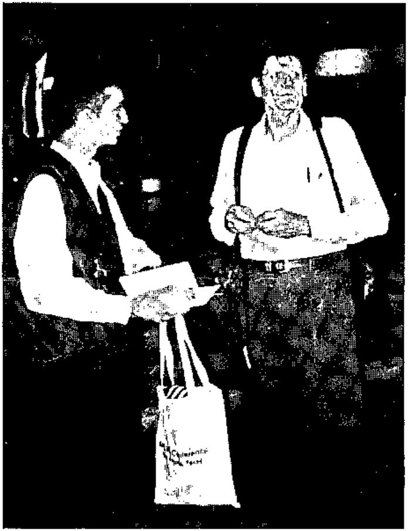

*recorded by Jon Sandles*
{ .byline }

This session was a three-hour workshop split into two halves by a coffee break. The first half was well attended and I suspect that those who made it all the way through felt that although they probably didn’t get what they came for they got a fascinating insight into what drives any language writer. Phil has obviously been involved in the introduction of nested arrays into APL for many years. His insights in the whys and wherefores leave you with only one question - if they fit in so well then why weren’t they in the language in the first place?!

**Jon Sandles with Phil Benkard**

This talk should never have been a workshop. Although a few people tinkered at the keyboards, the level of the talk was mainly theoretical and the exploratory workspaces that Phil supplied where too difficult to get to grips with in the time available - more something to play with back home. Many people had come to find out what nested arrays could do for them back in the office - certainly a nested array workshop would be suited for this - but Phil’s theoretical direction prevented this being the case.

Phil introduced what the elements of the APL language - **Tokens, Syntax, Structure** and **Semantics**. Of course APL is famous for its rich quota of single character tokens. Syntax is ‘what goes with what’. Semantics are ‘where the action is’.

The crux of the discussion was that when APL was extended to encompass nested arrays it was done in such a way that the existing structure of APL was unchanged - also no new functions would need to be defined. (Unlike the concept of BOXED arrays which needed new, arguably more arbitrary, functionality and a new data type.)

**Scalar conformance** was introduced as a critical concept.

**Enclose** was introduced. Although a new function it was just a shorthand for existing functionality .....

`''⍴X X <-->1⌷X X<-->(X X)[1]<-->⊂X`

in APL2 .....`2 2[1]<-->⊂2`

and in APL\\360 ....`2 2[1]<-->2`

and hence ....`2 <--> ⊂2`

and of course .....`⊂2<-->⊂⊂2. etc etc`

This is the key to scalar conformance. *“Think of a scalar as infinitely enclosed – it’s so deep you have lost sight of it – that’s what makes scalar conformance work”*

Later on we were introduced to a similar set of identities for **each** (¨) and scalar functions (functions that return scalars). This led to Phil introducing a simple set of functions which allow outer products to be expressed in nested notation. The same was also done for complex numbers.

The talk taken as a whole was too unstructured to provide a good introduction to nested arrays. Perhaps some theoretical exercises to be done on the PCs were what it needed to give it a bit more direction.

But every now and again Phil has a way of describing what you thought was complex and making it sound very simple - and this made it very worthwhile and enjoyable.
