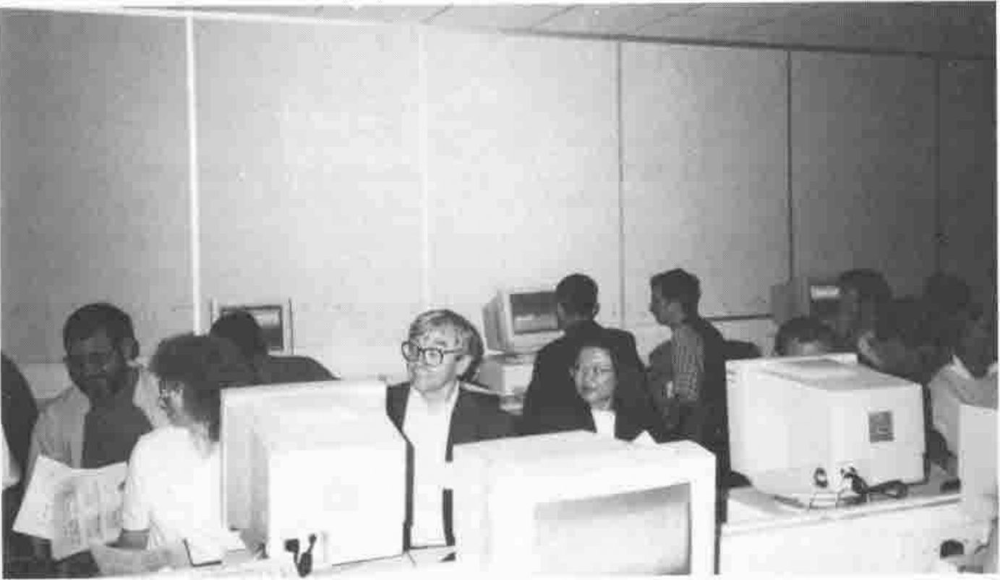
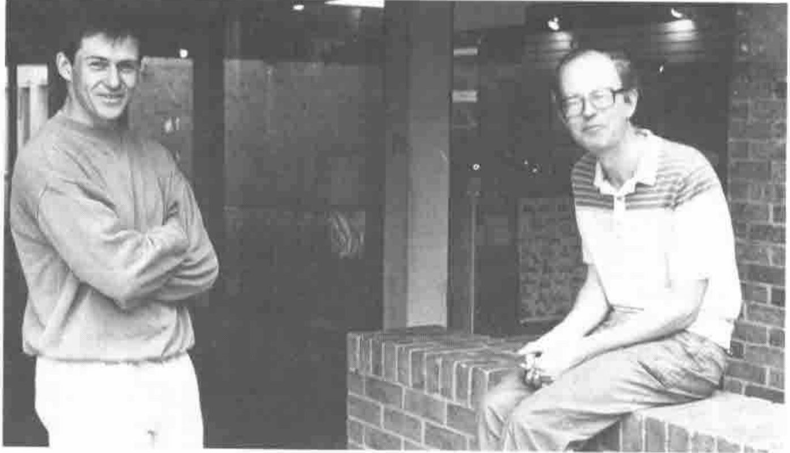

*notes by Marc Griffiths*
{ .byline }


**Gill Smith, the “Local Arrangements Chair”**

Before I describe specific sessions, I want to thank everyone who helped to make APL’96 possible: the organising committee and the conference staff at Lancaster University; the programme committee and the plenary speakers, authors and reviewers; the many people who prepared and led the tutorials and workshops; the sponsoring organisations and vendors who continue to develop the software products; and, finally, to everyone who thought it important enough to attend. Special thanks to Richard Smith and to the university’s systems support staff who were instrumental in setting up the software and preparing the personal computing labs for the workshops.

As an application developer, I came away from the conference with a relatively warm feeling. However, I could not help but reflect upon what was not there. First, a significant number of younger delegates. If the age of APL conference attendees continues to reflect the age profile of baby boomers, the big question for vendors will be whether to use an 18-point or a 24-point font size as the default for the installed interpreter. Second, I saw little evidence that APL has been touting its successes in other forums, although I admit that I could easily have missed something here. (I hope that the report about APL and legacy systems succeeds in dispelling the air of a rearguard action that this topic has about it.) Third, and most noticeable for me, was the emphasis on the hardware and software to the detriment of system development approaches and the user as a fundamental part of these systems. Ironically, Lancaster University is where Peter Checkland devised his Soft Systems Methodology (SSM) over 15 years ago. In this, he argues that information systems are fundamentally social systems, and that no amount of clever hardware or software will enable any system to succeed that has not taken into account the often disparate views of its stakeholders. SSM has subsequently been employed as a framework for participatory design, user-centred design, rapid prototyping and so on, all of which have found proponents in a number of areas of system development, and all of which lend themselves readily to APL and J. Handled correctly, here is an opportunity to (re-)establish the technical and commercial viability of APL and J. *Carpe diem.*

Finally, a few general comments about the workshops. Those I attended focused on the use of features built into APL, either directly or through third-party software. While the ‘how’ is undoubtedly useful, I would like to improve my understanding and so would welcome more background information (‘what’ and ‘why’) about the topic, even if only in the form of some references or a summary of performance characteristics within a variety of environments. This is perhaps more true of ODBC and TCP/IP than of the GUI design workshops, but this is indicative of my greater familiarity with the latter.



**One of the Two Workshop Labs used at APL96**

From the presenters’ point of view, it would help to distribute feedback forms to the attendees and ask that the forms be filled in and returned at the conclusion of the workshop or conference. As many of the workshops deal with one or more interpreters and third-party products, the presenters are likely to receive more pertinent comments than they would in almost any other situation. And a note for future organisers: the sad truth of many computing labs is that they are not designed for presenting material to a large group. The arrangement of furniture, the acoustics, the lighting and so on, do not support the effective presentation of material to a group, especially when there are two people sharing most machines. It would benefit everyone concerned to ensure that, in addition to adequate hardware and software, the facilities also support overhead or LCD projectors. If not, then the presentations may be delivered more effectively in a room with these facilities, even if it is not adjacent to the lab.

## An Introduction to GUI Programming in Dyalog

*presented by Peter Donnelly*

Peter presented this Monday afternoon session to a group of over 40 people, most of whom sat two to a PC. He apologised that the machines did not have Windows 95, especially as he had prepared the workshop on the basis that Microsoft’s newer offering would be available. Nonplussed, he proceeded to introduce the features in Dyalog APL for Windows that support the design of graphical user interfaces (GUIs). As soon as individuals figured out the keyboard mappings, and one or two problematic machines were identified, we were off to the races.

No one appeared to have any difficulty following Peter’s clear explanations and illustrations of the main GUI system functions. We created objects and then proceeded to get and set various properties. While we were thus engaged, Peter managed to explain the ‘dot’ notation and the different coordinate systems without apparently losing anyone. After the first half hour or so, the course of the presentation changed a little according to the questions that people asked. After a brief review, we spent some time experimenting with event handling, callbacks and the event queue. Finally, Peter used the WDESIGN workspace to introduce Dyadic’s implementation of namespaces, and to demonstrate a more structured environment in which to develop GUIs. We were then left to construct the application on the back page of the latest Dyalog APL for Windows brochure.

## Advanced Features in Dyalog APL for Windows

*presented by John Daintree*

This late Monday afternoon workshop became a presentation owing to the absence of Windows 95 on the PCs in the lab. And, despite unfavourable lighting for the LCD overhead display, John was able to provide us with a good introduction to several features available in versions 7.2 and 8.0 of Dyalog APL for Windows.

John began by demonstrating the new ‘GetEnvironment’ method and the monadic use of `⎕WC`, both of which are documented in the online help. He then proceeded to demonstrate how to use the `greet_bitmap` command-line parameter. For example, under Windows 3.1, if the command line:

```
c:\dyalog72\dyalog72.exe greet_bitmap=c:\dyalog72\myhello.bmp
```

is the command line associated with the Dyalog APL version 7.2 executable, the ‘myhello’ bitmap is displayed on the screen when the interpreter starts to load and is removed when the session appears. Alternatively, if a workspace is loaded together with the interpreter, the bitmap can be removed under program control through `⎕NQ`:

```apl
  2 ⎕NQ '.' 'GreetBitmap' 0
```

Peter Donnelly then asked whether anyone had specific requests for advice on how to do something or for new features. The Grid object attracted a lot of attention, especially in terms of having a ‘print’ property. John pointed out that the Grid had many attachments and parameters, all of which added up to a very complicated general case. More likely to be looked into was a request for improved Grid paging. The final question was for the list of files and the directory structure required to create a run-time Dyalog APL application. Unfortunately, I was able to note down only a partial list, so we must wait until someone provides a complete answer in Vector for each operating system.

## An Introduction to Designing with Causeway

*presented by Duncan Pearson*

The first session on Tuesday afternoon saw about 45 people arrange themselves two to a machine in the lab. There was a slight delay while Adrian Smith fashioned curtains from some bedsheets to reduce the amount of light coming in the windows; for some reason, the overhead projections were even fainter than those during the Dyalog workshops on the previous day. In any event, the improvised solution worked well enough for the session to get underway.

Duncan introduced Causeway by having us construct the ‘flipper’ application that has almost become the company’s unofficial trademark. A few of those who were less familiar with object-oriented nomenclature found the move from operators, functions and variables to methods, classes and properties a bit problematic, but with Duncan taking questions at the front and Adrian supporting people at the back of the room, there was never any danger of leaving anyone behind. At the conclusion of the flipper exercise, Duncan demonstrated how to add a variety of objects — a multi-line edit field, a group of radio buttons, a drop-down listbox — to a form through the Causeway development environment. As the emphasis in this workshop was on rolling up our sleeves and getting our hands dirty, Duncan distributed a page containing a series of exercises that would eventually yield a simple personnel record management system. Everyone stayed hard at it until tea-time.

## Creating and Modifying Classes in Causeway

*presented by Duncan Pearson*

After tea on Tuesday, about 25 of us re-convened in the PC lab for the second Causeway workshop. This session aimed to explain how individual classes are defined, and to demonstrate how we could customise the default classes that ship with Causeway.



**Duncan Pearson & Adrian Smith taking a well-earned rest**

Duncan began by explaining that each row of the `∆classtab` variable contains the methods and properties that the Causeway development environment uses to create a new instance of a specific object. Each class has up to five generic methods (create, refresh, read, resize and design) as well as specific methods for any event-handling. All of the methods are functions stored in `⎕OR` form. The first step in creating a new class is to find one within `∆classtab` that contains a class with similar properties, then to concatenate that row to the bottom of matrix. Second, change the first item in this new row to be a unique uppercase text identifier. Third, change the second item in this same row to be a brief, appropriate text description. The remaining changes involve the use of utility functions in the `maint` namespace to edit the method functions.

The example Duncan used to demonstrate all of this was the creation of a text edit field for password input and that returned an encrypted text string. Starting from the standard text entry class, he took us through the changes to the create method. We were then encouraged to make changes to the refresh method (adding decryption), the read method (adding encryption) and the keystroke event handler, with support from Duncan or Adrian only if necessary.

## Multi-dimensional Databases

*presented by Phil Chastney*

I am continually amazed by the resourcefulness of speakers when things go wrong. Phil had planned to illustrate his tutorial on multi-dimensional databases by demonstrating the system he has been working on at Eurostat. Unfortunately, his departure from Luxembourg had been delayed a few days, and he arrived in Lancaster only to find that he was unable to decompress some of the data files. The solution? Bring some fine art posters, of course. Having been numbed by two-and-a-half days of high technology, the 25 or so of us who filed into the tutorial room on Wednesday afternoon saw an interesting array of low technology equipment: a free-standing notice board with drawing pins, a standard overhead projector with acetates, and a whiteboard. Clearly it was time to put on our lateral thinking caps. Phil’s use of the posters to illustrate or emphasise various points in his talk was both entertaining and a refreshing change.

The main objective of the tutorial was to introduce multi-dimensional databases (MDD), and to use the work at Eurostat to illustrate various concepts and problems. Eurostat is responsible for the collection and analysis of various data from countries in the European Union as well as several other non-EU countries such as Iceland. Data collection takes place in Luxembourg, where Phil has been working, and data analysis in Brussels. Essentially, the Eurostat database is an n-cube that must lend itself to two-dimensional slicing along any axis. A large part of the data collection process involves quality assurance. This is a non-trivial matter, given the diverse types of data gathered (industrial production, public transportation facilities, tourism, etc.), and the different ways they are collected, consolidated and reported by each country. Even indicating a missing value is complicated. Phil’s experience at Eurostat supports the notion of “sixteen types of nothingness” which is clearly exemplified by the Icelandic railways problem: there are none. So, is this missing data the same as all others? Another challenge is how to deal with data which include classes that are not mutually exclusive.

Phil gave us a potted history of databases before pointing out that, although MDD is a hot topic, it lacks a clear definition. However, almost all articles describing multi-dimensional databases refer to the star model. The main data table lies in the midst of a number of service tables. In practice, this has evolved into a snowflake schema in which the primary service tables need service tables to accommodate all of the ancillary information associated with the data in each dimension. Much of the development work at Eurostat is an attempt to refine the dimensions of the data model, for example, to standardise on a basic reporting period (one month), or to remove from the dimensions various units of measurement (length of period, currency, valuation, etc.) to allow for a change of basis in reporting.

All of this has been implemented in APL\*PLUS/PC on networked PCs. The APL constructs sets of SQL commands that are passed to an Oracle database. The performance of the network was highly problematic at the outset, but this has been corrected. The performance of the APL and Oracle DBMS have been good, although Phil recommended doing joins 1k at a time in APL rather than in SQL. The development is being pushed by the IT group in the direction of using ODBC under Windows NT 4.0 and of ISO 9000 compliance.

It was interesting to note that the users, when asked to rank order a list of possible future developments, chose functional improvements over migration to Microsoft Windows. On a more cautionary note, we were advised to select analogies carefully whenever we need to explain some concept. Some of the users did not understand the notion of a *z*-dimension in the context of viewing 2D slices through a particular dimension. Phil tried to use some file dividers with coloured tabs to explain it, but only succeeded in having the users associate specific colours (from the tabs) with different planes. This resulted in additional development work, as the colours had to be incorporated into the user interface of the next release.

Finally, there were two quotations that I found particularly relevant. On the amount of effort that is going into the overall design of the Eurostat system, and particularly the MDD model, Phil cites the contention of Frederick Brooks, Jr. that “... conceptual integrity is the most important consideration in system design.” And, with regard to the major challenge facing anyone designing a multi-dimensional database, Lao Tse offers this: “The wise man ... knows there is no limit to dimensions.”
