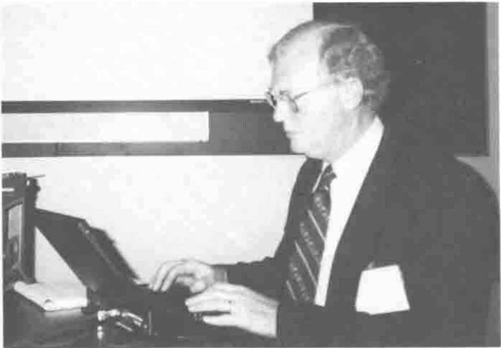
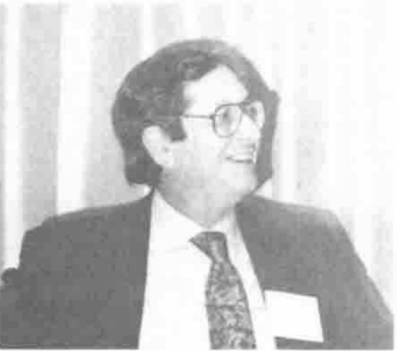
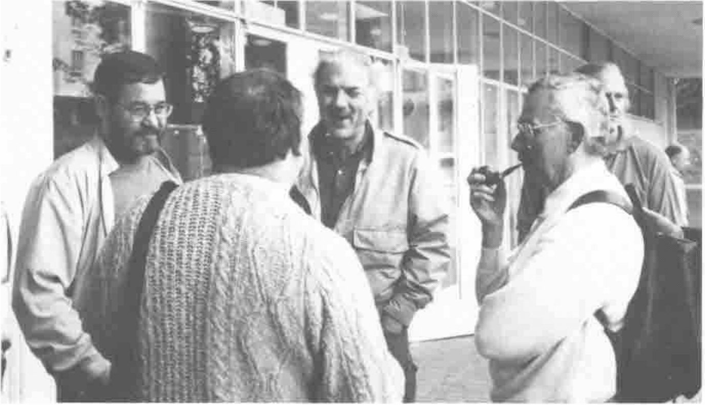

*by Richard Procter ([e-mail address omitted])*
{ .byline }

APL96 was a great conference for the Array Processing Languages consultant. The variety and depth of practical, hands-on training and information sessions was well beyond the norm, and greatly appreciated by attendees. New developments in APL/J products mean unprecedented opportunities for consultants to apply their skills in many business areas not previously open to array-oriented solutions. Connectivity and compatibility with other software was a big theme at the conference. Fitting APL/J into the rest of the business software world is facilitated by a number of new features and products now or soon to be available. Consultants should be looking to incorporate these emerging technologies into customer solutions in many application areas.

The conference facilitators arranged for two hands-on labs equipped with PCs running Windows (sadly, not Windows 95). Even though only about 150 attended the conference in total, several of the tutorial sessions were so popular, they had to be split into two sessions to accommodate the demand. The hottest sessions involved connectivity between APL and the rest of the world: e.g. TCP/IP and ODBC; and GUI programming techniques: Dyalog, Causeway. In addition to these topics, there was also plenty of traditional, and practical tutorial information for both beginners and experts: sessions on utility functions, enclosed arrays, operators, J programming techniques. Several papers and tutorials also addressed what I call the “academic side” of the APL/J community: neural networks, functional J, genetic algorithms, etc.

Presentations of submitted papers, it was mentioned at conference wrap-up, were generally poorly attended at the conference, due to the fact that these were competing for attention with the highly popular workshop/ tutorials. Future conference organizers will have to be mindful of this dichotomy if the emphasis on workshops continues, which hopefully it will.

I find that the best part of these conferences are the subtle surprises. They sometimes happen, for example, when you attend a session thinking that it has little relevance to your work, and will probably be dull, but there’s not much else happening so you go. In fact, that session then turns out to be one of the most fascinating of the conference, and furnishes you with great ideas for future work and study that you never even thought of before. The other great thing of course about conferences is the chance to meet colleagues from around the world and share ideas at the leading edge of APL development and application.

Another theme at the conference was the word “legacy”. So-called legacy APL systems are apparently still alive but some are not so well, and many need our help. The suggestion is that new products and features: Windows GUIs, database connectivity, OLE mechanisms, client-server techniques, etc. can and should all be used to spruce up these systems, bring them up to speed with the modern world, and blow any would-be competitive products out of the water, just like APL has been doing all along, some would say. Trouble is, as usual, APL suffers from a historical image problem (slow, weird, unmanageable, whatever...) that is often insurmountable. Eric Baelen of APL2000 made a passionate plea at the conference wrap-up to get out there and “blow the APL horn”, trumpet APL success stories from the highest hills, and build on these triumphs. Not a bad idea.

Here are my conference highlights, with details:

## Techniques/Workshops

**ODBC** — stands for Open Database Connectivity, a Microsoft standard for I/O with SQL-type relational databases (Oracle, Access, Dbase, etc.). APL systems have been talking to these centralized databases as a client for some time now, but what’s more exciting, APL can now act as an ODBC server, allowing other non-APL systems to talk to *its* database. This important feature will help existing APL systems keep doing what they do best, handle information in array-oriented fashion, yet still talk the same language as the rest of the world. Especially helpful for situations, as workshop presenter Morten Kromberg pointed out: “...when managers ask, ‘what’s the database written in?’ You reply: ‘why, it’s ODBC of course’, ...and they shut up”, he says.

**TCP/IP** — again, a big buzz-acronym in the client/server world, this technology, as session leader Timo Laurmaa puts it, is “... *the* communications protocol to connect computers together”, possibly running totally different systems on different platforms, allowing these to communicate across the office (Intranet) or across the world (Internet). Using an auxiliary processor developed by Lingo Allegro, APL can talk to other sessions, send and receive instructions and data, or act as host to other APL or non-APL client inquiries. The tools that were presented in this workshop are the building blocks for all sorts of interesting networking possibilities, locally and world-wide.

**GUI Programming** — several excellent sessions were devoted to this topic:

First was Eric Lescasse’s presentation using Oracle’s Delphi, a sort of enhanced Visual Basic-like programming and GUI development environment that has many powerful features for creating Windows forms and DLLs written in Delphi/Pascal. Linking these features to Dyalog APL afterwards seemed remarkably trivial, meaning that sophisticated and efficient applications can be created by using these tools to their best advantage along with APL left to do what it does best, handling data.

Next, Causeway and Dyalog, a couple of workshops led us step-by-step through the pitfalls and triumphs of putting together a GUI interface and its underlying code. Causeway especially simplifies the task of linking together objects on the GUI form with corresponding data, and makes the whole process of event-driven programming somewhat automatic. Causeway featured highly in one of the plenary session presentations, discussing an application where it was used to rapidly develop a highly sophisticated company business organizational model for the sixth largest software company in the world!

**Ed Shaw (APL Group Inc) leading the EDI Tutorial**

**EDI** — this was one of my surprises. I went not knowing a thing about Electronic Data Interchange, and came out of the session thoroughly convinced that here was an application that APL, with its rapid development time and array-handling properties, could excel at.

Ed Shaw of The APL Group, Inc., led the session, pointing out how important EDI is to the US government and business community (use it or you’ll soon be out of business!), and did a good job of showing how APL lends itself to what at first seemed to me to be a non-APL application. Definitely something to watch for in future.

**J Functional Programming** — Toronto’s Chris Burke led this fascinating session, explaining in his usual precise and excellently clear manner how the programmer who is still stuck back in APL-think can adopt and embrace functional J techniques by some simple extensions to that mindset. I scribbled four pages of notes, and left thoroughly convinced that J has a great future with its superior approach to array handling. ...now if only somebody would pay me some money to program in it...

## Vendor Forums

These sessions were popular and as usual, important for the consultant, bringing us all up to date with recent product releases and new features. Several very important announcements and features were unveiled at APL96:

**IBM**: announced to an ovation from the audience that finally, it would soon be releasing a version of APL2 for Windows (’95/NT), instead of “that other operating system” OS/2. This is welcome news, as I don’t know many people who were willing to put in the time, effort and hardware required to master OS/2, just to do APL. Apparently IBM will be shipping Beta versions of their new product soon, so get yourself on their mailing list if you want to be one of the Beta testers.

**Dyalog**: wild excitement swept the room when Dyalog demonstrated two stunning new features for its Version 8 product (Windows 95 & NT, and soon to be made backward compatible for Windows 3.1).

The first was “dynamic functions”, a concept which extends the notion of assigning snippets of function code to a name, so that small functions can now be defined using something similar to Iverson’s original “direct definition” methodology. Using this powerful feature means that writing small, readable functions and applying them, say to the cells of a nested array by using the each operator, now becomes trivial. Dynamic functions bring back the concept of specifying function definitions with implicit arguments (`⍺`, `⍵`) and an implicit result, with all variables automatically localized.

Dyalog’s second big crowd-pleaser was the announcement of full OLE support, so that programming done in APL can now be packaged up using Namespace methodology, into an “instance” and called from any non-APL task that talks OLE, in a background manner, without having explicitly to start up an APL interpreter. J has had this “background server” or “calculator engine” feature for some time, and now we will soon have it in APL as well. Again, welcome news, with lots of exciting implications for the APL implementor.

**APL2000**: Eric Baelen presented its Windows product, covering much of the same territory he demonstrated to a Toronto audience in June. Once again, good to see that development and enhancements to this excellent APL environment are ongoing. APL2000 also announced the return of its own annual User Conferences, with the first coming up in Florida this year in October.

**APEX**: not quite a product so not quite a vendor forum, but Bob Bernecky put on a brave performance to a sceptical and highly critical audience, outlining the latest progress and developments in his APL compiler. Seems that Bob has some distance to go before the naysayers of the APL community are convinced it will fly, but watch out if it ever does, as this product could go far in terms of dealing with those perennial problems that legacy APL system sceptics like to harp about.

## Other conference info

J vs APL? — this topic seemed to be a non-issue at APL96. Most people attended J and APL sessions both with enthusiasm. J is being embraced by APL people as a potentially useful array processing language, and seen by some as better than APL, although the majority still argue it requires a lot more careful study to comprehend and use.

APL employment? — again, another non-issue at this conference. Only a couple of jobs were posted on the bulletin board, and I heard almost nobody discussing the issue. I don’t believe that means that the issue has gone away, maybe it just took a back seat to other more important matters?

**Professor Annibali announcing the choice of Rome for APL98**

APL SIGs worldwide — a meeting among SIG executives from around the world was convened to discuss a few issues. We agreed to cooperate more fully to share information, be that electronically by posting announcements and newsletters, or in the traditional manner by sending each other newsletters. Some sort of centralization of APL SIG info worldwide was proposed, especially when it comes to speakers and meetings/event schedules. Look for a global SIG calendar online soon. We also discussed the lamentable situation that future APL conferences are in trouble due basically to lack of availability of people willing to volunteer their time and skills to help put one on. Apathy is reaching crisis proportions: APL96 was a miracle, considering how much work had to be done by so few people at the last minute. APL97 will be held somewhere on the East coast of United States, and APL98 is set to be hosted by an apparently enthusiastic local group in Rome, Italy. Conference costs are also a big discussion factor: how can we reduce them, boost attendance, and still deliver the goods?

Finally, Lancaster itself proved to be a hit with attendees. The historical centre, with its great selection of friendly pubs and restaurants made a welcome detour from the main conference venue, which was at the university, a short bus or cab ride out in the countryside. Getting past that classically unappetizing English cafeteria breakfast at the uni took some doing, and it was reassuring to see no radical changes to the traditional British “pub grub” on most menus in town.

**Sasha Skomorokhov and Chris Lincoln talking to Dieter Lattermann (Conference Chairman) and Mike Kent (Treasurer - back view)**

I would like to thank personally the organizers of APL96 for putting on what I think was the best conference ever in terms of excellent presentations and informative workshop and tutorial content that consultants like myself can put to immediate use in day-to-day customer support and future exciting APL/J projects. Let’s hope this trend continues.
