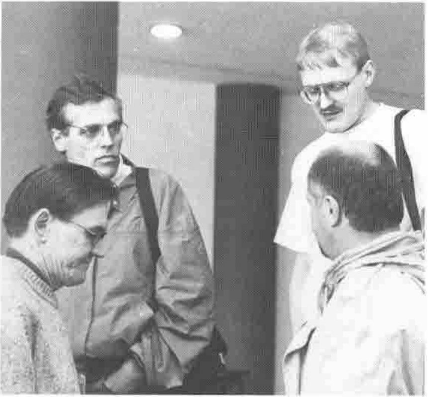
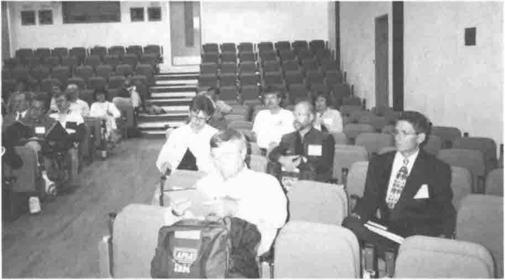

*by Adrian Smith*
{ .byline }

This felt like a very international gathering, certainly the University Conference Office had never seen anything like it before; the Lancaster House Hotel also coped remarkably well once it had recovered from the initial shock.

## Analysis of Delegates by Country

Here are the approximate numbers, taken from delegate list available at end of Conference — see note below. Cast in order of appearance!

| Country | Delegates |
|---|--:|
| Finland | 15 |
| USA | 36 |
| Spain | 1 |
| Italy | 3 |
| Germany | 16 |
| Canada | 10 |
| Netherlands | 9 |
| UK | 22 |
| Denmark | 13 |
| Sweden | 7 |
| Belgium | 1 |
| France | 6 |
| Switzerland | 4 |
| New Zealand | 1 |
| Japan | 4 |
| Russia | 4 |
| Ireland | 1 |
| Australia | 2 |
| Austria | 1 |
| Israel | 1 |
| Portugal | 2 |

**Part of the Finnish Delegation**

Note this does not include any “extras” as in accompanying persons. It also has inaccuracies, for example it includes at least one Frenchman who wasn’t there. Note too that “nationality” refers to current place of work/accommodation, such that for instance Mironov is recorded under France not Russia.

From my point of view, the thing I was most grateful for was everyone’s tolerance over the first day and a half, after which things started to move reasonably smoothly. Much of the impetus for this conference came very late in the day, and there were a good many pieces to pick up on the Saturday and Sunday morning, particularly when it came to setting up the labs and making sure the right kit was in the right rooms in the George Fox centre. Looking back over a hectic week, I can see a few names missing from the list of people who really ought to be thanked:

- Hilary Barraclough, who runs the University Conference office. She was remarkably forgiving when we decided at the last minute to change the layout of the tutorial rooms, which meant shifting out around 20 tables and moving in the seats to make space for an extra 30 or so delegates. She also managed the campus room-bookings with very little fuss and considerable efficiency.
- John Stewart, the audio-visual technician for the centre. At times we had three rooms on the go, all with high-quality computer projection and microphone sound. He was faced with a wide variety of hardware, and everything from Per Gjerløv’s Whale Songs (played directly from his PC) to Willi Hahn’s animations (from a portable RS/6000) worked first time. The last time we came close to this quality of AV support was at Canterbury in 1988, when the requirements were a lot simpler.
- Ian and Mark, the lab technicians from the engineering department, who worked late on Sunday to get us off to a solid start on Monday morning, and then came in every evening after the last workshop had finally ended (usually after 6.00) to set things up for the following day. We deliberately left the ‘hairy’ sessions (Timo and Morten) until the end of the week, by which time the setting-up was almost completely automatic. It was marvellous to set up a single ‘master’ machine and have it cloned around the room in less than a minute.
- Gary and Angie, who worked the front desk, got things copied, put up notices and managed not to lose their rag even when the lack of planning finally caught up with us and they were faced with a string of bemused delegates and a marked lack of helpful signposts on the Monday morning.
- John and Mrs De Lorenzo, who kept the bookings under control, knew who was entitled to what, and made sure everyone got the right bits and pieces when they arrived.
- Mike Kent, who had had it up to *here* with APL95, but was still willing to pick up the form-filling, look after the budget, make sure bills got paid and Vendors got invoiced, and was probably the person most responsible for the small profit that SigAPL made from the conference.
- The staff at the Lancaster House Hotel, who seem to have had remarkably little problem with the ‘evening seminars’ which typically disgorged at around 3.00am. I spoke to a good many delegates who were staying at the hotel, and none of them had anything but praise for the welcoming and relaxed atmosphere.
- Dieter Lattermann, who accepted the chairman’s role when we lost the original co-chairs back in September, and kept the conference quietly moving forward when it really looked as if it might stall completely. I think it is very likely that without his steadfastness, and the solid backing of the APL Club of Germany, APL96 would not have happened.

Finally, the family Smith, who came along for a pleasant week’s holiday and ended up spending most of the time fetching and carrying. Richard did a splendid job on Sunday installing Dyalog APL on around 20 PCs — doing it the hard way from floppy disk! At one point he had a perfect pipeline running — all seven disks installing simultaneously in seven machines. Then we hit one with a slow A: drive ..... Gill managed to talk French to the French and German to the Germans (alas she has yet to learn to converse in Finnish) and generally act as a human signpost and point of reference for a large number of delegates. Tim helped with the signposting, then just kept out of the way, playing Pool with the Baarghorn boys.

**The Main Lecture Hall**

## Conference Highlights

I thought we had a really solid set of plenary sessions, and that the vendor forums were well-attended and very well presented. The stuff on dynamic functions (Dyadic) came as a complete surprise, and looks to be a real step forward in bringing some of the J ideas back into the APL mainstream. For the first time since I-APL, we now have the option of developing our applications entirely from script files and using the workspace simply as a superb memory manager. I can’t wait to try it — my only regret is that I was not wearing my APL88 tee-shirt which John Scholes could have executed `{⍵⌹⍵∘.*0}` to obtain an average.

The most memorable moment came in Chris Burke’s tutorial on J operators. He worked mostly in Dyalog APL, which has many of the advanced features such as function assignment and a commute operator, and only after demonstrating the APL approach did he reproduce the effect in J. Phil Benkard came in a few minutes late, and sat down looking extremely sceptical — then he began to get seriously interested as he realised that J has been using its weird ascii spelling to conceal a good many ideas that Phil has been trying to get into APL2 for years!

## Summarised Results from Dick Holt’s Feedback Survey

The table shows the average of non-blank scores on a scale of 1 (most satisfied) to 5 (least satisfied) for various Conference features. Scores from the more general survey in 1994 are shown to the right for comparison.

| *APL96* | | *1994 Survey (for comparison)* | |
|---|--:|---|--:|
| *Tutorials* | 1.95 | *Proceedings* | 1.73\* |
| *Workshops* | 1.95 | *Location* | 1.76\* |
| *Location* | 2.11\* | *Vendor information* | 1.80 |
| *Vendor Information* | 2.20 | *Program* | 2.00 |
| *Housing* | 2.26 | *Social/Vacation* | 2.08 |
| *Program* | 2.54 | *Workshops* | 2.20 |
| *Software Exchange* | 2.60 | *Banquet* | 2.23 |
| *Cost* | 2.74 | *Birds of a Feather* | 2.52\* |
| *Business Opportunities* | 2.83\* | *Tutorials* | 2.58 |
| *Birds of a Feather* | 2.83\* | *Housing* | 2.59 |
| *Social/Vacation* | 2.83 | *Poster Sessions* | 2.67\* |
| *Banquet* | 3.15 | *Software Exchange* | 2.69 |
| *Job Opportunities* | 3.50\* | *Cost* | 3.01 |
| *Poster Sessions* | 3.70\* | *Business/job oppty* | 3.38\* |

\* not comparable; Birds of a Feather, Poster Sessions, and Proceedings were missing at APL96. Business opportunities and job opportunities were combined in the 1994 survey, but split in the APL96 survey. The fact that data aren’t comparable is a healthy measure of the ability of APL Conferences to evolve and adapt to changing conditions.
