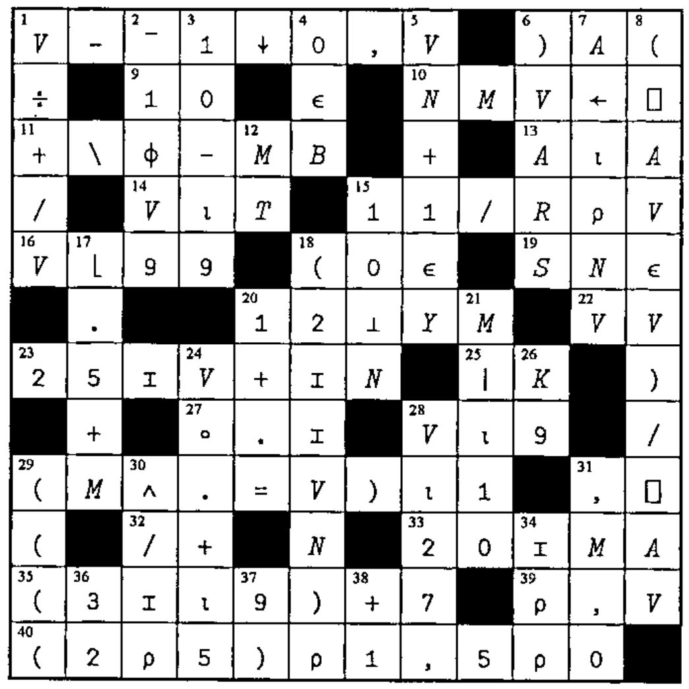
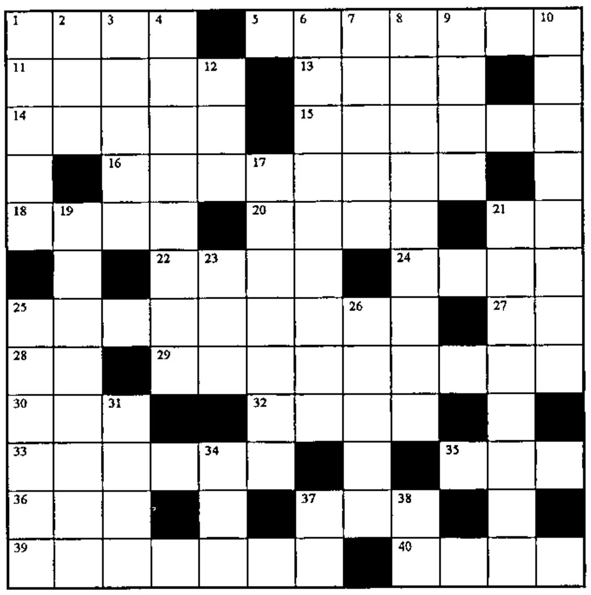

## Solution to Crossword from Vector 15.3

*[Vector Production] This faithfully reproduces Gary's original. Vector Production reckons that the 'i-beam' characters are really multiplication signs. What do you think?*

## Crossword

### Across

1. `V[I]×B[(1+⍴B)-I]` for *I* from 1 to `⍴V`, for origin 1 with `(⍴B)=(⍴V)`
5. A random integer from 0 to 4, with 0 half as likely as the others
11. `⍳(⍴V)+(⍴B)`
13. The matrix *F* with its first `M5` columns made last
14. The values in *A* rounded to the nearest integer (.5 down not up)
15. Are all the elements of the vector *VN* larger than zero?
16. The difference of 102 and one-fifth *S*
18. `(V≠25)/V`
20. Flag the 52s in *N*
21. Get outta here!
22. `0` where `S=V`, `1` where `S>V`, `¯1` where `S<V`
24. `2⌽'(0|A÷B)×C'~'ABC×',⍕0`
25. The index of the first row of the matrix *M* that CONTAINS the vector *V*
27. The number of rows and columns in *K*
28. The vector `1 2 3 ... L`
29. `(RV-1),(RV-2),...,(RV-(10+VC))`
30. An empty vector with the same datatype as the scalar *S*
32. Random one-element vector from `¯1` to `¯9`
33. Get objects from a stored workspace IF they're not in the active workspace
35. All but the first *N* elements of the vector *V*
36. The number of dimensions in *A*
37. Deal a card from the deck
39. Famous earless APL programmer, \_\_\_\_\_\_\_ Van Go To
40. Deal five cards from the deck

### Down

1. `(⍒V)[⎕IO]`
2. Is the vector *A* nonempty?
3. Subtract 12 from each element of *V*; then reverse their order
4. Stick onto matrix B a new column, using the numbers in the vector *VR* divided by 20
6. The index of the first row of the matrix *M* that MATCHES the vector *V*
7. Five random numbers from 1 to 25, with replacement
8. `2÷109÷(9↓V),9↑V` if `(⍴V)≥9`
9. The available programs
10. The vector *KC* with negative values replaced by zero and padded to length 500
12. A good name for a function that bombs a lot
17. `M+Y-N` without using `+`
19. For a bit vector *A*, where `L←⍴A`, reshape bits *I* to length *P*, pad to the length of *A*, and compare *A* to see where neither is true
21. `((⍴V)=0)/L5`
23. Flag the occurrences of the (start of) substring *S* in the vector *V*
25. The first element of any nonempty array *V*, as a scalar
26. The vector `1 2 3...` up to some random number between 1 and 55
31. Cumulative reduction
34. What the circle `○` function is easy as
37. A random integer scalar from 1 to *T*
38. `⍕⍎⌽'2*5'`
