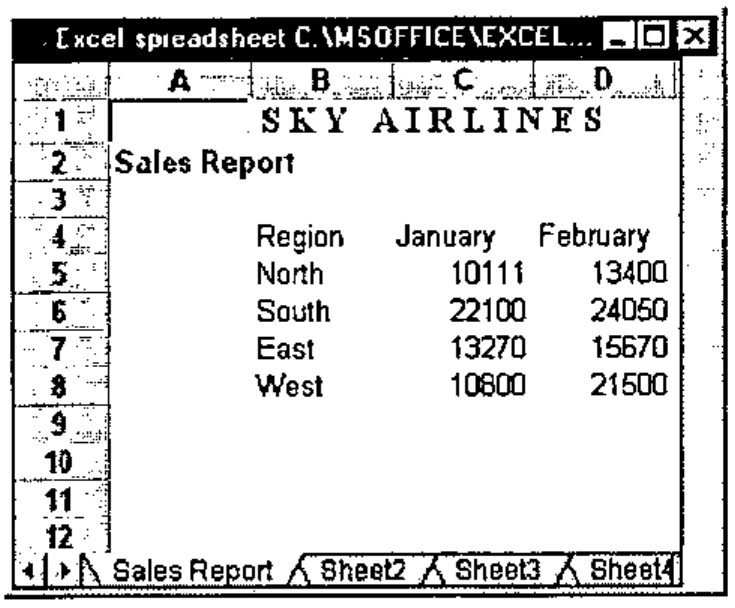
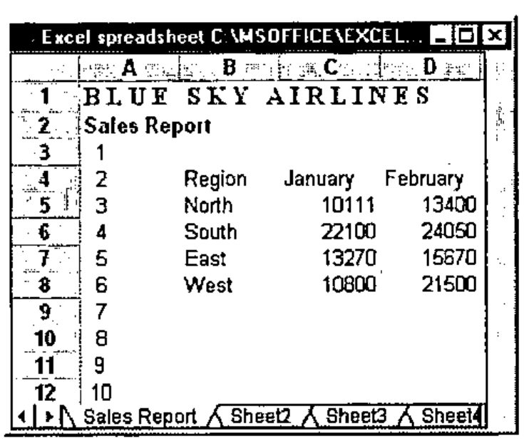

*From: Ajay Askoolum, 18th January 1999*
{ .byline }

Very interesting to read Jonathan Barman’s *VideoSoft FlexGrid Pro with APL+Win* in Vector 15.3. I have been using another OCX control, Formula One, from Tidestone Technologies. Formula One offers two nice features

1. It can read Excel spreadsheets (without graphs), tab delimited text files etc.

   For example,

```apl
ReadExcel 'C:\MSOFFICE\EXCEL\EXAMPLES\SALES.XLS'
```



```apl
∇ ReadExcel R
[1]   ⍝ Demo FORMULA ONE reading EXCEL spreadsheets
[2]
[3]   'EXCEL' ⎕wi 'Delete'
[4]
[5]       ⎕wself←'EXCEL' ⎕wi 'New' 'Form' 'Hide'
[6]           ⎕wi 'caption' ('Excel spreadsheet ',R)
[7]           ⎕wi 'Set' ('where' 0 0) ('size' 15 60)
[8]
[9]       ⎕wself←'EXCEL.SS' ⎕wi 'New' 'VC Formula One 5.0 Workbook'
[10]          ⎕wi 'Set' ('where' 0 0) ('size' 15 58)
[11]          ⎕wi 'XHeapMin'
[12]          0 0⍴⎕wi 'XRead' R 4
[13]          ⍝ 2=Excel 4, 3=TAB delimited text files 4=Excel 5.0 etc
[14]
[15]
[16]  'EXCEL' ⎕wi 'Wait'
  ∇
```

2. It has an array facility with its properties (note the []).

```apl
'EXCEL.SS' ⎕wi 'xTextSRC[]' (1,(,['']2+⍳10),1) (⍕,['']⍳10)
```



However, you won’t find the array extension documented with the Formula One package. Most cell manipulation properties support it.

In general, in order to find all the properties, methods and events of an OCX supported by APL+Win, create an instance of it (EXCEL.SS, here), then

```apl
methods←⊃'EXCEL.SS' ⎕wi 'methods'
properties←⊃'EXCEL.SS' ⎕wi 'properties'
events←⊃'EXCEL.SS' ⎕wi 'events'
```

Having established the methods, properties and events, basic documentation on any one of these can be displayed in the APL session. For example,

```apl
'EXCEL.SS' ⎕wi '?xTextSRC[]' ⍝ Note single ?

xTextSRC      Sets or returns the text value of the specified cell.
  Ref         String <- xTextSRC(Long nSheet, Long nRow, Long nCol)
  Set         xTextSRC(Long nSheet, Long nRow, Long nCol) <- String
```

or

```apl
'EXCEL.SS' ⎕wi '??xTextSRC[]' ⍝ Note double ?
```

which displays the text above in the APL session and call the Formula One help file and display the topic `xTextSRC[]`. However, the help file does not contain the array topics. Therefore you’d have to look for TextSRC.

This way of finding the properties, methods and events of any OCX works. First create an instance of the OCX, in this example Excel 5.0

```apl
    ∇ Excel5
[1]   '#' ⎕wi 'Reset'
[2]   'XL' ⎕wi 'New' 'Excel.Application'
[3]   'XL' ⎕wi 'caption' 'APL running EXCEL'
[4]   'XL' ⎕wi 'visible' 1
[5]
[6]   'Now Open a workbook'
    ∇
```

This instance of Excel 5.0 does not open a workbook, so it must be done manually. Excel 97 opens a workbook. Now, create some children

```apl
    ∇ ExcelHierarchy
[1]
[2]   ⍝ Workbook must be open
[3]   'XL' ⎕wi 'Workbooks>XL.WB' 1
[4]   'XL.WB' ⎕wi 'xActiveSheet>XL.SH'
[5]   'XL.SH' ⎕wi 'xUsedRange>XL.UR'
[6]   'XL.UR' ⎕wi 'FormulaR1C1'
[7]   'XL.UR' ⎕wi 'Formula'
[8]   'XL.UR' ⎕wi 'ClearContents'
    ∇
```

The properties, methods, events of each object can be found in a similar way :

```apl
properties←⊃object ⎕wi 'properties'

Try

'XL.SH' ⎕wi 'properties'
'XL.UR' ⎕wi 'properties'
```

Finally, what OCXs are available to APL+Win? That is, which OCXs are registered? On my PC,

```apl
⍴'#' ⎕wi 'XInfo'
466 3
```

You can filter the OCXs

```apl
⍴'#' ⎕wi 'XInfo' 'Excel'
4 3
```

The last expression returned all the OCXs with the word Excel in their registration.

OCX vendors simply do not mention APL in their documentation. However, the Formula One web site occasionally documents APL/FORMULA ONE problem resolution.
