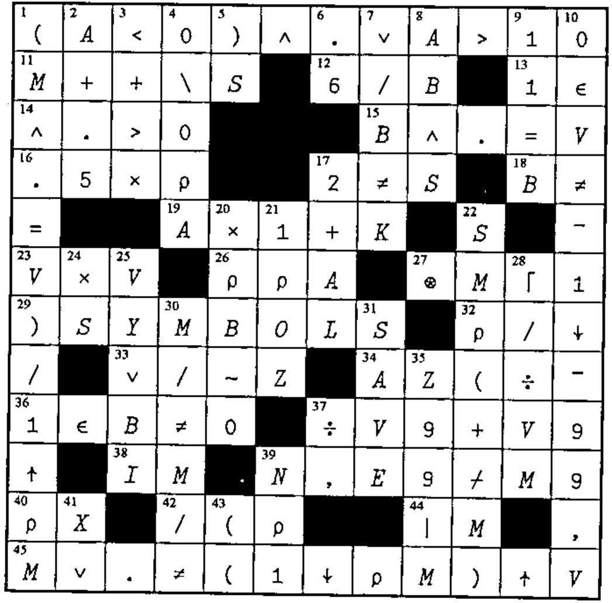
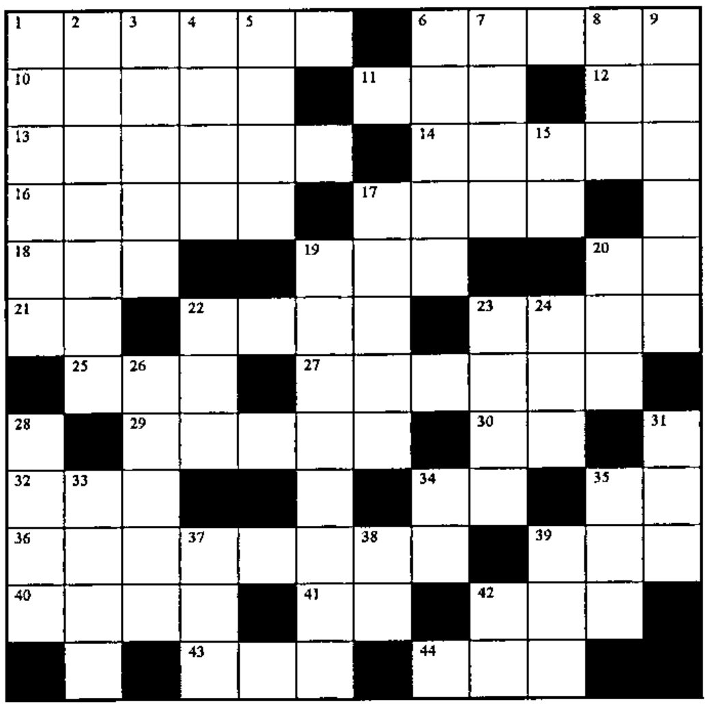

## Solution to Crossword from Vector 16.1

## Crossword

### Across

1. Are all elements of the vector A negative or greater than 10?
11. The running balance, given the starting balance M and the vector S of deposits and withdrawals.
12. Expand the matrix B by repeating each column six times
13. Any
14. All positive
15. `B≡V` for vectors B and V
16. Half the length of
17. `~2=S`
18. B isn’t
19. The value of A in one year at annual interest rate K (e.g. 0.07)
23. `V*2`
26. The number of dimensions of A
27. The natural log of M, but avoid a negative result or an error message
29. How many variable, function or label names have been used?
32. `3⍴'⍴',⍉2 2⍴'/\↓↑'`
33. Are any of Z false?
34. `(20⍴0 0 1 0)/'(MATX+Z)*-(TAB÷K)ׯ3'`
36. Does the vector B contain any nonzeros? (Compare to 20 Down)
37. `1÷V9×2`
38. A good variable name for a matrix of whole numbers
39. Extract the rows from matrix M9 corresponding to 1s in bit vector E9, and precede each row by the scalar N
40. The length of the vector X
42. `2⌽¯3↑7⍴'⍴/\)('`
44. The magnitude of M
45. Flag the rows of the matrix M that do not match the vector V (padded with blanks or truncated to conform with M)

### Down

1. The indices in the matrix M of the rows that match the vector V (but omit the ninth symbol from the expression)
2. The first step to round A
3. `1⌽⌽'>+<×'`
4. 0 if A is numeric, blank if character.
5. What `)SAVE`, `)SI`, and `)SYMBOLS` have in common
6. `÷5÷3`
7. Are any of the elements of the vector B not the constant K?
8. The product of Booleans AB and S
9. `0=B-11`
10. Does the sorted vector V, which does not contain ¯99, contain duplicates?
17. The integer AL, incremented twice
20. Does the vector B contain any nonzeros (Compare to 36 Across)
21. The first element in the array OZ
22. The denominator, with redundant parentheses, of the expression that scales the values of the matrix M so each column adds to 1 (given `SM←⍴M`).
24. S>0, for nonnegative S
25. Return bit vector BI if VY=0, or all 1s if VY=1
28. The largest reciprocal in the vector VM
30. `6⍴⌽'(A≠B)/M'~'(AB)'`
31. What to do often when power failures are common
35. The remainder of `M÷Z99`
37. `'÷×+-'[?⎕IO],,','`
39. N/1 for scalar N
41. The \_\_\_\_cist eliminates APL demons
43. The square root of one-third the sum of A and B (The first two symbols)
