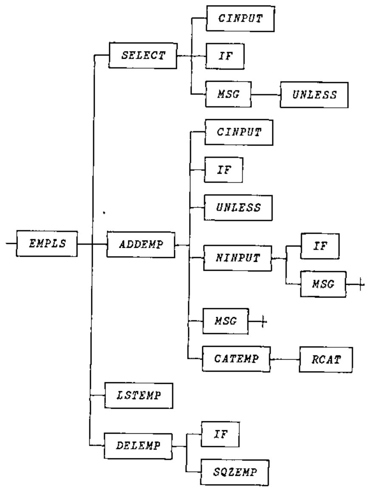
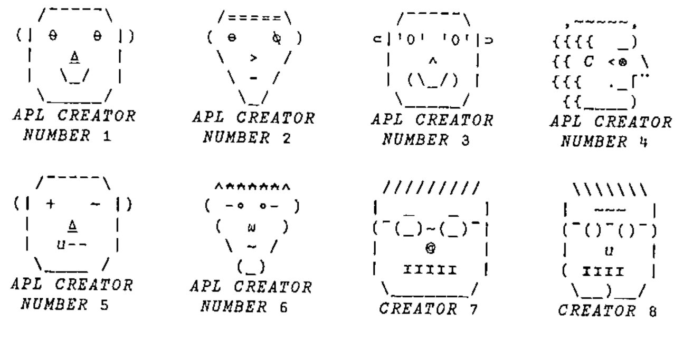

*introduced by Jon Sandles*
{ .byline }

Thank you to the few who noticed that in the last issue we reprinted the same crossword (but with the solution ... so it was a bit easier!) Many apologies for this error, this time we should have a new crossword and a continuation of the tree function analysis puzzles. I once again encourage you all to try and shed new light on these problems, particularly in the context of namespaces or even J locales.

## UTILITY CORNER: Identifiers Within Functions

(The purpose of this column is to make you more productive by introducing you to utility functions. Think of utility functions as APL functions that have names instead of symbols. By expanding your function vocabulary, you’ll be able to write APL code that’s more concise, more efficient, and more readable.)

In last issue’s LIMBERING UP column, we asked you to write a function named `ANALYZE` that analyses the identifiers used in the function whose name is given as the right argument. Consider this function to be analysed:

```apl
      ∇ IND←CHOICES SELECT PROMPT;R
[1]    ⍝ Ask for choice:
[2]    ASK:R←CINPUT PROMPT
[3]    ⍝ Search choices for 1st char of response:
[4]     IND←CHOICES⍳1↑R
[5]    ⍝ Ask again if not a valid choice:
[6]     →ASK IF(IND>⍴CHOICES)MSG'INVALID CHOICE.'
      ∇
```

Here’s an illustration of the `ANALYZE` function:

```apl
      )FNS
ANALYSE   SELECT
      )VARS
                              No variables
      ANALYSE SELECT
      )VARS
ARGS  FNS  IDS  LABELS  LOCALS  RESULT
      ARGS
CHOICES
PROMPT
      FNS
ANALYSE
SELECT
      IDS
ASK
R
CINPUT
PROMPT
IND
CHOICES
R
ASK
IF
IND
CHOICES
MSG
      LABELS
ASK
      LOCALS
R
      RESULT
IND
```

As you can see, `ANALYZE` builds six global variables. Each of the variables is a character matrix with one name per row. Short names are left-justified. Here’s what they represent:

| | |
|---|---|
| `FNS` | the names of the functions in the workspace |
| `RESULT` | the name of the result variable (0 rows if none) |
| `ARGS` | the names of the argument variables (0, 1 or 2 rows) |
| `LOCALS` | the names of the variables localised in the header, i.e. preceded by `';'` |
| `LABELS` | the names of the labels, i.e. the names beginning a function line and followed immediately by `':'` |
| `IDS` | the names of all identifiers within the body of the function (all lines but the header), ignoring names within comments or quotes; you may include or ignore label names, at your whim. |

All six character matrices have the same number of columns, namely as many as the longest name in `FNS`. Any longer names are omitted. Names that begin with the `⎕` symbol, such as `⎕IO` or `⎕PW`, are omitted.

Here’s one solution to the problem:

```apl
      ∇ ANALYZE FNAME;COLS;CR;HDR;I;LEN;LET;MAX;N;NUM;OK;
        START;VC;WID;⎕IO
[1]    ⍝ Analyses the identifiers within the function named
[2]    ⍝ in FNAME.  In particular, the ANALYZE function
[3]    ⍝ creates six global variables: FNS, RESULT, ARGS,
[4]    ⍝ LOCALS, LABELS, and IDS.  Each of the global
[5]    ⍝ variables is a character matrix with one name per
[6]    ⍝ row.  Short names are left-justified, i.e. padded to
[7]    ⍝ the right with blanks. Here⍋s what they contain:
[8]    ⍝
[9]    ⍝  FNS     The names of the functions in the workspace
[10]   ⍝  RESULT  The name of the result variable (0 rows if
[11]   ⍝          none)
[12]   ⍝  ARGS    The names of the argument variables (0, 1,
[13]   ⍝          or 2 rows)
[14]   ⍝  LOCALS  The names of the variables localised in the
[15]   ⍝          header, i.e. preceded by ';'
[16]   ⍝  LABELS  The names of the labels, i.e. the names
[17]   ⍝          beginning a function line and followed
[18]   ⍝          immediately by a ':'
[19]   ⍝  IDS     The names of all identifiers within the body
[20]   ⍝          of the function (all lines but the header),
[21]   ⍝          ignoring names within comments or quotes.
[22]   ⍝
[23]   ⍝ All size matrices have the same number of columns,
[24]   ⍝ namely as many as the longest name in FNS.  Any
[25]   ⍝ longer names are omitted.  Names that begin with the
[26]   ⍝ ⎕ symbol, suchas as ⎕IO or ⎕PW, are omitted.
[27]   ⍝
[28]    ⎕IO←0 ⍝ Origin 0 simplifies the logic a bit
[29]    FNS←⎕NL 3 ⍝ Char matrix of fns in the ws
[30]    COLS←1↓⍴FNS ⍝ No. cols in each global results
[31]    CR←⎕CR FNAME ⍝ Canonical rep (char mat) of fn
[32]    WID←⍴HDR←CR[0;] ⍝ Fn header and width of ⎕CR
[33]   ⍝ HDR←(HDR⍳'⍝')↑HDR ⍝ In APL2, drop any hdr comment
[34]    CR←1 0↓CR ⍝ Body of fn
[35]    LEN←('←'∊HDR)×HDR⍳'←' ⍝ Length of result var if any
[36]   ⍝ RESULT is 0 or 1 row matrix (0 if too long)
[37]    RESULT←(((LEN≤COLS)∧×LEN),COLS)⍴COLS↑LEN↑HDR
[38]    HDR←(LEN+×LEN)↓HDR ⍝ Drop result var and '←'
[39]    HDR←(+/∨\⌽HDR≠' ')↑HDR ⍝ Delete trailing blanks
[40]    LEN←HDR⍳';' ⍝ Length of fn syntax
[41]    ARGS←LEN↑HDR ⍝ Select syntax
[42]    HDR←LEN↓HDR ⍝ Drop syntax, leaving semicolon
[43]    I←(ARGS=' ')/⍳LEN ⍝ Indices of blanks
[44]    N←⍴LEN←(I,LEN)-0,I+1 ⍝ Lengths of names in syntax
[45]    MAX←⌈/LEN ⍝ Length of longest name
[46]   ⍝ Convert to a matrix:
[47]    ARGS←(N,COLS)↑(N,MAX)⍴(,LEN∘.>⍳MAX)\ARGS-' '
[48]   ⍝ Select args, not fn name, unless too long:
[49]    ARGS←((LEN≤COLS)∧(N≥3 1 2)/1 0 1)⌿ARGS
[50]    I←(HDR=';')/⍳LEN←⍴HDR ⍝ Indices of semicolons
[51]    N←⍴LEN←(1↓I,LEN)-I+1 ⍝ Lengths of locaised names
[52]    MAX←⌈/LEN ⍝ Length of longest name
[53]   ⍝ Convert to a matrix
[54]    LOCALS←(N,COLS)↑(N,MAX)⍴(,LEN∘.>⍳MAX)\HDR-';'
[55]    LOCALS←(LEN≤COLS)⌿LOCALS ⍝ Ignore long ones
[56]    OK←=\CR≠'''' ⍝ Flag code NOT within quotes
[57]   ⍝ Flag code NOT within comments or quotes:
[58]    OK←OK∧∧\OK≤CR≠'⍝'
[59]   ⍝ Chars that can begin identifier names:
[60]    LET←'ABCDEFGHIJKLMNOPQRSTUVWXYZ∆abcdefghijklmnopqrs
        tuvwxys⍙'
[61]   ⍝ Other valid chars (plus ¯ and _ if allowed):
[62]    NUM←'0123456789'
[63]   ⍝ Flag any valid chars, adding col for ending IDs:
[64]    VC←,(OK∧CR∊LET,NUM),0
[65]   ⍝ Flag start and end (+1) of each run:
[66]    VC←VC≠¯1↓0,VC
[67]    N←⍴IDS←VC/⍳⍴VC ⍝ Convert to indices
[68]    IDS←((N÷2),2)⍴IDS ⍝ Two-col mat of start/end inds
[69]    CR←,CR,' ' ⍝ Ravel code and pad to match VC
[70]    START←IDS[;0] ⍝ Start indices
[71]    LEN←IDS[;1]-START ⍝ LEngths of names
[72]   ⍝ Must start with a letter, not be too long, and not
[73]   ⍝ be preceded by a '⎕' (e.g. ⎕IO):
[74]    OK←(CR[START]∊LET)∧(LEN≤COLS)∧'⎕'≠CR[0⌈START-1]
[75]    START←OK/START ⍝ Squeeze out bad ones
[76]    N←⍴LEN←OK/LEN
[77]    IDS←(N×COLS)⍴' ' ⍝ IDS in raveled form
[78]   ⍝ I←(⍳LEN[0]),(⍳LEN[1]),(⍳LEN[2]),...:
[79]    I←LEN/¯1↓0,+\LEN
[80]    I←(⍳⍴I)-I
[81]   ⍝ Insert IDS where they belong
[82]    IDS[I+LEN/COLS×⍳N]←CR[I+LEN/START]
[83]    IDS←(N,COLS)⍴IDS ⍝ Reshape to a matrix
[84]   ⍝ Labels start a line and are followed by a colon:
[85]    LABELS←((0=(WID+1)|START)∧CR[START+LEN]=':')⌿IDS
      ∇
```

Though this function is extensively commented, some additional remarks are in order. We described the `⎕CR` (canonical representation) and `⎕NL` (name list) system functions in the last issue of the News. The former returns a character matrix image of the function and the latter returns a character matrix of the names of the functions in the workspace (for `⎕NL 3`). Let’s trace some of the important lines:

```apl
[29] FNS:  ANALYZE          These are the only functions
           SELECT           in the workspace

[31] CR:   IND←CHOICES SELECT PROMPT;R
           ⍝ Ask for choice:
           ASK:R←CINPUT PROMPT
           ⍝ Search choices for 1st char of response:
           IND←CHOICES⍳1↑R
           ⍝ Ask again if not a valid choice:
           →ASK IF(IND>⍴CHOICES)MSG'INVALID CHOICE.'

[32] HDR:  IND←CHOICES SELECT PROMPT;R

[37] RESULT:  IND

[39] HDR:  CHOICES SELECT PROMPT;R

[41] ARGS:  CHOICES SELECT PROMPT

[42] HDR:  ;R

[44] LEN:  7 6 6

[49] ARGS:  CHOICES
            PROMPT

[55] LOCALS:  R

[56] OK:   111111111111111111111111111111111111111111
           111111111111111111111111111111111111111111
           111111111111111111111111111111111111111111
           111111111111111111111111111111111111111111
           111111111111111111111111111111111111111111
           111111111111111111111111000000000000000011

[58] OK:   000000000000000000000000000000000000000000
           111111111111111111111111111111111111111111
           000000000000000000000000000000000000000000
           111111111111111111111111111111111111111111
           000000000000000000000000000000000000000000
           111111111111111111111111000000000000000011

[64] VC:  ,0000000000000000000000000000000000000000000
           1110101111110111111000000000000000000000000
           0000000000000000000000000000000000000000000
           1110111111101010000000000000000000000000000
           0000000000000000000000000000000000000000000
           0111011011100111111101110000000000000000000

[66] VC:  ,0000000000000000000000000000000000000000000
           1001111000001100000100000000000000000000000
           0000000000000000000000000000000000000000000
           1001100000011111000000000000000000000000000
           0000000000000000000000000000000000000000000
           0100110110010100000011001000000000000000000

[70] START:43 47 49 56 129 133 141 143 216 220 223 228 236
[71]   LEN: 3  1  6  6   3   7   1   1   3   2   3   7   3
[74]    OK: 1  1  1  1   1   1   0   1   1   1   1   1   1
[75] START:43 47 49 56 129 133     143 216 220 223 228 236
[76]   LEN: 3  1  6  6   3   7       1   3   2   3   7   3

[80]  I: 0 1 2, 0, 0 1 2 3 4 5, 0 1 2 3 4 5, 0 1 2,
         0 1 2 3 4 5 6, 0, 0 1 2, 0 1, 0 1 2 ,
         0 1 2 3 4 5 6, 0 1 2

[82] CR[I+LEN/START]
         ASKRCINPUTPROMPTINDCHOICESRASKIFINDCHOICESMSG

[83]  IDS:  ASK
            R
            CINPUT
            PROMPT
            IND
            CHOICES
            R
            ASK
            IF
            IND
            CHOICES
            MSG

[85] LABELS:  ASK
```

Incidentally, the `=\` function, which converts pairs of `0`s to runs of `0`s, and the `∧\` function, which converts all `1`s after the leading `1`s to `0`s, can be replaced by the `≠\` function, which converts pairs of `1`s into runs of `1`s , and the `∨\` function, which converts all `0`s after the leading `0`s to `1`s. Here are the two sets of logic:

Current logic:

```apl
 OK←=\CR≠'''' ⍝ Flag code NOT within quotes
⍝ Flag code NOT within comments or quotes:
 OK←OK∧∧\OK≤CR≠'⍝'
⍝ Flag any valid chars, adding col for ending IDs:
 VC←,(OK∧CR∊LET,NUM),0
```

Alternative logic:

```apl
 NOK←≠\CR='''' ⍝ Flag code within quotes
⍝ Flag code within comments or quotes:
 NOK←NOK∨∨\NOK<CR='⍝'
⍝ Flag any valid chars, adding col for ending IDs:
 VC←,(NOK<CR∊LET,NUM),0
```

What happens if you use the `ANALYZE` function to analyse a function named `START`?

It won’t work. Why? Because the name `START` has been localised in the header of the `ANALYZE` function and is used therein as a variable. Hence, the global definition, the `START` function, is “shadowed” by the local `START` variable while `ANALYZE` is running. In particular, the `⎕NL` system function (line `[29]`) sees `START` as a variable, not a function, and so does not return it in its list of function names. Likewise, the `⎕CR` system function (line `[31]`) returns an empty character matrix since its argument is the name of a variable, not a function.

This shadowing problem exists for all the names local to `ANALYZE`, including the argument `FNAME` and the names of any labels (luckily there aren’t any). How can this problem be avoided?

It can’t. But you can minimise its impact by using bizarre variable names – names that aren’t likely to be used as function names. A name like `⍙67⍙XX` is pretty unlikely to be used as a function name. Unfortunately, screwball names like `⍙67⍙XX` will tend to make the `ANALYZE` function pretty unreadable. A good compromise is to use names that are just a little screwy, like `∆START` or `∆∆START` or `∆START∆`.

For now, we’ll leave the `ANALYZE` function as it is, and pray that we won’t need to analyse any functions with shadowed names.

## LIMBERING UP: Identifiers Within Functions

(The purpose of this column is to work some flab off your APL midsection. Like muscles, your APL skills can atrophy if not exercised with adequate frequency and variety. This column presents a task for you to perform. Set aside a few minutes from your busy schedule and work the task. Mail in your solution and stay tuned for the results.)

Two issues ago, we introduced a utility function name `FNTREE` that displays a tree diagram of the subfunctions (their subfunctions) called by a specified function in the workspace. The right argument of `FNTREE` is the name of the function to be diagrammed. The result is a character matrix of the tree diagram. See over ....

```apl
      FNTREE 'EMPLS'
```



Last issue, we discussed the logic for constructing the tree diagram. This issue (in the UTILITY CORNER column), we discuss the logic for analysing the identifiers used within a function. Next issue, we’ll present the finished product, in which we put it all together. In the meanwhile, one sticky problem remains.

Given the global variables `FNS`, `RESULT`, `ARGS`, `LOCALS`, `LABELS`, and `IDS` generated by the `ANALYZE` function, you still need to determine which of the identifiers represent subfunctions. In particular, the names in `IDS` that are found in `FNS`, but are not found in `RESULT`, `ARGS`, `LOCALS`, or `LABELS`, are subfunctions.

We’d like to express these subfunctions as a vector of row indices into `FNS`. But how?

If these six global variables were vectors of identifying numbers, rather than matrices of identifying names, the logic could proceed like this:

```apl
⍝ Make the identifiers distinct:
 IDS←((IDS⍳IDS)=⍳⍴IDS)/IDS
⍝ Eliminate those that are local:
 IDS←IDS~RESULT,ARGS,LOCALS,LABELS
⍝ Consider only those globally defined as functions:
 IDS←(IDS∊FNS)/IDS
⍝ Convert to indices into FNS:
 IDS←FNS⍳IDS
```

Straightforward but worthless. The six variables are matrices, not vectors. The dyadic `⍳`, `∊`, and `~` functions work on vectors, not matrices.

Your task is to write a set of APL expressions that generate the desired result. In particular, incorporate the expressions in a function named `SUBFNS`, which accepts all six variables (`FNS`, `RESULT`, `ARGS`, `LOCALS`, `LABELS`, `IDS`) as global arguments and which returns as an explicit result the row indices into `FNS` of the distinct rows of `IDS` not found in `RESULT`, `ARGS`, `LOCALS`, or `LABELS`, but found in `FNS`.

To illustrate, suppose the six variables have the values indicated earlier in this newsletter, except suppose `FNS` has five rows:

```apl
      FNS
ANALYZE
CINPUT
IF
MSG
SELECT
      SUBFNS
2 3 4
```

The result (`2 3 4`) indicates that the only names in `IDS` that are in `FNS` but not in `RESULT`, `ARGS`, `LOCALS`, or `LABELS` are the names found in `FNS[2 3 4;]`.

The `SUBFNS` function should be as efficient as possible. If your APL system supports nested arrays and you believe a nested solution is the most efficient, you’re welcome to use nested constructs. In APL2 use `⊂[2]MAT` to convert a matrix to a vector of vectors; in APL\*PLUS, use `↓MAT`; in Sharp APL use `<⍤MAT`.

Please send your solutions (on paper or disk) to:

> Vector Production, Brook House<br>
> Gilling East<br>
> York YO63 4JJ, UK

or via email to Vector Production at apl385@compuserve.com .

We also welcome your version of the completed `FNTREE` function. Look over the discussions in the last few issues of the Zark APL Tutor News and decide how you would put it all together.

Finally, we’d like to make a request to the artist in you. Those of you who use the Zark APL Tutor are familiar with the faces of the “APL Creators.” Throughout the course, the faces pop up to debate various design objectives and implementation issues.

We recently received a note from a Tutor user who wanted to give our Creators a face-lift. He offered some new faces. Below are the Creator faces currently in use or under consideration. Please drop us a note voting for your favourites. We even welcome any new faces you design. Some restrictions though:

1. The face must fit within a 7-row, 11-column character matrix (including the “`APL CREATOR NUMBER` n” label).
2. Since the Tutor runs under APL\*PLUS PC, APL\*PLUS II, and APL2 mainframe, you should try to use only characters that are common to these (and future) platforms. In other words, avoid characters that are too strange (like © on the PC) or that aren’t supported on some display terminals (like `≡` and `⍷` on the mainframe.)
3. The face should not look too much like the face of an actual APL creator, lest he sense the frustrated vibes of a Tutor voodoo user. (Say THAT five times fast!)



---

*Reprinted with kind permission from Zark APL Tutor News, a quarterly publication of Zark Incorporated, 23 Ketchbrook Lane, Ellington, CT06029, USA.*
