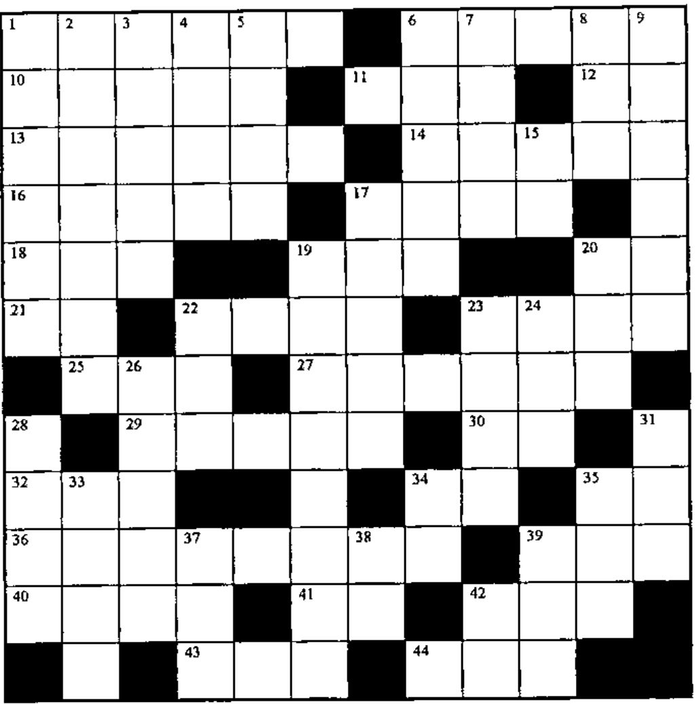

### Across

1. In the beginning...
6. Where did these come from?
10. The indices of the 1 bits in the vector P
11. Wait awhile
12. `'(⍳5)×5'~'(5)'`
13. Half of S, rounded up, times C
14. `(R+⍳19-R),⍳R`
16. Where to → to get to L5 when OK=1
17. The end
18. `-L-P`
19. The last line of a loop that begins `LP:→(N&lt;I;I←I+1)/0`
20. The remainder when dividing by Y
21. The quotient when Y is the numerator
22. Where L0 is first located in the vector N
23. `A≤B` for Boolean A and B
25. `2↑,M` where `(⍴,M)≥2`
27. Round A to the nearest integer, but go DOWN if the fraction is .5
29. `-N -2N -3N ... -DN` (origin 1)
30. `⌽2↓1⌽2↓'&lt;≤=≥&gt;≠'`
32. Look at a function under program control
34. `(~⎕IO)+.+⍳4`
35. What all APL\*PLUS file functions have in common
36. Do `,(~A≥36)[I]` most efficiently
39. APL’s Trojan Horse
40. Very important person power
41. `3+.×15∘.+0 1`
42. Needed, to tell you if a variable or function exists
43. `(×/⍳9)÷(×/⍳2)×(×/⍳9-2)`
44. The source of all randomness

### Down

1. Retrieve with caution
2. `(¯1 1)[⎕IO+C/K]`
3. `(⍒L)[⎕IO]`
4. E copies of the single letter SL
5. `AP×.2`
6. This workspace is no longer needed
7. `(WL↓F),WL↑F` for positive WL
8. `''⍴(I/⍳⍴I),⎕IO+⍴I`
9. The magnitude of the first nine elements of the matrix A, scaled by D
15. `+\F⍴1`
17. Retrieve a stored workspace
19. Go to line L if X is less than 99 (where `L≠0`)
20. `(Y≠5)/Y`
22. Multiply each value in the matrix NM by ...
23. `~B0`
24. Mismatch
26. `(⍴NR)+(⍴P)` for vectors NR and P
28. How many different characters are there?
31. Define a function under program control
33. The Ith value in the vector C
34. `2*2*2`
35. Where the tough go (→) after tough going
37. `I×I`
38. `×/¯1+×\2+⌽+\2⍴1`
39. `)VARS` or `)FNS`, under program control
42. `⎕←R←'⎕←R'~'←'`
