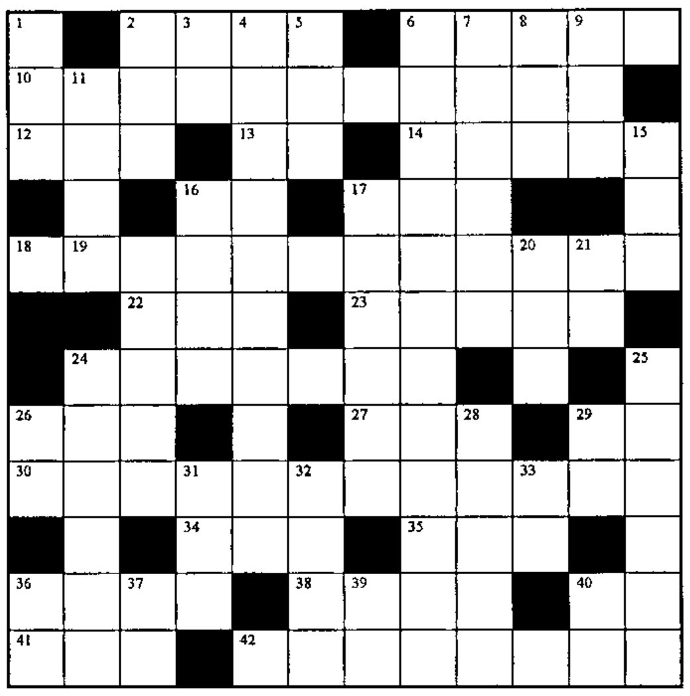

### Across

2. The shorter of `⍳B` or `⍳D`
6. `(A-⌊A)`
10. Round each element of P to the nearest tenth
12. Flag the rows of two-column N for which `(⍋N[I;])≡⍒N[I;]`
13. Right argument of ? when dealing a poker hand
14. `BLT[1]-BLT[2]+BLT[3]-BLT[4]+BLT[5]-...`
16. Add K to the first element of the array S. Use the result as the number of counting numbers from which to select A different random numbers. Add R to these random numbers but don’t allow any to get larger than B. Multiply each resulting number by 5 and use these numbers to fill an array having shape D52. (Put the resulting expression in 5D, 34A, 3D, 16A, 36D, 39D, 29A and 25A.)
17. The square root of one-third of AD (first three symbols only)
18. Future value of 1 per year for N years at accumulation rate I (where A=1+I)
22. `(+\R9⍴R9=R9)--⎕IO` for scalar R9
23. `(1 0 ¯1)[¯1 0 1⍳×ASI]`
24. Future value of 1 in N years at interest rate I
26. `''⍴((V=2)/⍳⍴V),⎕IO+⍴V`
27. `1⌽⌽')N('`
29. See 16 across
30. Probability of “four of a kind” given five cards from a deck of 52
34. See 16 across
35. `9,(A-1)⍴0`
36. Add the scalar A to the singleton `T` `(1∧.=⍴T)` returning a 1-element vector
38. `(-V)↓⍳K` for `K≥V`
40. Row-wise addition
41. A random integer between 1 and 25
42. Value that compounds in N years to 1 at interest I

### Down

1. Function used to match a vector to the rows or columns of a matrix
2. `(N≠0)⍴⎕IO` for non-negative scalar N
3. See 16 across
4. The quotient of 191 and 45, rounded to the nearest integer
5. See 16 across
6. Present value of 1 per year for N years at the accumulation rate A (A=1÷interest rate)
7. `DNA[;,⍉(10,1↓⍴DNA)⍴⍳1↓⍴DNA]`
8. `B≠0` for numeric B
9. A peculiar language
11. If TA is a scalar, ravel it; otherwise return TA
15. T random numbers from the set `⍳I`, without repeats
16. Equivalent of `(⍴R)⍴` on a numeric scalar without using `⍴` (see 40D, 16A)
17. `(*N+⍟A)`
19. `¯I23↑1` in origin 0
20. Now, what led to this error?
21. Present value of 1 per year forever, at interest rate I
24. `2↓⍳3` in either origin
25. The first S elements of `N[25/⍳1↑⍴N;]`
26. `')V('~(⍎''')~''')~'-`
28. `((5-⍴V)↓V)` where `(⍴V)≥5`
29. `+/+\5/1`
31. `(⍴T)≠0` for vector T
32. `8 16 24 32 40 ... 8×I` in origin 1
33. `×/⍳9` in origin 1
36. See 16 across
37. `1⍴5`
39. See 16 across
40. The two simplest inverse functions

## Solution to Crossword in 16.4

![The completed 12 by 12 crossword grid from Vector 16.4, filled with APL symbols, names and digits; row 1 reads M A T [ 2 ; ] ~ 0, then Z, and the bottom row reads ] 5 5 U 1 ⍳ V V 0](v17n1-p32-crossword/solution-16-4.jpg)
