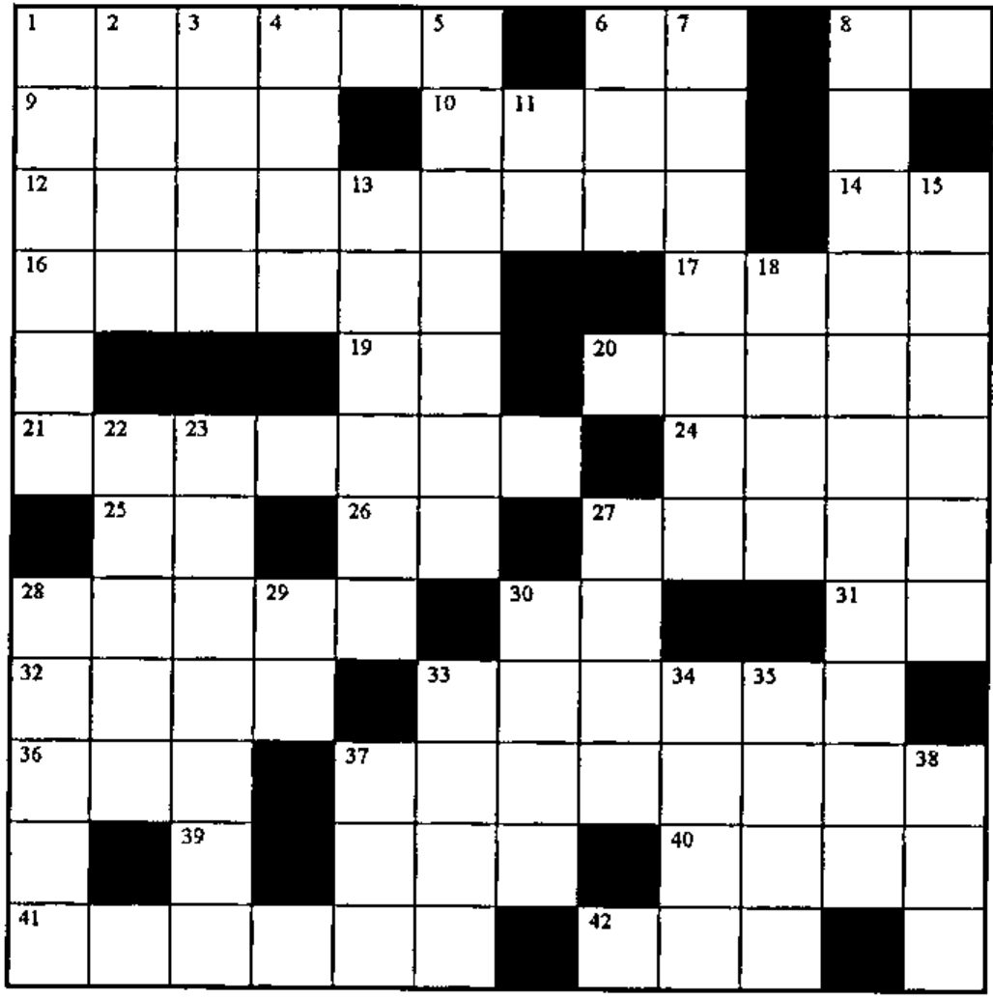
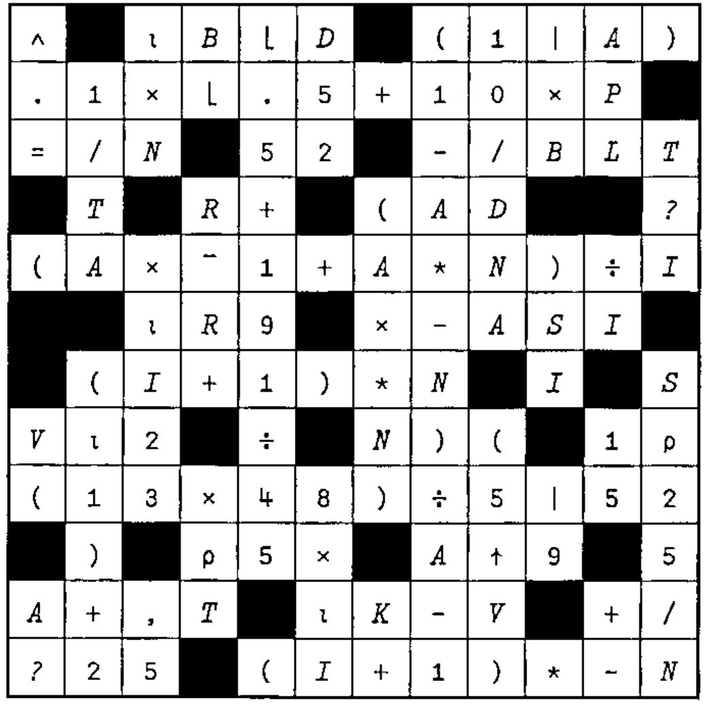

### Across

1. The first element of A, as a scalar
6. The values of x such that `(∧/(⍳⍴F)∊x)∧((⍴x)=⍴F)∧(1↓F[x])∧.≥¯1↓F[x]`
8. Resume the function that called the currently suspended function
9. The rank of the shape of F (or is it the shape of the rank?)
10. `(N>L)-N<L`
12. `⍉`
14. `B÷|B+B=0`
16. Clear the state indicator
17. `(~X∊DG)/X`
19. `1⍲B`
20. Subtract from the absolute value of M ...
21. Is (non-nested) A numeric?
24. `(12↓V),12↑V`
25. The opposite of `'⌈/'`
26. M, all strung out
27. `∨/,Z1=20`
28. Add the magnitude of K to VM
30. The product of A and ...
31. The result of 9 across
32. `((⍴B)=+/B)⍴⎕IO` for bit vector B
33. e to the power NVP, times five
36. `NX-1|NX`
37. Inverse of `+\V` for vector `V`
39. The sin of one radian
40. `(NE+1)-⍳NE` in origin 1
41. Assuming `V[]←0` and `∧/I∊⍳⍴V`, do `V←(⍳⍴V)∊I`
42. Go to the line labelled L1

### Down

1. `T×0`
2. `+\RR=RR` for vector RR in origin 1
3. `⍳0` if AE is numeric; `' '` if AE is character
4. `⎕NL 3`
5. Multiply alternate elements of A, whose shape is PTB, by the two values in M
6. `⍒S` without using `⍒`
7. `10-FLEX×⌊10÷FLEX`
8. Branch to the line labelled P if D is positive, to Z if zero, to N if negative
11. IS the answer obvious?
13. `((SE≠0)>SE∊K)/SE`
15. `-V11-BG`
18. M2 is not an element of ...
22. `0=(M[;1]∧N[;1])-(M[;2]∧N[;2])` for two-column matrices M and N
23. The sum of all but the first X elements of I, but no less than zero
27. `e+e`
28. `''⍴⍋V`
29. `(B×B)*.5`
30. `-A`
33. Pi less than 5
34. `⌽(-N)↓L`
35. `((V0/⍳⍴V0),⎕IO+⍴V0)[⎕IO]`
37. V1 gets ...
38. MAT, less one dimension

## Solution to Crossword in 17.1

