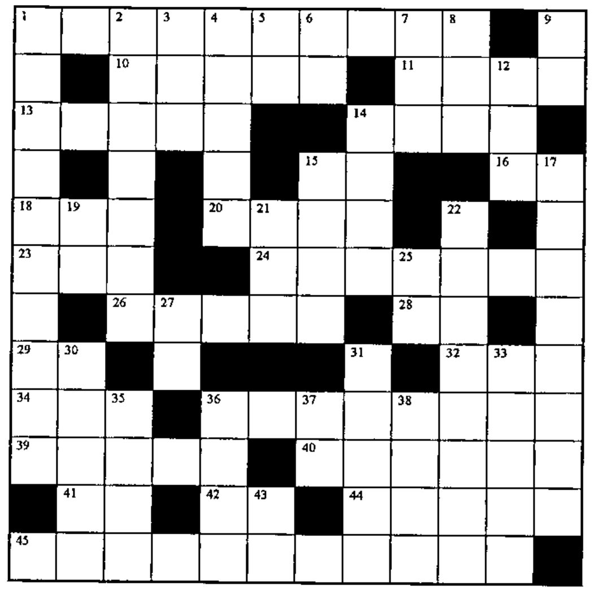

## Solution to Crossword in 17.2

![The completed 12 by 12 crossword grid from Vector 17.2, filled with APL symbols, names and digits; row 3 reads T R A N S P O S E, and the bottom row reads V [ I ] ← 1 → L 1 C](v17n3-p37-crossword/solution-17-2.jpg)

## Crossword

### Across

1. The frequency counts of the counting integers (origin 1) in the vector V, up to the biggest number in V
10. Round the numbers in N to the nearest integer (up if .5)
11. Return a vector of counting numbers with one number per element of array A, where `S←ρA`
13. Are any of the numbers in vector B no bigger than five?
14. The first A elements of array BS
15. The reverse of `~T`
16. `Nׯ1`
18. `ρ⍉M`
20. `1|V`
23. `A[⍳0]`
24. `(⊂⍳G)≡¨NNV`
26. T distinct random numbers from 1 to 125 (origin 1)
28. Where in the vector A is ...
29. `÷10÷2`
32. `(1 0⍕0 1),'TWO FOUR'[⎕IO]`
34. `~M[;1]=M[;2]` for two-column M
36. Branch to 1 if vector V does not contain the number A
39. `(⍋M)[⎕IO]`
40. `(-US)↑V` without using `↑` or `↓`
41. `-/⍳25`
42. `(V>0)-(V<0)`
44. `(+/1⊃NE),(+/2⊃NE),(+/3⊃NE), ...` in origin 1
45. `VECT[T1+⍳100]`

### Down

1. Number of columns in M, excluding its trailing all-zero columns
2. The lesser of V or B more than MAT
3. Given `⍳N` as both arguments, the function that returns an N by N bit matrix with 1s on and above its major diagonal
4. Does V contain the number .55?
5. `'S=+/V'~'S/V'`
6. `+\Nρ1`
7. Bits to indices `(B____B)`
8. `×/V,[(⎕IO+ρρV)-.5]B` where `(ρρV)=ρρB`
9. Reverse the dimensions of S
12. `'1 0 1/S-1'~'1 0'`
14. `(~A∊VV)/A`
15. The numbers in N5, capped at T
17. The adjective that preceds a number that precedes zero
19. Rank
21. `0-N2`
22. `⊃¨C` (APL\*PLUS) or `↑¨C` (APL2), for nonempty items in C
25. The simple elements of nested A, in the order they occur
27. Flip a coin: 1 I win, 2 you lose
30. `,(⍳10)∘.+0 0`
31. `∨/U=-V`
33. `⌽¯1↓NT`
35. `M-(M>30)×M-30`
36. Go to M if T is true; exit if false
37. `⍎'⌽''⌽A'''`
38. `E[VS/⍳ρE]`
43. The name of the first vector
