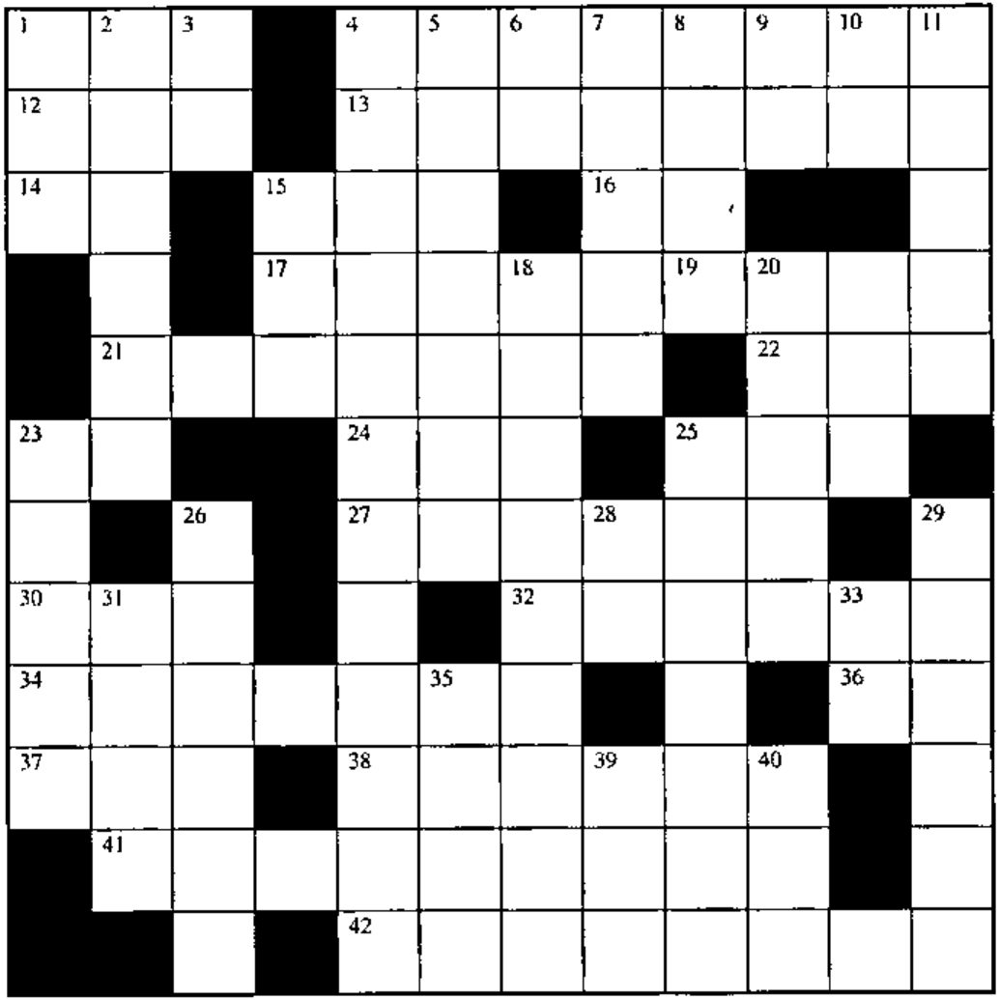
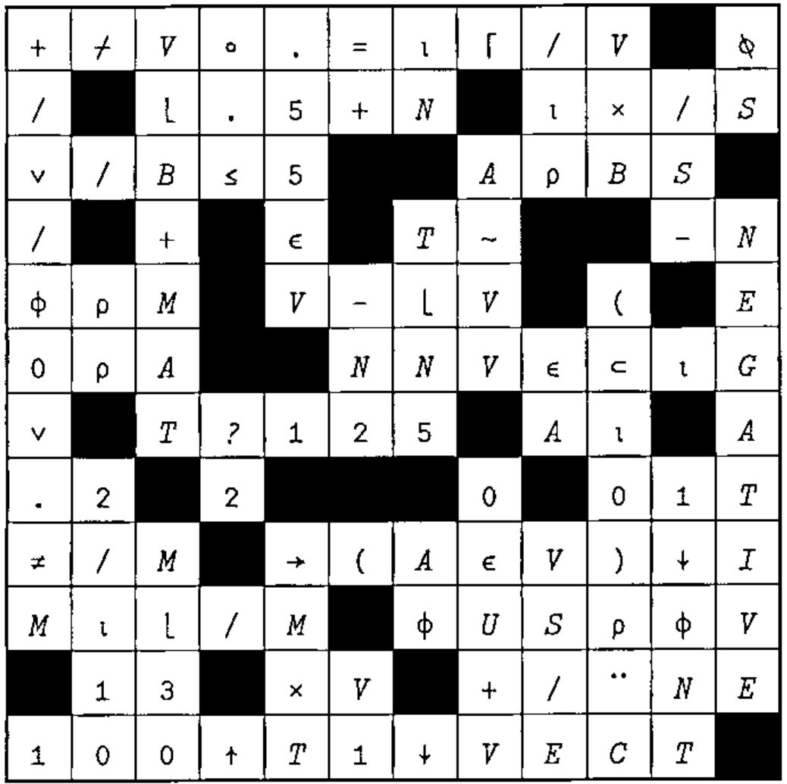

## Crossword

### Across

1. `(~V∊N)/V`
4. The elements of vector C that satisfy condition A1 or condition B
12. The characters used to represent the number KC
13. How many of the leading numbers in the list V are greater than 99?
14. `⎕_3` returns the names of all existing functions
15. Alternating sum of B
16. The larger of S or ...
17. Index of the first row of M that contains vector V
21. `T[I]-+/I↑mrv` for `I` from `1` to `ρT` (origin 1)
22. `S×(7÷S)-⍳7÷S`
23. `3 4+.*2`
24. `AA[(1+ρAA)-⍳ρAA]` in origin 1
25. The 256 different characters
27. How many elements in the same-length vectors VT and V are the same?
30. Pick a number form 1 to 10
32. `((E×E)ׯ1)+V5`
34. `(A×X*2)+(B×X)+C`, all scalars
36. `(5 10+.*3 2)*.5`
37. The remainder of M when dividing by S
38. One of the two system commands that can increase `⎕WA` when the state indicator is empty
41. Rotate vector D to the left P places; stick R on the front of it; grab the first M elememts; and reassign R
42. A constant is not ________

### Down

1. Format N to V decimal places
2. `(T5⍳KL)=⎕IO+ρT5`
3. A has a value if `2=⎕__ 'A'`
4. Drop the trailing elements of vector V that equal B
5. `(B\A)/MAT`
6. Lawrence Wall: “A __ a two and a ...”
7. The bits used to drop from V (via `/`) the characters before substring S
8. The greater of BV or N
9. In addition to `} ≥ ] ⊃` are __
10. ... replicates 9
11. 17’s, C9 of them
15. `⍉'-(+'`
18. Attach vector VCR to the left of matrix R, and add VRA to the result
19. The APL developer’s second-to-last system command at the end of the day
20. `(⎕IO-1)++\((V×V)*.5)ρ1`
23. 20 different random numbers from the set `⍳XS`
25. Does the number entered equla the alternating sum of the vector `(S↓A),S↑A` (for positive S)
26. Subtract the array `TOAM` from itself, reshape the result to have shape `⍳0`, and reassign it
28. `++/6 9 3`
29. All of the vector ZE but its first 125 numbers
31. The sum of the magnitude of the numbers in the vector R
33. e
35. `(×/ρERA)ρERA`
39. Application program interface (abbr.)
40. `(⊂'')ρ¨'EASY' 'DOOR' 'BOLT'`

## Solution to Crossword in 17.3

