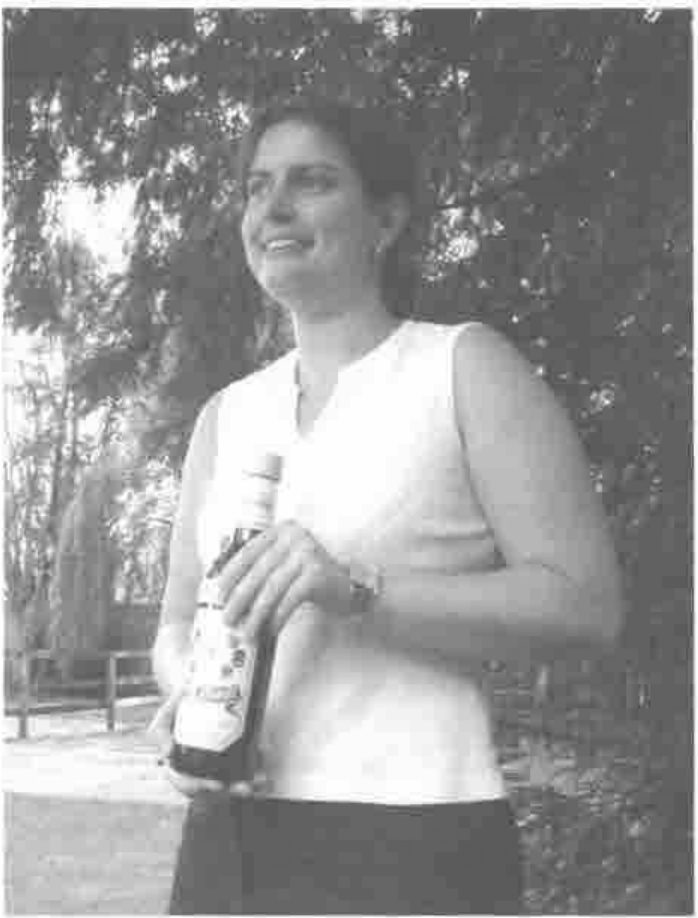
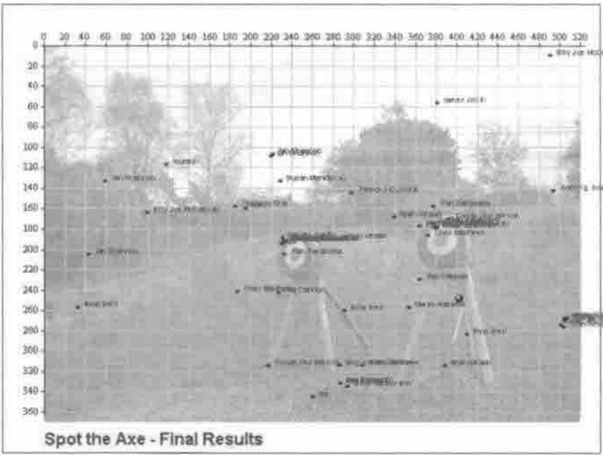

## Competition Winner – “Spot the Axe”

Readers of Vector will remember that at VikAPL there were a number of Viking challenges such as Log-sawing and Axe-flinging. We ran a picture of the target, with the axe cunningly eliminated (the Paintshop Pro clone brush is a wonderful thing) and allowed visitors to the website 3 attempts to click the exact spot where the axe was lodged. There were over 80 entries, a few of which were disallowed on the grounds of prior knowledge.

The prize to the lucky winner was a bottle of Aalborg Akvavit, and of course the honour of standing as the target in next year’s contest. The runner-up prize of a life-time’s supply of Gammel Dansk (possibly the most unpleasant drink in the world) was fortunately not awarded.

### Where the entries fell

The scatter shows a rather misplaced faith in the chance of actually sticking the axe in the target! As for the actual position (embedded in the rear leg of the support), no-one has any idea how it got there.
