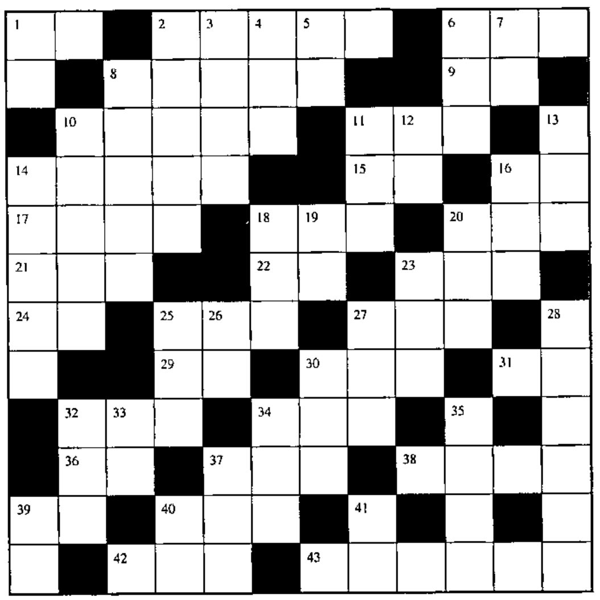
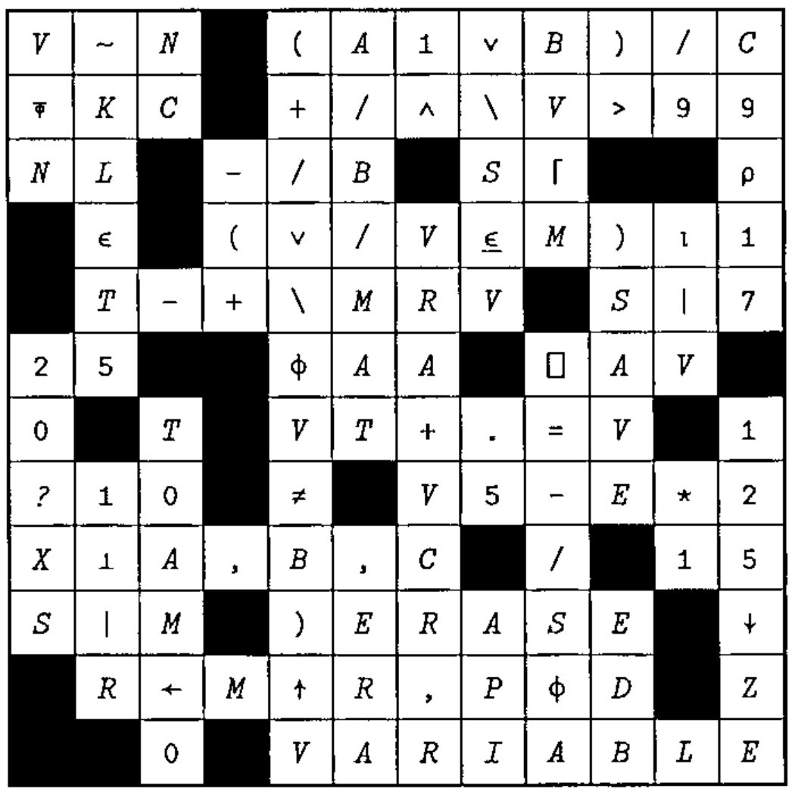

## Crossword

### Across

1. All done
2. `A≥~⊃C[D]` for Boolean A
6. The remainder of `B÷A`
8. How many elements in each row of D do not match the corresponding element in vector B?
9. Round C up to the nearest integer
10. `A≡B` for same length vectors A and B
11. N formatted to D decimal places
14. The largest number in the vector `E×B`
15. `1⍴C` for scalar C
16. How many
17. How many numbers in vector A are bigger than B (omit the A)?
18. From `⍳B` select N random numbers, without repeats
20. The Boolean vector B with all but its first 1 converted to 0s
21. `⍟(*C)×(*B)`
22. `,+/B=B` for vector B
23. `(+/V[1 3 5 7 ...])-(+/V[2 4 6 8 ...])`
24. `B[___]` to put B in sorted order
25. `(~V∊D)/V`
27. Once V is true
29. `(+\C⍴C=C)-~⎕IO` for scalar C
30. Product of V
31. `(⌽⍳⍴⍴N)⍉N`
32. `(N↓B),(N↑B)` for positive N on vector B, where `N≤⍴B`
34. 1-poles in Boolean vector V to 1-maps: `0 1 0 0 0 0 1 0 0 → 0 1 1 1 1 1 0 0 0`
36. `×/⍳C` in origin 1
37. `(×/V[1 3 5 7 ...]÷(×/V[2 4 6 8 ...])`
38. Half of V, rounded to an integer
39. A times pi
40. The leading true bits in Boolean V
42. The smallest number in vector V
43. `M⍱~∧/V`, for matrix M, vector V

### Down

1. Go to line L
2. `+/A×B` for vectors A and B
3. `0≠+/A∊B` for scalar B (omit the A)
4. `(D<B)∨(D>B)`
5. What’s hiding in the scalar A?
6. The values in A, but not less than N
7. The absolute value of C
8. Which columns of matrix B have numbers that are all less than the scalar D?
10. `A+⌈/B` for scalar A, vector B
11. Stick vector D onto the left side of matrix B
12. The number C in characters that look like it
13. The largest number in vector B (or negative infinity if B is empty)
14. The indices to extract from `(E⍴0),D` the elements of D sorted according to the collating sequence C
16. Cumulative sum of V
18. `D[N⍴⍳⍴D]`
19. `(⍳0)⍴1?B`
20. `V[1]<V[2]` for two-element vector V
23. Cumulative alternating sum
25. Where B is first seen in vector V
26. `C=0` for Boolean C
27. Are any of V true?
28. `(?N⍴V[1]),(?N⍴V[2])` in origin 1
30. Cumulative product of V
32. The number of different combinations of A items taken N at a time
33. `C[(⎕IO+⍴C)-⍳⍴C]`
34. Parity of Boolean vector V, i.e. `2|+/V`
35. `,+/V≠0` for vector V
37. Cumulative alternating product
39. Circumference of circle of diameter D
40. All
41. M, enclosed into a nested scalar

## Solution to Crossword in 17.4

[*Errata:* There were a couple of typos in the last crossword. In 6 down Lawrence Welk was mis-spelled as Lawrence Wall; 8 down should have been The greater of BV or M; and 19 and 20 down were marked one square too far left on the grid.]

### [Vector Production]

*Following an interesting run-in with Word2000 and shaded table-cells, the crosswords are now being generated in NewLeaf and linked to the Word document as metafiles! Moral: never upgrade your word-processor under time-pressure.*
