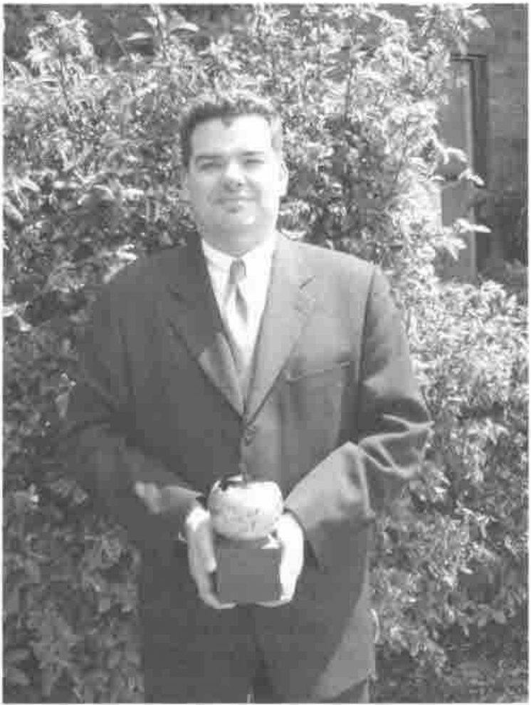

*by Anthony Camacho*
{ .byline }

## Minutes of the AGM of the British APL Association held at the Royal Statistical Society from 2pm to 2.15 pm on 18 May 2001

Apologies were received from Ian Clark and Stefano Lanzavecchia.

The minutes of the last AGM as printed in Vector Vol 17 No 1 were approved.

The Chairman reported as follows:

### British APL Association Chairman’s report on the year 2000-2001

The committee for next year is:

| | |
|---|---|
| Chairman | Adrian Smith |
| Secretary | Anthony Camacho |
| Treasurer | Nicholas Small |
| Editor | Stefano Lanzavecchia |
| Webmaster | Ray Cannon |
| Activities | Jon Sandles |
| Education Officer | Vacant – to be co-opted |
| Projects & Publicity | Alan Mayer |

The subscriptions for next year are to be increased to £20 for an individual, £100 (with entitlement to 5 copies of Vector) for a corporate and to £500 for a sustaining member.

Vector is thriving; it even has more material available than usual. The working group continues to be a friendly and effective way to drum up articles and it is noticeable that the material we print does not even largely come from the committee and the working group.

The project to port A+ is progressing (but we haven’t had a completely successful compilation yet) and we hope that we will have an APL-like powerful desk calculator that we can give away to schools and anyone interested before too long.

We gave welcome help to APL Berlin 2000 and as a by-product produced the CD of the working papers and the archive of those Vectors we have in electronic form. This is very useful as an aid to promote membership, particularly in the USA. We are committed to help to at least the same extent at Madrid.

## Accounts

The Treasurer, Nicholas Small, presented the accounts (as below). There were no questions.

### Outstanding Achievement Award



Adrian Smith presented the BAA award for outstanding achievement to John Daintree in recognition of his work in setting up Dyalog as part of Microsoft’s .NET project.

The award recognises that this work has not been at all easy, and has required considerable persistence and patience in interpreting the patchy and ever-changing documentation that goes with any beta software.

John has been able to work with a succession of .NET beta programmes from Microsoft and has been able to integrate the Dyalog APL interpreter into these environments with ever-increasing confidence and reliability.

The award also recognises that this is a major opportunity for the APL world to get back into mainstream development, and that Dyadic Systems as a whole should be thanked for their considerable investment in time and manpower in responding to Microsoft’s invitation to participate in the .NET programme.

No member wished to ask a question or to raise any other business. The Chairman declared the AGM over and the meeting continued with the presentations, no doubt reported elsewhere.

Anthony Camacho 22 May 2001

### Treasurer’s report

Nicholas Small reported: he circulated a short set of accounts:

### British APL Association – Summary of Annual Accounts 2000/2001

Summary of income and expenditure/receipts and payments:

```text
                                 2000/01 2000/01 1999/2000 1998/99 1997/98
                                  (R&P)   (I&E)    (I&E)    (I&E)   (I&E)
                                    £       £        £        £       £
Income/Receipts
 Subscriptions                    9513    9736     9152    10368   11021
 BCS services                      183     183      278      167       0
 Bank interest                    2251    2251     1882     2943    3322
 Vector advertising (incl. VAT)   2342    2967     3047     2463    3471
 Other                             394     394      366      264     108
                                  -----   -----    -----    -----   -----
 Total receipts                  14682   15530    14725    16206   17922
                                  -----   -----    -----    -----   -----

Expenditure/Payments
 Meetings                          265     265      259      704       0
 Administration                   1316    1347     1344     1423    1152
 BCS services                      183     183      278      167       0
 Vector production and despatch  16223   16344    15802    17086   14584
 Education Vector Supplement        -       -        -        -      108
 Projects                         1721    1721      470      328     501
 Other                             307     355      501      426     308
                                  -----   -----    -----    -----   -----
 Total payments                  20014   20215    18653    19954   16653
                                  -----   -----    -----    -----   -----

Assets summary:
 Bank and other balances                 39652    44984    49055   52525
 Debtors                                  1912      858      733    2071
 Creditors                              (5265)   (4858)   (4766)  (5270)
                                          -----    -----    -----   -----
 Net assets                              36299    40983    45012   49327
                                          -----    -----    -----   -----
 Written off                                       (100)    (568)
```

#### Notes to the Accounts

Pence figures have been omitted, so columns may not add exactly.

The value of stocks of Vector have not been assessed, nor has the value of the Association’s computing hardware and software.

For 2000/2001, figures are shown both as income and expenditure, i.e. revenues strictly relating to the activities of that year, and as receipts and payments, i.e. what goes in and out of our bank account. The comparative figures for earlier years relate to income and expenditure.

## Membership report

Nicholas reported on behalf of Rowena:

### 1. Membership at 30.4.01 (previous year’s figures in parentheses)

```text
              UK                 FOREIGN              TOTAL
              Number   Vectors   Number    Vectors    Number    Vectors
Sustaining     5 (4)   25 (15)    3 (4)    66 (76)     8 (8)    81 (88)
Corporate*     7 (6)   50 (37)    1 (1)    10 (30)     7 (11)   47 (87)
Corp. Ind*    19 (20)  19 (24)    2 (2)     2 (1)     22 (23)   26 (27)
Individual   122 (130) 122 (128) 237 (218) 235 (218) 359 (348) 357 (346)
Non-voting    16 (15)  16 (15)    0 (0)     0 (0)     16 (15)   16 (15)
Life           1 (1)    1 (1)     1 (1)     1 (1)      2 (2)     2 (2)
Library        0 (1)    0 (1)     5 (6)     5 (6)      5 (7)     5 (7)
Russians                         10 (10)   10 (10)    10 (10)   10 (10)
APL Groups                       13 (14)   39 (42)    13 (14)   39 (42)
                                                               586 (573))
```

\*Add the Vector numbers in these rows to get the total subscribed for by corporate members.

### 2. New members, May 2000-April 2001

Individual UK: 5 Europe: 9 USA/Canada:19\*<br>
\*including 13 taking advantage of the special $50 for two years offer.

Library:VUBA Printmedia, Germany<br>
Corporate: Adaytum

### 3. Non-renewers, May 2000-April 2001

Library: SWETS (Abingdon) and Tieto-Tietopalvelut OY (Finland)<br>
Individual: 29, of which<br>
3 gone away<br>
8 explicit resignations (usually not using APL)<br>
18 no contact, just failed to renew

## Further business

There were no questions to Officers nor any other business so the Chairman closed the meeting at approximately 2.15 pm and handed over the meeting to Jon Sandles.

Anthony Camacho 22nd May 2001
