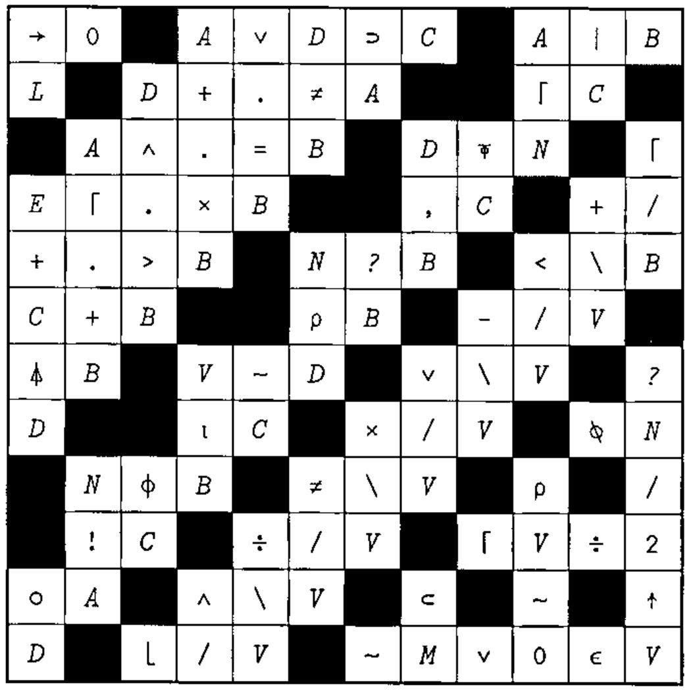
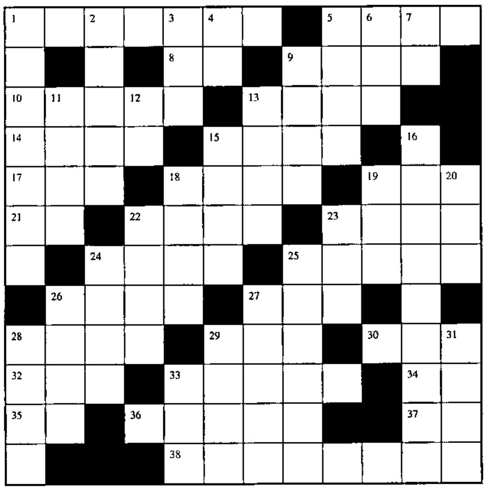

## Solution to Crossword in 18.1

## Crossword for Vector 18.2

### Across

1. For each number in B, the number of numbers in vector L larger than it
5. The values of B, capped at 3 and rounded up to the next integer
8. Same as `1↑` on an empty vector
9. Cosine of (pi times R) radians
10. `*/TAB,25 .5` for scalar TAB
13. Remainder when the absolute value of D is divided by N
14. `+/-R`
15. Where in V are the integers from 1 to T?
17. `V-G×⌊V÷G`
18. Number of possible combinations of `×/⍳N` objects taken 3 at a time
19. Branch to the line labelled V1
21. e to the power T
22. Shape of `A∘.×A`
23. 5 10 15 20 in origin 1
24. 2 if P>0; 0 if P=0
25. 3 random numbers from `⍳NV4`
26. `(~A∊~B)/A`
27. Same as 27 Down
28. Is T a scalar?
29. Stick a column of 2s on the right of matrix M
30. `~F` for Boolean F
32. Rank of A
33. Set K as `Z[4+⍳(⍴Z)-4]`
34. 1 2 3 ... I
35. Increase the depth of T by 1
36. Indices of the 1 bits in B
37. Length of V
38. `10*+/4⍴VE` for VE a scalar

### Down

1. Cumulative sum of the difference between T and G times itself
2. `B×V` where B is a Boolean vector, without `×`
3. `÷5×÷5×.05`
4. First true
5. Tangent of the magnitude of T radians
6. Circumference of a circle of diameter D, rounded up to the next integer
7. `|(-R)-1|-R`
9. `N⍴⎕IO,~⎕IO` for N a scalar
11. `((T×T)*.5)+A`
12. `×/R⍴e` (the mathematical constant *e*)
13. Where in vector N is A factorial?
15. Number of ways the elements of vector P can be combined in sets of V elements
16. Flag each distinct value in V when it first occurs
18. Sign (`¯1`, `0`, `1`) of the first three elements of matrix B
19. Exit the function if N=0; restart it if N>0
20. `×/2 3*2*2 1`
22. 2 if T=0; 0 if T=1
23. Shuffle the numbers `⍳5`
24. `⍳0` if A is nested (one deep); else 2
25. `B0[2+⍳3]`
26. Is A the shape of T?
27. Same as 27 Across
28. An empty vector for which `⍴⎕IO⊃1↑` returns `⍴M`
29. Set M as `0⍴0`
31. 2+3
33. `(+/K)⍴1`
