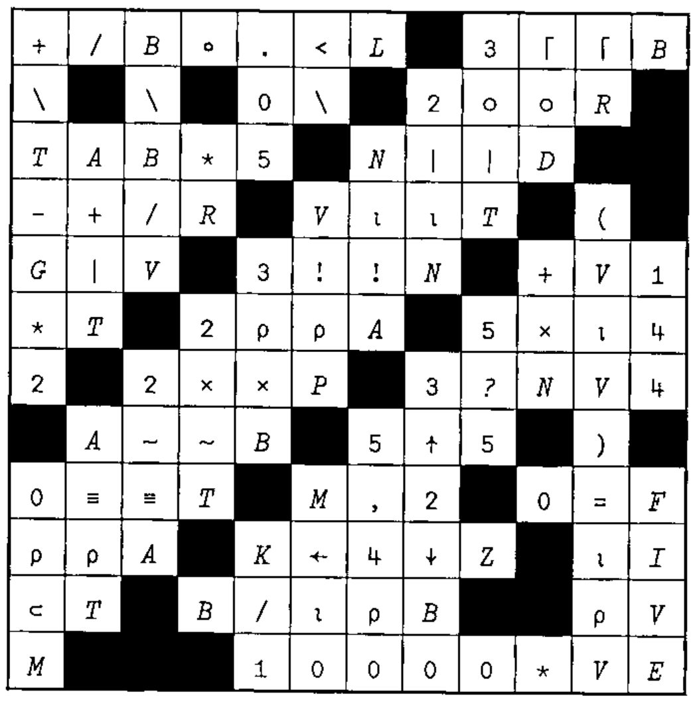
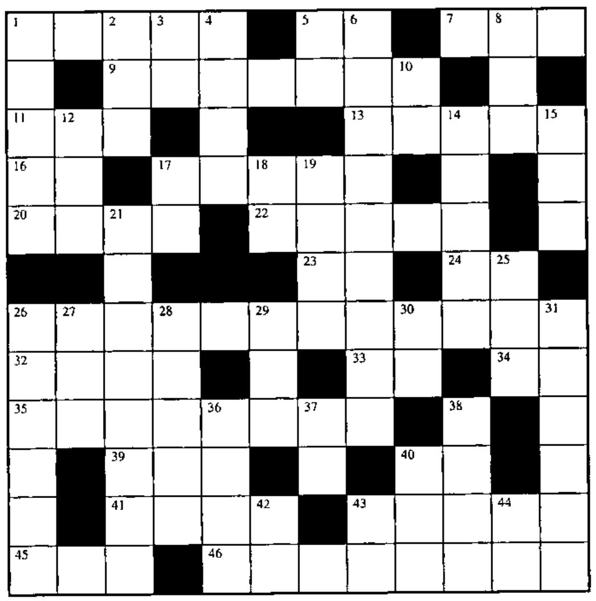

## Solution to Crossword in 18.2

## New Crossword

### Across

1. `+⌿MAT`
5. `V[((⍴V)+(⎕IO=1)-⎕IO=0)-⍳⍴V]`
7. `,1+⍳10⍟N` for integer scalar N>0
9. Are any of the corresponding rows in matrices M and W identical?
11. `(M×M≥N)+(N×M<N)`
13. Pythagoras: `(______+B*2)=C*2`
16. `⊃,/A` where A is a vector of simple vectors
17. `-V-100`
20. `0.5×VR`
22. `(⍳0)⍴⍒V`
23. `⍳0`, using shape
24. Add up
26. `A∊V` for vector V, using dyadic `⍳`
32. `(⍴N)+(⍴K)` for vectors N and K
33. `N-1|N`
34. `⌽⍴⍉M`
35. N random numbers from the set `(ML-1),(ML-2),(ML-3)  ...,(ML-59)`
39. The value of X, if `TP←⍟X`
40. `⌽¯2↑1⌽'NUMBER'`
41. `V[⍳15]`
43. `R[I]××/N[I;]` for all I
45. `⍳0`, using reshape
46. `MATRIX`, with values formatted to one decimal place

### Down

1. Are any of the values of matrix M in vector V?
2. Is either M or N true?
3. Replicate each element A times
4. Are both T and B0 true?
5. Reverse the values in each row of M
6. `(V≥0)∧(V≤9)`
8. `'1'` or `'2'` at random (origin 1)
10. `⎕__` tells you how much room there is
12. `-⌊-AR`
14. `(2×V[1])*(2×V[2])` for 2-element vector V in origin 1
15. What gave birth to this erroneous situation?
17. `×/(⌽⍳2)/1+⍳2` in origin 1
18. `2⍴2⌽⍎'''V←0'''`
19. `+\(⍴V)⍴¯1` for vector V in origin 1
21. `I,-I×*¯10`
25. Bit vector to index vector converter
26. `M≠M`, but faster
27. `)VARS` or `)FNS` under program control
28. OK random numbers from `⍳T5`
29. `____` your boat
30. `⊃N` in Sharp APL
31. Stick vector NX on the right side of matrix AMT as a new column
36. `1,(NP-1)⍴0`
37. `+/+\(+/+\(+/+\⍳2)⍴1)⍴1` in origin 1
38. `RRR[_____]` is in ascending order
40. `(N⍴T[1]),(N⍴T[2]),(N⍴T[3]),  ...` for scalar N
42. Format to V decimal places
43. `(A>0)-(A<0)`
44. `1⍴I` for scalar I
