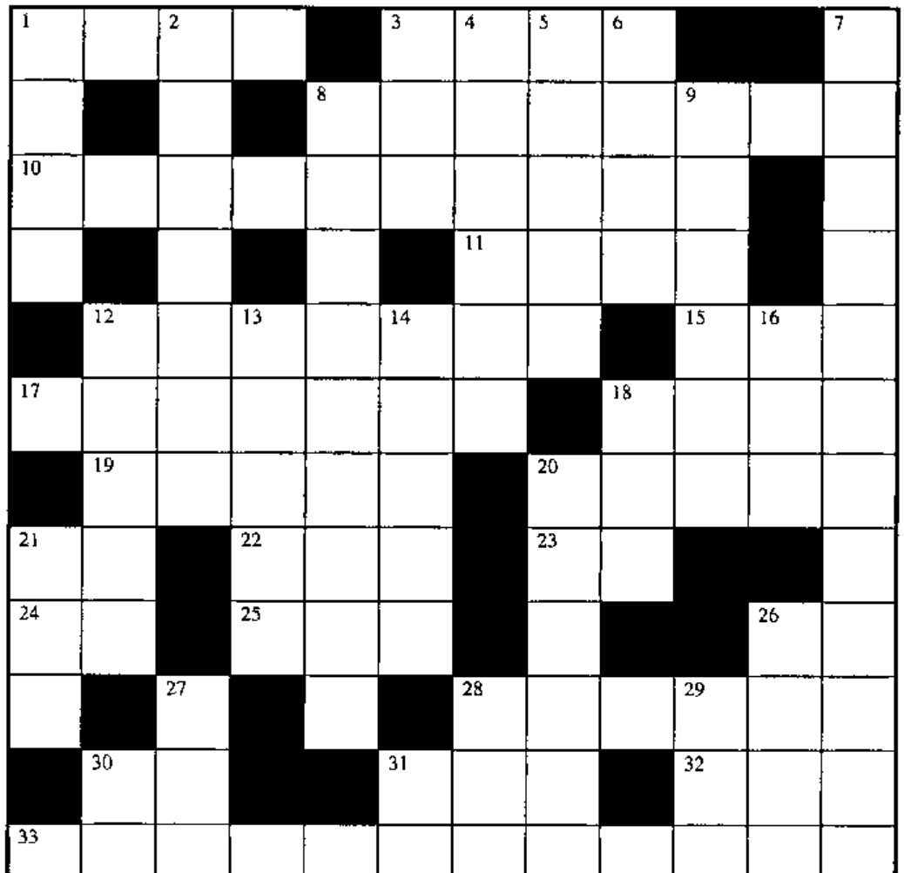
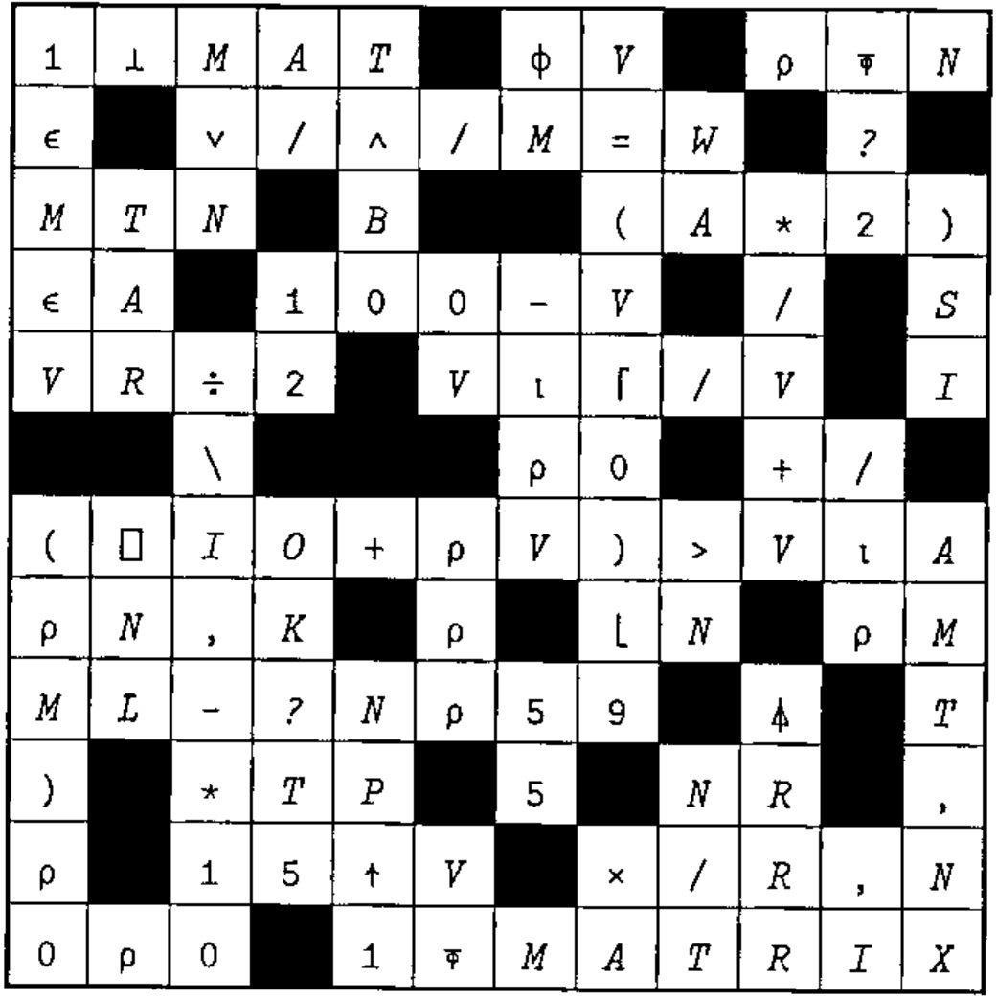

## New Crossword

### Across

1. .01, as a reciprocal
3. `(~V∊BT)/V`
8. The index within numeric vector V of the nearest value ≥ scalar S
10. Set M to 1 if any of the vector VE is true, or if any of vector C is untrue. Else set it to 0
11. The larger of G or JL
12. `(R<10↓VL),(R<10↑VL)`
15. `(⍴M)⍴(E⌽M[1;]),(E⌽M[2;]),(E⌽M[3;]),...`
17. An N by N matrix of 0s
18. The location in vector VA where A first occurs
19. `K=(×/⍴AT)⍴AT` for scalar K
20. The smallest number in each row of matrix RNT
21. `○1`
22. Bit vector to index vector : BV\_\_\_BV
23. `÷10`
24. `(B*2)*.5`
25. `((-/5 4*2)*.5)×(⍳N)=⍳N`
26. Rank (of an arrray)
28. `(+/LM[1;]×A[1],(+/LM[2;]×A[2]),...`
30. Cumulative product of
31. Flag the leading 1s in Boolean V
32. The number of elements in matrix A
33. The number of rows of MAT with more than one occurrence of substring SS

### Down

1. `MT[;1]÷MT[;2]` for two-column MT
2. Is A numeric?
3. `⍋V⍳E` for character vector V
4. `S<G≤0` for Boolean S
5. The values of R, with negatives replaced by 0s, and with B on the front
6. `∨/J=TV` for vector J and scalar TV
7. `MAT[⎕IO;]` without using indexing
8. Bits that flag each first distinct value in vector V
9. Let’s start from scratch
12. The matrix TB with a column of 12s stuck on its left side
13. `(⌽NT)/⌽N`
14. `(K⍴3),(L-K)⍴0`
16. `N,(N-1),(N-2),(N-3),...,1` (origin 1)
18. `(+/V)⍴1` for positive integer vector V
20. Round the elements of array VS
21. `P×(9÷P)-⌊9÷P`
26. `(⍴L)+(⍴A)` for vectors L and A
27. `B+B` for Boolean vector B
28. `R←A` and `R[A/⍳⍴A]←S` or `R←___`
30. Product of
31. All of

## Solution to Crossword in 18.3

