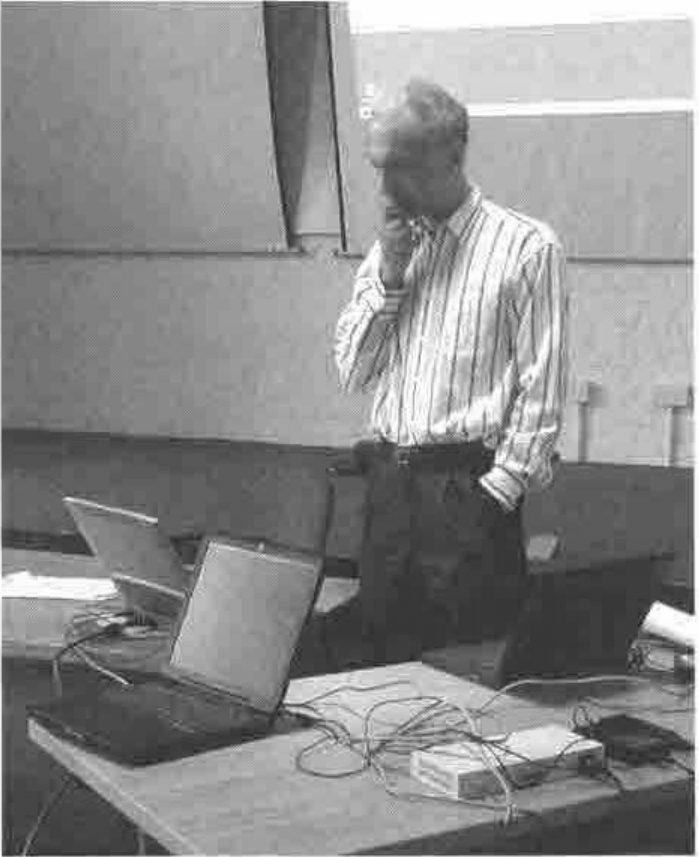

*notes by Adrian Smith*
{ .byline }

## Richard Nabavi on APL/X

APL/X is APL.68000 reborn as a cross-platform APL2-compatible interpreter. Richard used an interesting little network (with a Linux server, a PowerBook and a Windows 2000 portable) to show just how cross-platform it really is. As he commented, the fortunes of the interpreter are still very much tied to the fortunes of Apple, and it was not until Steve Jobs showed some signs of sorting out the mess at Apple that MicroAPL thought it worthwhile to invest the time in a full rebuild of the old interpreter.



He showed us around the existing interpreter, and also some of the things from the 1.1 pre-release which is due in around 6 months. This has one nice new idea (other vendors please copy) which is to be able to label control structures and then say:

```apl
blaaah
:leave loop3
blaah
```

To quit out from a named loop, or While block. Obviously, this works with :Continue in the same way.

## John Scholes on *Mornington Crescent*

Well actually, John Scholes on pathfinding through directed graphs using Dfns. This was a fascinating half-hour, at least in part for the tutorial on how to code up the London Underground as a directed graph so you can ask the software hard questions like “How do I get from Heathrow T3 to Heathrow T4 by train?”. Yes, the system has one-way sections, and not all transfers between platforms are as bi-directional as the maps would have you believe. This is crying out to be a Web-service – I hope they give it a go on Dyalog.NET soon!
