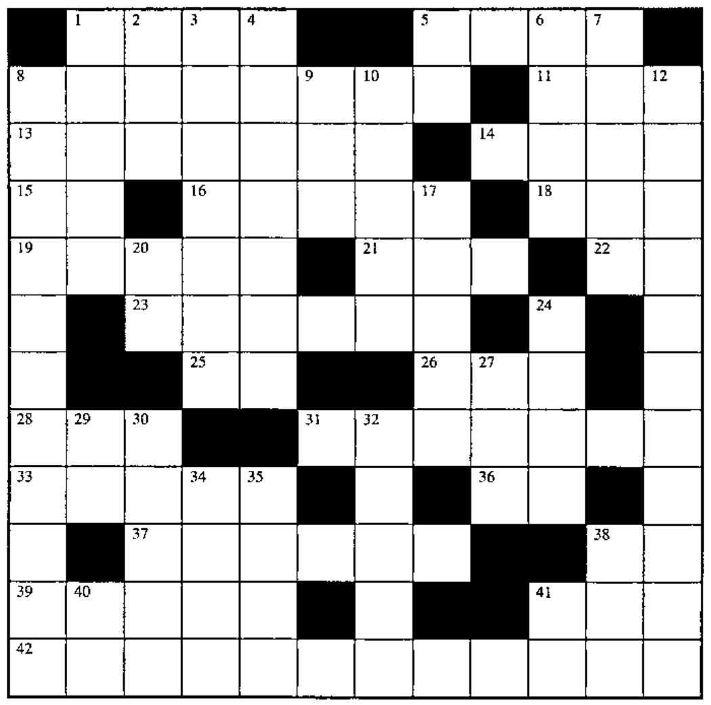
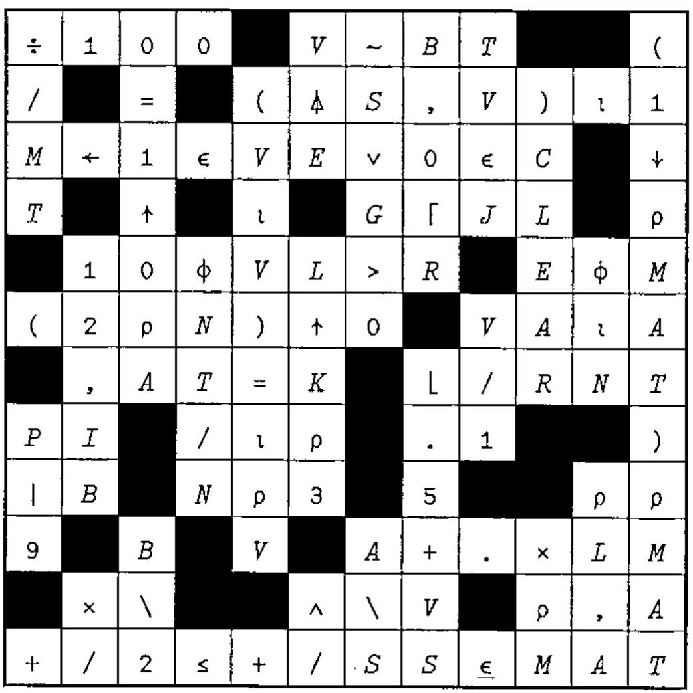

## Crossword

### Across

1. The lesser of M or SM
5. Branch to line L: if...
8. A matrix with N rows of the vector A
11. `(A,N)[A<N]` for scalars `A`, `N` in `⎕IO=0`
13. `B=TSD` exactly (as if `⎕CT=0`)
14. `V[2]-V[1]` in origin 1 where `2=⍴V`
15. A wild APL party
16. `(J=I)∨(J=K)` for scalars I, J, K
18. The remainder of E when divided by B
19. 2 if S<0, 1 if S=0. ÷2 if S>0
21. `(L≠0)/L`
22. `⎕__` tells functions from variables
23. `(1↓EXPR),(1↑EXPR)`
25. `⎕__` lists your functions or variables
26. `(×/⍴VT)⍴VT`
28. M formatted to R decimal places
31. The product of the rows of N, summed, times A
33. Where am I?
36. `-/5 3*2`
37. `-⍳N` in origin 1
38. `Eׯ1`
39. `⍳TW` in random order
41. Flag the leading 1s in Boolean C
42. The element in vector RATES corresponding to the largest element in vector V

### Down

1. `MN∊G5` for scalar G5
2. The integral portion of the elements of array B, as a vector
3. `S↑(-J)×N[⌽⍳⍴N]`
4. `(⎕IO+⍴SEL)>SEL⍳MAT`
5. Branch to line A:
6. 1 if A>B, 0 if A=B, ¯1 if A<B
7. `+\(|1↑N[⍒(N×N)*0.5])⍴1` in origin 1
8. Matrix TR, without its all-0 columns
9. What’s happening?
10. `(⍴D)+(⍴LP)` for vectors D, LP
12. NVEC in ascending order
17. `((K≠1)>K∊R)/K`
20. The mathematical constant `e`
24. The product of T and !3, rounded up to the nearest integer
27. `+/×\¯1↓1,⌽V` for V a vector
29. W formatted to `⎕PP` siginificant digits
30. One random number from `MS+1` to `ML+T`, in origin 1
32. `(⍴,MV)[⎕IO]`
34. `TE×I`, without multiplying, for scalar TE and Boolean vector I
35. `-WS-D`
38. Alternating sum of V
40. `⎕__` tells howmuch room remains
41. All

## Solution to Crossword in 18.4

