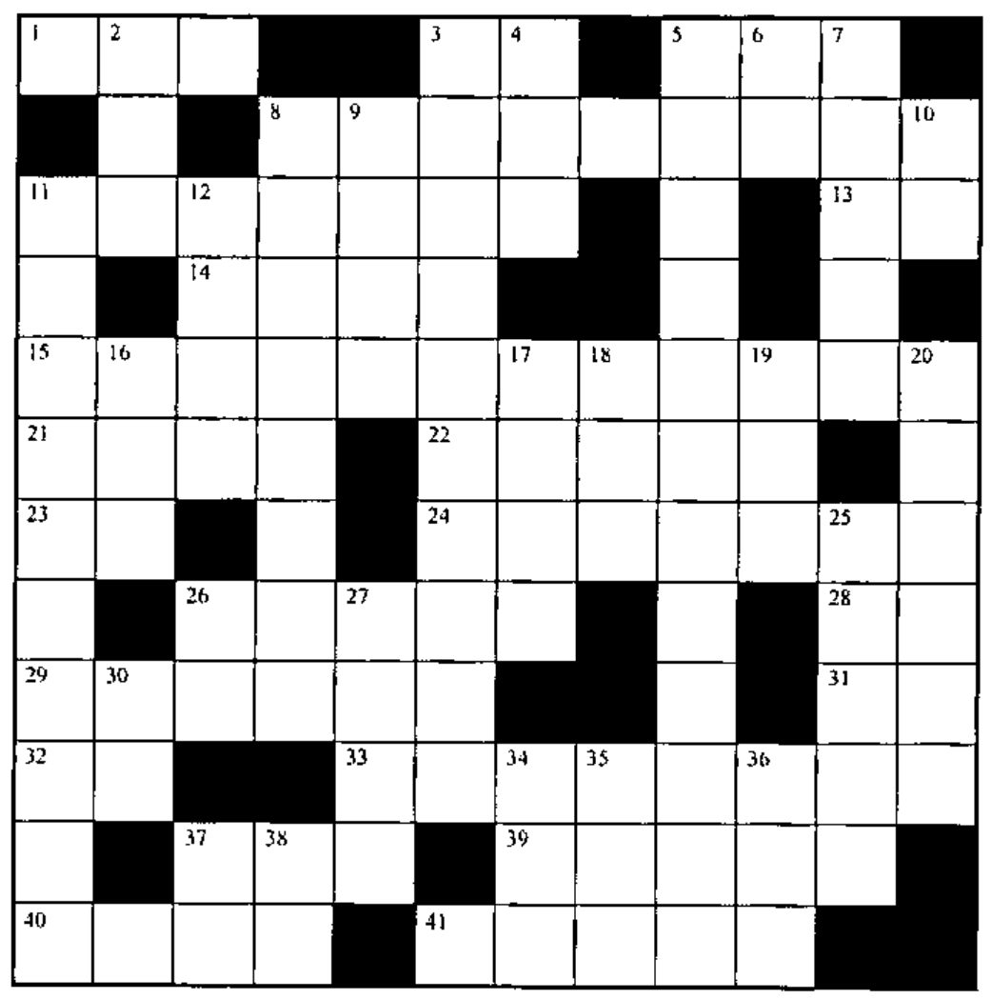

## Solution to Crossword in 19.1

![The completed 12 by 12 crossword grid from Vector 19.1, filled with APL symbols, names and digits; row 1 reads M ⌊ S M, → L × ⍳, and the bottom row reads R A T E S [ V ⍳ ⌈ / V ]](v19n2-p35-crossword/solution-19-1.jpg)

## New Crossword

### Across

1. `(~A∊B)/A`
3. Where in V is ...
5. `,?N`
8. Do any of the items in nested NST match the array NR?
11. `∨/B[29+⍳(⍴B)-29]`
13. Magnitude of D
14. Array of shape T5, filled with the elements of Z
15. Any array ABS, with all numbers replaced by 0s and characters by blanks
21. Correspondingly true in N and PA
22. Which elements of V match the corresponding elements of the vector in the enclosed scalar CP?
23. C, except ...
24. Is the NVLth item of vector A the same as the array E?
26. Which item of N first matches CV?
28. `(×/⍴L)⍴L`
29. Rotate the elements of vector T left Q places, format them, and stick the label V on the front
31. ... replicate A
32. The keys for `∊ |`
33. Flag the items of nested NST that match the array NR
37. The length of vector EV
39. The next higher integer from NNMS
40. The first element of X as a scalar
41. Never forget to ____

### Down

2. `∧/,`
3. `VECTS[VN↓⍳Z]`
4. 1, 2, 3, ..., RB
5. Flag the character matrix items of nested NV that contain the string CV
6. A random scalar from the set `⍳N`
7. The remainder of `JB÷NS`
8. The elements of Q are first located in which elements of the 25th item of A?
9. Nine ones, as a nested scalar
10. The keys used for `~⌊`
11. Does VEC exist in the workspace?
12. TOP=0 for Boolean TOP
16. `I>` for Booleans
17. Is V a scalar?
18. The shape of the array within the enclosed scalar N
19. The language J’s older brother
20. An array with empty shape
25. Catenate together the items of nested vector NS
26. Format to N decimal places
27. NV, flipped and enclosed
30. The elements of M as a vector
34. The larger of T or S
35. The depth (level of nesting) of NA
36. Create a nested scalar from array ME
37. Rank of ...
38. `⎕__` is used to erase objects
