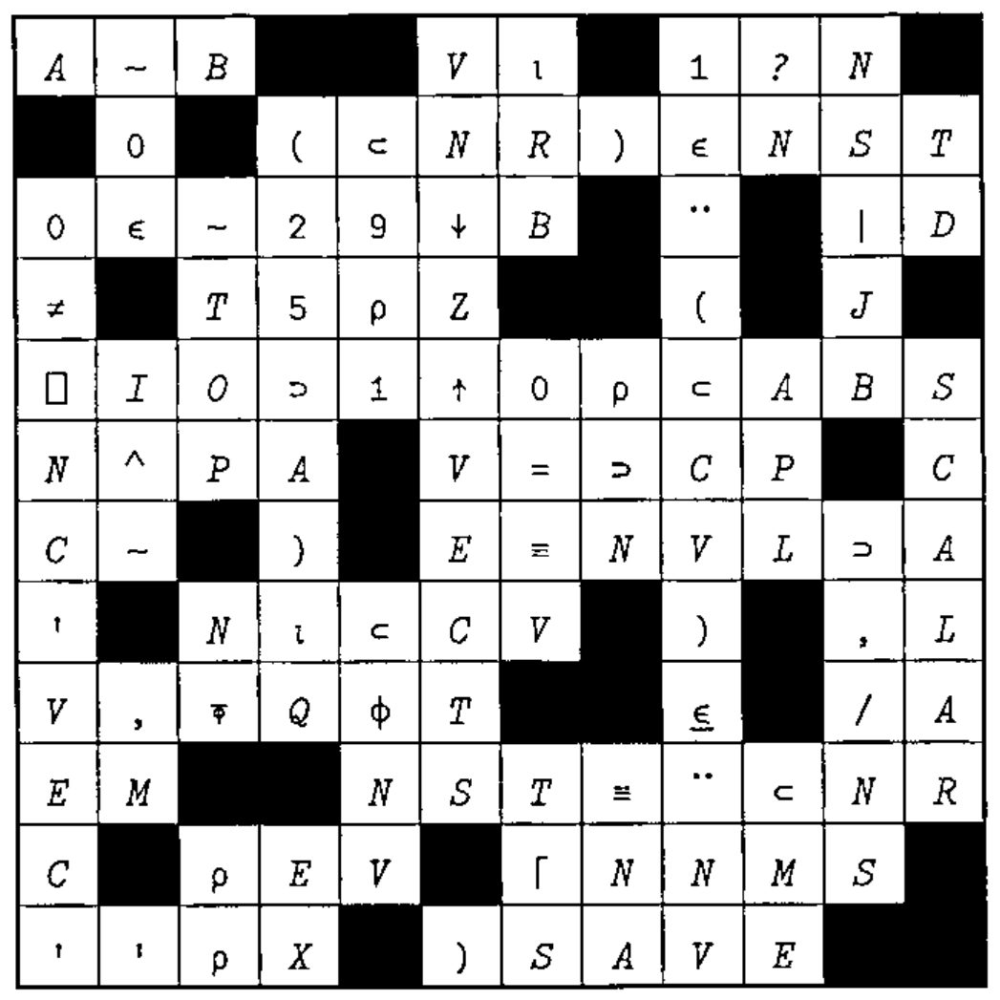
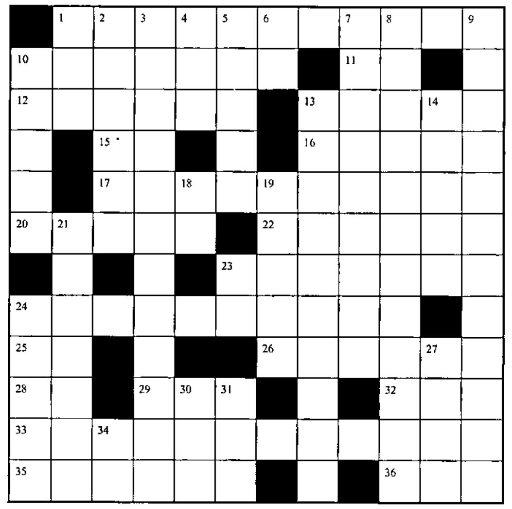

## Solution to Crossword in 19.2

## Crossword

### Across

1. Flag last of each group of equal values in sorted positive integer vector `PIV`.
10. Indices into `VEC` of the first `N` elements of vector `M`.
11. `⎕__`, the workspace’s elbow room.
12. Set `S` to be the lesser of `R` or `RE`.
13. `____A` to put the elements of `A` in the shape of `M`.
15. Product.
16. Add 2 to each element of `###ADV`.
17. A random integer from 1 to the length of `STRE/V`, for scalar `STRE`.
20. Format the elements of `RV0` to one decimal place.
22. Stick `D` and `OC` together and reshape to a matrix of shape `S`.
23. Magnitude of product of `AV` and `APT`.
24. Index into `NV` of the number following the first non-nine.
25. `R` times pi.
26. Shift the elements of vector `R` to the left `BQ` places and reshape to shape `E`.
28. `S###+\###IO,S⍴1` for scalar `S`.
29. Is execution suspended?
32. Stick `TL` onto...
33. The largest number of leading blanks in any row of `CM`.
35. `(1######3)+.*(###1######3)`, origin 1.
36. COBOL it’s not.

### Down

1. `PE` gets...
2. `ICR`, scaled by a random integer from 1 to `R`.
3. Index into `V` of the smallest number above 99.
4. ... unlike `NR`.
5. Select the first element of `E`, or of `V` if `E` is empty.
6. Vector of vectors from matrix `M` (in the original nested APL\*PLUS).
7. `(-SD),(-2###SD),(-3###SD),...,(-B###SD)`, reshaped to length `IW`.
8. Onto bit matrix `VAMAT`, stick a new column flagging the elements of vector `A1QT` that match the scalar `A`.
9. Are both vectors `VECTOR` and `ML` empty?
10. All but the first `VS` elements of vector `V1`.
13. Expansion vector to put a blank after each character in the vector `V`.
14. Eliminate a stored workspace.
18. Empty vector, without using `⍳`.
19. Preserve the active workspace.
21. Format `(T+L)[RS/######RS]`, for scalar `T`.
23. Absolute value of `N`.
24. Sin of whole radians up to the integer at or above `E`.
27. `LCP`, backwards.
30. Are both `S` and `E` true?
31. Array that returns vector `N` when compressed with bit vector `I`.
34. `E`.
