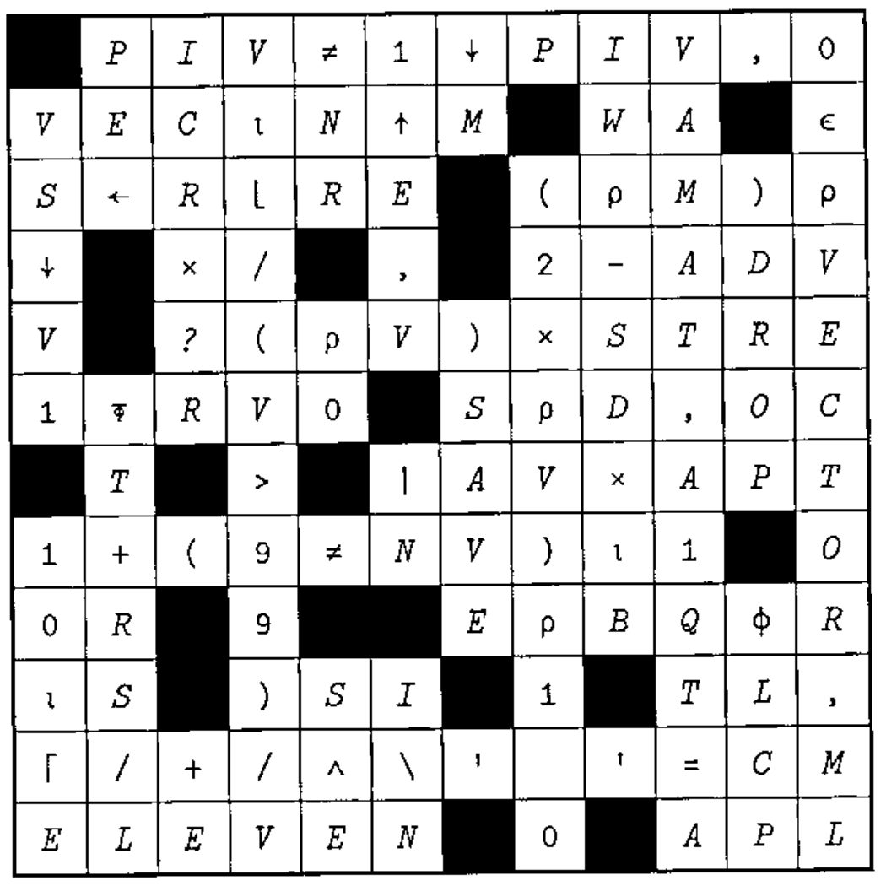
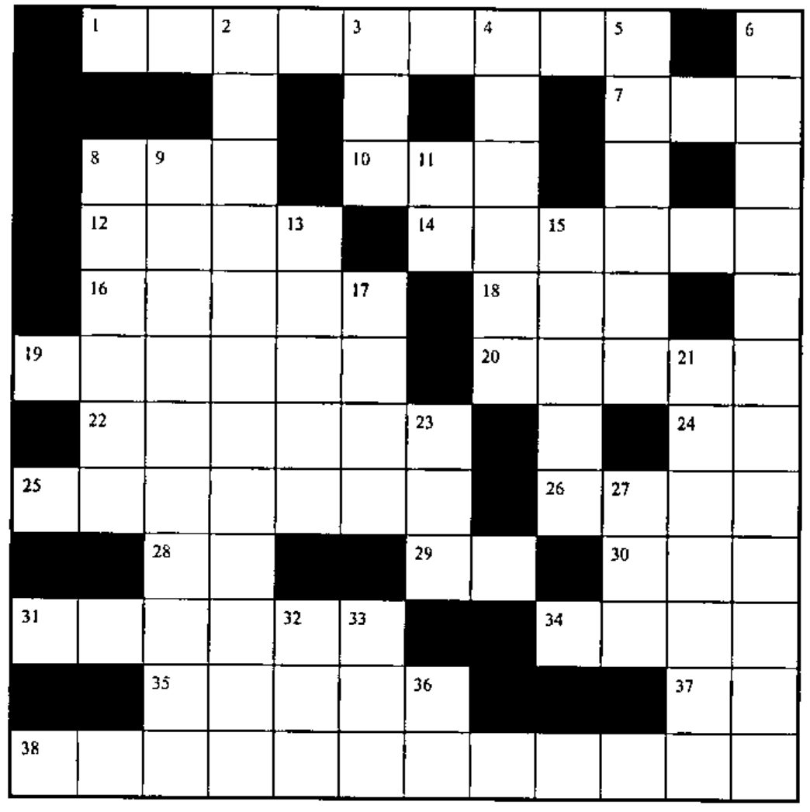

## Solution to Crossword in 19:3

## New Crossword

### Across

1. Smallest positive number in vector `V`
7. Cumulative product of vector `V`
8. Branch to line labelled `JV`
10. The larger of `M` or `C`
12. `(T+¯1),(T+¯2),...,(T+¯5)` for scalar `T`
14. Convert indices in `SO1` to origin 0
16. The remainder of `V2÷GF`
18. All but first `P` elements of vector `R`
19. `M=M` for any array `M`
20. `V[1;Y⍴1]`
22. `~(LB÷2)≠K+K`
24. `,×/⍴`
25. `10 20 30 40 ... 1230`
26. `('MAT←12 11⍴¯1'~'A1 ⍴←')[2 3 1 4]`
28. `¯1↓1↓'APL2'`
29. `!4`
30. `V1[(1+⍴V1)-⍳⍴V1]`
31. `(⍳4),5+⍳4`
34. `_____⍴A` is first element of `A`, as a scalar
35. `,(T-⌊T),[1.5]T-⌊T` for vector `T`
37. `__A` returns `A`, but promotes scalar `A` to a vector
38. Distinct elements of character array `CV`

### Down

2. Distinct elements of vector `V`, whose length is `L`
3. `M[;1]>M[;2]` for two-column `M`
4. Bring objects into active workspace without overwriting existing objects
5. `(V×-R1)+(V×J)`
6. Distinct elements of sorted,non-negative, numeric vector `V`
8. Branch to line labelled `L0` if bit `TF` is 1 .
9. `J-(MB×MB×P92A×P92A)*0.5`
11. The next larger integer at or above `S`
13. `K1[S2⍴⍳⍴K1]`
15. Number of columns in matrix `MT`
17. `G1+G1`
21. Number of dimensions in matrix `MV01A`
23. `(⍕1↓1↓⌽⍳5)~' '`
27. `__X is (2+⍳X-2),⍳2`
32. `∧/~`
33. `C-5×⌊C÷5`
36. Non-interactive full-screen interface
