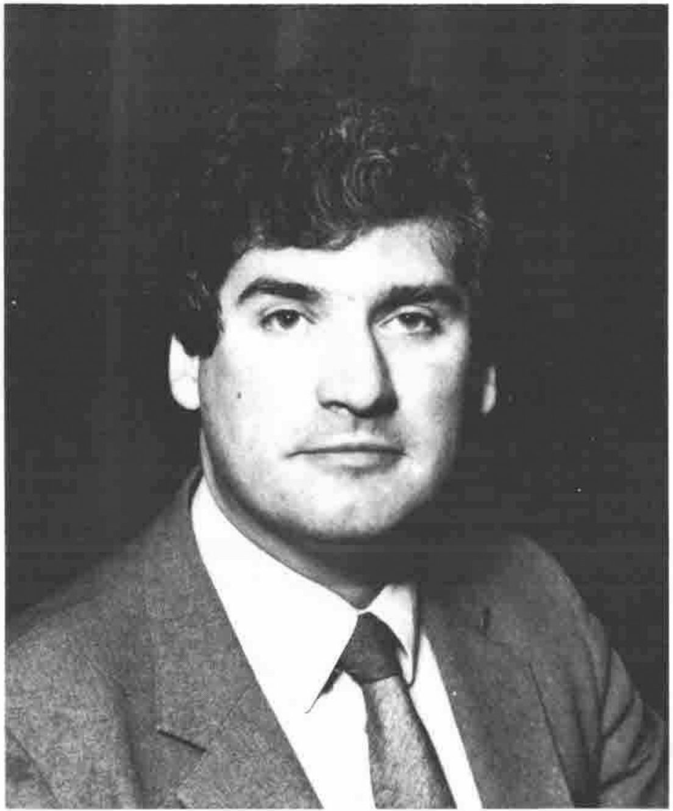

*Compiled by Robert Bittlestone*
{ .byline }

## Annual General Meeting

The 1983 Annual General Meeting of the British APL Association (formerly the U.K. APL User Group) took place at 2.00 p.m. on Friday 20th January 1984. Prior to this meeting an unprecedented level of activity had been taking place with a view to sweeping your Association's structure through with a clean broom. The difficulty of organising the Loughborough Business Technology show in September 1983 had put the spotlight on the need for some changes. Now that the dust has settled, we can reveal that the Loughborough event came within a hair's breadth of cancellation three weeks before opening day, primarily owing to a lack of its effective promotion by your Committee! At the last minute we appealed to UK companies trading in APL to help us out, and they generously gave of their time to mail off details to their contact lists. The result was salvation; Loughborough came and went and actually made the Association richer.

### "The AGM atmosphere was electric: you could cut it with a knife"

As a result of the Loughborough experience a Task Force was appointed to conduct an in-depth review of all Association activity. The proposals were published in the previous issue of the Association journal and were in essence voted on by the ordinary members at the January Annual General Meeting. It's true that competing candidates were not obliged to swear allegiance to the new manifesto, but social ostracism by the fellow Committee members would have been the inevitable outcome of any officer rejecting the embraces of change. After all, this didn't all happen in 1984 for nothing.

The atmosphere at the AGM was electric; you could also cut it with a knife (an irresponsibly mixed metaphor?). Based on the votes cast there were about 50 enfranchised members present, not all of whom voted on every issue. The first nail-biting scenario occurred when we came to elect a Chairman. Three candidates were presented: Phil Goacher, the outgoing Chairman and a donor of long and worthy service to the Association; Ron Fuss of "Fuss at Loughborough" fame (see last issue) who had been persuaded to stand by a splinter group intent on humour at Committee meetings at all costs; and Dick Bowman who entered the running as a dark horse late in the day, standing on a CEGB platform in apt harmony with the ambience of the meeting.

### "The candidates didn't even have $24 million to spend on their campaigns"

After a period of what has been described as "white knuckle time" involving frantic recounts by Anthony Camacho, who had not yet been elected Secretary but was nevertheless constitutional in his arithmetic following Gordon Sutcliffe's request as outgoing secretary for a stand-in, the votes were announced: Bowman 15, Fuss 15, Goacher 16. Neither Hart, Jackson nor Mondale could have played it more fairly, and our candidates didn't even have $24 million to spend on their campaign. The voices of reason held sway and continuity in Association matters was assured, while at the same time our incoming Chairman's majority was such as to leave the balance of power in the hands of the yet-to-be elected Committee.

Worse was yet to come, or better, depending on your electoral viewpoint. Mr. Camacho carried the Secretaryship against Les Hollingbery by 25:15, and Mel Chapman beat Mark Griffiths to the Treasurer's role by 17:12. Mr. Camacho was seen to be putting renewed vigour into his vote-counting now that he really was the Secretary, and Mr. Chapman started to count the cost of proceedings with some financial alacrity.

### "The failed candidates' tongues smarting from the bitter taste of defeat"

Next to come was the role of Activities Officer, where the lineup was David Allen from British Aerospace, no stranger to the BCS world with his Kingston branch involvement; Dominic Murphy of Inner Product, no stranger to the APL world with his VIZAPL involvement; Dick Bowman, no stranger to the world of humbler Committee men as distinct from Chairpersons, gritting his teeth with manfully concealed disappointment; and Robert Bittlestone, your humble correspondent, an also-ran for the Journal vacancy and by now eyeing the competition with some concern. Tactical voting prevailed: Mr. Bittlestone withdrew his nomination for the Activities job, posing a new constitutional dilemma for Mr. Camacho by so doing, but our gallant Secretary raised no objection to this irregularity and the Titans were left to fight it out. The result was Allen 14, Murphy 7, and Bowman 17, so Allen and Murphy retired to battle with their tongues smarting from the bitter taste of defeat and Bowman, crowned with a laurel wreath, performed the by now obligatory gladiatorial circuit of the Read Lecture Theatre arena.

Fred Perkins of I.P. Sharp fame was by now the only candidate for the role of Promotions Officer, and gracefully the ordinary members let him have it. Mr. Perkins obviously felt that an uncontested seat was a worthless seat since he stuck it for three months and then was regrettably obliged to tender his regination (see later). However, we didn't know that at the time and so the auditorium rocked with deafening applause. The post of Journal Editor was then offered and the candidates were Valerie Lusmore, the outgoing Editor, an APL person from APL People and the worthiest possible candidate following her years of dedication to the cause, and Robert Bittlestone of MicroAPL and Metapraxis, whose only claim to APL journalistic fame was his previous editorship of the blatantly commercial "MicroAPL News". Would integrity prevail over commerce? Very nearly, but after a further ashen-faced recount Mammon triumphed by 21 votes to 20, ushering in by one head the current regime of logorrhoea.

### "A wave of almost invisible releif swept over the AGM audience"

After this almost unbelievably stressful sequence it was with some visible lack of tension that Chris Beatty of Westminster City School was elected unopposed as Education Officer, and that Romilly Cocking of Cocking & Drury was elected also unopposed as Technical Officer. A wave of almost invisible relief swept over the audience and voting finished with an almost unnoticed ruse of great cunning by the new Chairman, to extend all our terms by 3 further contest-free months: the Association current year-end has now been fixed at 30th April 1985 and annually thereafter, thus conveying yet headier joys of this extended office on our unworthy heads.

### "The acronym formed by 'British APL Group' was rejected"

Talking of "Association" reminds me to announce that the name of your Organisation has undergone various metamorphoses. The original name of "APL User Group" was felt to be too low-key to live up to the major expectations that are now had of it, and so "British APL Society" was proposed. However, the British Computer Society were unenthusiastic about this since it might imply that all British Computers were in fact running APL, a commendable notion but rather short of the facts. So "British APL Group" was coined and lived for about two months until your Editor discovered to his horror the appalling nature of the acronym thus formed. Nights were lost with visions of seething masses of APL enthusiasts exclaiming "It's in the BAG", so the BCS was persuaded to adopt BAA instead. Any resemblance to a national airport authority is felt unlikely to pose a major practical problem. We hope our readers approve of this nomenclature.

## APL84 in focus

Many UK APL enthusiasts will be unable to visit the APL84 conference in Helsinki this year. Dick Bowman, the Association's Activities Officer, has thoughtfully provided a special session whereby speakers travelling back from Helsinki via London will be waylaid and asked to regurgitate their seminars. After the practice in Finland the presentations should be even sharper, so don't miss this opportunity of hearing the highlights of APL84.

This is a Special Event of the Association and is being held at the Waldorf Hotel, Aldwych, London WC2 on Friday 22nd June. A charge will be made, which will include lunch. The speakers will include Jim Brown of IBM, who will be talking about APL2; Roy Sykes of STSC, the author of "Collected Whizzbangs"; Philip van Cleave of TCC and MicroAPL talking about APL.68000; and a demonstration of the Analogic Corporation "APL Machine".

For technical details contact Dick Bowman at the address at the end of the journal. For booking inquiries contact Philip Goacher at the BCS, address also at the end of the journal.

*Our thanks are due to Romilly Cocking for sterling services to the APL User Group in the past and to the formation of the current Association*

## Situations Vacant

Mr. Romilly Cocking has felt obliged to tender his resignation as Technical Officer. Mr. Frederick Perkins has also felt obliged to tender his resignation as Publicity Officer. Both these posts are currently vacant and applications are invited to fill them.

The role of Technical Officer requires a history of exposure to APL, ideally on several different types of computer, and an acknowledged expertise in the technical aspects of the language. Duties include (a) acting as a reference point for members of the Association who have technical inquiries, (b) coordinating the activities of the Association in relation to APL standards, (c) supporting the Journal Editor by identifying potential authors, and (d) supporting the Activities Officer by identifying speakers and panellists.

The post of Publicity Officer requires an ability to handle Press contacts and a gift for phrasing announcements about Association affairs in an interesting and news-worthy way. Duties include (a) handling all Press matters, including press releases (b) liaising with sustaining members over matters of general APL market interest, (c) assisting the Journal Editor in promoting the circulation of VECTOR, and (d) helping the Activities Officer to publicise Association meetings.

The Association statutes are such that no general vote of members is required to fill interim vacancies. Consequently these officers will be appointed by vote of the Committee after reasonable time has elapsed for candidates to make their interests known. Please write to the Secretary of the Association (address at the end of this issue) with a brief outline of your APL experiences, a statement of your interests and orientation if appointed, and a recent black and white photograph.

## APL86

International APL Conferences take place alternately in the USA and elsewhere. The 1982 Conference was in Heidelberg; the 1983 in Washington; 1984 takes place in Helsinki; 1985 in Seattle, and 1986 has been allotted by EuroAPL to the United Kingdom. Initial planning is currently under way by your Committee, and in due course it is likely that a special secretariat will emerge to run the affair, with an identity distinct from the Association Committee itself, although existing officers are by no means disbarred.

Offers of assistance in organising APL86 will be gratefully received by the Secretary. There is also a requirement for referees to scan through papers that are submitted to the conference. Although such appointments are normally by invitation, any individual who considers himself or herself qualified and enthusiastic for such involvement is also invited to contact the Secretary.
