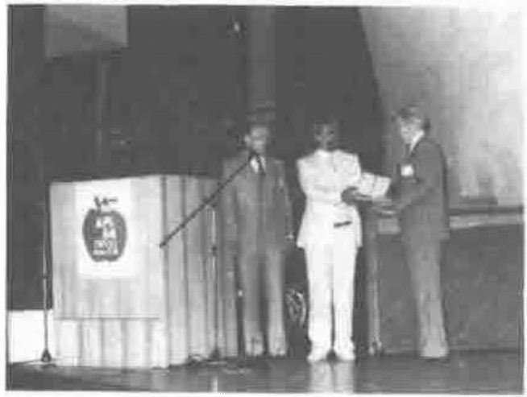
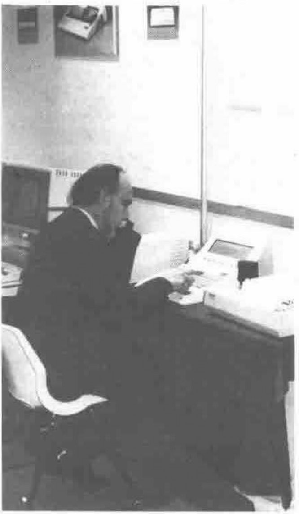
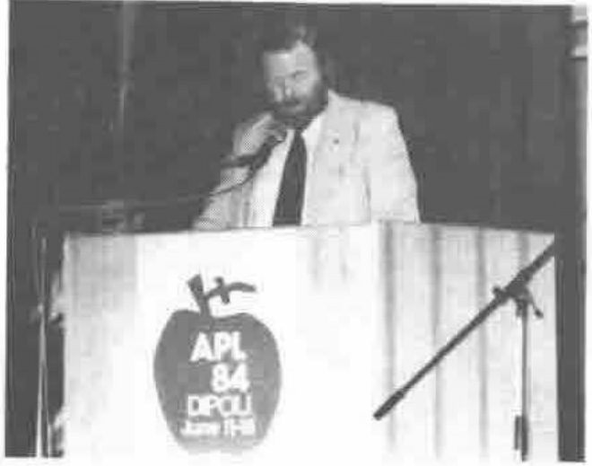
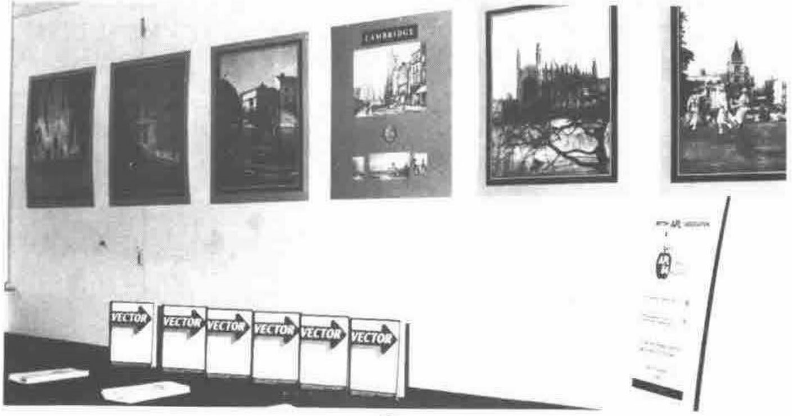
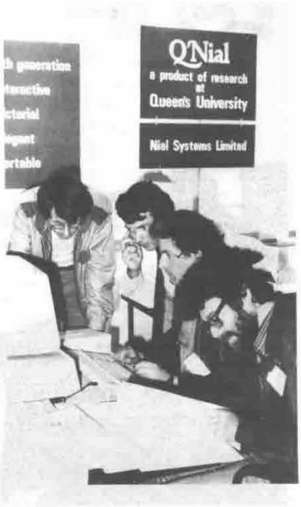
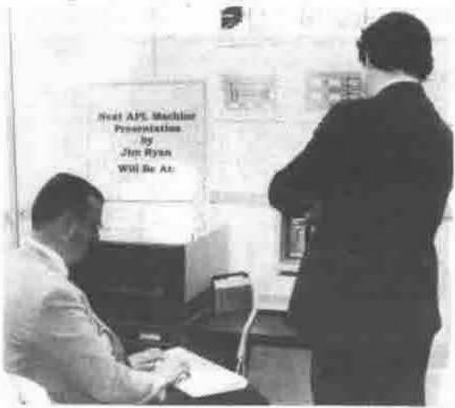
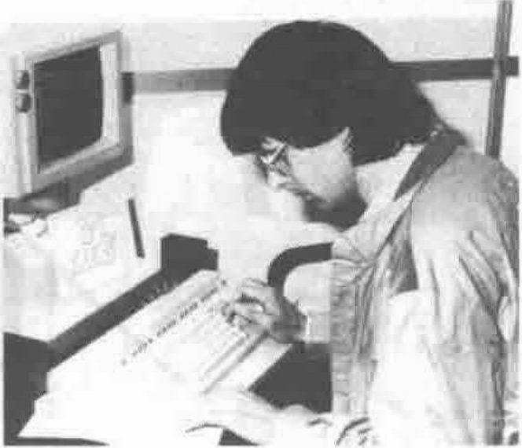
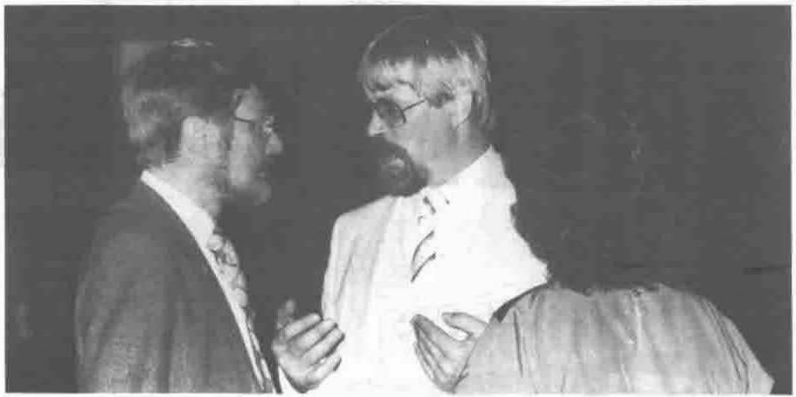

*Compiled by Robert Bittlestone*
{ .byline }

This column is open to other APL Associations outside the UK; please write to us with your news and we shall be pleased to broadcast extracts for you. A substantial number of VECTOR subscriptions are from overseas and we hope in this way to keep APL users in touch with each other internationally.

The International News section in this issue offers a truly transatlantic tour from APL’84 in Helsinki to APL’85 in Seattle, via Toronto, Lisbon and Mexico.

## APL’84 — Helsinki

All reports from Helsinki suggest that APL’84 turned out to be as successful a conference as everyone expected. Rather than attempting the gargantuan task of summarising the proceedings of the Conference, we are grateful to David Ziemann for preparing a photographic review of some of the memorable moments.

## I.P. Sharp 1984 APL User Meeting

“The Information Centre and Changing Technology” is the theme of this conference, which will be held on October 15-17 in Toronto, Canada.

Keynote speakers include H. Mitchell Watson Jr., IBM Vice President and President, System Products Division, IBM Corporation, White Plains, New York; and James Cunnie, Director of Office System Planning, ITT Corporation, Stratford, Connecticut. There will be a special half-day presentation by James Martin, who is according to Computer Weekly the computer industry’s most widely read author and best attended lecturer.

The registration fee for the 3-day Conference is $320(US). A brochure and registration details are available by contacting:

> Rosanne Wild, IPSA Ltd., Suite 1900, 2 First Canadian Place, Toronto, Ontario, Canada

or I.P. Sharp’s London office.

More complete details of this conference were given in the previous issue of VECTOR.

## APL\*2 Minicongress

As you may already know, there is now an APL association in Portugal, called Associacao Portuguesa da Linguagem APL, or APL\*2 for short.

APL\*2 is holding its second minicongress on October 31st, 1984 at the Faculty of Human and Social Sciences, New University of Lisbon. It has been arranged to coincide with the National Informatics Conference organized by the Portuguese Computer Society.

The guest speaker will be Professor Wolfgang Janko, from the University of Karlsruhe, Germany, and several papers will be presented by local APLers. A detailed programme will be available by October 1st and will be mailed to anyone who requests it.

For further information, please contact the Chairman of APL\*2:

> Jose Marques Henriques, [address omitted], Lisbon, Portugal.

## Mexican APL Society Conference

The Mexican APL Society is holding its annual 3-day conference on November 15-17. Topics will include Microcomputers, Decision Support Systems, Documentation and Technical items.

At the time of going to print, we do not know the venue for the Conference, but further details can be obtained by contacting the organisers:

> Adolfo Garcia, Presidente Sociedad Mexicana di APL, 
> Arenal 40, San Angel, Mexico 20, D.F.

## APL’85 — APL and the Future

Looking slightly further ahead than the coming 3 months, it is not too early to be making arrangements for APL’85 in Seattle, Washington — the Emerald City. The following extract comes from the Conference Announcement:

> “APL’85, the 1985 Conference of the international APL community will be held in Seattle, Washington, USA — May 12-16, 1985. The Conference is co-sponsored by ACM SIGAPL and by the Puget Sound Chapter of ACM. The Conference theme is: APL And The Future.
>
> “The Conference Committee welcomes you to the scenic Pacific Northwest, home of beautiful mountains, forests, lakes and Puget Sound. May is customarily a warm and sunny time in Seattle.
>
> “The conference site is the Seattle Westin Hotel. Its twin towers contain complete conference facilities, over 800 sleeping rooms, swimming, health and dining facilities. Located in downtown Seattle, the Westin is in easy walking distance of many of Seattle’s fine tourist attractions. You can also ride the Monorail to the Seattle Center, then eat at the top of the 600-foot Space Needle, and visit the Center’s fountains, shops and cultural attractions. Seattle’s FREE downtown bus service will take you to other attractions, such as the waterfront and restored Pioneer Square. For more extensive touring, you can take a Gray Line boat and bus tour of Seattle, or a one- or two-day side trip to Vancouver or Victoria BC.
>
> “The Conference starts Sunday afternoon, and ends Thursday noon. This is a day longer than previous North American APL Conferences, allowing fewer papers at one time so you can hear more papers of your choice. There will be the traditional fine banquet. The extra evening will feature a boat ride on beautiful Puget Sound, with an Indian-style salmon dinner, and entertainment by a Pacific Northwest specialty — African music from Zimbabwe played by a Marimba band.
>
> “An excellent technical exhibit will feature the latest in APL Hardware, Software, Applications and Literature, with an emphasis on Personal Computers.”

To obtain a registration packet, please send you name and address to:

> Mike Metzger, [address omitted], Seattle, WA

or use IPSA and STSC Mailbox Code — APL85, attention Registrar.

The call for papers closed on September 14th., but other questions about the technical program should be submitted to the Program Chair:

> Robert C. Metzger, I.P. Sharp Associates Inc., 
> 1200 First Federal Plaza, Rochester, NY 14614, 
> USA (IPSA & STSC Mailbox Code — [omitted]).

Questions about any other Conference matters should be directed to the Conference Chair:

> Bob Gailer, Boeing Computer Services 9A-90, 
> Education & Training Divn., PO Box 24346, Seattle, 
> WA 98124, USA (IPSA & STSC Mailbox Code — APL85).

## APL’86 — Cambridge, England.

If you think May 1985 is far enough to plan ahead, spare a thought for the British APL Association committee who are already planning for APL’86, which as you probably know is going to be held in Cambridge. Inevitably few details are available to date other than the venue and the planned date which is July 1-4, 1986. Further details will be announced in future issues of VECTOR.

## APL Quote Quad Subscriptions

*As an information service to VECTOR readers and as a courtesy to the editors of “APL Quote Quad” for allowing us to reprint some of their news material, we are relaying the details of how to subscribe to their journal.*

APL Quote Quad is an informal quarterly publication containing articles, algorithms, announcements, book reviews, correspondence, problems, and other materials of interest to users of the programming language APL. Subscription is a benefit of SIGAPL membership, but is also available to non-members. Address inquiries to:

> Fred Aronson 
> Coordinator of SIGs 
> Association for Computing Machinery 
> 11 West 42nd Street 
> New York, New York 
> USA 10036 
> Telephone: (212)869-7440 
> Telex: 421686 ACMUI

The price of annual subscriptions to ‘APL Quote Quad’ is US$30.00.

## APL Quote Quad Back Issues

Back issues of **APL Quote Quad** are available, while supplies last, to members for $7.50 US per copy (except Proceedings issues). Proceedings of some APL conferences are also available, with a discount for members. Request a Publications Catalog and/or Order Form, or mail order with payment or purchase order to

ACM Order Department, 
Waverley Press, 
P.O. Box 64145, 
Baltimore, Maryland, 
USA 21264.

| Order Number | Description | | | | | Price $ |
|---|---|---|---|---|---|--:|
| SIGAPL | APL Quote Quad | | | | | 7.50 |
| | 1973-74 Vol. 4 Nos. | | 2 | 3 | 4 | |
| | 1974-75 Vol. 5 Nos. | | 1&3 | 2 | 4 | |
| | 1975-76 Vol. 6 Nos. | 1 | 3 | | 4 | |
| | 1976-77 Vol. 7 Nos. | 1 | 2 | 3 | | |
| | 1977-78 Vol. 8 Nos. | 1 | 2 | 3 | 4 | |
| | 1978-79 Vol. 9 Nos. | 1 | 2 | 3 | | |
| | 1979-80 Vol. 10 Nos. | 1 | 2 | 3 | 4 | |
| | 1980-81 Vol. 11 Nos. | 1 | 2 | 3 | 4 | |
| | 1981-82 Vol. 12 Nos. | | 2 | 3 | 4 | |
| | 1982-83 Vol. 13 Nos. | | 2 | | 4 | |
| | 1983-84 Vol. 14 Nos. | 1 | | 3 | | |
| 554760 | APL76 Conference Proceedings | | | | | 23.00 |
| 554790 | APL79 Conference Proceedings Vol. 9 No. 4 Parts 1&2 | | | | | 22.00 |
| 554810 | APL81 Conference Proceedings Vol. 12 No. 1 | | | | | 28.00 |
| 554820 | APL82 Conference Proceedings Vol. 13 No. 1 | | | | | 29.00 |
| 554830 | APL83 Conference Proceedings Vol. 13 No. 3 | | | | | 24.00 |

## International APL Organisations

We are publishing with permission an updated version of the list of organisations appearing in APL Quote Quad, Vol 14 No. 1. The VECTOR Editor would be pleased to receive information from any of these groups for publication.

### Austria

APL-Club Austria 
Dr. Siegfried Streit, Chair 
Wiener Stadtwerke 
Mariannengasse 4-6 
A-1095 Vienna 
Austria

### Belgium — BACUS

An affiliate of the Computational and Applied Mathematics Group

Belgian APL-CAM Users Society 
Joseph De Kerf, Chair 
[address omitted] 
B-2570 Duffel 
Belgium

Telephone: [omitted] 
IPSA mailbox: [omitted]

### Canada: Toronto — CIPS APL SIG

An affiliate of the Canadian Information Processing Society

Toronto Special Interest Group on APL 
Richard Levine, APL Co-ordinator 
Xerox Canada Inc. 
703 Don Mills Road 
Don Mills, Ontario M3C 1S2 
Canada

Telephone: (416)429-6750, Ext. 2684 (after 4 p.m.) 
IPSA mailbox: [omitted]; group box: TSIG

### Finland — FinnAPL

Finnish APL Association 
Gustav Tollet, Chair 
P.O. Box 1005 
SF-00101 Helsinki 10 
Finland

### France

A subsidiary of the Association Francaise de Cybernétique, Économique, et Technique

Group APL, AFCET 
Gilles A. Martin, Chair 
CISI 
35 Boulevarde Brune 
F-75014 Paris 
France

### Germany — APLCG

APL-Club of Germany e.V. 
Prof. Dr. Wolffried Stucky 
Postfach 6380 
D-7500 Karlsruhe 1 
Federal Republic of Germany

### Italy

A subsidiary of the Associazione Italiana di Calcolo Automatico

APL Club Italia 
Giorgio Faconti, President 
CNUCE 
Via S. Maria 36 
I-56100 Pisa 
Italy

Telephone: (50)45245

### Mexico

Sociedad Méxicana de APL, A.C. 
Erick Alvarado, President 
Teleinformática de México, S.A. 
Arenal 40 
México 20, Dist. Féderal 
Mexico

Telephone: (905)550 80 33

### Netherlands — APLWG

A subsidiary of the System-Programming Section of the Netherlands Society for Informatics (NGI)

Werkgroep APL 
Dhr. Bram Kornaat, Secretary 
Rijks Computer Centrum, 
Fauststraat 1 
NL-7323 BA Apeldoorn 
Netherlands

Telephone: (55)778822

### Portugal

Associacao Portuguesa da Linguagem APL 
José M. Henriques 
[address omitted] 
P-1400 Lisboa 
Portugal

### Sweden — SIG-APL

A subsidiary of the Swedish Society for Informatics

APL Special Interest Group 
Bo Lundmark 
Sperry AB 
P.O. Box 1138 
S-171 22 Solna 
Sweden

### Switzerland — SAUG

Swiss APL User Group 
Herr Th. Formanek, President 
Postfach 
CH-3000 Bern 29 
Switzerland

Telephone: (31)624980

### United Kingdom

A Specialist Group of the British Computer Society

British APL Association 
Philip Goacher, Chairman 
British Computer Society 
13 Mansfield Street 
London W1M 0BP, England

Telephone: 01 637 0471

### USA: Dallas-Fort Worth — SWAPL

Southwest APL Users’ Group 
Don Hatfield, Secy/Treas. 
[address omitted] 
Garland, Texas 
USA

### USA: Denver — DIGAPL

Denver Interest Group for APL 
P.O. Box 3931 
Englewood, Colorado 
USA 80155

### USA: Houston

Houston APL Special Interest Group 
Mary Hall, President 
Charter Oil Company 
P.O. Box 87535 
Houston, Texas 
USA 77287/7535

Telephone: (713)640-4724

### USA: New York City — NY/SIGAPL

New York Chapter, SIGAPL 
P.O. Box 524 
New York City, New York 
USA 10025

### USA: Rochester

Rochester Chapter, ACM SIGAPL 
Robert Pullman, President 
P.O. Box 92487 
Rochester, New York 
USA 14692

Telephone: (716)244-4732

### USA: San Francisco — APLBUG

APL Bay Area Users’ Group 
Dick Foss, Treasurer 
Crocker National Corporation 
West Tower, 29th Floor 
One Montgomery Street 
San Francisco, California 
USA 94104

### USA: Seattle

UW APL Users Group / SIGAPL 
J.R. Atkins 
University of Washington DH-05 
Seattle, Washington 
USA 98155

### USA: Washington

Washington Chapter, ACM SIGAPL 
Lawrence Dusold 
Dept. of Health, Education and Welfare HFF-146 
200 C Street SW 
Washington, District of Columbia 
USA 20204

Telephone: (202)245-1413

## What’s in a Name

Whilst savouring the delights of Finnish vodka recently a discussion arose about the choice of the name VECTOR for our journal.

This lead to a suggestion from Jim Ryan, subsequently extended by Jim Brown, that an annual volume of VECTOR should be called an ARRAY.

To take this further, perhaps we should give the name SCALAR to all single sheet meeting notices and announcements and call future conference proceedings MATRIX.

Needless to say, a collection of such publications on your bookshelf would be a NESTED ARRAY.

