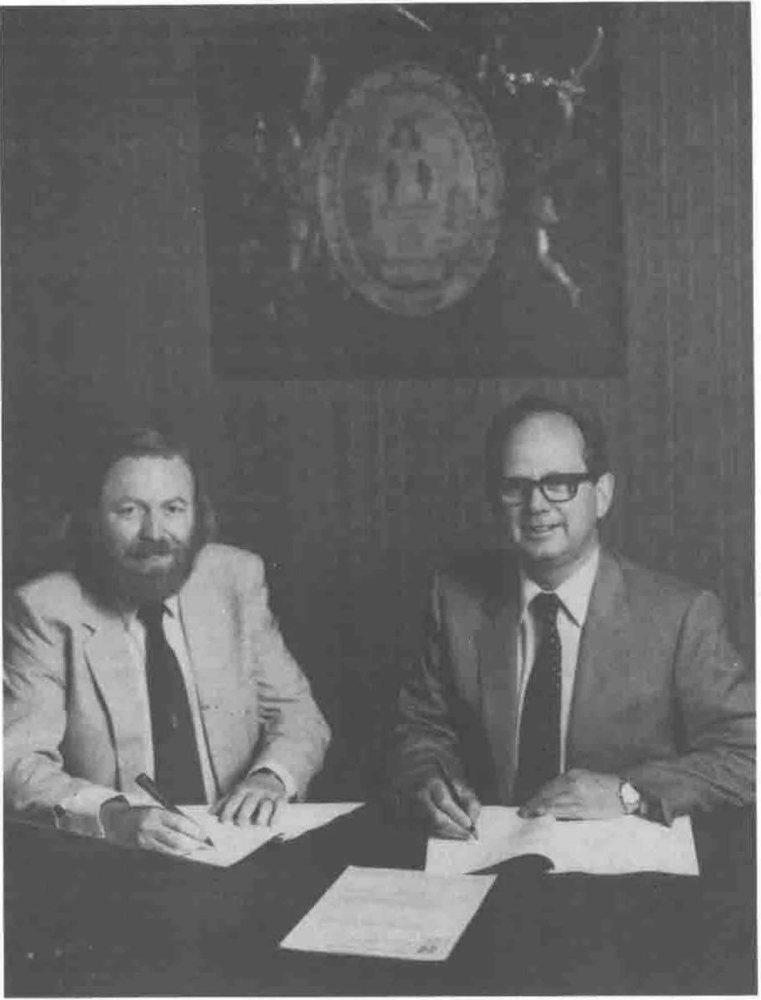

*Compiled by Philip Goacher*
{ .byline }

Following my article concerning the BCS in the last issue of VECTOR, a number of readers have contacted me to enquire about membership. I have therefore put together the following notes on membership requirements, facilities and services. If you have any queries please do not hesitate to contact Pat Harris at BCS headquarters; she will be only too pleased to help.

### Membership of the BCS

Each individual member belongs to an appropriate grade of membership, which reflects his or her experience and qualifications. Members pay a subscription which varies according to their membership grade.

The professional grades are:

Fellow (FBCS) 
Member (MBCS) 
Associate Member (AMBCS)

### Requirements for Membership

**Fellow (FBCS)**: This grade is for persons who have been members of the Society for at least one year, and who are recognised as authorities amongst their peers in their sphere of computing practice.

**Member (MBCS)**: The requirements for applicants for this grade are:

> Pass at, or exemption from, both parts of the Society Examination, plus at least four years’ full-time working experience, **OR**
>
> Exemption from Part II of the Society Examination, plus at least six years’ full-time working experience, **OR**
>
> An honours degree (or equivalent qualification) in a subject other than computing, plus at least six years’ full-time working experience (NB Unless the degree contained a substantial computing element, more than six years’ practical experience is likely to be required), **OR**
>
> No formal academic qualifications, but at least ten years’ full-time working experience; the applicant should be at least 30 years of age.
>
> Applicants should normally be sponsored by two Fellows or Members of the Society.

**Associate Member: (AMBCS)**: The requirement for applications for this grade are:

> Pass at, or exemption from, Part I or Part II of the Society Examination, plus at least three years’ full-time working experience, **OR**
>
> Pass at, or exemption from, both parts of the Society Examination, plus at least one year’s full-time working experience, **OR**
>
> An honours degree (or equivalent qualification) in a subject other than computing plus at least three years’ full-time working experience (NB Unless the degree contained a substantial computing element, more than three years’ practical experience is likely to be required).

In addition there are the following non-professional grades:

**Student**: For those studying to take, or gain exemption from, Parts I and/or II of the Society’s Examination.

**Affiliate**: For those wishing to take part in the Society’s activities but who are not qualified for other grades of membership. The categories of Affiliate Membership are: Individual Affiliate and Institutional Affiliate (corporate bodies, institutions, companies, educational establishments and student societies).

### Facilities and Services

All members of the Society benefit from:

- Opportunities to meet others from the scientific, commercial and social sectors of the computing industry
- Membership of the local branch of their choice
- Advice from, and participation in, the 46 specialist groups
- Choice of The Computer Journal or Computer Bulletin, plus the Society’s newsletter, free of charge
- A copy of “Computing” each week
- Notification of conferences, exhibitions and seminars, many of which are run by the Society, and discounts on registration fees
- Discounts on computing publications from major publishers
- Use of the Society’s library, housed at the Institution of Electrical Engineers, which welcomes personal callers as well as operating a postal lending service.

In addition, a wide range of advice and services connected with professional indemnity and legal charges are available to members of the professional grades.

Further details of the entry requirements can be found in the “Guide to Membership Regulations”, available free of charge from the Information Department of the BCS. Detailed enquiries regarding eligibility should be made to

> Ms P Harris 
> Assistant Registrar 
> The British Computer Society 
> 13 Mansfield Street 
> London W1M 0BP 
> Tel: 01-637 0471

## B.C.S. Appoints Cambridge University Press as publishers

As you may have noticed in the press recently, Cambridge University Press (CUP) are to produce the Society’s periodicals and books in future, although specialist groups will of course continue to have complete freeedom to use the publisher of their choice.

**The Computer Journal** is the leading publication of the BCS. It is produced quarterly and comprises papers that:

(a) describe original research or new applications, or original contributions to standards or working practice, or

(b) review the current position in some branch of computer technology which is not adequately described elsewhere, or

(c) are of general interest to readers, for example, describing the difficulties encountered in introducing new working methods in an established situation, or

(d) provide instruction on some aspect of computing of a standard at least equal to Part I of the BCS’ membership examinations.

All papers are expected to have high computer content or, if not directly related to computer theory or application, must show how the results obtained are applied in real computing situation.

**The Computer Bulletin** is being completely restyled in 1985, and will present a authoritative voice in many areas of computing. The Computer Bulletin will have a very practical outlook and should be essential reading to a wide range of compuer users and the computer managers that serve them.

**The Computer Newletter** will appear ten times a year from next January and will keep members up to date with BCS activities, particularly those in the Branches and Specialist Groups (such as ours).

In addition to these publications the BCS publish several series of books including the Workshop Series (for conference proceedings, workshop reports etc) and Computer Monographs

There are the various ways in which our APL users can make use of the ‘BCS connection’ to publish papers, articles or books on their subject of interest, to supplement the pages of VECTOR.

If any of you are budding authors wishing to follow in Adrian Smith’s footsteps then I would be pleased to offer any help to get your manuscripts into print in the most appropriate way.

