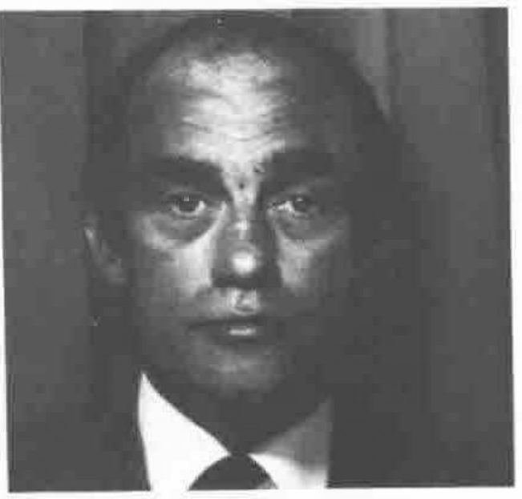

*Compiled by Robert Bittlestone*
{ .byline }

## Situations Vacant

Mr. Christopher Beatty, formerly Education Officer, has indicated his enthusiasm to transfer his activities to the Publicity Officer role, and has been confirmed in that role by your Committee, which anticipates with pleasure the missionary zeal that he is sure to lend to that position. As a consequence the role of Education Officer becomes vacant.

The Association’s Education Officer is expected to spearhead the exposure of APL to schools and universities by involving them in the Association’s activities and encouraging them to sample the language. Duties include (a) acting as a reference point for inquiries from the academic world, (b) promoting the use of APL in schools and universities, (c) liaising with the Activities Officer in arranging educational events and seminars, and (d) contributing material to VECTOR to assist the APL novitiate.

Various candidates for the Technical Officer’s role are under consideration following the announcement of the vacancy in the previous issue of VECTOR. In the event that no appointment has been made by the date of publication, we are reprinting the details that we published then.

The role of Technical Officer requires a history of exposure to APL, ideally on several different types of computer, and an acknowledged expertise in the technical aspects of the language. Duties include (a) acting as a reference point for members of the Association who have technical inquiries, (b) coordinating the activities of the Association in relation to APL standards, (c) supporting the Journal Editor by identifying potential authors, and (d) supporting the Activities Officer by identifying speakers and panellists.

## Situations Filled

Christopher Beatty, our new Publicity Officer, writes as follows:

Having eschewed Higher Education on leaving school, I spent 5 years in Chemical Engineering before taking a Physics degree at Essex University as a mature student (sic).

I then spent 10 years teaching in Uxbridge Mathematics which culminated in my appointment as Head of Computer Studies at Westminster City School — largely due to the seminal experience of reading the ‘Ladybird Book of Computing’ prior to my interview.

During my 4 years of Golden Enchantment at Westminster, APL was introduced to the pupils and Westminster Computer Systems Ltd. was formed by myself and a group of sixth formers. I have now severed my links with both the School and the above company and I now intend seeking my fortune in Computing and Communications.

## APL86

International APL Conferences take place alternately in the USA and elsewhere. The 1982 Conference was in Heidelberg; the 1983 in Washington; 1984 took place in Helsinki; 1985 will be held in Seattle, and 1986 has been allotted by EuroAPL to the United Kingdom to take place in Cambridge from July 1st-4th. Initial planning is currently under way by your Committee, and in due course it is likely that a special secretariat will emerge to run the affair, with an identity distinct from the Association Committee itself, although existing officers are by no means disbarred.

Offers of assistance in organising APL86 will be gratefully received by the Secretary. There is also a requirement for referees to scan through papers that are submitted to the conference. Although such appointments are normally by invitation, any individual who considers himself or herself qualified and enthusiastic for such involvement is also invited to contact the Secretary: address on the inside back cover of VECTOR.

## Activities Programme 1984

Here are further details of forthcoming Association activities:

| | |
|---|---|
| September 21 | APL and Knowledge-based Systems (Do we really have to learn PROLOG; or what should we do to make APL attractive in this growing area?) |
| October 19 | Workshop — How to Survive in Version xx of APL (Some APLs are more equal than others; what do you need to do if you covet that which your vendor doesn’t supply?) |
| November 16 | Information Centres Revisited. (The British APL Association has set up some working groups, one of which is in the Information Centre area; here they report on some case studies) |
| December 10 | What’s New for 1985 This event will be a revival of the long-popular “Roadshow” in which we present an exhibition of all that’s new in the APL world both in hardware and software. Product forums will accompany the exhibition. A new feature this year will be a “software village” to which we invite anyone with interesting APL software (both implementations and applications) to exhibit. Please contact either Dick Bowman or David Preedy as quickly as possible if you want to book exhibition, village or forum space. |
| 1985 | The technical meetings programme for 1985 is being prepared; among the prospective topics are:  Graphics Generalised Arrays Workshop Tree-structured datasets and/or user interfaces Text and numeric editors Interpreters and Compilers  More complete details will appear in due course; meanwhile if there are any topics on which you have a burning desire to know more (or indeed a compulsion to tell all) please contact the Activities Organiser. |

The programme is subject to revision; further details of each meeting will be sent to B.A.A. members nearer the date.

The recent Activities Questionnaire reveals some interest in our holding meetings in venues other than London. We are actively considering this and would like to hear from anyone willing to act as a local organiser.
