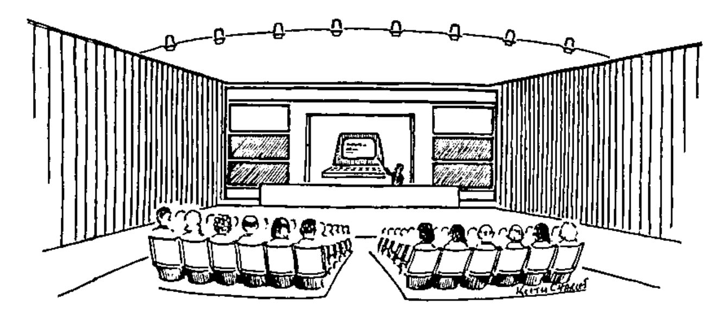
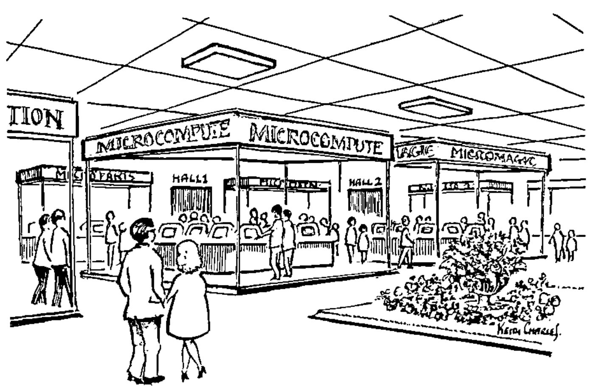
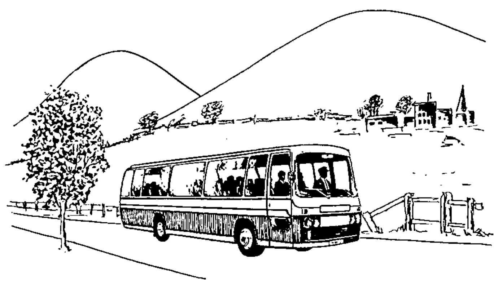

*compiled by David Ziemann*
{ .byline }

This column is open to APL Associations outside the UK; please write to us with your news and we shall be pleased to broadcast extracts for you. A substantial number of VECTOR subscriptions are from overseas, and we hope in this way to keep APL users in touch with each other internationally.

## APL86

**APL86** 
**Manchester, England** 
**7-11 July 1986**

organised by 
**The British APL Association**

The British Computer Society &emsp; acm — Association for Computing Machinery

### APL86 — Call for Papers

APL86 will be the first of the annual series of international conferences on the development and applications of APL to be held in England. There will be contributed and invited papers and a simultaneous exhibition by suppliers of APL-based services and products.

The conference will emphasise practical aspects of APL, and ‘live’ presentations to accompany submitted papers will be encouraged by the provision of a wide range of computing and audio-visual equipment.

As is traditional at the APL Conferences, a number of distinguished speakers from both within the APL community and other areas, such as Expert Systems, will be invited to present papers, and lead longer discussion sessions, based around ‘live’ presentations.

The conference will also include a number of tutorial sessions, of interest to both newcomers to APL and those with more experience in the use of the language.

The conference will have three main themes:

> APL in Action — including sessions on the use of APL in Personal Computing, Information Centres and Education. Other sessions currently planned include, for example, Full-screen and Graphics orientated systems, applications of APL in Expert Systems and programmer productivity tools.
>
> APL and its Environment — including sessions covering, for example, the interactions between APL and its host Operating Systems, APL as a compiled language, APL-dedicated hardware configurations and the use of APL as an ‘engine’ in systems constructed largely in other languages.
>
> The APL Notation — including sessions covering, for example, experience with the ISO Standard and with ‘second-generation’ APLs, the influence of theory on further extensions, the integration of the ‘second- generation’ extensions and APL as a teaching notation.

The Organising Committee is keen to encourage those who might not previously have considered submitting a paper to such a conference to share their experiences with others in the APL community.

#### Submission of Papers

Those intending to submit papers on one of the conference themes must make at least a preliminary submission by 15 June 1985; including a title, an abstract and an indication of the nature of the accompanying ‘live’ presentation and the equipment that would be required.

Full draft papers, for consideration by a panel of referees, must be submitted by 1 November 1985. Three copies of the paper, which is to be in English and should not exceed 6000 words, must be submitted, together with an abstract and a list of keywords for subject identification and classification, and a fuller description of the ‘live’ presentation. One or more referees may request that the presentation is made as part of the judging process.

Notification of the referees’ decisions will be sent out on 10 January 1986. Authors of papers accepted must provide final copies of their papers suitable for photo-reproduction by 4 April 1986.

All papers accepted and received by the final submission deadline will be published in the Conference Proceedings. Other papers will be considered for publication in VECTOR in the four issues following the conference.

It is intended that prizes will be awarded for the ‘best’ papers and presentations given to the conference.

For further details please contact the BISL Conference Department (APL86). Preliminary submissions may also be made through the I P Sharp Mailbox — APL86.

| Important Dates | |
|---|---|
| Preliminary Submission | 15 June 1985 |
| Submission Deadline | 1 November 1985 |
| Acceptance Deadline | 10 January 1986 |
| Final Version | 4 April 1986 |

The 1986 International Conference on APL and its applications will be held from 7 — 11 July 1986 at the University of Manchester Institute of Science and Technology, better known as UMIST.

This venue is situated at the centre of England’s second city. Its facilities for speakers, exhibitors and delegates are excellent and with the many interesting places to visit in the area APL86 promises to be a memorable event.

This preliminary notice about APL86 includes the call for papers and initial information for exhibitors. The conference will comprise tutorial sessions, contributed papers, invited speakers, exhibitor presentations and a full social programme including a conference banquet.

If you are not already on our mailing list to receive further information about the conference or exhibition please contact:

> BISL Conference Department (APL86) 
> The British Computer Society 
> 13 Mansfield Street 
> London W1M 0BP 
> England

| APL86 Local Organising Committee | |
|---|---|
| Chairman | Dick Bowman |
| Programme | Anthony Camacho |
| Publicity | Phil Goacher |
| Technical | Geoff Kemmish |
| Exhibition | Christine McCree |
| Finance | Mel Chapman |
| Administration | BISL (British Computer Society) |

### Manchester and UMIST

Situated in the North West of England, Manchester is within easy reach, having excellent road and rail access and a major international airport.

The University has a long tradition of computing and is where S.E. Williams developed the Williams Tube in 1946 — a small prototype computer which was the first stored program computer to operate.

The UMIST campus, located in Manchester City Centre is a mixture of old architectural styles and purpose built modern buildings. The modern complex being used for APL86 includes a conference and exhibition centre, restaurant and hall of residence — delegate accommodation is therefore available either on site or at one of the major hotels nearby.

The conference facilities at UMIST are excellent. The main lecture theatres are sited around the exhibition floor and a number of smaller theatres are available for meetings arranged during the conference.

Lunches and dinners will be provided in the large adjoining restaurant. UMIST also offers a wide range of sports facilities and a club bar for which delegates will become members during their stay.

### Exhibition

Throughout the Conference a comprehensive exhibition of APL hardware, software, applications and literature will be open to all conference delegates. The exhibition areas are ideally located immediately outside the lecture theatres and beside the cafeteria and bar.

Exhibitors will have an opportunity to give formal presentations on the products they offer through product forum sessions within the conference programme. These will be scheduled at a time when no technical papers are being given to ensure that all conference delegates have the opportunity to attend. Lecture theatres with 500, 300 or 150 seats are available for these one hour presentation sessions.

The British APL Association invite you to participate in APL86 by taking exhibition space, product forum sessions and a hospitality suite. We feel this will give you an excellent opportunity to display your services to the many delegates that this conference will attract from all over the world.

To book, or obtain further details about the exhibition, please contact the BISL Conference Department (APL86).

### Out and About

Manchester City Centre has the largest range of entertainment and attractions in the North West of England. For the serious music lover, Manchester is the home of the world famous Halle Orchestra — but all musical tastes are catered for locally. Museums, art galleries, theatres and an exciting night life can be found close by in the City, and whatever your tastes in food, there is a restaurant to meet them.

Manchester has a fine range of shops and minutes from UMIST there is the Arndale Centre, the largest under-cover shopping precinct in Europe.

Within easy reach of Manchester are the Lake District, Peak District, North Wales and the Roman town of Chester — all providing a different view of the area. Visits can also be made to the famous Wedgewood potteries or to the stately home Chatsworth, with its magnificent grounds and interesting history.

Day trips to London are also possible using the Inter-City rail service.

Pre- and post-conference tours will also be arranged for those delegates who wish to see more of England than is possible during the conference week. A programme for accompanying persons will also be available.

### For APL86 Information

To: BISL Conference Department (APL86), The British Computer Society, 13 Mansfield Street, London W1M 0BP, England.

*[Reply form: name and address, with boxes for “Please send further delegate information” and “Please send exhibitor information”.]*

Regular APL86 information will be issued to all on the mailing list.

## CIPS APL Special Interest Group (Toronto)

Do you have an interest in using the programming language APL, and live in the Toronto, Canada area?

The CIPS APL SIG (Toronto) is a special interest group (SIG) associated with the Canadian Information Processing Society (CIPS). This APL SIG enables APL professionals, users, vendors, consultants, and academics in the Toronto area to meet each other and to exchange ideas and information on new developments, applications, and problem solving techniques based on APL.

There is no charge for attending meetings. Membership in the SIG, however, is available for $15 (Canadian). Membership entitles you to receive advance mailing notice of our monthly meetings, to obtain our membership directory, to obtain copies of minutes of meetings and APL utilities (as available), and free admission to our annual APL micro-computer show held each fall.

Other publications of the group include the APL—NAPLPS (Telidon) Toolkit (a completely documented set of APL functions to interface APL and NAPLPS, available for $5), and the soon-to-be published first edition of our APL Utility Library.

We were formed in September, 1981, and currently have about 100 members.

We have a wide and varied program. For example, our program in 1984-1985 included meetings on APL and UNIX, Business Graphics, APL2 (with James Brown as speaker) SHARP APL (with Ken Iverson and Bob Bernecky as speakers), our new Birds of a Feather meeting, local area networks, and Q’NIAL (with Michael Jenkins as speaker).

Requests for publications and membership should be sent to the following address:

> Toronto APL SIG 
> P.O. Box 917, Station “Q” 
> Toronto, Ontario, Canada. 
> M4T 2P1

We also have a SHARP mailbox: TSIG.

Specific inquiries (between now and September, 1985) may also be sent to Richard Levine, APL Product Support Consultant, Xerox Canada Inc., 703 Don Mills Road, North York, Ontario, Canada. M3C 1S2 (416-429-6750).

### Meetings

**29 April 1985, Toronto**

Monthly Meeting of Canadian Information Processing Society Special Interest Group on APL. *Topic:* Mike Jenkins, President of NIAL Systems Limited, on Q’Nial; and annual general meeting. Ontario Institute for Studies in Education. *Contact:* Richard Levine (416) 429-6750.

*Q’Nial is a powerful 5th generation programming language combining ideas from APL, Lisp, and structured and functional programming. Q’Nial is a product of research in Computer Science at Queen’s University, Kingston, Ontario, Canada.*

**27 May 1985, Toronto**

Monthly Meeting of Canadian Information Processing Society Special Interest Group on APL. *Topic:* Local area networks. Ontario Institute for Studies in Education. *Contact:* Richard Levine (416) 429-6750

*Ed: The information above was sent to us by the Toronto APL SIG.*

## International APL Organisations

We are publishing with permission an updated version of the list of organisations appearing in APL Quote Quad, Vol 14 No. 1. The VECTOR Editor would be pleased to receive information from any of these groups for publication.

### Austria

> APL-Club Austria 
> Dr. Siegfried Streit, Chair 
> Wiener Stadtwerke 
> Mariannengasse 4-6 
> A-1095 Vienna 
> Austria

### Belgium — BACUS

An affiliate of the Computational and Applied Mathematics Group

> Belgian APL-CAM Users Society 
> Joseph De Kerf, Chair 
> [address omitted] 
> Belgium
>
> [telephone number and IPSA mailbox omitted]

### Canada: Toronto — CIPS APL SIG

An affiliate of the Canadian Information Processing Society

> Toronto Special Interest Group on APL 
> Richard Levine, APL Co-ordinator 
> Xerox Canada Inc. 
> 703 Don Mills Road 
> Don Mills, Ontario M3C 1S2 
> Canada
>
> Telephone: (416)429-6750, Ext. 2684 
> (after 4 p.m.) 
> IPSA mailbox: [omitted]; group box: TSIG

### Finland — FinnAPL

> Finnish APL Association 
> Gustav Tollet, Chair 
> P.O. Box 1005 
> SF-00101 Helsinki 10 
> Finland

### France

A subsidiary of the Association Francaise de Cybernétique, Économique, et Technique

> Group APL, AFCET 
> Gilles A. Martin, Chair 
> CISI 
> 35 Boulevarde Brune 
> F-75014 Paris 
> France

### Germany — APLCG

> APL-Club of Germany e.V. 
> Prof. Dr. Wolffried Stucky 
> Postfach 6380 
> D-7500 Karlsruhe 1 
> Federal Republic of Germany

### Italy

A subsidiary of the Associazione Italiana di Calcolo Automatico

> APL Club Italia 
> Giorgio Faconti, President 
> CNUCE 
> Via S. Maria 36 
> I-56100 Pisa 
> Italy
>
> Telephone: (50)45245

### Mexico

> Sociedad Méxicana de APL, A.C. 
> Erick Alvarado, President 
> Teleinformática de México, S.A. 
> Arenal 40 
> México 20, Dist. Féderal 
> Mexico
>
> Telephone: (905)550 80 33

### Netherlands — APLWG

A subsidiary of the System-Programming Section of the Netherlands Society for Informatics (NGI)

> Werkgroep APL 
> Dhr. Bram Kornaat, Secretary 
> Rijks Computer Centrum, 
> Fauststraat 1 
> NL-7323 BA Apeldoorn 
> Netherlands
>
> Telephone: (55)778822

### Portugal

> Associacao Portuguesa da Linguagem APL 
> José M. Henriques 
> [address omitted] 
> P-1400 Lisboa 
> Portugal

### Sweden — SIG-APL

A subsidiary of the Swedish Society for Informatics

> APL Special Interest Group 
> Bo Lundmark 
> Sperry AB 
> P.O. Box 1138 
> S-171 22 Solna 
> Sweden

### Switzerland — SAUG

> Swiss APL User Group 
> Herr Th. Formanek, President 
> Postfach 
> CH-3000 Bern 29 
> Switzerland
>
> [telephone number omitted]

### United Kingdom

A Specialist Group of the British Computer Society

> British APL Association 
> Philip Goacher, Chairman 
> British Computer Society 
> 13 Mansfield Street 
> London W1M 0BP, England
>
> Telephone: 01 637 0471

### USA: Dallas-Fort Worth — SWAPL

> Southwest APL Users’ Group 
> Don Hatfield, Secy/Treas. 
> [address omitted] 
> Garland, Texas 
> USA

### USA: Denver — DIGAPL

> Denver Interest Group for APL 
> P.O. Box 3931 
> Englewood, Colorado 
> USA 80155

### USA: Houston

> Houston APL Special Interest Group 
> Mary Hall, President 
> Charter Oil Company 
> P.O. Box 87535 
> Houston, Texas 
> USA 77287/7535
>
> Telephone: (713)640-4724

### USA: New York City — NY/SIGAPL

> New York Chapter, SIGAPL 
> P.O. Box 524 
> New York City, New York 
> USA 10025

### USA: Rochester

> Rochester Chapter, ACM SIGAPL 
> Robert Pullman, President 
> P.O. Box 92487 
> Rochester, New York 
> USA 14692
>
> [telephone number omitted]

### USA: San Francisco — APLBUG

> APL Bay Area Users’ Group 
> Dick Foss, Treasurer 
> Crocker National Corporation 
> West Tower, 29th Floor 
> One Montgomery Street 
> San Francisco, California 
> USA 94104

### USA: Seattle

> UW APL Users Group / SIGAPL 
> J.R. Atkins 
> University of Washington DH-05 
> Seattle, Washington 
> USA 98155

### USA: Washington

> Washington Chapter, ACM SIGAPL 
> Lawrence Dusold 
> Dept. of Health, Education and Welfare HFF-146 
> 200 C Street SW 
> Washington, District of Columbia 
> USA 20204
>
> Telephone: (202)245-1413

## APL Quote Quad Subscriptions

*As an information service to VECTOR readers and as a courtesy to the editors of “APL Quote Quad” for allowing us to reprint some of their news material, we are relaying the details of how to subscribe to their journal.*

APL Quote Quad is an informal quarterly publication containing articles, algorithms, announcements, book reviews, correspondence, problems, and other materials of interest to users of the programming language APL. Subscription is a benefit of SIGAPL membership, but is also available to non-members. Address inquiries to:

> Fred Aronson 
> Coordinator of SIGs 
> Association for Computing Machinery 
> 11 West 42nd Street 
> New York, New York 
> USA 10036 
> Telephone: (212)869-7440 
> Telex: 421686 ACMUI

The price of annual subscriptions to ‘APL Quote Quad’ is US$30.00.
