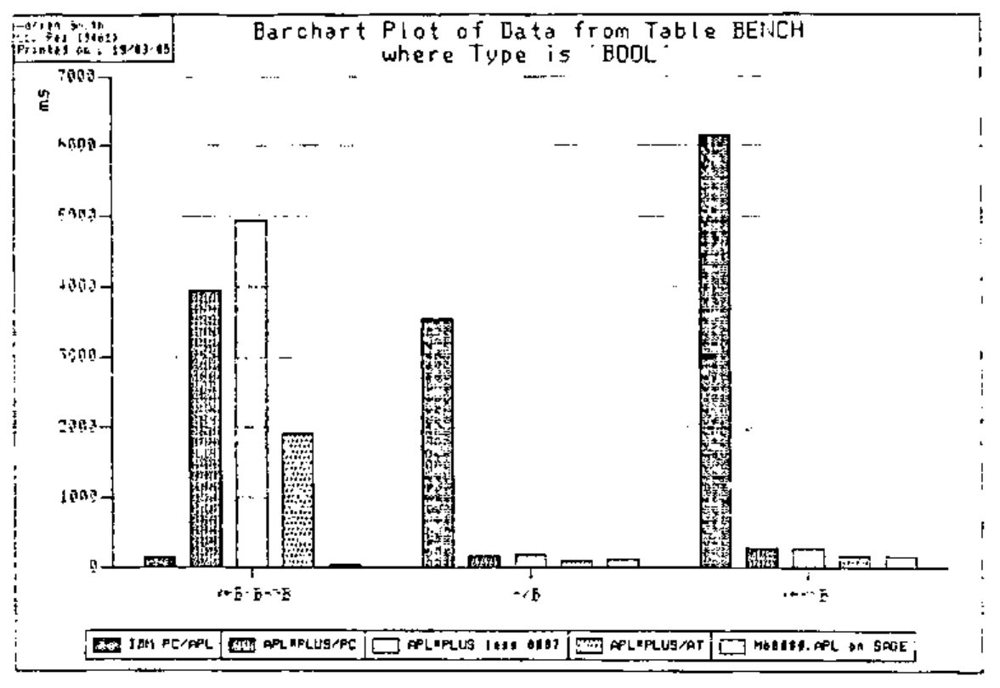
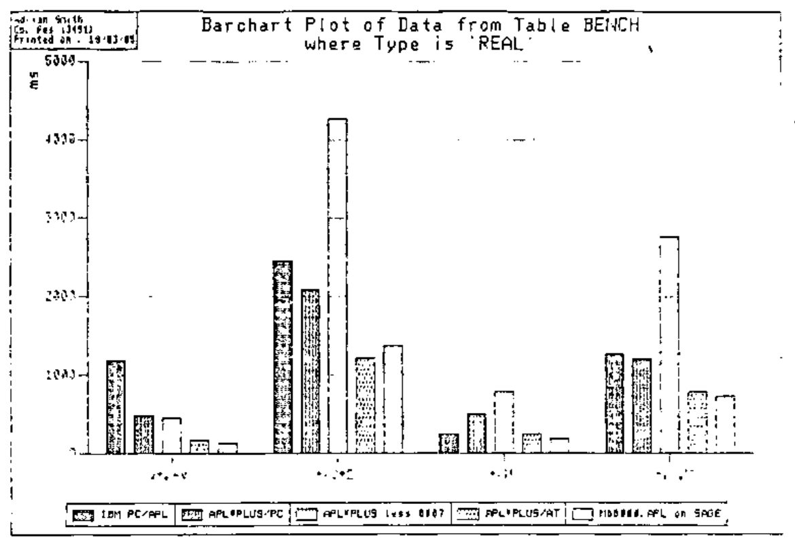
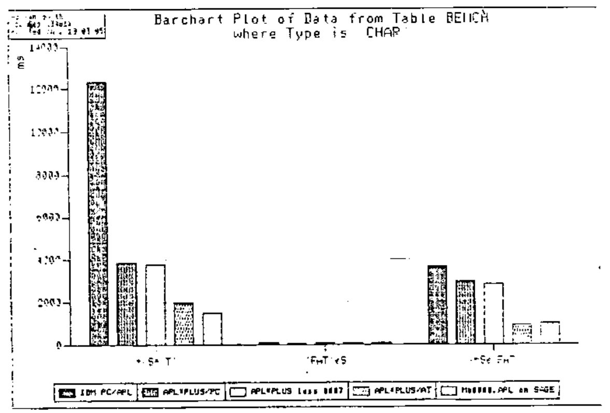
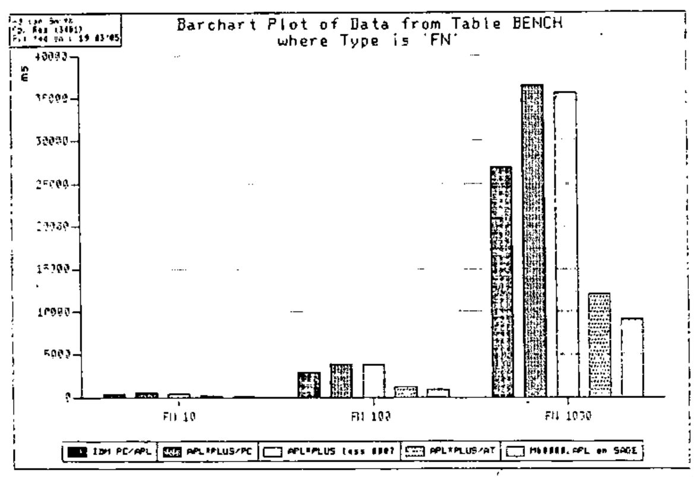
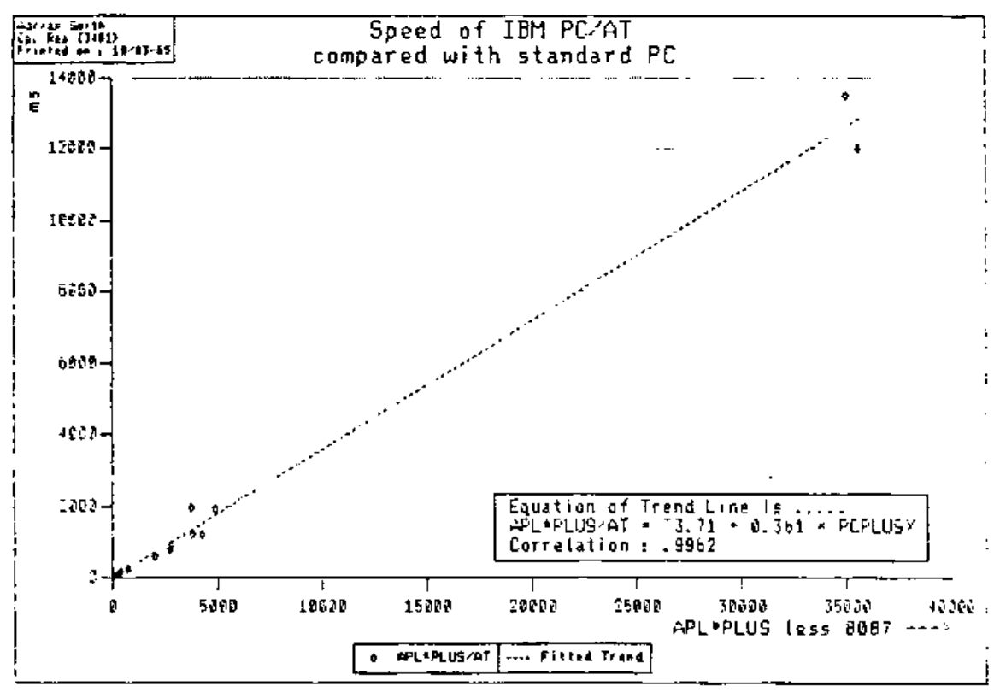

*by Adrian Smith*
{ .byline }

## Introduction

What follows is by no means an exhaustive review; more a case of simple opportunism when we found ourselves with a MicroAPL Sage and an IBM PC/AT on adjacent desks. The ‘benchmarks’ were the result of at most 10 minutes thought, and should obviously be extended if you are seriously considering any of the above as a vehicle for some particular system. There may also be other overriding factors, such as the speed of the file systems, which I have not been able to try out.

## First Impressions

It is very hard indeed to like the IBM PC/APL. I don’t quite know why, but it just doesn’t present a particularly friendly face! Partly it is annoying to be forced into installing the 8087 co-processor (so far two of ours have fried); partly it is the use of the graphics characters; partly the lack of ‘add-ons’ to make use of the PC. True, there is a selection of auxiliary processors, but they are very limiting; for example you cannot use colour in your screen design (AP205), and there is no real file system.

There were also some pretty obvious bugs - IBM did get them fixed quite quickly, but I can’t believe anyone else could possibly have been making serious use of the system for any length of time. Conclusion - this APL is really only worth considering in the absence of something better. It is included in the benchmarks for completeness (and maybe to embarrass STSC into doing something about booleans!) rather than for genuine comparison.

M68000.APL is by far the most aesthetically satisfying of the set. Similarly the architecture of the Sage IV is little short of brilliant; together they should prove a winning combination, but there are a couple of very serious reservations. The first is price - you won’t get much change out of £9,000; the second is the total lack of the kind of ‘programmer support’ which is offered almost to excess by the remaining APL in the group - APL\*PLUS/PC.

Basically I can find a lot in this APL to object to in principle, and a lot to like in practice! The use of two-byte integers; the restriction on object size; the ultimate limit to workspace; the shoals of quad-functions: all these ought to be serious gripes. So far I have found the sheer practical useability of STSC’s APL to be so great that I can live with an awful lot of these bodges, rather than take the path of true righteousness offered by MicroAPL and Phil van Cleave.

## The Benchmarks

The benchmarks used (and the APL objects required to run them) are listed below. They were designed in part to test the relative speed of the chips, and in part to investigate the short-cuts taken by the various interpreters. I would stress again that the only true benchmark is the system you intend to run; treat all such abstract tests with a hefty dose of scepticism.

### APL Objects Required ...

```apl
V←1000⍴4 5 6 0
M←100 10⍴2.5 6.7 0 0 8 ¯5.7

S←10000⍴'THE CAT SAT ON THE MAT '
S[999+⍳6]←'ADRIAN'

I←100?1000
B←10000⍴V=6

FF←800 5⍴'AASHJ RHF KJDSHJ '
FF[601;]←'EJD..'
```

```apl
    ∇ FN N;CT;X
[1]   CT←0
[2]  Lp:→(N<CT←CT+1)↑Exit
[3]   X←+/ 2 3 ⍴⍳6
[4]   →Lp
[5]  Exit:'Done'
    ∇
```

### Benchmarks Used ....

| Type | Bench Mark | PCAPL | PCPLUS | PCPLUSX | ATPLUS | SAGE |
|---|---|--:|--:|--:|--:|--:|
| INT | `+/V+V` | 520 | 370 | 390 | 160 | 188 |
| INT | `+/V[I]` | 180 | 70 | 60 | 50 | 17 |
| REAL | `V+.×V` | 1180 | 480 | 440 | 160 | 125 |
| REAL | `+/V*2` | 2450 | 2080 | 4270 | 1200 | 1361 |
| REAL | `X←+/M` | 228 | 490 | 770 | 238 | 177 |
| REAL | `V+.×,M` | 1250 | 1190 | 2750 | 770 | 720 |
| CHAR | `+/S='T'` | 12350 | 3840 | 3790 | 1954 | 1485 |
| CHAR | `'FAT'∊S` | 100 | 40 | 60 | 50 | 48 |
| CHAR | `X←X∊'FAT'` | 3650 | 2940 | 2810 | 900 | 985 |
| SS | `⎕SS(S;'ADRIAN')` | - | - | - | - | 275 |
| SS | `(S ⎕SS 'ADRIAN')/⍳⍴S` | - | 1640 | 2040 | 600 | - |
| BOOL | `X←B∨B∧~B` | 130 | 3940 | 4950 | 1900 | 25 |
| BOOL | `∧/B` | 3550 | 150 | 170 | 100 | 115 |
| BOOL | `X←∨\B` | 6150 | 270 | 270 | 160 | 145 |
| FN | `FN 10` | 400 | 490 | 390 | 160 | 85 |
| FN | `FN 100` | 2850 | 3940 | 3800 | 1200 | 915 |
| FN | `FN 1000` | 26850 | 36440 | 35600 | 12000 | 9085 |
| IP | `X←FF∧.='EJD..'` | 7050 | 80 | 60 | 60 | 485 |
| IP | `X←FF∧.=⍉20 5⍴'EJD..'` | 139850 | 34940 | 35050 | 13500 | 10485 |

PCAPL : IBM APL on IBM PC<br>
PCPLUS : APL\*PLUS on IBM PC<br>
PCPLUSX : ... without 8087<br>
ATPLUS : APL\*PLUS on PC/AT<br>
SAGE : Sage IV with M68000.APL

The results are also shown graphically on the following pages.

The first obvious comment is on the complete lack of relationship between IBM’s APL and APL\*PLUS. Basically there is very little in it on average; but it is a pretty meaningless average! However I do wish that STSC had taken booleans seriously; OK they’ve optimised the reductions to death (unlike IBM), but some of us rather like to use APL to solve logical problems!

It is also interesting to note that APL\*PLUS could well be faster without the 8087 co-processor. It obviously depends heavily on the type of processing you do, but my guess is that most commercial APL will be better off without it. Of course it only really makes sense to compare the 8087-less PC with the AT; the magic number is 0.361 (i.e. the AT is almost precisely 3 times as fast) with very little variability. This has the useful side effect that you can set up systems on the PC and be absolutely confident that you will get a predictable speed-up when you move them to the AT.

On balance, the Sage remains the fastest processor of the set, particularly when it comes to function execution. The string-search algorithm is pretty sneaky too, and the lack of an optimised inner product hardly matters. However I was quite surprised to see the AT running it so close on simple arithmetic and character handling. For a full system the AT would probably feel faster, as APL\*PLUS drives the screen much the quicker of the two.

## The Hardware

There is no doubt about it; the IBM/AT has got the keyboard absolutely right! I like the PC keyboard anyway, and the few minor quibbles have been well corrected for the AT. The screen (assuming you want colour) remains a let-down; until there is a decent one available you really ought to stick to monochrome for serious APL work. Maybe one of the optional graphics boards would be a good idea? Unfortunately I haven’t had a chance to try out any of these.

We ran our Sage with an Insight VDT-1, complete with MicroAPL keyboard. This is perfectly workable, but has nothing like the quality feel of the AT. In general I would say that it rather let the Sage down, but of course it is at the cheaper end of the MicroAPL range. Not really a fair comparison.

What about that APL character generator? You can now run APL\*PLUS on a colour screen in graphics mode rather than swopping the chip. In my view a non-starter; you lose all the nice scrolling and editing, and it burns nasty little holes in your retina. In order of preference, I would run my APL on:

1. Monochrome monitor with character ROM fitted.
2. Colour monitor as above.
3. Mono monitor without ROM using symbols (you soon get the hang of ‘square-root’ for ‘RHO’), rather than keywords.
4. Colour monitor as above.
5. Either, running keywords.
6. Colour monitor in graphics mode.

I also object to messing up my keyboard with stickers; experienced APLers will probably find that they know the majority of the key positions anyway; I found it quite good discipline to have to learn some of the odder ones! Incidentally, why have they moved ‘Goto’ to lower-case, rather than leaving it on upper-case ‘Assign’? This is about the only difference from the standard IBM layout and it is very annoying!

## The APL Itself

You pays your money and takes your choice! All the implementations are full APLs, with odd quirky bits round the edges. IBM is as near as dammit straight VS APL, with APs to play tunes, drive the screen and so on. STSC have gone quad-function crazy, but their interpreter seems to fit happily enough in a 256K PC, so who cares. You only need to learn the ones you want, after all. APL.68000 has some helpful oddities too (such as quad.BOX to do the vector to matrix bit); it really depends what sort of things you like, and what sort of systems you want to write. Basically they are all very good APLs.

I suppose the most obvious difference lies in the way they drive the screen. Naturally IBM play very much by the rules; everything goes via the PC BIOS and you drive the screen through a cut-down AP124. Much the same applies to the Sage, only this time you have a usefully augmented AP124 to go at. Both these work very well, and have the big advantage that mainframe code will run with only minimal modification.

APL\*PLUS completely reverses this approach; it merrily leapfrogs the BIOS and splats everything straight to the screen from memory. This leaves you with the job of re-writing your full-screen code to use the various quad-functions, but has the benefit of being extremely fast once you have done so. As a typical example, my ‘DRAW’ routines (Design Handbook, Chapter 10) run rather faster on APL\*PLUS/PC than on the Sage; in fact with a bit of tuning I suspect they will push mainframe APL pretty close! This is simply due to the ultra-fast screen I/O - the APL code itself runs no faster than you would expect from the table of benchmarks.

## The Environment

This is the one area where APL\*PLUS really scores over M68000.APL. The inbuilt editor is first class, and the use of function keys and on-screen scrolling make for an ideal APL workstation. Some of the key definitions are a bit weird (like having to hit ALT-INS to toggle insert mode!) but you learn them pretty fast and at least STSC have been consistent - the same keys do the same things in the editor as in terminal mode.

With the Sage you are basically back in teletype mode; you can get your last line back for modification (using all those funny DEL commands most of us forgot years ago) but there is very little by way of programmer support. You need to pay extra to get access to the operating system files, and to get any sort of full-screen editing. I don’t see how MicroAPL can go on charging £250 each for two essentials that APL\*PLUS throw in for nothing!

The operating system of the AT is standard PC DOS, and is hence very familiar to a vast number of PC users. STSC use normal DOS files to cover their component file system; in our limited experience this seems quite adequate, although I have heard rumours to the contrary. The Sage is a multi-user system, with a very much more complex operating system called Mirage. To a large extent this is tuned specifically for APL processing, so the native file system is very fast and extremely powerful. The drawback is the someone has to learn enough Mirage to support your APL user’s); it is by no means straightforward, and has some interesting traps such as a ‘Copy’ which goes from right to left!

## Summary

The AT is pretty cheap (say £5,500 for an all-up system) and provides a natural upgrade path from the PC. It is the obvious choice for stand-alone commercial APL processing. The Sage is a super system in principle, but lacks many of the friendly features that one is getting to expect on micros. It may be the only choice if you need multiple users or really big workspaces. It begins to look overpriced. IBM’s PC/APL will not run on the AT, and it is not really worth looking at even on the PC; sorry.



![Bar chart, “Barchart Plot of Data from Table BENCH where Type is ‘INT’”: times in ms for +/V+V and +/V[I] on the five systems](v1n4-p54-software-review/int.jpg)








