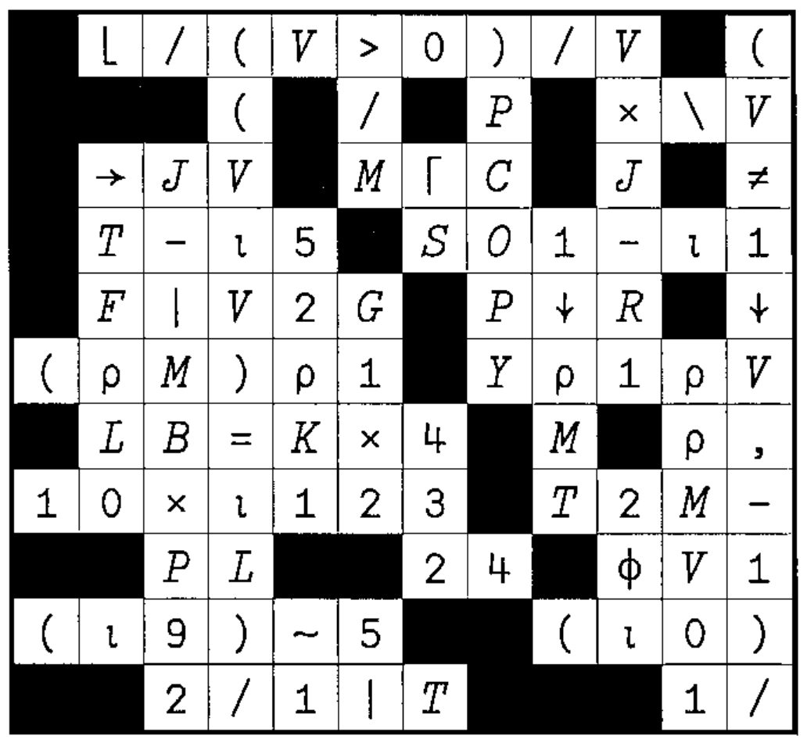
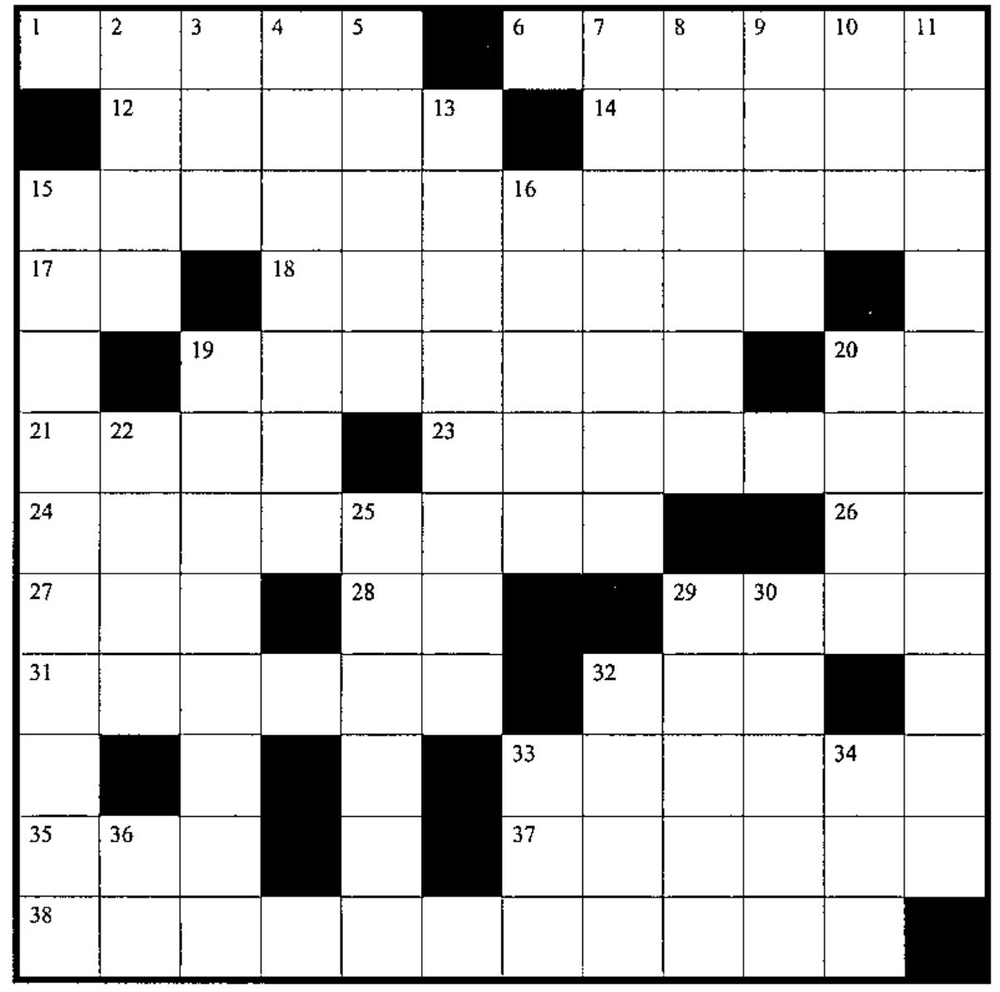

## Solution to Crossword in 19:4

## Puzzle (from Howard Peelle)

### *NOW I KNOW*

There are two positive integers, each greater than 1 and less than 100.

Pete knows their product. Serena knows their sum. First, Pete says: “I don’t know what they are.” Then Serena says: “I know you don’t know.” Then Pete says: “So, now I know.” And Serena says: “So do I.” What are the two integers?

This problem has been around for a while in various guises and is usually presented in terms of Mr. P (product) and Mr. S (sum).

I have changed the names to *Pete* and *Serena,* in reference to two great tennis players. Solution in the next Vector!

## New Crossword

### Across

1. Where the active workspace came from
6. Coding and testing are \_\_\_\_\_\_ in APL than in other languages
12. Format the absolute values of the elements in vector `X` corresponding to `1` bits in vector `M`
14. Matrix `MAT` with vector `E` as a new rightmost column
15. Flag distinct elements (first occurrences) in vector `VA`
17. Conjugate (imaginary portion is negated) of complex number `C` (for APL systems with complex number support)
18. Round elements of `RDS` to nearest integers (with `X.5` *down* to `X`)
19. Do all the elements of `V` equal `IMP`?
20. `A` times pi
21. `I×DK` for scalar `I`, bit vector `DK`, without multiplying
23. `RB[5+⍳TN]`
24. Current size of the symbol table
26. `×/Iρ*1`
27. `C[;1]÷C[;2]` for two-column matrix `C`
28. `P=0` for Boolean `P`
29. `J2L[____]` to get `J2L` in sorted order
31. `¯15↑1`
32. `M[___;]` to get `M` in alphabetic order according to the alphabet `A`
33. Name of the `⍕` function
35. Rank (number of dimensions) of `Y`
37. One random number from the set `(U×L+1), (U×L+2), (U×L+3),... (U×L+Y)`
38. How good programmers spend the majority of their time

### Down

2. Display `VC` to `W` decimal paces
3. `A-S×⌊A÷S`
4. Index in vector `IM` of its largest number
5. Elements in vector `VRV` corresponding to 1s in bit vector `D`
7. Flag the first `M` elements of `S` that equal `-AM`
8. Index in vector `SA` of `1÷P5`
9. Array of 2s, with shape `TT`
10. Vector `V` with scalar `E` stuck to its front
11. Speed, size and \_\_\_\_\_\_\_\_\_\_: the key measures of APL program quality
13. Flag elements of `TOP5` that match scalar `XAD`
15. Average across each row of matrix `D`
16. Local variables in suspension
19. Flag leading elements of vector `YC` that are integers
20. Area of circle of radius `R`
22. `(+/KS)ρ5` for integer vector `KS`
25. `(~B∊M[12+⍳(ρM)-12])/B`
29. Ranking vector for golf scores `RLI` (1 = lowest score)
30. Add `N` to each element of `JMM`
32. Product of `AO` and `T`
33. APL is \_\_\_ to use
34. From the set `⍳G`, return `A` distinct random numbers
36. Length of vector `O`
